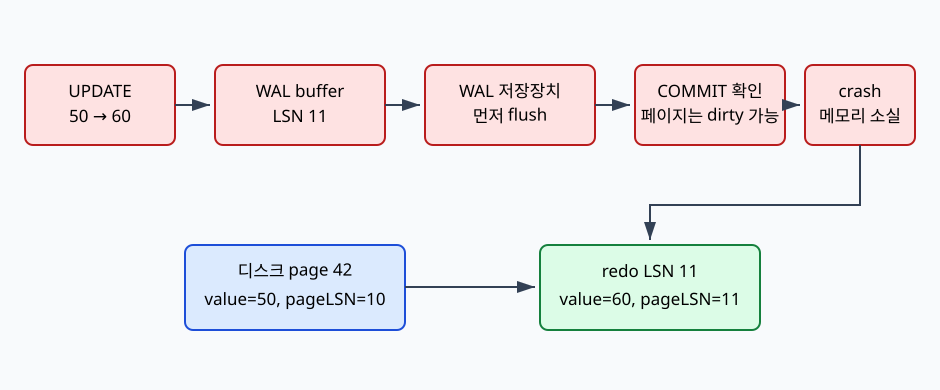
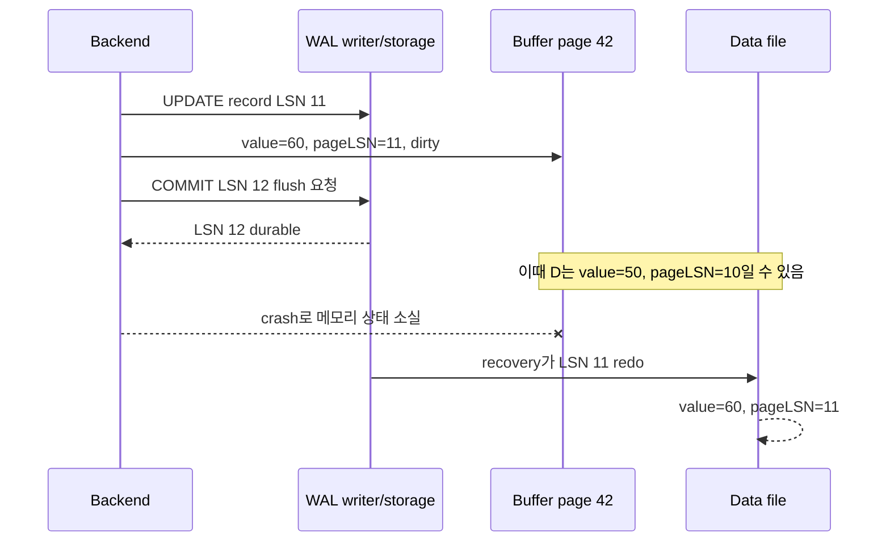

# 09. WAL, checkpoint와 recovery

[이 책 목차](README.md) · [이전: Isolation과 concurrency](08-isolation-and-concurrency.md) · [다음: Replication과 distributed transaction](10-replication-and-distributed-transactions.md)

WAL(Write-Ahead Log)은 data page 변경 내용을 복구할 log로 먼저 기록한다. 관련 WAL이 durable하기 전에 data page를 durable storage에 쓰지 않는 순서가 핵심이며 COMMIT은 모든 data page flush를 뜻하지 않는다.

모든 출력과 수치는 교육용이며 실제 PostgreSQL·Spark·Iceberg 실행 결과가 아니다.

## 1. 단어와 위치

| 용어 | 뜻 |
| --- | --- |
| WAL | Write-Ahead Log, data page보다 먼저 durable하게 기록하는 변경 log |
| LSN | Log Sequence Number, WAL 위치를 나타내는 순서 값 |
| WAL record | Page·transaction 변경을 재현하거나 판단하는 log entry |
| WAL buffer | Log record가 storage flush 전 머무는 memory |
| Commit record | Transaction commit을 나타내는 WAL state |
| Checkpoint | Recovery 시작점을 앞으로 옮기기 위한 consistency 지점 |
| Redo | Durable WAL을 다시 적용해 page를 최신 상태로 만드는 작업 |
| Crash recovery | 정상 shutdown 없이 재시작할 때 log와 page를 복구하는 절차 |
| Full-page image | 일부 조건에서 page 전체 image를 WAL에 담는 record |
| Torn page | Storage write 일부만 반영되어 page가 찢어진 상태 |

## 2. 실제 객체

- Shared WAL buffer

- WAL segment files

- Data file dirty page

- Page LSN

- Checkpoint record와 control metadata

- Recovery process의 redo position

## 3. 입력에서 결과까지

1. Transaction update가 buffer page를 dirty하게 만든다.

2. 변경을 설명하는 WAL record와 LSN을 생성한다.

3. Page는 그 record LSN을 기억한다.

4. Commit은 commit record까지 WAL flush를 요구한다.

5. Client에 commit success를 보낼 수 있다.

6. Data page는 이후 background writer/checkpoint가 flush한다.

7. Crash가 나면 마지막 checkpoint 정보를 읽는다.

8. Recovery가 WAL record를 순서대로 scan한다.

9. Page LSN이 뒤처진 record를 redo한다.

10. Consistent end에 도달하면 normal service를 시작한다.

## 4. 숫자 시간표

- page change WAL LSN=120

- commit record LSN=140

- WAL durable through 140

- data page on disk LSN=90여도 commit 가능

- recovery가 91~140 관련 record를 redo

## 5. 조건과 경계

WAL-first rule은 data page보다 관련 WAL durability가 먼저라는 순서다.

Commit flush는 WAL이며 모든 dirty data page를 즉시 flush하지 않을 수 있다.

Checkpoint는 WAL을 모두 지우는 event가 아니다. Replication·backup·recovery horizon이 보존을 결정한다.

Long checkpoint interval은 recovery WAL 양을 늘릴 수 있고 잦은 checkpoint는 write pressure를 높일 수 있다.

WAL archive는 base backup과 함께 복구 chain을 이룬다.

Filesystem와 device가 flush contract를 지켜야 durability 가정이 성립한다.

## 6. 실패를 읽는 순서

1. 어느 transaction·snapshot·LSN·stage인지 identity를 적는다.

2. Client 성공과 storage·replica 완료를 구분한다.

3. Estimate와 actual을 분리한다.

4. Retry가 전체 operation인지 일부 request인지 확인한다.

5. External side effect와 orphan object를 찾는다.

6. Version별 공식 보장을 확인한다.

## 7. 오해와 반례

- COMMIT은 table file의 모든 변경 page를 sync한다.

- Checkpoint 뒤 WAL은 즉시 모두 삭제된다.

- WAL만 있으면 base data 없이 언제나 복구한다.

- Redo는 SQL statement를 그대로 다시 실행한다.

- Replica WAL이 backup을 자동 대체한다.

## 8. 문제

1. WAL durable LSN 140, data page LSN 90에서 commit 가능한가?

2. Checkpoint의 목적은?

3. WAL만 보관하면 충분한 backup인가?

## 9. 해설

1. WAL-first와 recovery contract가 충족되면 가능하며 crash recovery가 redo한다.

2. Recovery가 scan해야 할 시작점과 dirty-page 상태를 관리해 recovery 범위를 제한하는 것이다.

3. 아니다. 시작 base backup과 필요한 WAL chain, restore 검증이 필요하다.

## 10. 공식 자료

- [공식 문서](https://www.postgresql.org/docs/16/wal-intro.html)

- [CMU 15-445/645 Fall 2024](https://15445.courses.cs.cmu.edu/fall2024/syllabus.html)

다음 장에서는 이 계약을 더 큰 execution 또는 재현 모델에 연결한다.

## 보강: LSN별 WAL, dirty page, checkpoint, crash

WAL(Write-Ahead Log)은 데이터 페이지를 저장 장치에 쓰기 전에 그 변경을 설명하는 로그를 먼저 내구화하는 방식이다. LSN(Log Sequence Number)은 WAL 안의 위치·순서를 나타내는 번호다. **dirty page**는 버퍼 풀에서 바뀌었지만 데이터 파일에는 아직 기록되지 않은 페이지다.

account page 42의 디스크 값이 50이고 `pageLSN=10`인 상태에서 60으로 갱신한다고 하자.

| 시각 | 사건과 실행 주체 | WAL 상태 | 버퍼 풀 page 42 | 디스크 page 42 |
|---:|---|---|---|---|
| t0 | backend가 UPDATE 시작 | durable LSN≤10 | value=50, clean | value=50, pageLSN=10 |
| t1 | WAL manager가 변경 레코드 생성 | buffer에 LSN 11 | value=60, dirty, pageLSN=11 | 여전히 50 |
| t2 | COMMIT 레코드 생성·WAL flush | LSN 12까지 durable | 여전히 dirty 60 | 여전히 50일 수 있음 |
| t3 | checkpoint가 대상 페이지 쓰기 시작 | LSN 12 durable | dirty 또는 write 중 | 성공하면 60, pageLSN=11 |
| t4 | crash | 메모리 WAL buffer 소실 | 버퍼 풀 소실 | 쓰기 완료 여부에 따라 50 또는 60 |
| t5 | startup recovery가 redo | LSN 11부터 검사 | 복구 버퍼에 60 | pageLSN이 10이면 redo 후 11 |

COMMIT 성공은 관련 WAL이 요구된 수준으로 내구화되었다는 뜻이지 모든 데이터 페이지가 flush되었다는 뜻이 아니다. 그래서 t2 직후 디스크 데이터 페이지가 50이어도 WAL 11을 사용해 복구할 수 있다.

체크포인트는 “그 순간 모든 쓰기가 멈추고 완전한 데이터 파일 복사본을 만든다”는 뜻이 아니다. 복구가 살펴볼 시작 범위를 정하고 dirty page 쓰기를 진행하는 사건이다. crash가 체크포인트 도중 나도 WAL과 page LSN을 비교해 필요한 기록을 재생한다.

page LSN이 이미 11이면 같은 LSN 11을 다시 적용하지 않는 식의 조건이 redo의 반복 안전성에 도움을 준다. 실제 엔진은 레코드 종류, full-page image, 손상 검출 등 더 복잡한 규칙을 사용한다.

**오해: commit은 변경 데이터 페이지를 모두 디스크에 썼다는 뜻이다.** WAL이 먼저 내구화되면 dirty page는 나중에 기록될 수 있다. **오해: checkpoint가 있으면 WAL이 필요 없다.** 마지막 체크포인트 뒤 변경과 체크포인트 도중 미완료 페이지를 복구하려면 WAL이 필요하다. **오해: LSN이 크면 무조건 모든 페이지에 적용한다.** WAL 레코드의 대상 페이지와 page LSN, 트랜잭션·레코드 규칙을 함께 본다.
