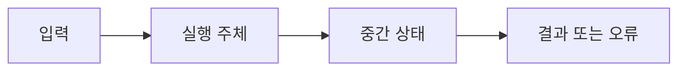

# 11. Columnar·vectorized query engine

[이 책 목차](README.md) · [이전: Replication과 distributed transaction](10-replication-and-distributed-transactions.md) · [다음: Spark, Iceberg와 최적화](12-spark-iceberg-and-optimization.md)

Analytical engine은 많은 row의 일부 column을 scan·aggregate한다. Columnar layout, compression, vectorized batch와 late materialization은 memory bandwidth와 CPU branch 비용을 줄이지만 point update에는 다른 trade-off가 있다.

모든 출력과 수치는 교육용이며 실제 PostgreSQL·Spark·Iceberg 실행 결과가 아니다.

## 1. 단어와 위치

| 용어 | 뜻 |
| --- | --- |
| Row-oriented | 한 row의 column 값을 가까이 저장하는 layout |
| Columnar | 같은 column 값을 연속적으로 저장하는 layout |
| Vectorized execution | Row 하나가 아니라 value batch를 operator 사이에 전달 |
| Batch | 한 번에 처리하는 여러 row 또는 column vector |
| Encoding | Dictionary, RLE처럼 value를 다른 표현으로 저장 |
| Compression | Byte 수를 줄이는 표현과 algorithm |
| Predicate pushdown | File/row-group reader에서 불필요 data를 일찍 제거 |
| Projection pushdown | 요청 column만 읽는 최적화 |
| Late materialization | 필요 시점까지 full row 조립을 늦추는 방식 |
| Row group | Column chunk를 함께 묶는 file-level row 범위 |

## 2. 실제 객체

- Columnar file footer와 statistics

- Row group의 column chunks

- Compressed pages

- Decoder output vectors

- Selection vector

- Hash aggregate table와 spill files

## 3. 입력에서 결과까지

1. Planner가 필요한 column과 predicate를 reader에 전달한다.

2. Reader가 footer와 row-group statistics를 읽는다.

3. Min/max 등으로 불가능한 row group을 skip한다.

4. 필요 column chunk bytes만 storage에서 읽는다.

5. Decoder가 compressed page를 value vector로 만든다.

6. Predicate가 vector를 평가해 selection을 만든다.

7. 다른 column이 selected position에만 decode될 수 있다.

8. Aggregation이 batch를 hash table에 누적한다.

9. Memory를 넘으면 partition을 spill한다.

10. Result batch를 row 또는 column format으로 반환한다.

## 4. 숫자 시간표

- 1억 rows, row width 200B → 20GB logical

- query가 8B column 2개만 사용 → 1.6GB uncompressed target

- compression 4:1이면 약 400MB

- row-group pruning 75%면 약 100MB candidate

- metadata·encoding·false-positive overhead는 별도

## 5. 조건과 경계

Columnar는 필요한 column이 적은 scan에 유리하다.

Compression은 I/O를 줄이지만 decode CPU를 사용한다.

Vectorization은 function call과 branch overhead를 줄이고 SIMD 가능성을 높인다.

Tiny query에서는 batch setup cost가 상대적으로 클 수 있다.

Update-heavy OLTP는 immutable columnar file rewrite 비용이 클 수 있다.

Statistics가 coarse하면 pruning이 적고 full scan에 가까워진다.

## 6. 실패를 읽는 순서

1. 어느 transaction·snapshot·LSN·stage인지 identity를 적는다.

2. Client 성공과 storage·replica 완료를 구분한다.

3. Estimate와 actual을 분리한다.

4. Retry가 전체 operation인지 일부 request인지 확인한다.

5. External side effect와 orphan object를 찾는다.

6. Version별 공식 보장을 확인한다.

## 7. 오해와 반례

- Columnar file은 모든 query에서 row store보다 빠르다.

- Compression ratio가 높을수록 CPU cost는 항상 낮다.

- Min/max statistics가 있으면 exact index다.

- Vectorized는 GPU execution과 같은 말이다.

- Projection pushdown은 network cost만 줄인다.

## 8. 문제

1. 20GB 중 2개 8B column만 읽는 단순 logical byte는?

2. Row-group min/max가 predicate와 겹치면 모든 row가 match하는가?

3. Vectorization의 핵심 이점은?

## 9. 해설

1. 1억×16B=1.6GB다.

2. 아니다. Group을 읽어야 한다는 뜻이며 row-level filter가 남는다.

3. Batch 처리로 호출·branch overhead를 줄이고 cache/SIMD 활용을 높이는 것이다.

## 10. 공식 자료

- [공식 문서](https://parquet.apache.org/docs/file-format/)

- [공식 문서](https://arrow.apache.org/docs/format/Columnar.html)

- [CMU 15-445/645 Fall 2024](https://15445.courses.cs.cmu.edu/fall2024/syllabus.html)

다음 장에서는 이 계약을 더 큰 execution 또는 재현 모델에 연결한다.

## 보강: column chunk에서 SUM까지

Columnar storage는 같은 column의 값을 가까이 두는 물리 배치다. `SUM(amount) WHERE amount>100`이면 row group의 amount column chunk를 읽고 encoding을 해제해 1,024개 값 vector를 만든다. Filter operator는 값마다 함수 호출하는 대신 비교 결과 mask를 만들고 Aggregate operator는 mask가 선택한 값을 누적한다. row group의 min=0, max=90이면 읽기 전에 전체를 건너뛸 수 있다. max=150이면 일부가 맞을 가능성이 있어 실제 vector를 읽고 행별 조건을 검사해야 한다.
