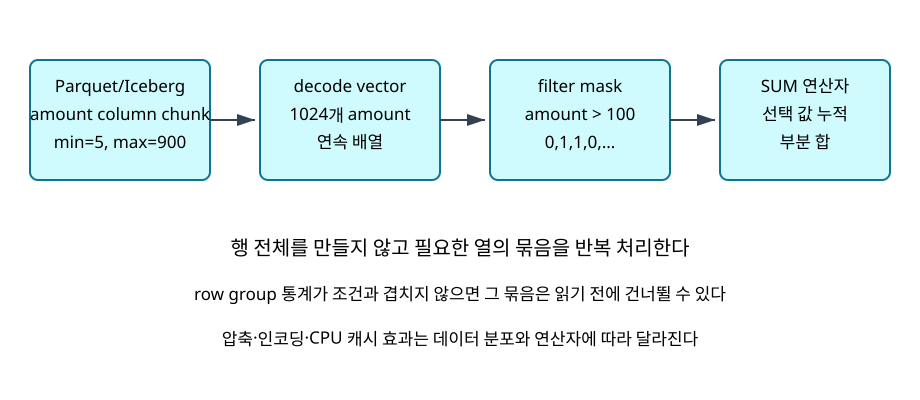
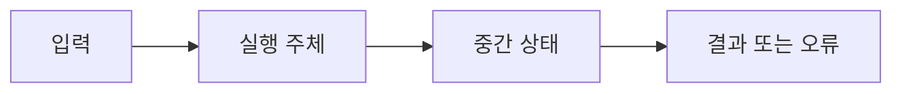

# 11. Columnar·vectorized query engine

## 저장 객체에서 CPU batch까지

행 지향 저장은 한 행의 여러 열을 가까이 두고, 열 지향 저장은 같은 열의 값을 연속 배치한다. 주문 한 건의 여러 열을 자주 고치는 OLTP에는 행 배치가 자연스럽고, 수억 행에서 amount와 region 두 열만 읽는 분석에는 열 배치가 유리할 수 있다. 어느 쪽도 모든 workload에 우월하지 않다. 읽는 열 수, 갱신 빈도, 선택도와 파일 크기가 조건이다.

Parquet의 row group은 같은 행 범위를 여러 column chunk로 나눈 묶음이다. column chunk는 한 열의 값과 여러 page를 가진다. page는 encoding과 compression이 적용되는 더 작은 단위이고 footer는 위치와 통계를 가진다. 파일 writer가 이 객체를 만들고 저장소가 바이트를 보관하며 reader가 footer를 읽어 필요한 byte range를 고른다.

Arrow 계열 column vector는 실행 중 메모리 표현이다. 값 buffer, NULL bitmap, 가변 길이 offset buffer가 역할을 나눈다. Parquet는 지속 파일 형식이고 vector batch는 task 메모리에서 연산자 사이를 흐른다. reader가 page를 decode해 batch를 만들지만 두 객체의 표현과 수명은 다르다.

vectorized execution은 예를 들어 1,024행의 amount vector를 filter에 넘긴다. filter는 boolean mask 또는 선택 위치 배열을 만들고 projection은 필요한 vector만 남긴다. aggregate는 선택된 lane만 읽어 상태를 갱신한다. SIMD는 CPU 명령 하나가 여러 lane에 같은 연산을 하는 기능이다. batch 실행이 SIMD 사용을 돕지만 자료형·NULL·정렬·컴파일러 때문에 자동 보장은 아니다.

## 전체 추적 1: footer에서 SUM까지

파일 F에는 4개 row group이 있고 각 1,000행이다. amount 통계가 G0 최소 0 최대 49, G1 50~99, G2 100~199, G3 NULL 1,000개라고 하자. 질의는 amount가 100 이상인 행의 합계다.

1. planner가 projection amount와 predicate를 reader에 전달한다.
2. reader는 footer에서 G0과 G1을 최대값으로 제거한다. G3는 non-null 값이 없어 일반 비교가 TRUE일 수 없으므로 제거한다.
3. G2의 amount chunk만 읽고 다른 19개 열은 projection pruning으로 열지 않는다.
4. 첫 page의 여덟 값이 [90,100,120,NULL,80,150,100,30]이면 비교 결과는 [F,T,T,U,F,T,T,F]다.
5. selection 위치 [1,2,5,6]을 aggregate가 읽는다. 상태는 0에서 100, 220, 370, 470으로 바뀌고 count는 4다.
6. G2의 1,000행을 모두 처리한 최종 합이 128,000이라고 하자. min/max는 G2 전체가 참이라고 보장하지 않으므로 실제 filter가 남는다.

pruning 전 행 범위는 4,000, 후에는 1,000이다. G2 amount chunk가 압축 전 8KiB, 후 2KiB라면 후보 data는 2KiB지만 footer, page header, 저장소 요청 정렬 비용은 별도다. 실제 전송 byte와 요청 수를 함께 본다.

## 전체 추적 2: dictionary와 late materialization

status 12개가 [paid,paid,paid,cancelled,cancelled,paid,paid,paid,paid,paid,cancelled,paid]라고 하자. dictionary는 0=paid, 1=cancelled와 id vector [0,0,0,1,1,0,0,0,0,0,1,0]을 저장한다. run-length 표현은 앞부분을 (0,3),(1,2),(0,5),(1,1),(0,1)로 줄일 수 있다. 실제 encoder는 분포와 구현에 따라 선택한다.

status=paid인 행의 customer_name을 구하면 먼저 작은 id vector에서 위치 [0,1,2,5,6,7,8,9,11]을 얻는다. 가변 길이 이름 열의 offset과 payload는 그 위치만 decode할 수 있다. 모든 이름을 먼저 문자열로 만들지 않는 late materialization이다. 선택도가 99%면 간접 위치 조회의 이득이 작을 수 있다.

region별 hash aggregate에서 distinct region 10,000개, 상태당 64바이트면 핵심 상태만 640,000바이트다. bucket과 allocator overhead는 더해진다. task memory 512KiB를 넘으면 일부 partition을 임시 저장소에 spill하고 다시 읽어 병합한다. 결과는 같아도 write·read와 tail latency가 늘어난다.

## 실패 반례와 연구 설계

- 통계가 누락되거나 문자열 bound가 잘렸다면 보수적으로 읽어야 한다. 불확실한 파일을 제거하면 정답을 잃는다.
- compression ratio가 높아도 decode CPU가 커지면 느릴 수 있다.
- projection으로 data byte가 줄어도 수천 작은 파일의 footer open이 지배할 수 있다.
- vectorization은 NULL의 UNKNOWN 의미를 없애지 않는다.
- cold와 warm run을 섞어 평균 하나로 만들면 cache 효과를 숨긴다.

filtered-vector 연구는 metadata file pruning, row-group pruning, ANN 후보 탐색을 구분한다. exact filtered top-k를 기준 답으로 두고 SQL filter 위반 수, recall@k, 읽은 파일·byte, latency를 각각 기록한다. filter correctness는 논리 계약이고 recall은 근사 탐색 품질이므로 하나의 평균으로 합치지 않는다. preprint 관측을 모든 dataset과 engine의 보장으로 확대하지 않는다.

## 완전 풀이 문제 5개

1. 1억 행에서 8바이트 열 두 개만 읽으면 압축 전 얼마인가? **해설:** 행당 16바이트이므로 16억바이트, 십진 약 1.6GB다. metadata와 bitmap은 별도다.
2. row group 최대가 20,70,110,200일 때 x>120 후보는? **해설:** 앞 세 그룹을 제거하고 네 번째 한 그룹을 남긴다. 네 번째의 모든 행이 참인 것은 아니다.
3. [10,NULL,30,50]에서 x>=30 mask와 합은? **해설:** [F,U,T,T], 선택 위치 2와3, 합 80이다.
4. 상태 20,000개가 각 80바이트면? **해설:** 최소 1,600,000바이트이며 hash overhead는 추가다.
5. warm 40ms와 cold 200ms로 encoding이 5배 빠르다고 할 수 있는가? **해설:** cache 조건이 달라 불가하다. 같은 조건에서 encoding만 바꾼다.

[이 책 목차](README.md) · [이전: Replication과 distributed transaction](10-replication-and-distributed-transactions.md) · [다음: Spark, Iceberg와 최적화](12-spark-iceberg-and-optimization.md)

Analytical engine은 많은 row의 일부 column을 scan·aggregate한다. Columnar layout, compression, vectorized batch와 late materialization은 memory bandwidth와 CPU branch 비용을 줄이지만 point update에는 다른 trade-off가 있다.

모든 출력과 수치는 교육용이며 실제 PostgreSQL·Spark·Iceberg 실행 결과가 아니다.

## 1. 단어와 위치

| 용어 | 뜻 |
| --- | --- |
| Row-oriented | 한 row의 column 값을 가까이 저장하는 layout |
| Columnar | 같은 column 값을 연속적으로 저장하는 layout |
| Vectorized execution | Row 하나가 아니라 value batch를 operator 사이에 전달 |
| Batch | 한 번에 처리하는 여러 row 또는 column vector |
| Encoding | Dictionary, RLE처럼 value를 다른 표현으로 저장 |
| Compression | Byte 수를 줄이는 표현과 algorithm |
| Predicate pushdown | File/row-group reader에서 불필요 data를 일찍 제거 |
| Projection pushdown | 요청 column만 읽는 최적화 |
| Late materialization | 필요 시점까지 full row 조립을 늦추는 방식 |
| Row group | Column chunk를 함께 묶는 file-level row 범위 |

## 2. 실제 객체

- Columnar file footer와 statistics

- Row group의 column chunks

- Compressed pages

- Decoder output vectors

- Selection vector

- Hash aggregate table와 spill files

## 3. 입력에서 결과까지

1. Planner가 필요한 column과 predicate를 reader에 전달한다.

2. Reader가 footer와 row-group statistics를 읽는다.

3. Min/max 등으로 불가능한 row group을 skip한다.

4. 필요 column chunk bytes만 storage에서 읽는다.

5. Decoder가 compressed page를 value vector로 만든다.

6. Predicate가 vector를 평가해 selection을 만든다.

7. 다른 column이 selected position에만 decode될 수 있다.

8. Aggregation이 batch를 hash table에 누적한다.

9. Memory를 넘으면 partition을 spill한다.

10. Result batch를 row 또는 column format으로 반환한다.

## 4. 숫자 시간표

- 1억 rows, row width 200B → 20GB logical

- query가 8B column 2개만 사용 → 1.6GB uncompressed target

- compression 4:1이면 약 400MB

- row-group pruning 75%면 약 100MB candidate

- metadata·encoding·false-positive overhead는 별도

## 5. 조건과 경계

Columnar는 필요한 column이 적은 scan에 유리하다.

Compression은 I/O를 줄이지만 decode CPU를 사용한다.

Vectorization은 function call과 branch overhead를 줄이고 SIMD 가능성을 높인다.

Tiny query에서는 batch setup cost가 상대적으로 클 수 있다.

Update-heavy OLTP는 immutable columnar file rewrite 비용이 클 수 있다.

Statistics가 coarse하면 pruning이 적고 full scan에 가까워진다.

## 6. 실패를 읽는 순서

1. 어느 transaction·snapshot·LSN·stage인지 identity를 적는다.

2. Client 성공과 storage·replica 완료를 구분한다.

3. Estimate와 actual을 분리한다.

4. Retry가 전체 operation인지 일부 request인지 확인한다.

5. External side effect와 orphan object를 찾는다.

6. Version별 공식 보장을 확인한다.

## 7. 오해와 반례

- Columnar file은 모든 query에서 row store보다 빠르다.

- Compression ratio가 높을수록 CPU cost는 항상 낮다.

- Min/max statistics가 있으면 exact index다.

- Vectorized는 GPU execution과 같은 말이다.

- Projection pushdown은 network cost만 줄인다.

## 8. 문제

1. 20GB 중 2개 8B column만 읽는 단순 logical byte는?

2. Row-group min/max가 predicate와 겹치면 모든 row가 match하는가?

3. Vectorization의 핵심 이점은?

## 9. 해설

1. 1억×16B=1.6GB다.

2. 아니다. Group을 읽어야 한다는 뜻이며 row-level filter가 남는다.

3. Batch 처리로 호출·branch overhead를 줄이고 cache/SIMD 활용을 높이는 것이다.

## 10. 공식 자료

- [공식 문서](https://parquet.apache.org/docs/file-format/)

- [공식 문서](https://arrow.apache.org/docs/format/Columnar.html)

- [CMU 15-445/645 Fall 2024](https://15445.courses.cs.cmu.edu/fall2024/syllabus.html)

다음 장에서는 이 계약을 더 큰 execution 또는 재현 모델에 연결한다.

## 보강: column chunk에서 SUM까지

Columnar storage는 같은 column의 값을 가까이 두는 물리 배치다. `SUM(amount) WHERE amount>100`이면 row group의 amount column chunk를 읽고 encoding을 해제해 1,024개 값 vector를 만든다. Filter operator는 값마다 함수 호출하는 대신 비교 결과 mask를 만들고 Aggregate operator는 mask가 선택한 값을 누적한다. row group의 min=0, max=90이면 읽기 전에 전체를 건너뛸 수 있다. max=150이면 일부가 맞을 가능성이 있어 실제 vector를 읽고 행별 조건을 검사해야 한다.
