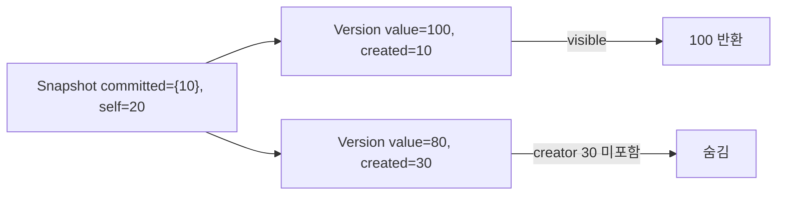
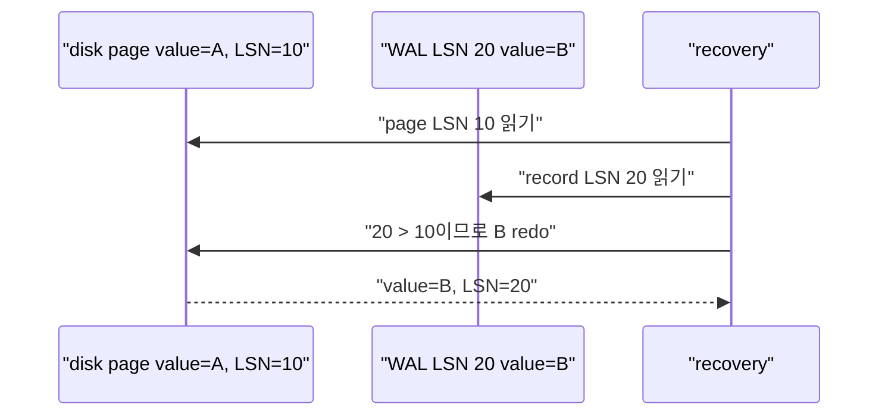

# 13. 로컬 교육 모델

[이 책 목차](README.md) · [이전: Spark, Iceberg와 최적화](12-spark-iceberg-and-optimization.md) · [다음: 실험과 연구 설계](14-experiments-and-research.md)

이 장은 외부 database를 띄우지 않고 세 가지 핵심 상태 전이를 Python 표준 라이브러리만으로 재현한다.

모델은 실제 PostgreSQL·Spark 구현이 아니다.

구현의 모든 예외와 성능을 흉내 내지 않고, 입력과 중간 상태를 눈으로 확인하기 위한 작은 계산기다.

## 1. 세 모델의 경계

| 파일 | 입력 | 핵심 상태 | 결과 |
| --- | --- | --- | --- |
| `mvcc_model.py` | 고정 transaction·row version | snapshot visibility | 각 snapshot이 보는 값 |
| `join_cost_model.py` | 고정 row/page 수 | nested loop·hash cost | 단순 cost 비교 |
| `wal_recovery_model.py` | 고정 WAL·disk page | redo 조건 | crash 뒤 복구 page |

세 script는 network, database, filesystem write를 사용하지 않는다.

고정 input과 `assert`를 사용해 같은 Python version에서 같은 logical 결과를 만든다.

## 2. MVCC 모델의 실제 객체

`Version` object는 value, 만든 transaction, 끝낸 transaction을 가진다.

실제 PostgreSQL tuple header 전체를 구현하지 않는다.

`Snapshot` object는 visible committed transaction 집합과 자기 transaction을 가진다.



Visibility 함수는 newest version부터 검사한다.

Creator가 자기 transaction이면 자기 write를 볼 수 있다.

다른 creator라면 snapshot의 committed 집합에 있어야 한다.

End transaction이 snapshot에서 committed라면 그 old version은 삭제된 것으로 본다.

이 규칙은 교육용 subset이다.

Subtransaction, abort status, XID wraparound와 PostgreSQL hint bit를 생략한다.

## 3. MVCC 고정 시간표

| 시각 | 사건 | Version 상태 |
| --- | --- | --- |
| t0 | T10이 value 100 commit | v1 creator=10 |
| t1 | T20 snapshot 생성 | committed={10} |
| t2 | T30이 value 80 작성 | v1 end=30, v2 creator=30 |
| t3 | T30 commit | global committed={10,30} |
| t4 | T20 재조회 | 기존 snapshot이면 100 |
| t5 | 새 T40 조회 | 새 snapshot이면 80 |

XID 숫자가 더 크다는 사실만으로 commit 시각을 단정하지 않는다.

T30이 T20보다 나중에 시작해도 먼저 commit할 수 있다.

Visibility는 transaction status와 snapshot의 active/visible 범위로 판단한다.

## 4. Join cost 모델의 실제 객체

`Relation`은 name, rows, pages를 가진 교육용 record다.

Nested-loop 모델은 outer page를 한 번 읽고 inner page를 outer row마다 읽는 극단적 단순식을 사용한다.

```text
cost_nested = outer.pages + outer.rows × inner.pages
```

Hash join 모델은 두 input page를 한 번씩 읽고 row hash CPU를 더하는 단순식이다.

```text
cost_hash = build.pages + probe.pages + cpu_factor × (build.rows + probe.rows)
```

실제 optimizer의 cost formula가 아니다.

Cache, batch, spill, parallel worker와 output cost를 생략한다.

## 5. Join 숫자 예제

```text
customers: rows=100, pages=10
orders: rows=10,000, pages=500
```

Customers를 outer로 한 page nested loop는 다음과 같다.

```text
10 + 100 × 500 = 50,010 page-cost units
```

Hash join의 page 부분은 `10 + 500 = 510`이다.

CPU factor가 0.01이면 row CPU는 `0.01 × 10,100 = 101`이다.

단순 hash total은 611이다.

이 숫자는 hash가 항상 이긴다는 법칙이 아니다.

Customers에 index lookup이 있고 orders 결과가 한 row만 필요하면 indexed nested loop의 startup cost가 유리할 수 있다.

## 6. WAL recovery 모델의 실제 객체

`Page`는 page ID, value, page LSN을 가진다.

`WalRecord`는 LSN, page ID, after-value를 가진다.

Recovery는 record LSN이 disk page LSN보다 클 때만 redo한다.



같은 WAL을 두 번 적용해도 두 번째에는 page LSN이 같아 skip된다.

이것이 model의 idempotent redo assert다.

실제 PostgreSQL WAL record는 page image, block reference와 resource manager별 redo logic을 가진다.

## 7. 실행 결과를 읽는 법

Script의 print는 proof가 아니라 설명 가능한 trace다.

Assert가 통과하면 model 내부 invariant를 만족했다는 뜻이다.

PostgreSQL이 같은 내부 구조를 쓴다는 검증은 아니다.

각 output에는 model 이름과 고정 input을 함께 표시한다.

Wall-clock benchmark를 하지 않는다.

작은 Python object timing으로 database engine 성능을 추론하지 않는다.

## 8. 모델을 바꾸는 실험

MVCC에서는 committed set 하나만 바꾼다.

Join에서는 outer rows 또는 inner pages 하나만 바꾼다.

WAL에서는 disk page LSN 하나만 바꾼다.

한 번에 하나를 바꾸면 결과 차이의 원인을 설명하기 쉽다.

```text
가설: page LSN이 WAL LSN 이상이면 redo하지 않는다.
변경: disk LSN 10 → 25
예상: WAL LSN 20 record skip
관찰: value와 LSN 유지
```

## 9. 흔한 오해와 수정

“Python MVCC가 PostgreSQL visibility를 검증한다”는 주장은 틀리다.

이 모델은 snapshot 집합과 version chain의 핵심 관계만 보여 준다.

“Hash cost 611이면 실행 시간 611ms”도 틀리다.

Cost unit은 교육용 상대 단위다.

“Redo skip이면 transaction이 commit됐다”도 틀리다.

Page LSN 비교는 한 page redo 조건이며 transaction commit 판단 전체가 아니다.

## 10. 안전성과 재현성

세 script는 고정 list와 dataclass만 사용한다.

Random, network, subprocess와 file write를 사용하지 않는다.

Import해도 실행되도록 side effect를 만들지 않는다.

직접 실행 entry point에서만 trace를 출력한다.

## 11. 문제

1. T20 snapshot에 T30 commit이 포함되지 않으면 어떤 version을 보는가?

2. Outer rows가 100에서 1,000으로 늘면 단순 nested loop cost는 어떻게 변하는가?

3. Disk page LSN 25, WAL record LSN 20이면 redo하는가?

## 12. 해설

1. T30이 만든 새 version은 숨겨지고 T20 snapshot에 보이는 old version을 본다.

2. Inner pages가 500이면 `10 + 1,000×500 = 500,010`으로 outer row 수에 비례해 크게 증가한다.

3. 하지 않는다. Page가 record 이상 progress를 반영했다고 모델이 판단하기 때문이다.

## 13. 공식·교육 자료

- [PostgreSQL MVCC introduction](https://www.postgresql.org/docs/current/mvcc-intro.html)

- [PostgreSQL WAL introduction](https://www.postgresql.org/docs/16/wal-intro.html)

- [CMU 15-445/645 Fall 2024](https://15445.courses.cs.cmu.edu/fall2024/syllabus.html)

다음 장에서는 이 모델과 실제 engine 실험을 혼동하지 않도록 가설, 변수, evidence와 재현 기록을 설계한다.
## 모델 경계 정정

`mvcc_model.py`의 `Snapshot`은 `committed` XID 집합과 현재 읽는 트랜잭션의 `self_xid`를 명시한다. `Version.creator`가 committed이거나 자기 XID일 때만 생성이 보인다. `Version.ended`가 committed이거나 자기 XID이면 그 옛 버전은 끝난 것으로 본다. 따라서 aborted XID는 단순히 “현재 진행 중이 아님”이라는 이유로 committed가 되지 않는다. 예제의 `old_snapshot(committed={10}, self_xid=20)`은 100을, `new_snapshot(committed={10,30}, self_xid=40)`은 80을 본다. 자기 XID 40이 만든 미커밋 값은 자기 snapshot에는 보이지만 다른 XID 41의 snapshot에는 보이지 않는다. 이는 PostgreSQL 튜플 상태 비트와 wraparound를 그대로 구현한 것이 아닌 교육용 규칙이다.

`wal_recovery_model.py`는 page LSN 비교와 반복 가능한 적용을 보여 주려고 `committed` 집합의 레코드만 적용한다. 이 commit 필터는 실제 PostgreSQL redo 알고리즘의 설명이 아니다. PostgreSQL crash recovery는 미커밋 트랜잭션이 남긴 WAL도 물리적으로 redo할 수 있으며, 복구 뒤 행을 보일지는 MVCC의 commit 상태가 판정한다. 이 모델은 “커밋된 논리 변경만 결과 페이지에 남기는 작은 모형”으로만 사용한다.
