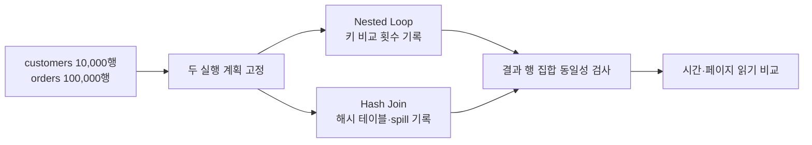

# 14. 실험을 설계하고 근거를 읽는 법

## 원시 자료에서 주장까지의 추적표

실험 row 하나에는 query id, 입력 snapshot, plan hash, estimated와 actual rows, read page·file·byte, spill byte, 결과 checksum, planning과 execution time, 오류를 둔다. cost는 optimizer 상대 단위이고 ms는 관측 단위다. checksum이 다르면 빠른 실행도 성능 후보에서 제외한다.

10회 시간이 [90,91,92,93,94,95,96,97,150,300]ms면 평균은 119.8ms, 중앙값은 94.5ms다. 평균 하나는 두 긴 지연을 숨긴다. cold는 catalog·footer·DB buffer·OS cache 중 무엇을 비웠는지 적고 warm은 어떤 객체를 재사용했는지 적는다. 순서를 교차해 온도와 백그라운드 작업이 한 조건에 몰리지 않게 한다.

QOaaS prototype을 기존 optimizer와 비교할 때 동일 SQL 결과, 통계와 engine capability를 고정한다. planning time, execution time, unsupported plan을 분리하고 모든 Spark workload 우위로 확대하지 않는다. filtered-vector preprint는 exact filtered top-k를 기준으로 filter correctness, ANN recall@k, pruning byte와 cold/warm latency를 따로 본다.

| 단계 | 원시 관측 | 잘못된 해석 |
|---|---|---|
| plan | cost 120, rows 100 | 120ms 실행 보장 |
| scan | 40파일, 800MiB | 결과 40행 |
| ANN | recall@10 0.9 | SQL filter 90% 정확 |
| timing | warm 40ms | cold storage도 40ms |

### 완전 풀이 문제 5개

1. estimate100, actual10,000은? **해설:** 100배 과소 추정이다.
2. [1,1,1,1,46] 평균과 중앙값은? **해설:** 평균10, 중앙1로 tail이 크다.
3. 결과가 다르면 시간 비교를 계속하는가? **해설:** 정확성 gate 실패로 중단한다.
4. recall과 filter correctness가 다른 이유는? **해설:** 전자는 관련 이웃 회수율, 후자는 조건 준수 계약이다.
5. QOaaS planning이 빨라도 전체가 느릴 수 있는가? **해설:** 선택 plan 실행과 데이터 이동 비용이 더 클 수 있다.

[이전: 로컬 실행 모델](13-local-models.md) · [목차](README.md) · [다음: 종합 문제와 용어](15-exercises-glossary-and-sources.md)

데이터베이스 실험은 명령을 한 번 실행하고 걸린 시간을 적는 일이 아니다. 무엇을 바꾸었는지, 무엇을 고정했는지, 어느 층의 시간을 재었는지 설명할 수 있어야 결과를 다시 사용할 수 있다. 이 장의 예시는 실험 설계 모형이며 실제 PostgreSQL에서 측정했다는 주장이 아니다.

## 1. 먼저 질문을 한 문장으로 고정한다

좋은 질문은 비교 대상과 관찰값이 들어 있다. 예를 들어 “인덱스가 빠른가?”보다 “100만 행 중 100행을 찾을 때, 워밍업 뒤 B-tree 인덱스 스캔은 순차 스캔보다 읽은 페이지 수가 적은가?”가 낫다.

- **독립 변수**는 실험자가 바꾸는 조건이다. 위 질문에서는 스캔 방식이다.
- **종속 변수**는 결과로 재는 값이다. 읽은 페이지 수와 경과 시간이다.
- **통제 변수**는 비교 중 고정할 조건이다. 데이터, 쿼리, 메모리 한도, 동시 사용자 수가 여기에 해당한다.
- **교란 변수**는 의도하지 않았지만 결과를 바꾸는 조건이다. 페이지 캐시, 자동 통계 갱신, 백그라운드 체크포인트가 대표적이다.

## 2. 객체가 존재하는 위치부터 적는다

같은 “캐시”도 위치가 다르다. DBMS 버퍼 풀은 데이터베이스 프로세스가 관리하는 메모리다. 운영체제 페이지 캐시는 커널이 파일 블록을 보관하는 메모리다. 저장 장치의 쓰기 캐시는 장치 내부에 있을 수 있다. 실험 기록에는 어느 층을 차갑게 또는 따뜻하게 했는지 적어야 한다.

쿼리 계획도 두 종류를 구별한다. 계획기에 있는 **추정 계획**은 통계와 비용 상수로 계산한 예상이다. 실행기에 있는 **실제 계측값**은 연산자가 처리한 행 수와 시간이다. PostgreSQL의 `EXPLAIN`은 전자를 보여 주며, `EXPLAIN ANALYZE`는 쿼리를 실제로 실행하여 후자를 추가한다. 쓰기 쿼리에 사용하면 실제 부작용이 생긴다.

## 3. 한 실험의 입력에서 결론까지

다음은 조인 알고리즘 비교를 설계하는 순서다.

1. 입력 데이터로 고객 10,000행과 주문 100,000행을 고정한다.
2. 고객 키 분포와 주문의 고객 키 분포를 기록한다.
3. 실행 주체인 쿼리 엔진이 중첩 반복 조인 또는 해시 조인을 수행한다.
4. 중간 상태로 비교 횟수, 해시 테이블 크기, 흘러넘친 파티션 수를 기록한다.
5. 결과 행 수가 두 방식에서 같은지 먼저 확인한다.
6. 그다음 실행 시간과 I/O를 비교한다.

결과 동일성 검사가 먼저인 이유는 잘못된 결과를 빨리 낸 실행기를 성능 우승자로 뽑을 수 없기 때문이다.

## 4. 숫자로 보는 반복 측정

같은 쿼리를 5회 측정해 `120, 84, 82, 83, 81 ms`를 얻었다고 하자. 첫 실행만 디스크나 운영체제 캐시를 채웠다면 첫 값은 다른 조건이다. 이를 조용히 버리지 말고 “1회차 cold, 2~5회차 warm”이라고 분리한다.

warm 네 값의 평균은 `(84+82+83+81)/4 = 82.5 ms`다. 중앙값은 정렬한 `81,82,83,84`의 가운데 두 값 평균인 `82.5 ms`다. 표본이 작을 때 평균 하나만 쓰면 일시 정지 한 번에 크게 흔들린다. 각 반복값과 최소·중앙·최대값을 함께 남기면 분포를 볼 수 있다.

처리량 1,000 query/s와 지연 시간 10 ms를 함께 봐야 한다. 처리량은 단위 시간당 완료량이고, 지연 시간은 요청 하나가 끝날 때까지 걸린 시간이다. 동시 요청 수를 늘리면 처리량이 오르면서 꼬리 지연 시간은 악화될 수 있다. p95는 관측값의 95%가 그 값 이하라는 뜻이지, 모든 요청이 그 안에 끝난다는 뜻은 아니다.

## 5. 비용 추정 오차를 추적한다

계획기가 필터 결과를 100행으로 추정했는데 실제로 10,000행이었다고 하자. 오차 배수는 `actual / estimated = 10,000 / 100 = 100배`다. 이 오차는 뒤쪽 조인의 입력 크기까지 퍼진다.

원인을 찾을 때는 다음 객체를 따라간다.

| 단계 | 실제 객체 | 질문 |
|---|---|---|
| 통계 | 열별 빈도, distinct 수, histogram | 값 분포가 오래되었는가? |
| 조건 | `region='KR' AND tier='gold'` | 두 열의 상관을 독립으로 가정했는가? |
| 계획 | Scan·Join 연산자 트리 | 작은 입력을 잘못 선택했는가? |
| 실행 | 실제 행 수·loops·buffer | 오차가 처음 커진 노드는 어디인가? |

“최상위 총 시간이 느리다”에서 멈추지 말고 추정 행과 실제 행이 처음 갈라지는 가장 아래 연산자를 찾는다.

## 6. WAL 복구 실험의 시간표

교육용 WAL 실험에서는 데이터 페이지를 직접 망가뜨리지 않는다. `wal_recovery_model.py`처럼 메모리 객체로 순서를 모델링한다.

| 시각 | 입력/사건 | 중간 상태 | 예상 결과 |
|---:|---|---|---|
| t0 | page LSN=10, value=50 | 디스크 페이지 역할 객체 | 기준 상태 |
| t1 | WAL LSN=11, value=60 | WAL 목록에만 추가 | redo 후보 |
| t2 | commit LSN=12 | commit 집합에 tx 기록 | tx는 내구성 있다고 가정 |
| t3 | crash | 메모리 중간 상태 소실 | page는 아직 50일 수 있음 |
| t4 | recovery | page LSN보다 큰 기록 재생 | value=60, page LSN=11 |

이 모형은 “커밋할 때 모든 데이터 페이지가 저장 장치에 써진다”는 오해를 반박한다. WAL 규칙은 관련 WAL을 데이터 페이지보다 먼저 내구화한다. 실제 복구에는 체크포인트, full-page image, page LSN, 손상 처리 등 더 많은 규칙이 있다.

## 7. 동시성 실험은 스케줄을 적는다

격리 수준 실험에서 세션 A와 B를 번갈아 클릭한 기록만 남기면 재현하기 어렵다. 트랜잭션 시작, 각 statement 시작, 잠금 획득, commit 시점을 표로 적는다.

| 시각 | 트랜잭션 A | 트랜잭션 B |
|---:|---|---|
| 0 | BEGIN | |
| 1 | `SELECT balance` → 100 | |
| 2 | | BEGIN; UPDATE → 80; COMMIT |
| 3 | 두 번째 `SELECT balance` | |
| 4 | COMMIT | |

PostgreSQL Read Committed라면 시각 3의 문장은 새 문장 시작 스냅샷을 얻어 80을 볼 수 있다. Repeatable Read라면 트랜잭션 스냅샷을 사용하여 100을 계속 볼 수 있다. 단, 격리 수준 이름만 기록하지 말고 DBMS와 버전도 기록한다.

## 8. 반례로 해석을 단단하게 만든다

**“인덱스가 있으면 항상 빠르다”는 왜 틀리는가?** 결과가 테이블 대부분이면 임의 페이지 접근 비용이 커져 순차 스캔이 더 유리할 수 있다. 인덱스 유지 비용도 쓰기 경로에 추가된다.

**“EXPLAIN ANALYZE는 읽기 전용 진단이다”는 왜 틀리는가?** 이 명령은 내부 쿼리를 실제 실행한다. `INSERT`, `UPDATE`, 함수 호출은 실제 상태를 바꿀 수 있으므로 안전한 롤백 경계와 부작용 여부를 먼저 검토해야 한다.

**“평균 시간이 같으면 사용자 경험도 같다”는 왜 틀리는가?** `1,1,1,1,46 ms`와 `10,10,10,10,10 ms`는 평균이 모두 10 ms지만 첫 분포의 꼬리는 훨씬 크다.

**“한 번 재현되면 원인을 증명했다”는 왜 틀리는가?** 동시에 바뀐 캐시, 통계, 동시 부하 중 어느 것이 원인인지 분리되지 않았다. 하나의 변수를 바꾸고 반복해야 인과 설명이 강해진다.

## 9. 연구 자료를 읽는 순서

먼저 논문이나 공식 문서가 정의한 워크로드와 메트릭을 읽는다. 그다음 비교 기준선, 하드웨어, 데이터 크기, 메모리 크기, 반복 횟수를 확인한다. 마지막으로 결과가 어느 범위까지 일반화되는지 본다.

TPC 계열 벤치마크 이름을 썼다고 해서 공식 결과가 되는 것은 아니다. 스키마와 쿼리를 참고한 교육 실험인지, 규격을 준수해 감사 가능한 공식 실행인지 구별해야 한다. 작은 노트북 실험 결과를 분산 클러스터 전체에 그대로 일반화할 수도 없다.

재현 기록에는 최소한 다음을 남긴다.

- DBMS·운영체제·런타임 버전
- 스키마, 데이터 생성 규칙, 행 수와 바이트 크기
- 설정과 메모리 한도
- 쿼리 원문과 바인드 값
- cold/warm 조건, 동시 사용자 수, 반복 횟수
- 각 반복의 원시 측정값과 오류
- 결과 동일성 검증 방법

## 10. 연습 문제와 해설

### 문제 1

인덱스 계획이 `10 ms`, 순차 스캔이 `14 ms`로 한 번씩 측정되었다. 인덱스가 40% 빠르다고 결론 내려도 되는가?

**해설:** 두 값의 차이는 `(14-10)/14 ≈ 28.6%`이므로 계산부터 40%가 아니다. 더구나 반복 1회에는 캐시와 일시 부하가 섞인다. 같은 데이터와 캐시 조건에서 여러 번 측정하고 결과 행 동일성을 확인한 뒤 분포를 비교해야 한다. 따라서 주어진 조건만으로 성능 우위를 일반화할 수 없다.

### 문제 2

추정 행 수가 500, 실제 행 수가 20,000이면 오차 배수는 얼마이며 어디부터 조사해야 하는가?

**해설:** `20,000/500=40배`다. 실행 계획의 아래쪽부터 추정과 실제가 처음 갈라지는 노드를 찾고, 그 조건에 쓰인 열 통계와 열 사이 상관을 확인한다. 최상위 총 시간만 보는 것으로는 오차의 시작점을 찾을 수 없다.

### 문제 3

WAL LSN 20까지 페이지에 반영되었고, 커밋된 트랜잭션의 WAL 레코드가 LSN 21과 22에 있다. 복구 모형은 몇 개를 재생해야 하는가?

**해설:** page LSN보다 큰 21과 22가 후보이므로 두 레코드를 순서대로 재생한다. 단, 실제 엔진에서는 레코드의 페이지 대상, 트랜잭션 상태, 멱등 조건을 함께 확인한다. 숫자가 크다는 이유만으로 모든 레코드를 모든 페이지에 적용하는 것은 아니다.

## 공식 근거

- [PostgreSQL: Using EXPLAIN](https://www.postgresql.org/docs/current/using-explain.html)
- [PostgreSQL: EXPLAIN](https://www.postgresql.org/docs/current/sql-explain.html)
- [PostgreSQL: Transaction Isolation](https://www.postgresql.org/docs/current/transaction-iso.html)
- [PostgreSQL 16: Write-Ahead Logging](https://www.postgresql.org/docs/16/wal-intro.html)
- [CMU 15-445/645 Database Systems, Fall 2024](https://15445.courses.cs.cmu.edu/fall2024/syllabus.html)

[이전: 로컬 실행 모델](13-local-models.md) · [목차](README.md) · [다음: 종합 문제와 용어](15-exercises-glossary-and-sources.md)
