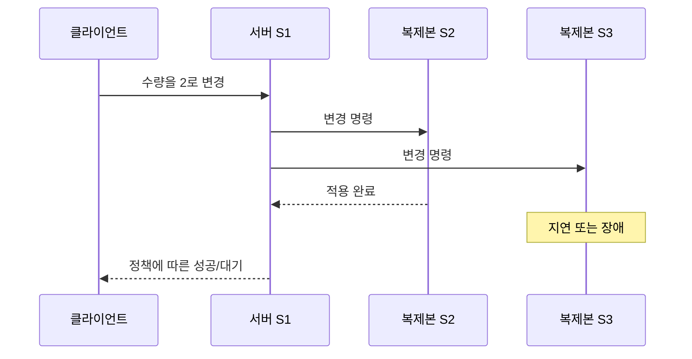

# 00. 왜 분산 시스템인가

## 한 컴퓨터 안의 프로그램과 무엇이 다른가

노트북에서 실행되는 프로그램 두 부분은 같은 메모리 주소를 읽을 수 있다. 한 부분이 변수 `stock`을 2에서 1로 바꾸면, 적절한 동기화를 거친 다른 부분도 같은 메모리에서 1을 읽는다. 분산 시스템의 서버 A와 서버 B는 그렇지 않다. 두 서버의 메모리는 물리적으로 떨어져 있고, 각 운영체제가 따로 관리한다. A의 `stock=1`은 B의 `stock=1`과 이름만 같을 뿐 서로 다른 복사본이다.

이때 **상태(state)** 는 다음 행동을 바꾸는 기억값이다. 재고, 계좌 잔액, 로그인 세션, 처리한 요청 ID가 모두 상태다. 상태는 프로세스 메모리, 로컬 디스크, 원격 데이터베이스, 복제 로그처럼 서로 다른 위치에 살 수 있다. 위치가 달라지면 수명도 달라진다. 프로세스 메모리는 재시작 때 사라질 수 있고, 디스크는 재시작 뒤 남지만 장비 손실에는 사라질 수 있다. 복제본은 장비 손실을 견딜 수 있지만 잘못된 삭제 명령까지 똑같이 복제할 수 있다.

**메시지(message)** 는 독립된 두 프로세스가 상태에 관한 사실이나 변경 요청을 전달하는 바이트 묶음이다. 메시지는 “주문 17의 수량을 1 줄여라”라는 뜻을 가질 수 있지만, 네트워크 장비는 그 업무 의미를 모른다. 네트워크는 바이트를 나누고 전달할 뿐이다. 전달 성공, 업무 검증, 디스크 기록, 복제 커밋은 서로 다른 단계다.

도서관 비유로 보면 서버는 서로 다른 건물의 사서다. 각 사서는 자기 장부만 즉시 볼 수 있다. 한 사서가 책을 대출 처리해도 다른 건물 장부는 전화나 전산 메시지를 받기 전까지 바뀌지 않는다. 전화가 끊겼을 때 상대 사서가 아무 일도 하지 않았다고 단정할 수 없는 이유도 같다.

## 왜 여러 컴퓨터를 쓰는가, 무엇을 새로 지불하는가

첫째 이유는 **용량 확장**이다. 이미지 변환처럼 서로 독립적인 작업 100개를 여러 서버에 나누면 동시에 처리할 수 있다. 둘째는 **장애 내성**이다. 한 복제본이 멈춰도 다른 복제본이 충분한 상태를 가지고 있으면 서비스를 계속할 수 있다. 셋째는 **지리적 지연 감소**다. 사용자의 가까운 지역에서 읽기를 제공하면 빛의 이동과 네트워크 경로에 드는 시간을 줄일 수 있다.

그러나 서버 수를 곱한다고 처리량이 그대로 곱해지지는 않는다. 서버 한 대가 초당 독립 읽기 100건을 처리하고 세 대에 균등 분산하면 이론상 300건에 가까워질 수 있다. 반면 모든 쓰기가 한 리더를 지나고 리더 한계가 초당 80건이면 서버를 세 대로 늘려도 쓰기 한계는 여전히 80건일 수 있다. 복제 메시지와 확인 응답 때문에 실제 한계는 더 낮을 수도 있다.

| 요청 종류 | 한 서버 처리량 | 서버 3대의 단순 합 | 공유 병목이 있을 때 |
|---|---:|---:|---:|
| 독립 이미지 읽기 | 100/s | 300/s | 캐시·네트워크에 따라 약 300/s |
| 단일 리더 쓰기 | 80/s | 240/s로 계산하면 오류 | 리더 한계 약 80/s |
| 3복제본 전체 확인 쓰기 | 80/s | 단순 합 불가 | 가장 느린 필수 확인에 영향 |

분산화는 네트워크 왕복, 상태 복제, 장애 감지, 운영 도구라는 비용을 만든다. 따라서 “분산 시스템이 더 현대적이므로 쓴다”가 아니라, 필요한 용량·가용성·지역성을 한 컴퓨터로 만족하기 어려울 때 그 비용을 받아들이는 선택이다.

## 부분 실패를 한 요청으로 끝까지 추적하기

**부분 실패(partial failure)** 는 시스템의 일부만 실패하는 상황이다. 클라이언트는 정상이고 서버가 멈출 수 있다. 서버는 정상인데 둘 사이 링크만 끊길 수도 있다. 요청은 서버에 도착했지만 응답만 유실될 수도 있다. 한 프로세스 안의 함수 호출은 보통 프로세스와 함께 성공하거나 함께 사라지지만, 네트워크 호출의 양 끝은 서로 다른 운명을 가진다.

장바구니 수량을 1에서 2로 바꾸는 요청 R17을 보자.

| 시각 | 클라이언트 | 서버 S1 | 저장소 |
|---:|---|---|---|
| 0 ms | R17 전송 | 아직 모름 | 수량 1 |
| 8 ms | 응답 대기 | R17 수신·검증 | 수량 1 |
| 18 ms | 응답 대기 | 변경 요청 | 수량 2 커밋 |
| 20 ms | 응답 대기 | 성공 응답 전송 | 수량 2 |
| 100 ms | timeout | 정상 대기 | 수량 2 |

이 표에서 timeout은 실패가 아니다. 클라이언트가 아는 사실은 “100 ms 안에 응답을 받지 못했다”뿐이다. 서버가 18 ms에 커밋했다는 사실은 네트워크 반대편에서 자동으로 보이지 않는다. 같은 R17로 결과를 조회하거나 재시도할 수 있는 계약이 필요한 이유다.

가정을 바꿔 요청 자체가 1 ms에 유실되었다고 하자. 클라이언트의 관측은 똑같이 timeout이지만 저장소는 수량 1이다. 동일한 관측이 서로 반대인 실제 상태를 가질 수 있다. 분산 시스템 설계는 이 **불확실한 결과(unknown outcome)** 를 오류 코드 하나로 숨기지 않고 다음 행동을 정해야 한다.

## 장애 모델은 설계가 다루는 세계의 경계다

**장애 모델(fault model)** 은 어떤 종류의 실패가 얼마만큼 일어날 수 있다고 보는지 명시한 가정이다. 실행 주체는 알고리즘 설계자와 운영자다. 입력은 예상 환경과 위협이며, 결과는 알고리즘이 보장한다고 주장할 수 있는 범위다.

- **crash-stop**: 노드가 어느 순간 멈추고 다시 돌아오지 않는다.
- **crash-recovery**: 노드가 멈췄다가 재시작하며 영속 상태를 읽는다.
- **omission fault**: 요청이나 응답 같은 메시지가 유실된다.
- **timing fault**: 처리가 예상 시간보다 늦거나 시계 가정이 깨진다.
- **Byzantine fault**: 참여자가 임의의 값이나 서로 다른 거짓말을 보낼 수 있다.

crash-recovery를 다루려면 어떤 상태가 디스크에 남는지 정해야 한다. 투표 기록을 메모리에만 두면 재시작 뒤 같은 선거에서 두 번 투표할 수 있다. Byzantine fault까지 다루려면 단순 과반수 crash 합의와 다른 인증·복제 조건이 필요하다. “노드 한 대 장애 허용”이라는 문장만으로는 부족하며, 멈춤인지 거짓말인지, 재시작하는지, 디스크는 보존되는지까지 적어야 한다.

장애 영역도 모델의 일부다. 복제본 세 개가 한 전원 장치에 있으면 서로 다른 프로세스 장애는 견뎌도 전원 장애는 함께 맞는다. 서로 다른 rack에 두면 rack 장애는 분리되지만 지역 전체 장애는 남는다. 서로 다른 지역에 두면 독립성은 커지지만 왕복 지연과 운영 비용도 커진다.

## safety와 liveness를 함께 읽는 법

**safety(안전성)** 는 “나쁜 일이 일어나지 않는다”는 성질이다. 같은 재고 한 개를 두 고객에게 확정 판매하지 않는다, 서로 다른 두 값을 모두 커밋하지 않는다는 예가 있다. safety 위반은 한 번 생기면 나중에 통신이 회복돼도 과거 사실을 없앨 수 없다.

**liveness(진행성)** 는 조건이 좋아지면 “좋은 일이 결국 일어난다”는 성질이다. 네트워크가 회복되고 충분한 노드가 살아 있으면 요청이 언젠가 완료된다는 예다. 진행성에는 반드시 조건이 붙는다. 영원히 메시지가 전달되지 않는 환경에서 모든 요청 완료를 약속할 수는 없다.

두 사서 비유에서 safety는 같은 책을 두 사람에게 동시에 최종 대출하지 않는 것이다. liveness는 전화가 복구되면 대출 절차가 계속되는 것이다. 연결이 끊긴 동안 한쪽 사서가 대출을 멈추면 진행성은 일시적으로 줄지만 safety를 지킬 수 있다.

| 상황 | 안전성 우선 행동 | 진행성에 미치는 영향 |
|---|---|---|
| 복제본 과반수와 통신 가능 | 과반수로 순서 확정 | 계속 진행 가능 |
| 소수 복제본만 통신 가능 | 새 커밋 거부 | 요청 대기·실패 |
| 통신 회복 | 로그 비교·복구 | 다시 진행 |

## 두 서버 재고 요청을 상태별로 계산하기

서버 A와 B가 각자 메모리에 `stock=1`을 가지고 동시에 주문 X와 Y를 받는 잘못된 설계를 보자.

| 시각 | A의 로컬 상태 | B의 로컬 상태 | 외부 결과 |
|---:|---|---|---|
| 0 ms | stock=1 | stock=1 | 판매 0 |
| 10 ms | X가 1을 읽음 | Y가 1을 읽음 | 판매 0 |
| 15 ms | 0으로 저장·성공 | 0으로 저장·성공 | 판매 2 |
| 30 ms | 상대 결과 수신 | 상대 결과 수신 | 과판매 발견 |

각 서버의 계산 `1-1=0`은 지역적으로 맞다. 오류는 같은 물리 재고를 나타내는 두 독립 상태를 동시에 권위 있는 값으로 사용한 데 있다.

리더 L이 단일 순서를 정하면 결과가 달라진다. t=10 X를 로그 index 8에 두고 재고를 0으로 만든다. t=12 Y를 index 9에 두면 현재 재고 0이라 거부한다. 총 성공은 1건이다. 대신 L이 과부하되거나 과반수와 단절되면 새 판매가 멈출 수 있다. safety와 liveness의 설계 선택이 실제 업무 결과로 드러난다.

## 연습 문제와 완전 해설

### 1. 서버 응답이 200 ms 동안 없으면 서버 사망을 확정할 수 있는가?

지연 상한이 없는 모델에서는 확정할 수 없다. 요청 유실, 긴 처리, 응답 유실, 서버 중단이 모두 같은 침묵으로 보인다. “정상 메시지는 최대 50 ms 안에 전달된다”는 강한 환경 가정이 검증되었다면 200 ms 침묵을 장애 판단에 사용할 수 있지만, 그 가정이 깨지는 순간 오탐이 생긴다.

### 2. 복제본 세 개가 있으면 데이터 손실 확률이 항상 독립적으로 세 번 곱해지는가?

아니다. 세 복제본이 같은 전원, 소프트웨어 버그, 운영자 삭제 명령을 공유하면 실패가 독립이 아니다. 각 장비 손실 확률을 단순히 곱하려면 실패 원인이 독립이라는 가정이 필요하다. 장애 영역을 분리하고 백업을 별도로 두는 이유다.

### 3. 리더 자신 기록 3 ms, F1 확인 8 ms, F2 확인 70 ms일 때 자기 자신 포함 과반수 정책의 가장 이른 응답은?

세 노드 과반수는 2개다. 리더와 F1이 준비되는 8 ms 시점에 확인 수가 2가 된다. 따라서 모형상 가장 이른 응답은 약 8 ms다. 세 복제본 모두를 요구하면 약 70 ms다. 실제로는 네트워크 왕복과 영속화 정의를 더 확인해야 한다.

### 4. safety는 지켰지만 liveness가 낮은 예를 들어라.

네트워크가 3노드 중 한 노드만 남기는 파티션을 만들었을 때 그 노드가 새 쓰기를 모두 거부하면 상충 커밋은 만들지 않는다. safety는 지키지만 그쪽 사용자의 요청은 완료되지 않아 liveness가 낮다. 통신과 과반수가 회복되면 진행할 수 있다는 조건부 liveness를 말할 수 있다.

### 5. 서버 두 대가 각각 초당 100건을 처리하면 왜 항상 200건이 아닌가?

독립 작업이면 200건에 가까울 수 있다. 그러나 모든 요청이 초당 120건 한계의 공유 데이터베이스를 거치면 전체는 약 120건에서 막힌다. 각 쓰기가 서로 확인해야 한다면 조정 비용도 더해진다. 처리량 계산은 서버 수가 아니라 실제 직렬 병목과 공유 자원을 따라 해야 한다.

## 먼저 “떨어져 있다”는 뜻부터 이해하기

**분산 시스템**은 서로 독립된 메모리와 운영체제를 가진 둘 이상의 프로세스가 네트워크 메시지로 협력하는 시스템이다. 독립 메모리란 서버 A가 변수 `balance=100`을 바꿔도 서버 B의 메모리 값이 저절로 바뀌지 않는다는 뜻이다. B가 새 값을 알기 위해서는 A가 메시지를 보내거나 둘 다 같은 저장소에서 읽어야 한다.

**네트워크**는 바이트를 옮기는 통로다. 네트워크는 요청의 업무 의미를 모른다. 패킷이 도착했다는 사실은 데이터베이스가 커밋했다는 뜻이 아니고, 연결이 끊겼다는 사실도 서버의 업무 처리가 실패했다는 뜻이 아니다.

두 서버가 재고 1개를 함께 판다고 하자. A와 B가 각자 메모리에 재고 1을 가지고 동시에 주문을 받으면 둘 다 1을 읽고 판매 성공을 답할 수 있다. 결과는 판매 2건, 실제 재고 1개다. 여러 서버를 둔 사실만으로 같은 상태를 유지하지 못한다. 상태의 권위자, 변경 순서, 복제 확인 조건이 필요하다.

| 시각 | 서버 A | 서버 B | 문제 |
|---:|---|---|---|
| 0 ms | stock=1 | stock=1 | 두 메모리는 독립 |
| 10 ms | 주문 X 수신 | 주문 Y 수신 | 서로의 요청을 모름 |
| 15 ms | 1→0, 성공 | 1→0, 성공 | 판매 2건 |
| 30 ms | 결과 교환 | 결과 교환 | 이미 과판매 |

한 저장소 리더가 순서를 정하면 X가 재고를 0으로 만든 뒤 Y는 품절을 본다. 대신 모든 쓰기가 리더를 지나므로 리더 처리량과 네트워크 왕복이 병목이 될 수 있다.

## fault model: 어떤 실패를 상정하는가

**fault model(장애 모델)** 은 설계가 어떤 실패를 다룬다고 가정하는지 적은 목록이다. crash-stop은 노드가 멈춘 뒤 돌아오지 않는 모델이다. crash-recovery는 재시작하며 디스크 상태를 읽는 모델이다. omission은 요청이나 응답이 유실되는 모델이다. Byzantine fault는 노드가 거짓되거나 임의의 값을 보낼 수 있는 모델이다.

Raft 같은 crash fault 합의가 악의적인 노드의 거짓 서명을 자동 해결하지 않는다. 같은 데이터센터의 세 복제본은 서버 crash를 견딜 수 있어도 공통 전원 장애를 함께 맞을 수 있다. 무엇을 견딘다는 문장은 장애 종류와 동시 장애 수를 함께 써야 한다.

| 시각 | 클라이언트 관측 | 서버의 가능한 실제 상태 |
|---:|---|---|
| 0 ms | R1 전송 | 아직 미수신 |
| 20 ms | 응답 없음 | 요청 유실·처리 중 |
| 40 ms | 응답 없음 | 커밋 뒤 응답 유실 가능 |
| 100 ms | timeout | 성공·실패 모두 미확정 |

지연 상한이 없는 비동기 모델에서는 느린 정상 노드와 죽은 노드를 침묵만으로 완벽히 구별할 수 없다. “100 ms면 사망”은 진리가 아니라 서비스가 택한 의심 정책이다.

## 문제를 계산으로 다시 풀기

### 문제 A: 독립 메모리의 재고

A와 B가 stock=2로 시작하고 서로 통신하지 않은 채 각각 주문 2건을 승인하면 총 승인 수는 4다. 실제 재고 2보다 2건 많다. 각 서버가 로컬에서 `2-2=0`을 올바르게 계산했어도 전역 상태가 틀린 이유는 같은 두 재고를 별도 사본으로 세었기 때문이다.

### 문제 B: 복제 확인 지연

리더 로컬 기록 3 ms, 팔로워 F1 확인 8 ms, F2 확인 70 ms라고 하자. 자기 자신 포함 2개 확인 정책은 약 8 ms 뒤 진행할 수 있다. 세 복제본 전부 확인 정책은 적어도 70 ms를 기다린다. 전자는 F2 지연을 숨기지만 두 확인 노드를 동시에 잃는 조건에는 약하다. 숫자는 교육용 모형이다.

### 문제 C: timeout의 의미

서버가 35 ms에 커밋했고 응답만 유실된 경우와 요청이 1 ms에 유실된 경우를 클라이언트가 100 ms까지 응답 없음으로 관측했다고 하자. 관측값은 같지만 업무 결과는 반대다. 따라서 timeout 뒤에는 상태 조회나 같은 요청 ID 재시도가 필요하며, 즉시 “실패”라고 기록하면 안 된다.

[목차](README.md) · [다음 장 →](01-rpc-and-message-delivery.md)

## 한 컴퓨터를 여러 컴퓨터로 바꾸는 이유

한 컴퓨터의 CPU, 메모리, 디스크에는 한계가 있다.
사용자가 늘면 요청을 여러 서버에 나누고 싶어진다.
한 서버가 고장 나도 서비스를 계속하려면 같은 데이터를 다른 서버에도 둬야 한다.
서로 먼 지역의 사용자에게 빨리 응답하려면 가까운 지역에 복제본을 둔다.
이 세 요구가 각각 확장성, 가용성, 지연 시간 개선이다.

**노드(node)** 는 분산 시스템에 참여하는 컴퓨터나 프로세스다.
**클라이언트(client)** 는 서비스를 요청하는 주체다.
**상태(state)** 는 계좌 잔액처럼 서버가 기억해야 하는 값이다.
**복제본(replica)** 은 같은 논리 상태를 보관하는 사본이다.
복제본은 단순 파일 복사본이 아니라 새 쓰기를 적용하는 실행 주체일 수 있다.

## 한 번의 쓰기를 따라가기

사용자 A가 장바구니 수량을 1에서 2로 바꾼다고 하자.
입력은 상품 ID, 새 수량, 사용자 인증 정보다.
로드 밸런서는 요청을 서버 S1으로 보낸다.
S1은 현재 상태를 읽고 변경 명령을 만든다.
S1이 S2와 S3에 명령을 보내면 각 복제본의 적용 위치가 달라질 수 있다.
S2는 8 ms 뒤 적용하고 S3는 80 ms 동안 응답하지 않을 수 있다.
S1이 언제 성공을 답할지는 시스템의 일관성·가용성 정책에 달려 있다.

## 분산 시스템의 핵심 어려움

한 프로세스는 다른 프로세스의 내부를 직접 볼 수 없다.
관측 수단은 도착한 메시지와 로컬 시계뿐이다.
응답이 늦으면 상대가 죽었는지, 네트워크가 느린지, 응답만 유실됐는지 구별할 수 없다.
이 모호함 때문에 timeout은 사실 판정이 아니라 기다림을 끝내는 정책이다.

**부분 장애(partial failure)** 는 일부 노드나 링크만 실패하는 상황이다.
S1은 정상이고 S2만 멈출 수 있다.
S2는 정상이어도 S1↔S2 링크만 끊길 수 있다.
모두 함께 멈추는 단일 컴퓨터 장애와 다르다.

## 작은 수치 모형

서버 한 대가 초당 100개 요청을 처리한다고 가정한다.
세 대면 항상 초당 300개가 되는 것은 아니다.
각 쓰기를 세 복제본에 보내고 두 확인을 기다리면 네트워크와 조정 비용이 붙는다.
읽기가 서로 독립적이면 280개까지 늘 수 있다.
모든 쓰기가 한 리더를 지나면 쓰기는 여전히 리더 한계에 묶일 수 있다.
이 숫자는 병목 위치를 보는 교육용 예다.

## 반례와 경계

데이터를 나누기만 하면 노드 하나의 장애가 그 조각 전체의 손실이 될 수 있다.
복제만 하면 모든 복제본이 같은 오류 명령을 적용할 수 있다.
서버 수를 늘려도 공유 데이터베이스 한 대가 병목이면 전체 처리량은 늘지 않는다.
따라서 “여러 대” 자체가 확장성이나 가용성을 보장하지 않는다.

## 점검 문제

### 1. 응답이 없으면 서버가 죽었다고 확정할 수 있는가?

없다.
요청 유실, 처리 지연, 응답 유실, 서버 중단이 같은 관측으로 보인다.
추가 메시지와 시간 가정을 써서 의심할 수 있을 뿐이다.

### 2. 복제본 세 개가 있으면 데이터 손실이 불가능한가?

아니다.
같은 결함, 잘못된 삭제, 동시 지역 장애, 커밋 전 장애가 모두 가능하다.
독립 장애 영역과 영속성 규칙을 함께 확인해야 한다.

### 3. 분산화의 비용은 무엇인가?

메시지 지연, 실패 모호성, 상태 순서 조정, 운영 복잡성이다.
얻는 확장성과 가용성이 이 비용보다 큰 구간에서 사용한다.

## 공식 자료

- [AWS Builders' Library: Challenges with distributed systems](https://aws.amazon.com/builders-library/challenges-with-distributed-systems/)
- [Google SRE Book](https://sre.google/sre-book/table-of-contents/)

[목차](README.md) · [다음 장 →](01-rpc-and-message-delivery.md)
