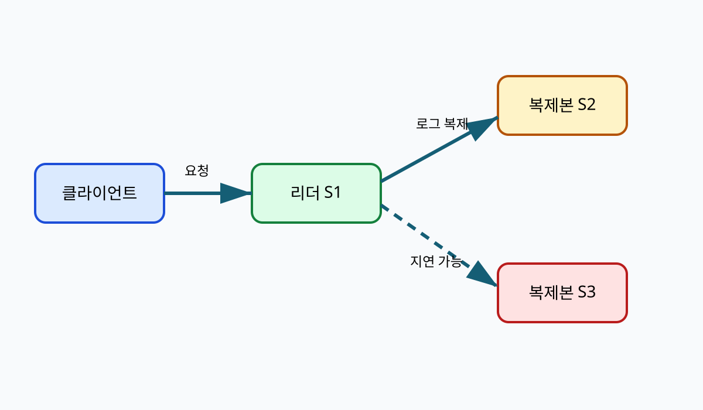
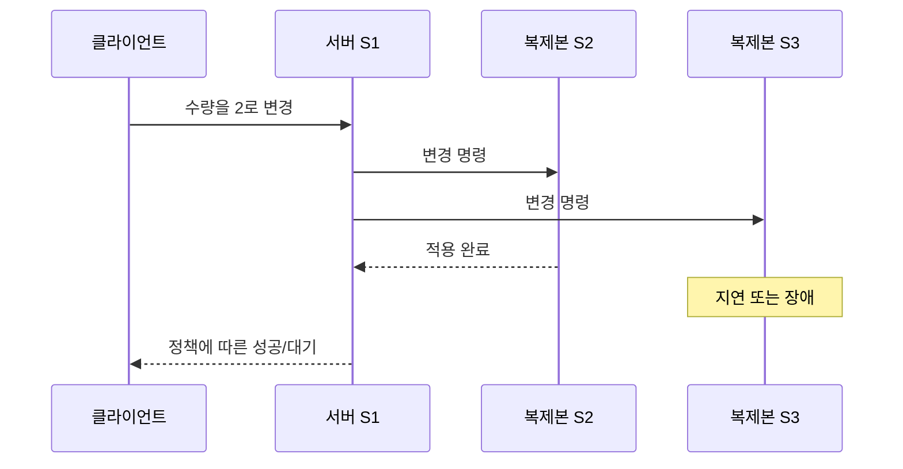

# 00. 왜 분산 시스템인가

## 먼저 “떨어져 있다”는 뜻부터 이해하기

**분산 시스템**은 서로 독립된 메모리와 운영체제를 가진 둘 이상의 프로세스가 네트워크 메시지로 협력하는 시스템이다. 독립 메모리란 서버 A가 변수 `balance=100`을 바꿔도 서버 B의 메모리 값이 저절로 바뀌지 않는다는 뜻이다. B가 새 값을 알기 위해서는 A가 메시지를 보내거나 둘 다 같은 저장소에서 읽어야 한다.

**네트워크**는 바이트를 옮기는 통로다. 네트워크는 요청의 업무 의미를 모른다. 패킷이 도착했다는 사실은 데이터베이스가 커밋했다는 뜻이 아니고, 연결이 끊겼다는 사실도 서버의 업무 처리가 실패했다는 뜻이 아니다.

두 서버가 재고 1개를 함께 판다고 하자. A와 B가 각자 메모리에 재고 1을 가지고 동시에 주문을 받으면 둘 다 1을 읽고 판매 성공을 답할 수 있다. 결과는 판매 2건, 실제 재고 1개다. 여러 서버를 둔 사실만으로 같은 상태를 유지하지 못한다. 상태의 권위자, 변경 순서, 복제 확인 조건이 필요하다.

| 시각 | 서버 A | 서버 B | 문제 |
|---:|---|---|---|
| 0 ms | stock=1 | stock=1 | 두 메모리는 독립 |
| 10 ms | 주문 X 수신 | 주문 Y 수신 | 서로의 요청을 모름 |
| 15 ms | 1→0, 성공 | 1→0, 성공 | 판매 2건 |
| 30 ms | 결과 교환 | 결과 교환 | 이미 과판매 |

한 저장소 리더가 순서를 정하면 X가 재고를 0으로 만든 뒤 Y는 품절을 본다. 대신 모든 쓰기가 리더를 지나므로 리더 처리량과 네트워크 왕복이 병목이 될 수 있다.

## fault model: 어떤 실패를 상정하는가

**fault model(장애 모델)** 은 설계가 어떤 실패를 다룬다고 가정하는지 적은 목록이다. crash-stop은 노드가 멈춘 뒤 돌아오지 않는 모델이다. crash-recovery는 재시작하며 디스크 상태를 읽는 모델이다. omission은 요청이나 응답이 유실되는 모델이다. Byzantine fault는 노드가 거짓되거나 임의의 값을 보낼 수 있는 모델이다.

Raft 같은 crash fault 합의가 악의적인 노드의 거짓 서명을 자동 해결하지 않는다. 같은 데이터센터의 세 복제본은 서버 crash를 견딜 수 있어도 공통 전원 장애를 함께 맞을 수 있다. 무엇을 견딘다는 문장은 장애 종류와 동시 장애 수를 함께 써야 한다.

| 시각 | 클라이언트 관측 | 서버의 가능한 실제 상태 |
|---:|---|---|
| 0 ms | R1 전송 | 아직 미수신 |
| 20 ms | 응답 없음 | 요청 유실·처리 중 |
| 40 ms | 응답 없음 | 커밋 뒤 응답 유실 가능 |
| 100 ms | timeout | 성공·실패 모두 미확정 |

지연 상한이 없는 비동기 모델에서는 느린 정상 노드와 죽은 노드를 침묵만으로 완벽히 구별할 수 없다. “100 ms면 사망”은 진리가 아니라 서비스가 택한 의심 정책이다.

## 문제를 계산으로 다시 풀기

### 문제 A: 독립 메모리의 재고

A와 B가 stock=2로 시작하고 서로 통신하지 않은 채 각각 주문 2건을 승인하면 총 승인 수는 4다. 실제 재고 2보다 2건 많다. 각 서버가 로컬에서 `2-2=0`을 올바르게 계산했어도 전역 상태가 틀린 이유는 같은 두 재고를 별도 사본으로 세었기 때문이다.

### 문제 B: 복제 확인 지연

리더 로컬 기록 3 ms, 팔로워 F1 확인 8 ms, F2 확인 70 ms라고 하자. 자기 자신 포함 2개 확인 정책은 약 8 ms 뒤 진행할 수 있다. 세 복제본 전부 확인 정책은 적어도 70 ms를 기다린다. 전자는 F2 지연을 숨기지만 두 확인 노드를 동시에 잃는 조건에는 약하다. 숫자는 교육용 모형이다.

### 문제 C: timeout의 의미

서버가 35 ms에 커밋했고 응답만 유실된 경우와 요청이 1 ms에 유실된 경우를 클라이언트가 100 ms까지 응답 없음으로 관측했다고 하자. 관측값은 같지만 업무 결과는 반대다. 따라서 timeout 뒤에는 상태 조회나 같은 요청 ID 재시도가 필요하며, 즉시 “실패”라고 기록하면 안 된다.

[목차](README.md) · [다음 장 →](01-rpc-and-message-delivery.md)

## 한 컴퓨터를 여러 컴퓨터로 바꾸는 이유

한 컴퓨터의 CPU, 메모리, 디스크에는 한계가 있다.
사용자가 늘면 요청을 여러 서버에 나누고 싶어진다.
한 서버가 고장 나도 서비스를 계속하려면 같은 데이터를 다른 서버에도 둬야 한다.
서로 먼 지역의 사용자에게 빨리 응답하려면 가까운 지역에 복제본을 둔다.
이 세 요구가 각각 확장성, 가용성, 지연 시간 개선이다.

**노드(node)** 는 분산 시스템에 참여하는 컴퓨터나 프로세스다.
**클라이언트(client)** 는 서비스를 요청하는 주체다.
**상태(state)** 는 계좌 잔액처럼 서버가 기억해야 하는 값이다.
**복제본(replica)** 은 같은 논리 상태를 보관하는 사본이다.
복제본은 단순 파일 복사본이 아니라 새 쓰기를 적용하는 실행 주체일 수 있다.

## 한 번의 쓰기를 따라가기

사용자 A가 장바구니 수량을 1에서 2로 바꾼다고 하자.
입력은 상품 ID, 새 수량, 사용자 인증 정보다.
로드 밸런서는 요청을 서버 S1으로 보낸다.
S1은 현재 상태를 읽고 변경 명령을 만든다.
S1이 S2와 S3에 명령을 보내면 각 복제본의 적용 위치가 달라질 수 있다.
S2는 8 ms 뒤 적용하고 S3는 80 ms 동안 응답하지 않을 수 있다.
S1이 언제 성공을 답할지는 시스템의 일관성·가용성 정책에 달려 있다.

## 분산 시스템의 핵심 어려움

한 프로세스는 다른 프로세스의 내부를 직접 볼 수 없다.
관측 수단은 도착한 메시지와 로컬 시계뿐이다.
응답이 늦으면 상대가 죽었는지, 네트워크가 느린지, 응답만 유실됐는지 구별할 수 없다.
이 모호함 때문에 timeout은 사실 판정이 아니라 기다림을 끝내는 정책이다.

**부분 장애(partial failure)** 는 일부 노드나 링크만 실패하는 상황이다.
S1은 정상이고 S2만 멈출 수 있다.
S2는 정상이어도 S1↔S2 링크만 끊길 수 있다.
모두 함께 멈추는 단일 컴퓨터 장애와 다르다.

## 작은 수치 모형

서버 한 대가 초당 100개 요청을 처리한다고 가정한다.
세 대면 항상 초당 300개가 되는 것은 아니다.
각 쓰기를 세 복제본에 보내고 두 확인을 기다리면 네트워크와 조정 비용이 붙는다.
읽기가 서로 독립적이면 280개까지 늘 수 있다.
모든 쓰기가 한 리더를 지나면 쓰기는 여전히 리더 한계에 묶일 수 있다.
이 숫자는 병목 위치를 보는 교육용 예다.

## 반례와 경계

데이터를 나누기만 하면 노드 하나의 장애가 그 조각 전체의 손실이 될 수 있다.
복제만 하면 모든 복제본이 같은 오류 명령을 적용할 수 있다.
서버 수를 늘려도 공유 데이터베이스 한 대가 병목이면 전체 처리량은 늘지 않는다.
따라서 “여러 대” 자체가 확장성이나 가용성을 보장하지 않는다.

## 점검 문제

### 1. 응답이 없으면 서버가 죽었다고 확정할 수 있는가?

없다.
요청 유실, 처리 지연, 응답 유실, 서버 중단이 같은 관측으로 보인다.
추가 메시지와 시간 가정을 써서 의심할 수 있을 뿐이다.

### 2. 복제본 세 개가 있으면 데이터 손실이 불가능한가?

아니다.
같은 결함, 잘못된 삭제, 동시 지역 장애, 커밋 전 장애가 모두 가능하다.
독립 장애 영역과 영속성 규칙을 함께 확인해야 한다.

### 3. 분산화의 비용은 무엇인가?

메시지 지연, 실패 모호성, 상태 순서 조정, 운영 복잡성이다.
얻는 확장성과 가용성이 이 비용보다 큰 구간에서 사용한다.

## 공식 자료

- [AWS Builders' Library: Challenges with distributed systems](https://aws.amazon.com/builders-library/challenges-with-distributed-systems/)
- [Google SRE Book](https://sre.google/sre-book/table-of-contents/)

[목차](README.md) · [다음 장 →](01-rpc-and-message-delivery.md)
