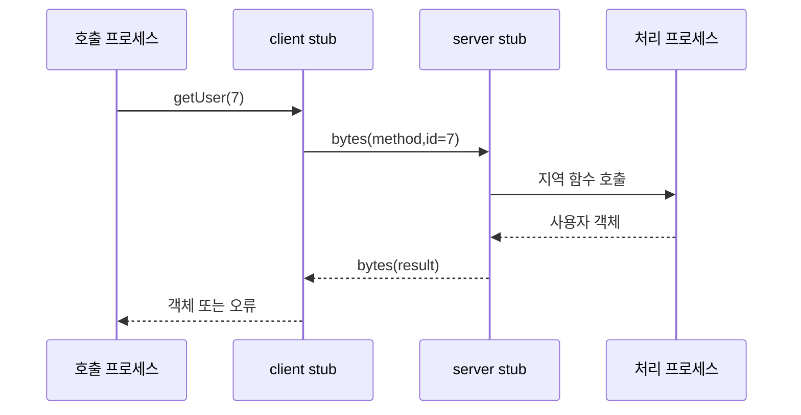

# 01. RPC와 메시지 전달

## 함수처럼 보이는 동안 실제로 일어나는 일

RPC의 입력은 메서드 이름, 인자, 요청 ID, 인증 정보다. **직렬화**는 `amount=100` 같은 메모리 값을 정해진 바이트 형식으로 바꾸는 일이다. client stub이 바이트를 만들고, 서버 stub이 다시 자료형으로 복원한다. 양쪽 schema가 다르면 네트워크 전달은 성공해도 해석이 실패한다.

**요청 ID**는 한 논리 시도를 식별한다. **응답 ID** 또는 요청 ID 반사는 동시에 진행 중인 여러 호출 중 어느 응답인지 연결한다. TCP 연결 하나에서도 R1과 R2 응답 순서가 달라질 수 있으므로 호출자는 ID로 기다리는 작업을 찾는다.

| 시각 | 주체 | 상태 |
|---:|---|---|
| 0 ms | 호출자 | R7, pay(100) 생성 |
| 2 ms | client stub | bytes와 R7 header 생성 |
| 7 ms | server stub | 역직렬화·검증 |
| 18 ms | 업무 서비스 | 결제 커밋 |
| 20 ms | 네트워크 | 성공 응답 유실 |
| 100 ms | 호출자 | timeout, 결과 미상 |

timeout은 호출자가 기다림을 끝내는 정책이다. 서버 실행을 취소했다는 증거가 아니다. 취소 메시지도 늦게 도착해 이미 커밋된 결과를 되돌리지 못할 수 있다.

## 전달 횟수와 업무 처리 횟수를 분리한다

at-most-once delivery는 전달을 최대 한 번 시도해 0회 또는 1회가 되게 한다. 요청 유실 시 업무는 0회다. at-least-once delivery는 확인될 때까지 재전송해 전달은 1회 이상일 수 있다. 업무 코드가 비멱등이면 처리도 여러 번 될 수 있다.

| 전달 사건 | 서버 중복 기록 없음 | 영속 R7 기록 있음 |
|---|---:|---:|
| 첫 R7 도착 | 결제 1회 | 결제 1회+결과 저장 |
| 응답 유실 | 클라이언트 결과 미상 | 클라이언트 결과 미상 |
| R7 재도착 | 결제 2회 가능 | 기존 결과 반환 |

“exactly-once”라는 말은 전송 패킷이 정확히 한 번이라는 뜻으로 이해하면 안 된다. 패킷은 반복될 수 있다. 요청 ID 기록과 업무 변경을 같은 원자적·영속 경계에 두어 관측 가능한 효과가 한 번처럼 보이게 한다.

## 큐 소비의 순서를 바꾼 반례

소비자가 메시지를 받자마자 ack하고 업무 커밋 전에 죽으면 큐는 완료로 보지만 업무는 0회다. 업무 커밋 뒤 ack하기 전에 죽으면 큐가 재전달하여 처리 2회 가능성이 생긴다. 뒤 순서는 중복 제거로 복구할 수 있지만 앞 순서는 원본 메시지가 사라질 수 있다.

`set status=paid`는 반복 결과가 같을 수 있다. `balance -= 100`과 이메일 발송은 반복할수록 효과가 늘어난다. 전달 의미가 같아도 명령 의미에 따라 안전성이 다르다.

## 계산 문제와 완전 해설

### 문제 A: 총 처리 횟수

R7이 처음 도착해 처리됐고 응답이 유실된 뒤 두 번 재전송됐다고 하자. 중복 제거가 없으면 최대 처리 3회다. R7 고유 키와 저장 결과가 있으면 전달은 3회여도 업무 실행은 1회다. 전달 횟수와 실행 횟수를 구분해야 한다.

### 문제 B: ack 위치

t=10 수신, t=12 ack, t=20 업무 예정인데 t=15 crash라면 업무는 0회이고 재전달도 없다. ack를 t=22 업무 커밋 뒤로 옮기면 t=15 crash 때 ack가 없어 큐가 재전달한다. 두 번째 설계가 at-least-once 처리를 만들며 소비자는 중복을 감당해야 한다.

### 문제 C: 새 ID 재시도

첫 요청 R7이 커밋됐지만 응답이 유실됐는데 재시도를 R8로 보내면 서버는 새 결제로 본다. 잔액 1,000에서 첫 결제 뒤 900, 두 번째 뒤 800이 된다. 같은 R7이면 저장된 900을 돌려줄 수 있다. ID 재사용 기간은 중복 기록 보존 기간 안이어야 한다.

[← 이전 장](00-why-distributed-systems.md) · [목차](README.md) · [다음 장 →](02-time-events-and-ordering.md)

## RPC는 지역 함수 호출처럼 보이는 네트워크 작업이다

**RPC(Remote Procedure Call, 원격 프로시저 호출)** 는 다른 프로세스의 기능을 메시지로 요청하는 방식이다.
클라이언트 코드에는 `getUser(7)`처럼 보일 수 있다.
실제로는 직렬화, 전송, 대기, 역직렬화가 일어난다.
**직렬화(serialization)** 는 메모리 객체를 전송 가능한 바이트로 바꾸는 일이다.
**stub** 은 호출 인자와 응답을 메시지 형식으로 바꾸는 대리 코드다.

입력은 메서드 이름, 인자, 요청 ID다.
client stub이 바이트와 헤더를 만든다.
운영체제와 네트워크가 패킷을 전달한다.
server stub이 형식을 검사하고 서버 함수를 호출한다.
서버의 중간 상태에는 요청 수신, 처리 중, 결과 저장이 생긴다.
응답이 돌아오면 호출자는 결과를 얻는다.

## 전달 의미

**at-most-once** 는 처리 횟수가 0번 또는 1번이라는 목표다.
중복 요청을 버릴 수 있지만 유실되면 0번이다.
**at-least-once** 는 성공할 때까지 재전송해 한 번 이상 처리될 수 있다는 목표다.
중복 실행을 견디는 연산이 필요하다.
**exactly-once** 는 관측 가능한 효과가 정확히 한 번이라는 강한 목표다.
네트워크만으로 얻지 못하며 요청 ID, 영속 중복 기록, 트랜잭션 경계가 필요하다.

## timeout 뒤 결과가 모호한 이유

t=0 ms에 클라이언트가 결제 요청 R7을 보낸다.
t=20 ms에 서버가 결제를 저장한다.
t=22 ms에 서버가 성공 응답을 보낸다.
응답 패킷이 유실된다.
t=100 ms에 클라이언트 timeout이 난다.
클라이언트가 아는 것은 “100 ms 안에 응답을 못 받았다”뿐이다.
결제가 실패했다는 뜻이 아니다.

## 메시지 큐와 반례

**메시지 큐** 는 생산자와 소비자 사이에 메시지를 보관하는 구성 요소다.
큐가 확인 응답 전에 소비자를 잃으면 메시지를 다시 전달할 수 있다.
따라서 소비자는 중복을 예상해야 한다.
TCP 연결 성공은 업무 커밋 성공이 아니다.
HTTP 200 뒤 후속 비동기 작업도 실패할 수 있다.

## 점검 문제

### 1. timeout 때 반대 연산을 보내면 안전한가?
원래 결과가 미상이므로 위험하다. 상태 조회나 같은 요청 ID 재시도로 먼저 확인한다.

### 2. at-least-once 소비자에게 필요한 성질은?
같은 메시지가 여러 번 와도 효과가 한 번처럼 보이는 멱등성이나 중복 제거다.

### 3. 지역 호출과 RPC의 큰 차이는?
RPC에는 독립 실패와 결과 미상이 있다.

## 공식 자료

- [gRPC Concepts](https://grpc.io/docs/what-is-grpc/core-concepts/)
- [RabbitMQ Reliability Guide](https://www.rabbitmq.com/docs/reliability)

[← 이전 장](00-why-distributed-systems.md) · [목차](README.md) · [다음 장 →](02-time-events-and-ordering.md)
