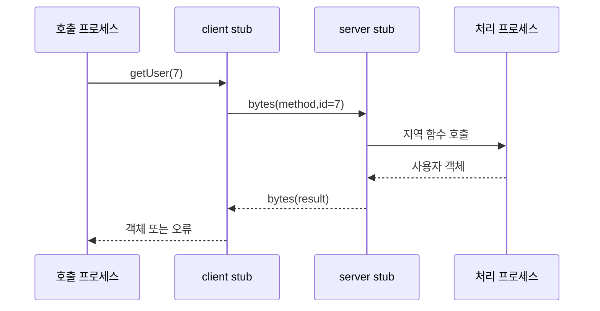

# 01. RPC와 메시지 전달

## 지역 함수 호출과 RPC를 같은 것으로 보면 생기는 착각

지역 함수 `pay(100)`은 같은 프로세스의 메모리와 호출 스택에서 실행된다. 함수가 반환하면 호출자는 같은 프로세스 안에서 결과를 받는다. **RPC(Remote Procedure Call, 원격 프로시저 호출)** 는 다른 프로세스의 기능을 네트워크 메시지로 요청한다. 코드 모양은 함수 호출과 비슷하지만 호출자, 네트워크, 서버가 각각 독립적으로 실패한다.

식당 비유로 지역 호출은 주방 안에서 옆 조리사에게 재료를 건네는 일이다. RPC는 다른 지점에 주문서를 택배로 보내고 답장을 기다리는 일이다. 답장이 없을 때 주문서가 안 갔는지, 요리가 끝났는지, 답장만 잃었는지 알 수 없다.

RPC의 실제 대상은 두 프로세스 사이의 요청·응답 프로토콜이다. client stub은 호출자 프로세스 안에 있고, server stub은 서버 프로세스 입구에 있다. socket은 운영체제가 제공하는 통신 끝점이다. socket에 바이트를 썼다는 사실은 상대 업무 함수가 실행됐다는 뜻이 아니다.

## 객체가 바이트가 되고 다시 객체가 되는 과정

**직렬화(serialization)** 는 메모리 객체를 약속된 바이트 형식으로 바꾸는 일이다. 메서드 이름, 필드 번호, 정수 표현, 문자열 인코딩 같은 규칙이 필요하다. **역직렬화(deserialization)** 는 받은 바이트를 서버 언어의 값으로 복원한다.

예를 들어 호출자가 `{account:"A", amount:100}`을 보낸다고 하자. client stub은 schema에 따라 필드 번호와 길이를 붙인다. 운영체제는 이 바이트를 socket 송신 버퍼에 넣는다. 네트워크가 전달하면 server stub이 길이와 타입을 검사하고 `pay("A",100)`을 호출한다. 서버 함수 결과 `{approved:true,balance:900}`도 반대 과정을 거친다.

| 단계 | 실행 주체 | 입력 | 중간 상태 | 출력 |
|---|---|---|---|---|
| 1 | 호출 코드 | 계좌 A, 100 | 함수 인자 | stub 호출 |
| 2 | client stub | 인자·schema | 요청 bytes | socket write |
| 3 | 운영체제·네트워크 | bytes | 패킷·버퍼 | 서버 bytes |
| 4 | server stub | bytes·schema | 검증된 객체 | 업무 함수 호출 |
| 5 | 업무 서비스 | 객체 | DB transaction | 결과 객체 |
| 6 | 두 stub | 결과 객체 | 응답 bytes | 호출자 결과 |

schema 버전이 다르면 네트워크 전달은 성공해도 서버가 필드를 이해하지 못할 수 있다. 새 필드를 모르는 구버전이 무시할 수 있는지, 필수 필드가 빠지면 거부하는지 호환 규칙을 정한다. 직렬화는 단순 포장이 아니라 양쪽 프로그램이 같은 의미를 공유하는 계약이다.

## request ID와 응답 연결

**request ID**는 한 논리 요청을 식별하는 값이다. 한 연결에서 R1과 R2를 연속 전송하고 R2가 먼저 끝날 수 있다. 응답이 ID를 돌려주면 client stub은 어느 대기 작업을 깨울지 안다. ID가 없으면 동시에 진행한 두 응답을 잘못 연결할 수 있다.

ID의 수명도 정해야 한다. 중복 제거를 24시간 보관한다면 클라이언트가 25시간 뒤 같은 ID로 재시도할 때 서버는 새 요청으로 볼 수 있다. ID가 전역 고유한지, 사용자 안에서만 고유한지, 재사용 가능 시점은 언제인지가 프로토콜 일부다.

같은 ID에 다른 입력이 오면 위험하다. R7로 100원 결제를 저장한 뒤 R7에 500원이 오면 기존 결과를 그대로 돌려주거나 새 결제로 실행해서는 안 된다. 서버는 ID와 입력 요약을 함께 저장하고 불일치 오류를 내야 한다.

## timeout은 결과가 아니라 기다림의 경계다

**timeout**은 호출자가 응답을 기다리는 최대 시간 정책이다. monotonic clock으로 경과 시간을 재고, 기한이 지나면 호출 대기를 끝낸다. timeout은 서버 프로세스를 되돌리지 않는다. 취소 메시지를 보내더라도 이미 커밋된 데이터베이스 변경을 시간 역순으로 없앨 수 없다.

결제 R7을 시간순으로 보자.

| 시각 | 클라이언트 | 서버 | 데이터베이스 |
|---:|---|---|---|
| 0 ms | R7 전송 | 미수신 | balance=1000 |
| 7 ms | 대기 | 역직렬화·검증 | 1000 |
| 18 ms | 대기 | transaction commit | 900, R7=DONE |
| 20 ms | 대기 | 성공 응답 전송 | 900 |
| 21 ms | 응답 유실 | 정상 | 900 |
| 100 ms | timeout | 정상 | 900 |
| 120 ms | R7 재시도 | R7 조회 | 저장 결과 900 |

동일한 timeout 관측에서 요청이 2 ms에 유실됐다면 데이터베이스는 1000이다. 그래서 클라이언트 오류를 “결제 실패”가 아니라 “결과를 확인할 수 없음”으로 표현해야 할 때가 있다.

## delivery와 processing은 다른 층의 말이다

**delivery(전달)** 는 메시지가 소비자에게 도착한 횟수다. **processing(처리)** 는 업무 코드가 실행되거나 효과가 커밋된 횟수다. 메시지가 세 번 전달되어도 중복 제거 때문에 업무는 한 번일 수 있다. 한 번 전달되어도 서버가 검증에서 거부해 업무 효과는 0번일 수 있다.

**at-most-once delivery**는 메시지를 0번 또는 1번 전달하려는 성질이다. 재전송하지 않으면 중복은 줄지만 유실 시 처리 0번을 받아들인다. **at-least-once delivery**는 성공 확인까지 재전송해 한 번 이상 도착하게 하려는 성질이다. 중복 전달 가능성이 있으므로 소비자가 대비한다.

| 상황 | 전달 횟수 | 업무 실행 횟수 | 최종 효과 |
|---|---:|---:|---|
| 요청 유실, 재시도 없음 | 0 | 0 | 없음 |
| 응답 유실, 새 ID 재시도 | 2 | 2 가능 | 중복 결제 |
| 응답 유실, 같은 ID+영속 dedup | 2 | 1 | 결제 한 번 |
| 검증 실패 메시지 재전달 | 여러 번 | 0 | 오류 반복 |

“exactly once”는 네트워크 패킷이 물리적으로 한 번만 움직인다는 뜻으로 쓰면 부정확하다. 보통 여러 전달과 재시작이 있어도 관측 가능한 업무 효과를 한 번처럼 만들었다는 범위를 명시해야 한다.

## ack의 위치가 결과를 바꾼다

**ack(acknowledgement, 확인 응답)** 은 수신자가 특정 단계까지 마쳤다고 송신자에게 알리는 메시지다. 무엇을 확인했는지 정의해야 한다. 메모리 수신 확인, 디스크 저장 확인, 업무 커밋 확인은 서로 다르다.

메시지 큐 소비자가 t=10에 메시지를 받고 t=12에 ack한 뒤 t=15에 죽고, 업무 커밋은 t=20 예정이었다고 하자. 큐는 완료로 알고 재전달하지 않지만 업무는 0회다.

순서를 바꿔 t=10 수신, t=20 업무 커밋, t=22 ack 예정인데 t=21 죽으면 큐가 재전달한다. 업무는 이미 한 번 커밋됐으므로 중복 가능성이 있다. 그러나 같은 request ID를 영속 중복 기록에서 찾으면 두 번째 업무 실행을 막을 수 있다. 일반적으로 “커밋 뒤 ack + 멱등 소비”가 유실보다 중복을 선택해 복구 가능성을 높인다.

## idempotency와 deduplication

**멱등성(idempotency)** 은 같은 연산을 여러 번 적용해도 한 번 적용한 것과 관측 결과가 같은 성질이다. `status=PAID` 설정은 조건에 따라 멱등일 수 있다. `balance -= 100`, 카운터 증가, 이메일 발송은 보통 멱등이 아니다.

**중복 제거(deduplication)** 는 request ID를 기록해 같은 요청의 업무 코드를 다시 실행하지 않는 메커니즘이다. 멱등성은 연산의 성질이고 중복 제거는 서버가 두 호출을 같은 논리 요청으로 알아보는 구현이다.

업무 변경과 중복 기록은 같은 내구 경계에 있어야 한다. 잔액을 900으로 커밋한 뒤 R7 기록 전에 죽으면 재시도 때 다시 차감한다. R7 DONE을 먼저 기록하고 잔액 변경 전에 죽으면 실제 결제 없이 성공처럼 보인다. 하나의 데이터베이스 transaction이나 복구 가능한 상태 기계로 둘을 함께 확정한다.

| request_id | 입력 요약 | 처리 상태 | 저장 결과 |
|---|---|---|---|
| R6 | debit:50 | DONE | balance=950 |
| R7 | debit:100 | DONE | balance=850 |
| R8 | debit:200 | IN_PROGRESS | 아직 없음 |

IN_PROGRESS 요청이 오래 남았을 때 새 실행이 가져갈지, 원래 작업 상태를 조사할지 정책이 필요하다. 단순히 시간이 지났다는 이유로 같은 외부 결제를 다시 보내면 첫 요청이 상대 시스템에서 성공했을 수 있다.

## 두 업무 요청을 끝까지 비교한다

첫 업무는 프로필 표시 이름을 “민수”로 설정하는 요청이다. 같은 최종 값을 설정하므로 재실행 결과는 대체로 같다. 그러나 매 실행마다 감사 이메일을 보낸다면 전체 업무는 멱등하지 않다.

둘째 업무는 계좌에서 100원을 차감하는 요청이다. R7이 두 번 실행되면 1000→900→800이 된다. 서버가 R7을 기록하면 첫 실행 후 900을 저장하고, 두 번째 전달에는 저장된 900을 반환한다.

| 단계 | 이름 설정 N1 | 결제 R7 |
|---|---|---|
| 첫 실행 | name=민수 | 1000→900 |
| 응답 유실 | 결과 미상 | 결과 미상 |
| 같은 ID 재시도 | 기존 결과 또는 같은 설정 | 기존 900 반환 |
| 새 ID 재시도 | 이름 결과는 같을 수 있음 | 900→800 위험 |

인접 개념을 구별해야 한다. 재시도 가능성은 transport 정책이고, 멱등성은 업무 연산 성질이며, dedup은 저장 메커니즘이다. 셋 중 하나의 이름으로 나머지를 자동 보장할 수 없다.

## 연습 문제와 완전 해설

### 1. socket write가 성공하면 서버 업무도 성공했는가?

아니다. write 성공은 보통 바이트가 로컬 운영체제 버퍼에 받아들여졌다는 정도다. 이후 연결 단절, 서버 역직렬화 실패, 업무 검증 거부, DB rollback이 가능하다. 업무 성공은 서버가 정의한 커밋 지점과 응답 계약으로 판단한다.

### 2. R7이 처음 한 번, 재시도 두 번 전달되었다. dedup이 없을 때 최대 업무 실행 횟수와 dedup이 있을 때 횟수는?

모든 전달이 서버에 도착해 실행되면 dedup 없음은 최대 3회다. 영속 R7 기록을 업무와 원자적으로 저장하면 첫 전달만 실행하고 두 재시도는 결과를 읽으므로 1회다. 전달 횟수와 처리 횟수가 다른 예다.

### 3. 큐 ack를 업무 전에 보내는 설계의 실패 시간표를 계산하라.

t=10 수신, t=12 ack, t=15 crash, t=20 업무 예정이면 ack는 이미 큐에 반영됐고 업무는 실행 전이다. 큐는 재전달하지 않으므로 처리 횟수 0이다. ack를 커밋 뒤로 옮기면 같은 crash에서 ack가 없어 재전달 가능하다.

### 4. 같은 request ID에 다른 amount가 왔을 때 기존 결과를 반환하면 왜 위험한가?

R7의 원 입력이 100이고 결과가 900인데 새 입력이 500이면, 기존 900을 반환하는 것은 호출자의 500 요청을 처리했다고 거짓말하는 셈이다. 새로 처리하면 ID 의미가 깨진다. ID와 입력 요약을 비교해 충돌 오류를 내야 한다.

### 5. dedup 기록 TTL이 24시간이고 재시도가 30시간 뒤 오면 어떤 조건이 필요한가?

기록이 이미 삭제됐다면 서버는 요청을 새 것으로 볼 수 있다. 중복 효과를 막으려면 최대 재시도 기간을 TTL보다 짧게 제한하거나 더 오래 기록하거나, 업무 자체의 자연 키로 중복을 검증해야 한다. TTL은 저장 비용과 안전 재시도 창 사이 계약이다.

## 함수처럼 보이는 동안 실제로 일어나는 일

RPC의 입력은 메서드 이름, 인자, 요청 ID, 인증 정보다. **직렬화**는 `amount=100` 같은 메모리 값을 정해진 바이트 형식으로 바꾸는 일이다. client stub이 바이트를 만들고, 서버 stub이 다시 자료형으로 복원한다. 양쪽 schema가 다르면 네트워크 전달은 성공해도 해석이 실패한다.

**요청 ID**는 한 논리 시도를 식별한다. **응답 ID** 또는 요청 ID 반사는 동시에 진행 중인 여러 호출 중 어느 응답인지 연결한다. TCP 연결 하나에서도 R1과 R2 응답 순서가 달라질 수 있으므로 호출자는 ID로 기다리는 작업을 찾는다.

| 시각 | 주체 | 상태 |
|---:|---|---|
| 0 ms | 호출자 | R7, pay(100) 생성 |
| 2 ms | client stub | bytes와 R7 header 생성 |
| 7 ms | server stub | 역직렬화·검증 |
| 18 ms | 업무 서비스 | 결제 커밋 |
| 20 ms | 네트워크 | 성공 응답 유실 |
| 100 ms | 호출자 | timeout, 결과 미상 |

timeout은 호출자가 기다림을 끝내는 정책이다. 서버 실행을 취소했다는 증거가 아니다. 취소 메시지도 늦게 도착해 이미 커밋된 결과를 되돌리지 못할 수 있다.

## 전달 횟수와 업무 처리 횟수를 분리한다

at-most-once delivery는 전달을 최대 한 번 시도해 0회 또는 1회가 되게 한다. 요청 유실 시 업무는 0회다. at-least-once delivery는 확인될 때까지 재전송해 전달은 1회 이상일 수 있다. 업무 코드가 비멱등이면 처리도 여러 번 될 수 있다.

| 전달 사건 | 서버 중복 기록 없음 | 영속 R7 기록 있음 |
|---|---:|---:|
| 첫 R7 도착 | 결제 1회 | 결제 1회+결과 저장 |
| 응답 유실 | 클라이언트 결과 미상 | 클라이언트 결과 미상 |
| R7 재도착 | 결제 2회 가능 | 기존 결과 반환 |

“exactly-once”라는 말은 전송 패킷이 정확히 한 번이라는 뜻으로 이해하면 안 된다. 패킷은 반복될 수 있다. 요청 ID 기록과 업무 변경을 같은 원자적·영속 경계에 두어 관측 가능한 효과가 한 번처럼 보이게 한다.

## 큐 소비의 순서를 바꾼 반례

소비자가 메시지를 받자마자 ack하고 업무 커밋 전에 죽으면 큐는 완료로 보지만 업무는 0회다. 업무 커밋 뒤 ack하기 전에 죽으면 큐가 재전달하여 처리 2회 가능성이 생긴다. 뒤 순서는 중복 제거로 복구할 수 있지만 앞 순서는 원본 메시지가 사라질 수 있다.

`set status=paid`는 반복 결과가 같을 수 있다. `balance -= 100`과 이메일 발송은 반복할수록 효과가 늘어난다. 전달 의미가 같아도 명령 의미에 따라 안전성이 다르다.

## 계산 문제와 완전 해설

### 문제 A: 총 처리 횟수

R7이 처음 도착해 처리됐고 응답이 유실된 뒤 두 번 재전송됐다고 하자. 중복 제거가 없으면 최대 처리 3회다. R7 고유 키와 저장 결과가 있으면 전달은 3회여도 업무 실행은 1회다. 전달 횟수와 실행 횟수를 구분해야 한다.

### 문제 B: ack 위치

t=10 수신, t=12 ack, t=20 업무 예정인데 t=15 crash라면 업무는 0회이고 재전달도 없다. ack를 t=22 업무 커밋 뒤로 옮기면 t=15 crash 때 ack가 없어 큐가 재전달한다. 두 번째 설계가 at-least-once 처리를 만들며 소비자는 중복을 감당해야 한다.

### 문제 C: 새 ID 재시도

첫 요청 R7이 커밋됐지만 응답이 유실됐는데 재시도를 R8로 보내면 서버는 새 결제로 본다. 잔액 1,000에서 첫 결제 뒤 900, 두 번째 뒤 800이 된다. 같은 R7이면 저장된 900을 돌려줄 수 있다. ID 재사용 기간은 중복 기록 보존 기간 안이어야 한다.

[← 이전 장](00-why-distributed-systems.md) · [목차](README.md) · [다음 장 →](02-time-events-and-ordering.md)

## RPC는 지역 함수 호출처럼 보이는 네트워크 작업이다

**RPC(Remote Procedure Call, 원격 프로시저 호출)** 는 다른 프로세스의 기능을 메시지로 요청하는 방식이다.
클라이언트 코드에는 `getUser(7)`처럼 보일 수 있다.
실제로는 직렬화, 전송, 대기, 역직렬화가 일어난다.
**직렬화(serialization)** 는 메모리 객체를 전송 가능한 바이트로 바꾸는 일이다.
**stub** 은 호출 인자와 응답을 메시지 형식으로 바꾸는 대리 코드다.

입력은 메서드 이름, 인자, 요청 ID다.
client stub이 바이트와 헤더를 만든다.
운영체제와 네트워크가 패킷을 전달한다.
server stub이 형식을 검사하고 서버 함수를 호출한다.
서버의 중간 상태에는 요청 수신, 처리 중, 결과 저장이 생긴다.
응답이 돌아오면 호출자는 결과를 얻는다.

## 전달 의미

**at-most-once** 는 처리 횟수가 0번 또는 1번이라는 목표다.
중복 요청을 버릴 수 있지만 유실되면 0번이다.
**at-least-once** 는 성공할 때까지 재전송해 한 번 이상 처리될 수 있다는 목표다.
중복 실행을 견디는 연산이 필요하다.
**exactly-once** 는 관측 가능한 효과가 정확히 한 번이라는 강한 목표다.
네트워크만으로 얻지 못하며 요청 ID, 영속 중복 기록, 트랜잭션 경계가 필요하다.

## timeout 뒤 결과가 모호한 이유

t=0 ms에 클라이언트가 결제 요청 R7을 보낸다.
t=20 ms에 서버가 결제를 저장한다.
t=22 ms에 서버가 성공 응답을 보낸다.
응답 패킷이 유실된다.
t=100 ms에 클라이언트 timeout이 난다.
클라이언트가 아는 것은 “100 ms 안에 응답을 못 받았다”뿐이다.
결제가 실패했다는 뜻이 아니다.

## 메시지 큐와 반례

**메시지 큐** 는 생산자와 소비자 사이에 메시지를 보관하는 구성 요소다.
큐가 확인 응답 전에 소비자를 잃으면 메시지를 다시 전달할 수 있다.
따라서 소비자는 중복을 예상해야 한다.
TCP 연결 성공은 업무 커밋 성공이 아니다.
HTTP 200 뒤 후속 비동기 작업도 실패할 수 있다.

## 점검 문제

### 1. timeout 때 반대 연산을 보내면 안전한가?
원래 결과가 미상이므로 위험하다. 상태 조회나 같은 요청 ID 재시도로 먼저 확인한다.

### 2. at-least-once 소비자에게 필요한 성질은?
같은 메시지가 여러 번 와도 효과가 한 번처럼 보이는 멱등성이나 중복 제거다.

### 3. 지역 호출과 RPC의 큰 차이는?
RPC에는 독립 실패와 결과 미상이 있다.

## 공식 자료

- [gRPC Concepts](https://grpc.io/docs/what-is-grpc/core-concepts/)
- [RabbitMQ Reliability Guide](https://www.rabbitmq.com/docs/reliability)

[← 이전 장](00-why-distributed-systems.md) · [목차](README.md) · [다음 장 →](02-time-events-and-ordering.md)
