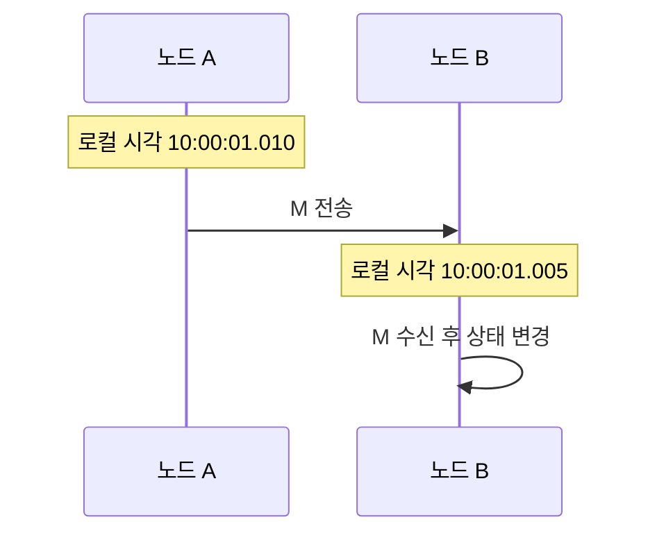

# 02. 시간, 사건, 순서

## 시각, 경과 시간, 사건 순서는 서로 다른 질문이다

분산 시스템에서 “언제?”는 세 질문으로 나뉜다. 달력에서 몇 시였는가, 얼마 동안 걸렸는가, 어느 사건이 다른 사건의 원인이 되었는가다. 한 종류의 시계로 세 질문을 모두 정확히 답할 수 없다.

**wall clock**은 사람이 읽는 날짜와 시각이다. 로그를 여러 시스템에서 대조하고 인증서 만료를 판단할 때 필요하다. 운영체제는 NTP 같은 동기화로 wall clock을 보정할 수 있다. 보정 중 시각이 빨라지거나 느려지고, 구현에 따라 뒤로 움직일 수도 있다.

**monotonic clock**은 같은 실행 환경에서 경과 시간을 재는 시계다. 값의 절대 원점은 의미가 없고 두 번 읽은 값의 차이를 사용한다. timeout과 처리 시간은 monotonic clock으로 재야 wall clock 보정의 영향을 피한다.

택배 비유에서 wall clock은 송장에 적힌 “오후 3시”이고 monotonic clock은 스톱워치의 “출발 후 12분”이다. 서로 다른 지점의 벽시계가 다르면 송장 시각만으로 실제 이동 순서를 확정하기 어렵다. 그러나 한 스톱워치로 잰 12분은 그 장치 안의 경과 시간으로 쓸 수 있다.

| 측정 목적 | 적합한 값 | 입력 | 결과 |
|---|---|---|---|
| 사용자에게 주문 시각 표시 | wall clock | 달력 시각 | 타임스탬프 |
| RPC 100 ms timeout | monotonic | 시작·현재 값 | 경과 시간 |
| 두 사건의 인과 추적 | 논리 시계 | 사건·메시지 | 순서 관계 |

## 물리 시계 오차를 숫자로 해석하기

노드 A가 10:00:00.100에 사건 a를 기록하고 B가 10:00:00.103에 사건 b를 기록했다고 하자. 두 시계의 실제 시각 오차가 각각 ±5 ms일 수 있다면 a의 실제 구간은 95~105 ms, b는 98~108 ms다. 두 구간이 겹치므로 3 ms 표시 차이만으로 실제 순서를 확정할 수 없다.

표시 차이가 30 ms이고 같은 ±5 ms 상한이 정말 보장된다면 A의 가장 늦은 105 ms보다 B의 가장 이른 125 ms가 늦다. 이때는 물리 순서를 제한할 수 있다. 핵심은 “NTP를 쓴다”가 아니라 오차 상한과 그 상한이 깨졌을 때 행동까지 알고 있어야 한다는 점이다.

| 사건 | 표시 시각 | 오차 가정 | 가능한 실제 구간 |
|---|---:|---:|---:|
| a | 100 ms | ±5 ms | 95~105 ms |
| b | 103 ms | ±5 ms | 98~108 ms |
| c | 130 ms | ±5 ms | 125~135 ms |

a와 b는 순서 미정이다. a는 c보다 앞선다고 말할 수 있다. 오차 상한이 검증되지 않았다면 이 결론도 사용할 수 없다.

## happens-before: 원인이 될 수 있는 순서

**사건(event)** 은 프로세스 내부 계산, 메시지 전송, 메시지 수신처럼 한 지점에서 일어난 변화다. Lamport의 happens-before 관계는 세 규칙으로 만든다. 같은 프로세스에서 앞 사건은 뒤 사건보다 앞선다. 메시지 전송은 그 메시지 수신보다 앞선다. 앞선 관계는 연결해서 전파된다.

A가 값을 저장한 뒤 메시지 M을 보내고, B가 M을 받은 뒤 응답 N을 보내며, A가 N을 받았다면 저장→M 전송→M 수신→N 전송→N 수신 순서가 생긴다. 두 프로세스가 서로 메시지를 주고받지 않고 각각 쓴 사건은 어느 쪽도 다른 쪽보다 앞선다고 증명되지 않으며 **concurrent(동시 사건)** 라고 한다. 여기서 동시는 물리적으로 같은 나노초라는 뜻이 아니라 인과 순서를 정할 정보가 없다는 뜻이다.

## Lamport clock을 처음부터 계산하기

**Lamport clock**은 각 프로세스가 메모리에 가진 증가 정수다. 목적은 happens-before이면 논리 값도 증가하게 만드는 것이다. 실제 초나 밀리초를 저장하지 않는다.

규칙은 다음과 같다. 지역 사건 전에 값을 1 올린다. 메시지에 현재 값을 넣는다. 수신자는 자기 값과 받은 값 중 큰 값에 1을 더한다. 수신 시 `max+1`을 쓰는 이유는 수신 사건이 자기 과거와 송신자의 사건 양쪽보다 뒤에 오게 하기 위해서다.

| 순서 | 사건 | A 값 | B 값 | 메시지 값 | 계산 |
|---:|---|---:|---:|---:|---|
| 0 | 시작 | 0 | 0 | - | 초기 |
| 1 | A 지역 쓰기 a | 1 | 0 | - | 0+1 |
| 2 | A가 M 전송 | 2 | 0 | 2 | 1+1 |
| 3 | B 지역 쓰기 b | 2 | 1 | - | 0+1 |
| 4 | B가 M 수신 | 2 | 3 | 2 | max(1,2)+1 |
| 5 | B가 N 전송 | 2 | 4 | 4 | 3+1 |
| 6 | A가 N 수신 | 5 | 4 | 4 | max(2,4)+1 |

a의 값 1은 M 수신 값 3보다 작고 실제로 happens-before다. 그러나 값 1과 3만 보고 직접 메시지 경로를 복원할 수는 없다. Lamport clock은 `a→b`이면 `L(a)<L(b)`를 보장하지만, `L(a)<L(b)`이면 반드시 `a→b`라는 역은 보장하지 않는다.

동일한 Lamport 값이 서로 다른 프로세스에 생길 수 있다. 전체 로그 정렬이 필요하면 `(Lamport 값, 프로세스 ID)`처럼 tie-breaker를 붙일 수 있다. 이 정렬은 결정적 전체 순서를 만들지만, tie-breaker 순서가 새로운 인과 사실을 만드는 것은 아니다.

## 벡터 시계가 동시 사건을 구별하는 방법

**vector clock**은 참여 프로세스마다 한 성분을 가진 정수 배열이다. 세 프로세스 A,B,C라면 `[A가 안다고 보는 A 사건 수, B 사건 수, C 사건 수]`처럼 읽는다. 각 프로세스는 자기 성분을 올리고, 메시지 수신자는 성분별 최댓값을 취한 뒤 자기 성분을 올린다.

벡터 X가 Y보다 앞서려면 모든 성분에서 `X[i]≤Y[i]`이고 적어도 한 성분은 작아야 한다. 어떤 성분은 X가 크고 다른 성분은 Y가 크면 두 벡터는 concurrent다.

| 순서 | 사건 | A 벡터 | B 벡터 | C 벡터 |
|---:|---|---|---|---|
| 0 | 시작 | [0,0,0] | [0,0,0] | [0,0,0] |
| 1 | A가 a 수행 | [1,0,0] | [0,0,0] | [0,0,0] |
| 2 | B가 b 수행 | [1,0,0] | [0,1,0] | [0,0,0] |
| 3 | A가 C로 전송 | [2,0,0] | [0,1,0] | [0,0,0] |
| 4 | C가 수신 | [2,0,0] | [0,1,0] | [2,0,1] |
| 5 | B가 C로 전송 | [2,0,0] | [0,2,0] | [2,0,1] |
| 6 | C가 수신 | [2,0,0] | [0,2,0] | [2,2,2] |

a의 `[1,0,0]`과 b의 `[0,1,0]`은 각자 큰 성분이 있어 concurrent다. 둘 다 C의 마지막 `[2,2,2]`보다 작으므로 C의 마지막 수신보다 앞선다.

세 프로세스에서는 배열 세 칸이면 되지만 참여자가 10,000개이고 계속 가입·탈퇴한다면 메타데이터가 커진다. 실제 시스템은 버전 벡터를 replica 단위로 줄이거나, dotted version vector처럼 표현을 바꾸거나, 중앙 순서 서비스를 택할 수 있다. 벡터 시계가 모든 규모에서 공짜인 해결책은 아니다.

## 두 업무 사례에서 순서가 결과를 바꾸는 이유

첫 사례는 숫자 5에 명령 `+3`과 `×2`를 적용하는 것이다. `+3` 뒤 `×2`는 `(5+3)×2=16`이다. `×2` 뒤 `+3`은 `5×2+3=13`이다. 명령이 **비가환(non-commutative)** 이므로 복제본이 다른 순서로 적용하면 상태가 갈라진다. 합의 로그가 전체 순서를 정하는 이유다.

둘째 사례는 협업 문서의 서로 다른 두 문단 편집이다. A가 첫 문단을 고치고 B가 마지막 문단을 고쳤으며 서로 인과가 없다면 두 변경은 합칠 수 있다. 무조건 전체 순서를 기다리는 대신 concurrent임을 보존하고 애플리케이션 병합 규칙을 사용할 수 있다.

| 업무 | 사건 관계 | 순서가 결과에 미치는 영향 | 가능한 처리 |
|---|---|---|---|
| 같은 숫자에 +3, ×2 | 동시 입력 가능 | 16 또는 13 | 전체 순서 합의 |
| 서로 다른 문단 편집 | concurrent | 자동 병합 가능 | 인과 메타데이터 |
| 게시물 P 뒤 댓글 C | P→C | C만 보이면 의미 손상 | 인과 순서 보존 |

## wall time과 논리 시간을 섞은 반례

서버 A의 wall clock이 실제보다 500 ms 빠르다고 하자. A의 로그 timestamp가 B보다 크더라도 사건이 실제로 나중이라는 보장은 없다. “가장 큰 timestamp의 쓰기가 승리” 규칙은 시계가 튄 한 서버가 오랫동안 다른 정상 쓰기를 덮게 만들 수 있다.

반대로 Lamport 값 100과 110의 차이를 10초로 해석해도 틀린다. 한 프로세스가 짧은 시간에 사건 열 번을 만들었을 수 있다. 논리 시계는 순서를 돕고, monotonic clock은 경과를 재며, wall clock은 달력 위치를 제공한다.

## 연습 문제와 완전 해설

### 1. monotonic 시작값이 12.200초, 종료값이 12.350초라면 경과 시간은?

`12.350-12.200=0.150초`, 즉 150 ms다. 같은 동안 wall clock이 NTP 보정으로 200 ms 뒤로 갔더라도 timeout 계산에는 monotonic 차이를 사용한다.

### 2. B의 Lamport 값이 7인데 값 4인 메시지를 받았다. 새 값은?

`max(7,4)+1=8`이다. 받은 값에만 1을 더해 5로 만들면 B의 이미 일어난 값 7보다 뒤로 가므로 규칙을 위반한다. 수신 사건은 양쪽 과거보다 커야 한다.

### 3. X=`[3,1,2]`, Y=`[3,2,2]`의 관계는?

X의 모든 성분이 Y 이하이고 B 성분 `1<2`가 엄격히 작으므로 X→Y다. X를 `[4,1,2]`로 바꾸면 A 성분은 X가 크고 B 성분은 Y가 커서 어느 쪽도 성분별 이하가 아니다. 이 경우 concurrent다.

### 4. A의 표시 100 ms, B의 표시 106 ms이고 각 오차가 ±5 ms라면 실제 순서를 확정할 수 있는가?

A의 실제 구간은 95~105 ms, B는 101~111 ms다. 구간이 101~105 ms에서 겹치므로 확정할 수 없다. 표시 차이가 오차 폭의 합보다 충분히 커야 구간이 분리된다.

### 5. Lamport clock으로 concurrent를 정확히 판별할 수 있는가?

일반적으로 없다. 서로 독립인 사건도 tie-breaker 때문에 한쪽 값이 작을 수 있다. Lamport clock은 인과가 있으면 값 순서가 있다는 한 방향 성질을 준다. 동시성 판별이 필요하면 vector clock처럼 더 많은 인과 정보를 보존해야 한다.

## 물리 시계와 경과 시간

wall clock은 “2026-10-11 10:00” 같은 달력 시각이다. 운영체제가 NTP로 보정하면 앞으로 또는 뒤로 움직일 수 있다. monotonic clock은 같은 프로세스에서 경과 시간을 재기 위한 비감소 값이다. timeout은 monotonic clock으로 계산해야 한다.

| 측정 | 시작 | 끝 | 계산 |
|---|---:|---:|---|
| monotonic | 12.200 s | 12.350 s | 150 ms |
| wall clock 보정 전후 | 10:00:00.100 | 09:59:59.950 | -150 ms |

wall clock 차이가 2 ms라고 두 사건의 순서를 확정할 수 없다. 두 노드 오차가 각각 ±5 ms라면 실제 순서 범위가 겹친다. 오차 상한을 검증하지 않았다면 timestamp 정렬은 인과 증명이 아니다.

## Lamport clock을 사건마다 계산하기

각 프로세스는 지역 사건 전에 값을 1 올린다. 메시지에는 현재 값을 넣는다. 수신자는 `max(자기 값, 받은 값)+1`로 갱신한다.

| 사건 | A 값 | B 값 | 설명 |
|---|---:|---:|---|
| 시작 | 0 | 0 | 초기 |
| A 지역 쓰기 | 1 | 0 | A+1 |
| A가 M 전송 | 2 | 0 | M에 2 |
| B 지역 쓰기 | 2 | 1 | B+1 |
| B가 M 수신 | 2 | 3 | max(1,2)+1 |
| B 응답 전송 | 2 | 4 | B+1 |
| A 응답 수신 | 5 | 4 | max(2,4)+1 |

M 전송 값 2는 수신 값 3보다 작다. 반대 방향은 성립하지 않는다. 값이 작다는 사실만으로 두 사건 사이에 메시지 경로가 있었다고 역추론할 수 없다.

## 세 프로세스 벡터 시계

vector clock `[A,B,C]`는 각 프로세스가 알고 있는 사건 수를 성분별로 담는다. 지역 사건에서 자기 성분을 올리고, 수신 시 성분별 최댓값을 취한 뒤 자기 성분을 올린다.

| 사건 | A | B | C |
|---|---|---|---|
| A가 a 수행 | [1,0,0] | [0,0,0] | [0,0,0] |
| B가 b 수행 | [1,0,0] | [0,1,0] | [0,0,0] |
| A→C 전송 | [2,0,0] | [0,1,0] | [0,0,0] |
| C 수신 | [2,0,0] | [0,1,0] | [2,0,1] |
| B→C 전송·수신 | [2,0,0] | [0,2,0] | [2,2,2] |

`[1,0,0]`과 `[0,1,0]`은 각자 큰 성분이 있어 concurrent다. 둘 다 `[2,2,2]`보다 성분별로 작으므로 C의 마지막 수신보다 앞선다. 참여자가 1,000개로 늘고 자주 교체되면 벡터 크기와 성분 수거가 큰 비용이라는 반례가 생긴다.

## 계산 문제와 완전 해설

### 문제 A: 수신 값

로컬 값 7인 B가 값 4 메시지를 받으면 `max(7,4)+1=8`이다. 받은 값에 단순 1을 더해 5로 만들면 B의 이미 일어난 사건 순서가 뒤로 간다.

### 문제 B: 벡터 비교

X=`[3,1,2]`, Y=`[3,2,2]`이면 X의 모든 성분이 Y 이하이고 B 성분이 작으므로 X→Y다. X=`[4,1,2]`로 바꾸면 A는 X가 크고 B는 Y가 커서 concurrent다.

### 문제 C: 비가환 명령

초기값 5에 `+3` 뒤 `×2`는 16이다. 순서를 바꾸면 13이다. 모든 복제본이 같은 결과를 내려면 두 명령의 전체 순서를 합의해야 한다. 단순 읽기처럼 교환 가능한 작업이면 전체 순서 비용을 피할 여지가 있다.

[← 이전 장](01-rpc-and-message-delivery.md) · [목차](README.md) · [다음 장 →](03-replication-and-consistency.md)

## 시계와 사건

**사건(event)** 은 메시지 전송, 수신, 상태 변경처럼 한 지점에서 일어난 일이다.
**wall clock** 은 달력 시각을 나타낸다.
**monotonic clock** 은 경과 시간 측정 중 뒤로 가지 않는 로컬 시계다.
서로 다른 컴퓨터의 wall clock은 정확히 같지 않다.
NTP 보정, 발진기 오차, 가상화 일시 정지가 차이를 만든다.

B의 표시 시각이 더 이르다고 수신이 전송보다 먼저 일어난 것은 아니다.
메시지 전송은 반드시 그 메시지 수신보다 앞선다.
이 인과 관계를 **happens-before** 관계라고 부른다.

## 논리 시계

**Lamport clock** 은 사건마다 증가하는 정수다.
지역 사건 때 1을 더하고 메시지에 값을 넣는다.
수신자는 자신의 값과 받은 값 중 큰 값에 1을 더한다.
A가 4에서 보내고 B가 7에서 받으면 B는 8이 된다.
값이 작다고 반드시 직접 원인이라고 역추론할 수는 없다.

**vector clock** 은 노드별 카운터 벡터다.
[2,1]과 [3,1]이면 첫 사건이 앞선다.
[2,3]과 [3,2]는 어느 쪽도 모든 성분이 작지 않아 동시 사건이다.

## 작은 추적

A와 B는 [0,0]에서 시작한다.
A가 쓰면 [1,0]이다.
B가 독립 쓰기를 하면 [0,1]이다.
A의 메시지를 B가 받으면 max 뒤 B 성분을 올려 [1,2]가 된다.
전체 순서는 모든 두 사건의 앞뒤를 정한다.
부분 순서는 인과가 있는 사건만 정한다.

## 반례

timestamp가 크다고 항상 나중 업무 사건은 아니다.
Lamport 값으로 실제 초 차이를 계산할 수 없다.
vector clock이 동시라고 물리적으로 같은 순간이라는 뜻도 아니다.

## 점검 문제

### 1. timeout 측정에는 어떤 시계가 적합한가?
뒤로 가지 않는 monotonic clock이다.

### 2. Lamport clock은 실제 초인가?
아니다. 인과 순서를 보조하는 논리 정수다.

### 3. 전체 순서는 언제 필요한가?
모든 복제본이 같은 비가환 명령을 같은 순서로 적용해야 할 때다.

## 공식 자료

- [Lamport, Time, Clocks, and the Ordering of Events](https://lamport.azurewebsites.net/pubs/time-clocks.pdf)

[← 이전 장](01-rpc-and-message-delivery.md) · [목차](README.md) · [다음 장 →](03-replication-and-consistency.md)
