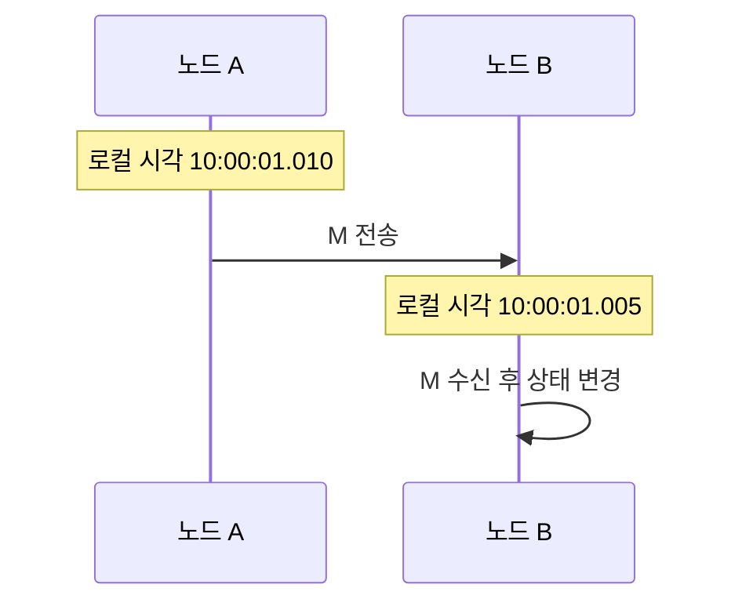

# 02. 시간, 사건, 순서

## 물리 시계와 경과 시간

wall clock은 “2026-10-11 10:00” 같은 달력 시각이다. 운영체제가 NTP로 보정하면 앞으로 또는 뒤로 움직일 수 있다. monotonic clock은 같은 프로세스에서 경과 시간을 재기 위한 비감소 값이다. timeout은 monotonic clock으로 계산해야 한다.

| 측정 | 시작 | 끝 | 계산 |
|---|---:|---:|---|
| monotonic | 12.200 s | 12.350 s | 150 ms |
| wall clock 보정 전후 | 10:00:00.100 | 09:59:59.950 | -150 ms |

wall clock 차이가 2 ms라고 두 사건의 순서를 확정할 수 없다. 두 노드 오차가 각각 ±5 ms라면 실제 순서 범위가 겹친다. 오차 상한을 검증하지 않았다면 timestamp 정렬은 인과 증명이 아니다.

## Lamport clock을 사건마다 계산하기

각 프로세스는 지역 사건 전에 값을 1 올린다. 메시지에는 현재 값을 넣는다. 수신자는 `max(자기 값, 받은 값)+1`로 갱신한다.

| 사건 | A 값 | B 값 | 설명 |
|---|---:|---:|---|
| 시작 | 0 | 0 | 초기 |
| A 지역 쓰기 | 1 | 0 | A+1 |
| A가 M 전송 | 2 | 0 | M에 2 |
| B 지역 쓰기 | 2 | 1 | B+1 |
| B가 M 수신 | 2 | 3 | max(1,2)+1 |
| B 응답 전송 | 2 | 4 | B+1 |
| A 응답 수신 | 5 | 4 | max(2,4)+1 |

M 전송 값 2는 수신 값 3보다 작다. 반대 방향은 성립하지 않는다. 값이 작다는 사실만으로 두 사건 사이에 메시지 경로가 있었다고 역추론할 수 없다.

## 세 프로세스 벡터 시계

vector clock `[A,B,C]`는 각 프로세스가 알고 있는 사건 수를 성분별로 담는다. 지역 사건에서 자기 성분을 올리고, 수신 시 성분별 최댓값을 취한 뒤 자기 성분을 올린다.

| 사건 | A | B | C |
|---|---|---|---|
| A가 a 수행 | [1,0,0] | [0,0,0] | [0,0,0] |
| B가 b 수행 | [1,0,0] | [0,1,0] | [0,0,0] |
| A→C 전송 | [2,0,0] | [0,1,0] | [0,0,0] |
| C 수신 | [2,0,0] | [0,1,0] | [2,0,1] |
| B→C 전송·수신 | [2,0,0] | [0,2,0] | [2,2,2] |

`[1,0,0]`과 `[0,1,0]`은 각자 큰 성분이 있어 concurrent다. 둘 다 `[2,2,2]`보다 성분별로 작으므로 C의 마지막 수신보다 앞선다. 참여자가 1,000개로 늘고 자주 교체되면 벡터 크기와 성분 수거가 큰 비용이라는 반례가 생긴다.

## 계산 문제와 완전 해설

### 문제 A: 수신 값

로컬 값 7인 B가 값 4 메시지를 받으면 `max(7,4)+1=8`이다. 받은 값에 단순 1을 더해 5로 만들면 B의 이미 일어난 사건 순서가 뒤로 간다.

### 문제 B: 벡터 비교

X=`[3,1,2]`, Y=`[3,2,2]`이면 X의 모든 성분이 Y 이하이고 B 성분이 작으므로 X→Y다. X=`[4,1,2]`로 바꾸면 A는 X가 크고 B는 Y가 커서 concurrent다.

### 문제 C: 비가환 명령

초기값 5에 `+3` 뒤 `×2`는 16이다. 순서를 바꾸면 13이다. 모든 복제본이 같은 결과를 내려면 두 명령의 전체 순서를 합의해야 한다. 단순 읽기처럼 교환 가능한 작업이면 전체 순서 비용을 피할 여지가 있다.

[← 이전 장](01-rpc-and-message-delivery.md) · [목차](README.md) · [다음 장 →](03-replication-and-consistency.md)

## 시계와 사건

**사건(event)** 은 메시지 전송, 수신, 상태 변경처럼 한 지점에서 일어난 일이다.
**wall clock** 은 달력 시각을 나타낸다.
**monotonic clock** 은 경과 시간 측정 중 뒤로 가지 않는 로컬 시계다.
서로 다른 컴퓨터의 wall clock은 정확히 같지 않다.
NTP 보정, 발진기 오차, 가상화 일시 정지가 차이를 만든다.

B의 표시 시각이 더 이르다고 수신이 전송보다 먼저 일어난 것은 아니다.
메시지 전송은 반드시 그 메시지 수신보다 앞선다.
이 인과 관계를 **happens-before** 관계라고 부른다.

## 논리 시계

**Lamport clock** 은 사건마다 증가하는 정수다.
지역 사건 때 1을 더하고 메시지에 값을 넣는다.
수신자는 자신의 값과 받은 값 중 큰 값에 1을 더한다.
A가 4에서 보내고 B가 7에서 받으면 B는 8이 된다.
값이 작다고 반드시 직접 원인이라고 역추론할 수는 없다.

**vector clock** 은 노드별 카운터 벡터다.
[2,1]과 [3,1]이면 첫 사건이 앞선다.
[2,3]과 [3,2]는 어느 쪽도 모든 성분이 작지 않아 동시 사건이다.

## 작은 추적

A와 B는 [0,0]에서 시작한다.
A가 쓰면 [1,0]이다.
B가 독립 쓰기를 하면 [0,1]이다.
A의 메시지를 B가 받으면 max 뒤 B 성분을 올려 [1,2]가 된다.
전체 순서는 모든 두 사건의 앞뒤를 정한다.
부분 순서는 인과가 있는 사건만 정한다.

## 반례

timestamp가 크다고 항상 나중 업무 사건은 아니다.
Lamport 값으로 실제 초 차이를 계산할 수 없다.
vector clock이 동시라고 물리적으로 같은 순간이라는 뜻도 아니다.

## 점검 문제

### 1. timeout 측정에는 어떤 시계가 적합한가?
뒤로 가지 않는 monotonic clock이다.

### 2. Lamport clock은 실제 초인가?
아니다. 인과 순서를 보조하는 논리 정수다.

### 3. 전체 순서는 언제 필요한가?
모든 복제본이 같은 비가환 명령을 같은 순서로 적용해야 할 때다.

## 공식 자료

- [Lamport, Time, Clocks, and the Ordering of Events](https://lamport.azurewebsites.net/pubs/time-clocks.pdf)

[← 이전 장](01-rpc-and-message-delivery.md) · [목차](README.md) · [다음 장 →](03-replication-and-consistency.md)
