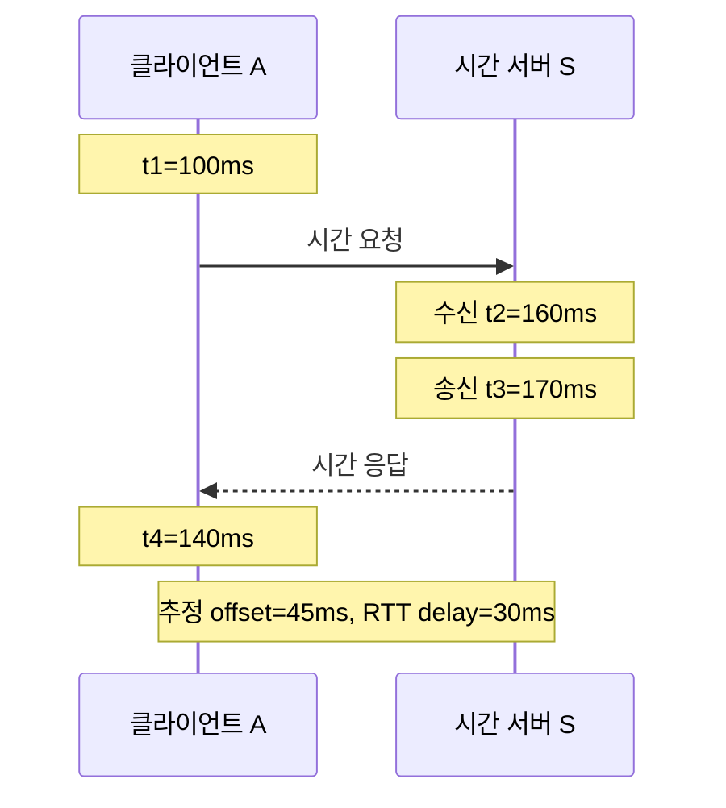

# 02. 시간, 사건, 순서

분산 시스템에서 “먼저”라는 말은 하나의 뜻만 갖지 않는다. 사용자 A의 결제가 달력상 몇 시에 끝났는지, 요청이 몇 밀리초 걸렸는지, 데이터 쓰기 `x`가 메시지 `m`의 원인이었는지, 두 복제본 중 어느 변경을 먼저 적용할지를 묻는 질문은 서로 다르다. 이 장은 세 프로세스 A, B, C에서 일어나는 사건을 물리 시계, Lamport 시계, 벡터 시계로 모두 기록한다. 각 시계가 답할 수 있는 질문과 답할 수 없는 질문을 구분하는 것이 목표다.

## 시계보다 먼저 “무엇을 측정하는가”를 정한다

**사건(event)**은 한 프로세스에서 상태가 바뀌는 한 지점이다. 지역 계산, 파일 기록, 메시지 전송, 메시지 수신을 각각 하나의 사건으로 볼 수 있다. 사건은 로그 한 줄과 비슷하지만 로그 기록 자체도 별도 사건일 수 있다. 이 장에서는 애플리케이션이 이름 붙인 `e1`, `e2` 같은 사건을 추적한다.

**물리 시계(physical clock)**는 수정 발진기나 하드웨어 타이머가 만든 주기적인 신호를 세어 시간 값을 제공하는 장치와 운영체제 기능을 뜻한다. 현실의 초와 연결하려고 하지만 완벽하지 않다. 서버마다 발진기의 속도가 조금씩 다르고, 온도와 노화, 가상화 정지, 동기화 보정의 영향을 받는다. 물리 시계에서 사용자가 읽는 날짜와 시각을 **벽시계(wall clock)**라고 한다. `2026-10-11 13:00:00.125 KST` 같은 값이다. 로그 대조, 인증서 만료, 사용자 화면에는 필요하지만 운영체제나 시간 동기화 프로그램이 값을 앞이나 뒤로 조정할 수 있다.

**단조 시계(monotonic clock)**는 같은 운영체제 실행 생애 안에서 앞의 읽기보다 뒤의 읽기가 작아지지 않도록 제공하는 경과 시간용 시계다. 원점이 “부팅 뒤 3812.4초”처럼 임의이므로 다른 서버의 값과 직접 비교하지 않는다. 요청 시작이 `812.120s`, 종료가 `812.275s`이면 경과는 `0.155s = 155ms`다. 리눅스의 `CLOCK_MONOTONIC`은 벽시계의 갑작스러운 변경에는 영향을 받지 않지만 점진적 NTP 보정의 영향을 받고, 시스템 절전 시간은 세지 않는다. 절전까지 포함해야 하면 `CLOCK_BOOTTIME`처럼 의미가 다른 시계를 검토해야 한다. “단조”는 정확한 UTC나 모든 환경에서 같은 속도를 뜻하지 않는다.

**오프셋(offset, 시각 차이)**은 같은 실제 순간에 두 시계가 표시하는 값의 차이다. 실제 시각이 10:00:00.000일 때 A가 10:00:00.004를 표시하면 A는 4ms 빠르다. **드리프트(drift, 진행률 오차)**는 시간이 흐르며 그 차이가 얼마나 빨리 변하는가다. 20ppm은 100만 초당 20초, 또는 1초당 20마이크로초의 진행률 차이다. 동기화 뒤 1시간인 `3,600s` 동안 보정하지 않으면 `3,600 × 20×10^-6 = 0.072s = 72ms`까지 차이가 자랄 수 있다. A가 +20ppm, B가 -20ppm이면 둘 사이 상대 차이는 40ppm이어서 같은 한 시간에 144ms까지 벌어질 수 있다. 이는 교육용 계산이며 특정 장비의 보장값이 아니다.

**정확도(accuracy)**는 표시값이 UTC 같은 기준에 얼마나 가까운지, **정밀도(precision)**는 반복 측정값이 얼마나 촘촘하고 일관적인지다. 나노초 단위로 표시하는 시계도 기준에서 2초 틀리면 해상도는 높아도 정확하지 않다. 반대로 오차 범위를 ±10ms로 보장하는 값은 소수점 아홉 자리가 없어도 그 범위 안의 판단에 쓸 수 있다.

| 질문 | 적합한 값 | 저장 위치와 수명 | 직접 답하지 못하는 것 |
|---|---|---|---|
| 사용자가 본 주문 시각은 언제인가 | 벽시계 타임스탬프 | 로그·DB에 오래 저장 | 서로 다른 노드 사건의 확정 인과 |
| RPC가 200ms를 넘었는가 | 같은 노드의 단조 시계 차이 | 프로세스 타이머가 요청 동안 관리 | 다른 노드와의 달력 시각 |
| 사건 x가 y의 원인이 될 수 있는가 | 메시지와 프로그램 순서, 논리 시계 | 프로세스 메모리와 메시지 메타데이터 | 실제로 몇 초 떨어졌는가 |
| 모든 복제본이 같은 적용 순서를 써야 하는가 | 합의한 로그 순서 또는 결정적 전체 순서 | 복제 로그가 내구성 있게 관리 | 그 순서가 자연 발생한 인과인지 여부 |

## 벽시계 숫자에는 오차 구간을 붙여 읽는다

A 로그의 시각이 `10:00:00.100`, 보장된 오차가 ±5ms라면 실제 사건 시각은 기준에 대해 95ms부터 105ms 사이일 수 있다. B의 기록이 103ms이고 역시 ±5ms라면 가능한 구간은 98~108ms다. 두 구간이 98~105ms에서 겹치므로 표시값이 3ms 작다는 이유로 A가 먼저라고 확정할 수 없다.

반면 C의 사건이 130ms, 오차가 ±5ms라면 구간은 125~135ms다. A의 가장 늦은 가능 시각 105ms가 C의 가장 이른 가능 시각 125ms보다 이르다. 오차 상한이 실제로 지켜졌다는 조건 아래 A가 C보다 먼저라고 제한할 수 있다. “NTP를 켰다”는 설정 이름만으로 ±5ms를 보장하지 않는다. 동기화 상태, 현재 오프셋과 분산, 마지막 정상 동기화 시점, 네트워크 경로, 호스트 정지를 관측해야 한다.

| 사건 | 표시 시각 | 주장한 오차 | 가능한 실제 구간 | 물리 순서 판정 |
|---|---:|---:|---:|---|
| a | 100ms | ±5ms | 95~105ms | b와 겹쳐 미정 |
| b | 103ms | ±5ms | 98~108ms | a와 겹쳐 미정 |
| c | 130ms | ±5ms | 125~135ms | a와 b 뒤 |
| d | 90ms | 오차 상한 없음 | 알 수 없음 | 다른 사건과 확정 불가 |

시계가 한 번 동기화됐더라도 드리프트 때문에 불확실성은 시간과 함께 커진다. 마지막 동기화 때 오차가 ±2ms이고 이후 최대 드리프트가 20ppm이며 500초가 지났다면 드리프트 몫은 `500 × 20µs = 10,000µs = 10ms`다. 다른 오차를 무시한 단순 상한은 ±12ms다. 마지막 보정 시각을 버리고 타임스탬프 숫자만 저장하면 나중에 이 판단을 재구성할 수 없다.

## NTP는 왕복 측정으로 오프셋을 추정한다

**NTP(Network Time Protocol)**는 컴퓨터 시계를 시간 서버와 맞추기 위한 인터넷 표준 프로토콜이다. 이름만으로 “정확해졌다”고 가정하지 않고, 한 번의 교환에서 어떤 값을 관측하는지 계산해 보자. 클라이언트 A와 시간 서버 S는 네 개의 타임스탬프를 사용한다.

1. A가 요청을 보낼 때 A 시계로 `t1=100ms`를 기록한다.
2. S가 요청을 받을 때 S 시계로 `t2=160ms`를 기록한다.
3. S가 응답을 보낼 때 S 시계로 `t3=170ms`를 기록한다.
4. A가 응답을 받을 때 A 시계로 `t4=140ms`를 기록한다.

NTP의 오프셋 추정은 `θ = ((t2-t1) + (t3-t4)) / 2`다. 숫자를 넣으면 `((160-100) + (170-140))/2 = (60+30)/2 = 45ms`다. 이 부호 규칙에서는 서버 S가 클라이언트 A보다 약 45ms 앞선다고 추정한다. 왕복 네트워크 지연은 `δ = (t4-t1) - (t3-t2)`이고, `(140-100) - (170-160) = 40-10 = 30ms`다. S 내부 처리 10ms를 왕복 네트워크 시간에서 뺀 결과다.

이 계산에는 요청과 응답의 편도 지연이 비슷하다는 **대칭 가정**이 숨어 있다. 실제로 A→S가 25ms, S→A가 5ms이고 S 시계의 참 오프셋이 +35ms라고 하자. 요청은 실제 100ms에 출발해 125ms에 도착하므로 S는 160ms를 찍는다. S가 실제 135ms에 응답을 보내면 S는 170ms를 찍고, 5ms 뒤 A가 140ms를 찍는다. 관측 네 값은 위와 완전히 같지만 계산은 +45ms를 낸다. 실제 +35ms보다 10ms 큰데, 이는 편도 비대칭 `(25-5)/2 = 10ms`가 오프셋으로 섞였기 때문이다. 왕복 시간만 보고 어느 방향이 더 느렸는지는 알 수 없다.

실제 NTP 구현은 여러 서버와 여러 표본을 사용하고, 지연·분산·지터를 평가하며 이상 표본을 걸러 시계를 급격히 뛰게 하거나 천천히 조정한다. 그래도 애플리케이션이 얻는 것은 조건부 추정이다. 비대칭 라우팅, 큐잉, 가상 머신 정지, 잘못된 시간원, 인증되지 않은 응답은 오차를 키운다. RFC 5905는 오프셋과 왕복 지연뿐 아니라 분산과 지터를 함께 모델링한다. 운영 코드는 “현재 동기화됨”과 “현재 허용 오차 안”을 구분해야 한다.

## PTP가 더 정밀해도 인과관계를 대신하지 않는다

**PTP(Precision Time Protocol, 정밀 시간 프로토콜)**는 IEEE 1588 계열 표준으로, 제어된 네트워크에서 장치 시계를 정밀하게 맞추도록 설계됐다. PTP 도메인은 기준이 되는 grandmaster와 이를 따르는 시계들로 구성된다. 메시지가 운영체제 소프트웨어 스택을 지나는 임의 시각 대신 네트워크 인터페이스 가까이에서 하드웨어 타임스탬프를 찍을 수 있고, transparent clock은 스위치 내부 체류 시간을 보정 정보로 전달하며, boundary clock은 구간별 동기화를 중계할 수 있다. 이 구조는 소프트웨어 큐잉 변동을 줄인다.

그러나 PTP도 빛의 속도를 없애거나 모든 경로를 자동으로 대칭으로 만들지는 않는다. 정방향 광섬유 경로와 역방향 경로의 길이가 다르거나, 송수신 회로 지연이 다르거나, 큐가 한 방향에만 생기면 지연 비대칭이 오프셋 오차로 들어간다. IEEE는 지연·비대칭 보정 확장을 계속 다루고 있으며, NIST 자료도 경로 비대칭이 보정되지 않는 오차를 만든다고 설명한다. 따라서 PTP의 높은 정밀도 수치를 다른 토폴로지에 복사하면 안 된다. 실제 하드웨어, 경로, grandmaster, holdover 상태를 교정하고 측정해야 한다.

NTP와 PTP는 “실제 시각에 가까운 값”을 만드는 도구다. 메시지 `m`의 전송이 수신보다 앞선다는 사실은 프로토콜 의미에서 이미 참이며, 수신 서버의 시계가 뒤처져 더 작은 숫자를 기록해도 바뀌지 않는다. 반대로 두 노드의 PTP 시각이 1ns 차이라고 해서 한 사건이 다른 사건의 원인이라는 뜻도 아니다. 물리 순서와 인과 순서는 다른 관계다.

## happened-before는 원인이 전달될 수 있는 길을 표시한다

**happened-before(발생 선행 관계, `→`)**는 한 사건의 정보나 영향이 다른 사건에 전달될 수 있는지를 나타내는 부분 순서다. Lamport가 제시한 관계는 세 규칙으로 만든다.

1. 같은 프로세스 안에서 프로그램 순서상 `x`가 `y`보다 먼저면 `x→y`다.
2. 메시지 전송 `send(m)`은 그 메시지 수신 `receive(m)`보다 먼저다.
3. `x→y`이고 `y→z`이면 추이성에 의해 `x→z`다.

두 사건 `x`, `y`에 대해 `x→y`도 아니고 `y→x`도 아니면 **동시 사건(concurrent events)**이라고 부른다. 여기서 동시는 같은 나노초에 실행됐다는 뜻이 아니다. 현재 모델의 프로그램 순서와 메시지 경로만으로 어느 쪽 영향이 다른 쪽에 도달했다고 증명할 수 없다는 뜻이다. 실제로 10초 떨어져 실행됐어도 사이에 정보 전달 경로가 없으면 인과적으로 동시일 수 있다.

**부분 순서(partial order)**는 모든 두 사건의 앞뒤를 억지로 정하지 않는 순서다. 반대로 **전체 순서(total order)**는 임의의 두 사건마다 하나를 먼저 놓는다. 복제본이 비가환 명령을 같은 순서로 적용할 때는 합의 로그나 결정적 tie-breaker로 전체 순서가 필요할 수 있다. 그러나 전체 순서에서 `x`를 `y` 앞에 놓았다는 사실이 `x`가 `y`의 원인이라는 뜻은 아니다.

## 세 프로세스, 열두 사건의 모든 시계를 계산한다

A, B, C의 Lamport 시계는 모두 0, 벡터 시계는 모두 `[0,0,0]`에서 시작한다. 벡터 성분 순서는 `[A,B,C]`다. Lamport 규칙은 지역·송신 사건에서 1 증가하고, 수신 사건에서 `max(내 값, 메시지 값)+1`을 적용한다. 벡터 규칙은 지역·송신 사건에서 자기 성분을 1 증가시키고, 수신 때 메시지 벡터와 성분별 최댓값을 취한 뒤 수신자의 성분을 1 증가시킨다.

| 번호 | 프로세스와 사건 | Lamport 전→후 | 벡터 전→후 | 메시지에 실린 값 |
|---:|---|---|---|---|
| e1 | A가 문서 x를 지역 수정 | `0→1` | `[0,0,0]→[1,0,0]` | 없음 |
| e2 | B가 문서 y를 독립 수정 | `0→1` | `[0,0,0]→[0,1,0]` | 없음 |
| e3 | A가 B로 `m1` 전송 | `1→2` | `[1,0,0]→[2,0,0]` | `L=2, V=[2,0,0]` |
| e4 | C가 지역 캐시 정리 | `0→1` | `[0,0,0]→[0,0,1]` | 없음 |
| e5 | B가 `m1` 수신 | `max(1,2)+1=3` | `max([0,1,0],[2,0,0])+B증가=[2,2,0]` | m1 |
| e6 | B가 C로 `m2` 전송 | `3→4` | `[2,2,0]→[2,3,0]` | `L=4, V=[2,3,0]` |
| e7 | A가 C로 `m3` 전송 | `2→3` | `[2,0,0]→[3,0,0]` | `L=3, V=[3,0,0]` |
| e8 | C가 먼저 도착한 `m3` 수신 | `max(1,3)+1=4` | `max([0,0,1],[3,0,0])+C증가=[3,0,2]` | m3 |
| e9 | C가 늦게 도착한 `m2` 수신 | `max(4,4)+1=5` | `max([3,0,2],[2,3,0])+C증가=[3,3,3]` | m2 |
| e10 | C가 A로 `m4` 전송 | `5→6` | `[3,3,3]→[3,3,4]` | `L=6, V=[3,3,4]` |
| e11 | A가 `m4` 수신 | `max(3,6)+1=7` | `max([3,0,0],[3,3,4])+A증가=[4,3,4]` | m4 |
| e12 | B가 m2 전송 뒤 지역 백업 | `4→5` | `[2,3,0]→[2,4,0]` | 없음 |

표에서 `max`는 각 벡터 성분에 따로 적용한다. e9를 예로 들면 C의 기존 `[3,0,2]`와 m2의 `[2,3,0]`을 합쳐 `[3,3,2]`를 만든 뒤 C 성분을 올려 `[3,3,3]`이 된다. 벡터 전체를 사전식으로 비교해 큰 하나를 고르는 계산이 아니다.

프로그램 순서와 메시지를 연결하면 `e1→e3→e5→e6→e9→e10→e11`이다. 또 `e3→e7→e8→e9`이고, `e4→e8`이다. 따라서 e1은 e11보다 앞선다. 중간 메시지 여러 개를 거쳤어도 추이성이 관계를 전달한다.

e1의 벡터 `[1,0,0]`과 e2의 `[0,1,0]`을 비교하면 A 성분은 e1이 크고 B 성분은 e2가 크다. 어느 벡터도 다른 벡터의 모든 성분 이하가 아니므로 둘은 동시다. e6의 `[2,3,0]`과 e7의 `[3,0,0]`도 같은 이유로 동시다. 둘은 공통 과거 e3를 갖지만, e3 이후 어느 가지가 다른 가지의 결과를 보지는 못했다.

e8의 `[3,0,2]`와 e12의 `[2,4,0]`도 동시다. C는 A 쪽 지식을 더 많이 가졌고 B의 e5 이후 지식은 아직 받지 못했다. B는 자기 사건을 더 많이 알지만 C의 사건은 모른다. 물리적으로 e8이 먼저 실행됐는지 e12가 먼저 실행됐는지는 이 벡터 관계의 질문이 아니다.

## Lamport 시계는 인과를 보존하지만 동시성을 판별하지 못한다

**Lamport 시계(Lamport clock)**는 각 프로세스가 관리하는 증가 정수다. 목적은 `x→y`이면 반드시 `L(x)<L(y)`가 되게 하는 것이다. 표에서 e3의 값 2는 e5의 값 3보다 작고, e6의 4는 e9의 5보다 작다. 수신 때 `max+1`을 쓰므로 수신 사건은 수신자의 과거와 송신자의 과거 양쪽보다 커진다.

그러나 역은 성립하지 않는다. e2의 Lamport 값은 1, e7은 3이지만 e2에서 e7로 가는 메시지 경로가 없으므로 `e2→e7`이라고 결론 낼 수 없다. 숫자가 작은 것은 필요조건을 만족할 뿐 원인 경로의 증거가 아니다. 같은 값도 여러 프로세스에서 생긴다. e1, e2, e4는 모두 1이다.

로그를 한 줄로 정렬해야 하면 `(Lamport 값, 프로세스 ID)`를 사용할 수 있다. 예를 들어 ID 순서가 A<B<C라면 e1, e2, e4를 A, B, C 순으로 놓는다. 이는 재현 가능한 전체 순서를 만들지만, A의 e1이 B의 e2를 일으켰다는 새 사실을 만들지 않는다. 전체 순서와 인과 순서를 혼동하면 독립 작업까지 불필요하게 직렬화할 수 있다.

## 벡터 시계는 고정된 참여 범위에서 동시성을 판별한다

**벡터 시계(vector clock)**는 참여 프로세스마다 하나의 카운터를 둔 배열이다. 사건 x의 벡터 `Vx`가 사건 y의 `Vy`보다 앞선다는 뜻은 모든 성분에서 `Vx[i]≤Vy[i]`이고 적어도 한 성분에서 엄격히 작다는 것이다. 이때 `Vx<Vy`로 쓴다. 어떤 성분은 x가 크고 다른 성분은 y가 크면 비교 불가능하며 동시다.

표에서 e5의 `[2,2,0]`은 e9의 `[3,3,3]`보다 모든 성분에서 작거나 같으므로 e5→e9다. 반면 e6 `[2,3,0]`과 e7 `[3,0,0]`은 서로 비교 불가능하다. Lamport 값은 e7=3, e6=4라서 순서를 하나 만들지만 벡터는 인과가 없음을 보존한다. 이 차이가 두 시계의 동시성 판단 범위다. Lamport 시계는 인과가 있으면 순서가 증가한다는 한 방향 정보만, 벡터 시계는 모델에 포함된 프로세스와 올바른 메시지 전파 안에서 `x→y` 여부를 성분 비교로 판별할 정보를 담는다.

대가는 크기다. 프로세스가 3개면 세 정수지만 동적으로 참여하는 복제본이 10,000개면 모든 메시지와 버전에 10,000개 성분을 붙일 수 없다. 탈퇴한 ID를 언제 안전하게 제거할지도 합의해야 한다. 실제 시스템은 복제본 단위 version vector, dotted version vector, 압축된 인과 문맥, 중앙 로그, 애플리케이션별 충돌 규칙 가운데 필요한 보장에 맞는 방법을 고른다. 벡터 시계도 누락된 메시지 메타데이터, 재사용된 프로세스 ID, 잘못된 병합 규칙을 자동으로 고치지 못한다.

## 단조 시계는 인과관계를 해결하지 못한다

A의 단조 시계가 e3에서 `812.000s`, B의 단조 시계가 e5에서 `51.000s`를 표시할 수 있다. 원점이 다르므로 `51<812`를 근거로 수신이 전송보다 먼저라고 말하면 틀린다. 같은 프로세스 안에서는 e1부터 e3까지 12ms 걸렸다고 잴 수 있지만, 다른 프로세스로 건너간 순간 값 비교의 공통 기준이 없다.

세 노드의 단조 시계를 우연히 같은 값에서 시작시켜도 인과는 생기지 않는다. 단조성은 각 시계가 뒤로 가지 않는다는 로컬 속성이다. A와 B 사이의 메시지 경로, 공유 데이터의 읽기, 선행 요청에 대한 응답을 기록하지 않는다. 재부팅 뒤 원점이 바뀌고, 절전 시간을 포함하는지도 종류마다 다르다. 단조 시계는 타임아웃과 지연 시간 측정에 적합하고, happened-before는 프로그램 순서와 통신 증거로 만든다.

벽시계도 마찬가지다. A가 실제보다 500ms 빠르면 A의 오래된 쓰기가 B의 새 쓰기보다 큰 타임스탬프를 받아 “마지막 타임스탬프 승리” 규칙에서 이길 수 있다. 시계가 앞으로 크게 튄 서버가 만든 값이 이후 정상 쓰기를 오랫동안 덮는 반례도 있다. 타임스탬프 충돌 해결을 쓸 때는 최대 오차 가정, 동일 값 tie-breaker, 미래 값 격리, 데이터 손실 의미를 함께 정의해야 한다.

## 현재 실무는 물리 시각과 논리 정보를 조건부로 결합한다

물리 시각을 버리거나 모든 사건에 큰 벡터를 붙이는 두 극단 사이에 여러 설계가 있다. **HLC(Hybrid Logical Clock, 혼합 논리 시계)**는 물리 시각에 가까운 성분과 같은 물리 시각 구간의 순서를 잇는 논리 카운터를 함께 둔다. 메시지를 받을 때 두 성분을 규칙에 따라 갱신해 happened-before이면 HLC 순서도 증가하게 한다. 운영자는 사람이 이해하기 쉬운 시간 근처의 값과 논리적 단조성을 함께 얻는다. 그러나 HLC 값이 작다는 사실만으로 직접 인과를 역추론할 수 없고, 벡터 시계처럼 모든 동시 사건을 정확히 구별하지도 않는다. 노드의 물리 시계가 허용 범위를 벗어날 때 거부·격리·재시작 중 무엇을 할지도 제품 규칙이다.

**불확실성 구간(uncertainty interval)**은 물리 시각을 한 점이 아니라 `[earliest, latest]` 범위로 표현한다. Google Spanner의 TrueTime은 현재 시각의 범위를 제공하고, Spanner는 이 범위와 대기 규칙을 트랜잭션 타임스탬프·외부 일관성 설계에 사용한다. 핵심은 GPS나 원자시계라는 이름만이 아니라, 불확실성 상한을 API에 드러내고 데이터베이스 프로토콜이 그 범위를 소비한다는 점이다. 일반 서버가 NTP 타임스탬프 하나를 기록하는 것과 같은 보장이 아니다.

현재 분산 데이터베이스의 HLC와 불확실성 처리, PTP의 비대칭 보정 연구는 “시계가 충분히 정확하니 인과 추적이 필요 없다”는 결론으로 가지 않는다. 물리 시계는 실제 시간에 가까운 정렬과 만료 판단을 돕고, 논리 시계는 통신으로 전달된 순서를 보존하며, 합의는 충돌하는 제안 가운데 하나의 결정 순서를 만든다. 필요한 보장에 따라 이들을 조합한다.

## 순서가 업무 결과를 바꾸는 두 반례

초기값 5에 명령 `+3`과 `×2`를 적용하자. `+3` 뒤 `×2`이면 `(5+3)×2=16`, 반대면 `5×2+3=13`이다. 두 명령은 순서를 바꾸면 결과가 달라지는 **비가환 연산(non-commutative operation)**이다. A와 B가 독립적으로 제안했다면 벡터 시계는 동시라고 알려 줄 수 있지만 어느 결과를 택할지는 정하지 않는다. 모든 복제본이 같은 값을 가져야 하면 합의한 전체 순서나 명시적 충돌 해결 규칙이 필요하다.

반대로 A가 문서 첫 문단, B가 마지막 문단을 고쳤고 두 사건이 동시라면 변경 위치가 겹치지 않는다는 애플리케이션 규칙으로 병합할 수 있다. 이때 억지로 전역 잠금을 잡아 전체 순서를 만드는 비용을 피할 수 있다. 그러나 A가 게시물을 만든 뒤 그 ID를 메시지로 받은 B가 댓글을 썼다면 생성→댓글의 인과를 보존해야 한다. 댓글만 먼저 노출하면 존재하지 않는 게시물의 댓글이라는 상태가 나타난다.

| 업무 | 필요한 순서 정보 | 시계가 주는 것 | 추가로 필요한 것 |
|---|---|---|---|
| RPC 제한 시간 | 한 노드의 경과 시간 | 단조 시계 차이 | 취소·재시도 규칙 |
| 여러 서버 로그 조사 | UTC 근처 시각과 오차 | NTP/PTP 물리 시각 | 요청 ID·trace ID·오차 상태 |
| 인과적 게시물과 댓글 | 생성→댓글 경로 | Lamport/HLC 증가 또는 벡터 | 인과적 전달·읽기 정책 |
| 동시 편집 충돌 탐지 | 비교 불가능한 변경 식별 | 벡터/버전 벡터 | 병합 의미 |
| 비가환 명령 복제 | 모두 같은 전체 순서 | 시계만으로 결정 불충분 | 합의 로그 또는 직렬화 지점 |

## 문제와 전체 해설

### 1. 벽시계가 10:00:00.500에서 10:00:00.300으로 보정됐다. 100ms 타임아웃의 경과를 두 값으로 계산해도 되는가?

두 벽시계 값을 빼면 -200ms가 되어 시간이 거꾸로 흐른 것처럼 보인다. 실제 요청은 실행 중일 수 있다. 타임아웃 시작과 현재를 같은 단조 시계에서 읽어야 한다. 시작이 `40.120s`, 현재가 `40.245s`라면 경과는 `0.125s=125ms`이므로 100ms를 넘었다. 단조 시계 종류가 절전을 포함하는지, 프로세스 재시작을 건너 저장한 값을 비교하는지도 확인해야 한다.

### 2. A의 사건은 100ms±4ms, B의 사건은 107ms±4ms다. A가 먼저라고 확정할 수 있는가?

A의 가능한 실제 구간은 96~104ms, B는 103~111ms다. 두 구간이 103~104ms에서 겹친다. 따라서 표시값 차이 7ms만으로 순서를 확정할 수 없다. B가 109ms±4ms라면 구간은 105~113ms이고 A의 최댓값 104ms보다 B의 최솟값 105ms가 크므로, 오차 상한이 유효하다는 조건 아래 A가 먼저다. “평균 오차 4ms”는 “항상 ±4ms”와 다르므로 상한의 의미도 확인해야 한다.

### 3. NTP 표본이 t1=200ms, t2=260ms, t3=270ms, t4=250ms다. 오프셋과 왕복 지연은 얼마인가?

오프셋은 `((260-200)+(270-250))/2=(60+20)/2=40ms`다. 서버가 클라이언트보다 약 40ms 앞선다는 추정이다. 왕복 네트워크 지연은 `(250-200)-(270-260)=50-10=40ms`다. 대칭을 가정하면 편도 약 20ms로 본다. 실제 정방향 35ms, 역방향 5ms일 수도 있으며 이때 오프셋 추정에는 15ms의 비대칭 편향이 섞인다. 네 타임스탬프만으로 두 편도 지연을 따로 알아낼 수 없다.

### 4. 위 열두 사건에서 e6과 e7 중 무엇이 먼저인가?

Lamport 값은 e7=3, e6=4이므로 정렬하면 e7이 앞에 놓인다. 하지만 벡터 e6=`[2,3,0]`, e7=`[3,0,0]`은 B 성분과 A 성분에서 각각 반대 방향으로 크다. e3 이후 두 갈래 사이에 메시지가 없으므로 happened-before 관계는 없다. 답은 “결정적 Lamport 정렬에서는 e7이 앞, 인과 관계에서는 동시”다. 질문이 로그 표시 순서인지 원인 관계인지 먼저 정해야 한다.

### 5. B가 Lamport 값 9일 때 값 4인 메시지를 받으면 왜 5가 아니라 10인가?

수신 사건은 메시지 송신자의 과거뿐 아니라 B 자신의 과거 뒤에도 있어야 한다. `4+1=5`로 만들면 B가 이미 기록한 값 9보다 작아져 로컬 프로그램 순서를 깨뜨린다. 규칙은 `max(9,4)+1=10`이다. 반대로 값 14인 메시지를 받으면 `max(9,14)+1=15`다. 이 숫자 차이를 6초나 6ms로 해석해서는 안 된다.

### 6. X=`[3,2,1]`, Y=`[3,4,1]`, Z=`[4,1,2]`의 관계를 모두 판정하라.

X의 각 성분은 Y 이하이고 B 성분 `2<4`가 엄격히 작으므로 X→Y다. X와 Z를 비교하면 A 성분은 Z가 크지만 B 성분은 X가 크고 C 성분도 Z가 크다. 한 방향의 성분별 이하가 성립하지 않아 X와 Z는 동시다. Y와 Z도 Y의 B 성분 4가 크고 Z의 A·C 성분이 커서 동시다. 벡터의 합 `6`, `8`, `7`이나 사전식 순서로 비교하면 잘못된 결론을 낸다.

### 7. 모든 서버가 PTP로 정밀 동기화됐다면 벡터 시계나 합의가 필요 없는가?

PTP는 통제된 네트워크에서 물리 시각 오차를 줄이지만 경로 비대칭, 시간원 장애, holdover, 잘못된 설정 가능성이 남는다. 더 근본적으로 1ns 차이의 타임스탬프는 두 쓰기 가운데 어느 업무 규칙을 택할지 정하지 않는다. 비가환 연산을 모든 복제본이 같은 순서로 적용하려면 합의나 하나의 직렬화 지점이 필요하다. 동시 편집을 자동 병합하려면 인과와 애플리케이션 의미가 필요하다. 정밀 시각은 유용한 입력이지 다른 프로토콜의 대체품이 아니다.

### 8. 벡터 시계가 `[5,2,0]`과 `[5,2,0]`으로 같으면 같은 사건인가?

같은 벡터는 같은 인과 경계를 표현할 수 있지만 애플리케이션 객체와 사건 ID가 없으면 동일 사건인지 단정할 수 없다. 구현이 지역 사건마다 자기 성분을 정확히 올리고 프로세스 ID를 재사용하지 않는다는 조건에서는 한 프로세스의 서로 다른 사건이 같은 벡터를 갖지 않도록 설계할 수 있다. 그러나 두 데이터 항목이 같은 인과 문맥을 복사해 가질 수 있고, 버전 벡터는 개별 사건 ID가 아니라 버전의 지식을 요약한다. 중복 제거에는 요청 ID나 연산 ID가 별도로 필요하다.

### 9. HLC 값이 `(physical=1000, logical=7)`과 `(1001,0)`이면 뒤 값이 앞 사건의 결과인가?

HLC 정렬에서는 `(1001,0)`이 더 크다. 하지만 값 순서만으로 직접 메시지 경로나 읽기 의존성을 증명할 수 없다. 두 노드의 물리 시각이 진행해 독립 사건이 뒤 값을 얻었을 수도 있다. HLC는 happened-before이면 타임스탬프 순서가 증가하도록 만들고 물리 시각에 가까운 정렬을 제공하지만, 역방향 추론이나 정확한 동시성 판별은 벡터와 같은 정보를 갖지 않는다. 인과 추적에는 trace context, 메시지 메타데이터, 버전 관계가 더 필요하다.

## 자료의 성격과 적용 범위

- **고전 이론:** Lamport의 1978년 논문은 happened-before, 논리 시계, 전체 순서 구성의 출발점이다. 물리 시계가 충분히 정확하다는 가정 없이 인과 순서를 다루는 원리를 제공한다.
- **인터넷 표준:** RFC 5905는 NTPv4의 오프셋·왕복 지연·분산·지터 모델을 정의한다. 공식 프로토콜 근거이지만 특정 네트워크에서 달성되는 정확도를 보증하는 성능표는 아니다.
- **정밀 시간 표준과 측정:** IEEE 1588 PTP와 NIST 자료는 하드웨어 타임스탬프와 네트워크 지원, 경로 비대칭 문제를 다룬다. 실측 정확도는 사용한 장비와 토폴로지의 결과이므로 일반 기본값으로 옮기지 않는다.
- **현재 실무:** Linux 시계 API 문서는 `CLOCK_MONOTONIC`과 `CLOCK_BOOTTIME`의 절전 포함 여부 같은 구체적 차이를 명시한다. Google Cloud Spanner 문서는 TrueTime의 불확실성 범위를 데이터베이스 보장에 연결하는 현재 제품 동작을 설명한다.
- **연구와 설계 계열:** 벡터 시계와 HLC 연구는 인과 정보의 정확도, 메타데이터 크기, 물리 시각 근접성 사이의 선택지를 넓힌다. 논문의 모델 가정과 제품의 실패 처리 규칙을 확인한 뒤 적용해야 한다.

이 장의 ppm, 오차 범위, 지연 숫자는 공식을 이해하기 위한 교육용 값이다. NTP, PTP, Linux, Spanner 또는 특정 데이터베이스의 성능 보장이 아니다.

## 공식 자료

- [Leslie Lamport, “Time, Clocks, and the Ordering of Events in a Distributed System”](https://lamport.azurewebsites.net/pubs/time-clocks.pdf)
- [RFC 5905, Network Time Protocol Version 4](https://www.rfc-editor.org/rfc/rfc5905)
- [IEEE 1588 Working Group public documents](https://sagroups.ieee.org/1588/public-documents/)
- [NIST, IEEE 1588 tutorial](https://www.nist.gov/system/files/documents/el/isd/ieee/tutorial-basic.pdf)
- [Linux clock_gettime manual](https://man7.org/linux/man-pages/man3/clock_gettime.3.html)
- [Google Cloud Spanner: TrueTime and external consistency](https://docs.cloud.google.com/spanner/docs/true-time-external-consistency)
- [Kulkarni et al., Logical Physical Clocks and Consistent Snapshots in Globally Distributed Databases](https://cse.buffalo.edu/tech-reports/2014-04.pdf)

[← 이전 장](01-rpc-and-message-delivery.md) · [목차](README.md) · [다음 장 →](03-replication-and-consistency.md)
