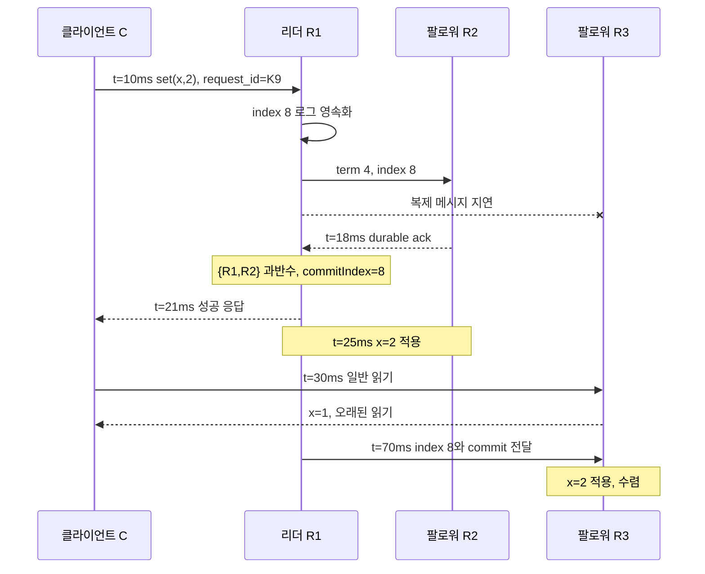

# 03. 복제와 일관성

사용자는 `orders.example`이라는 한 주소에 요청하지만 그 뒤에는 서로 다른 디스크와 메모리를 가진 복제본 R1, R2, R3가 있다. 한 서버가 고장 나도 서비스를 계속하고 가까운 지역에서 빨리 읽으려면 데이터를 여러 곳에 두어야 한다. 그러나 “세 곳에 같은 값을 둔다”는 한 문장 사이에는 전송 중, 저장됨, 확정됨, 적용됨이라는 여러 상태가 있다. 이 장은 `x=1`을 `x=2`로 바꾸는 한 요청이 세 복제본을 지나고, 성공 응답이 사라진 뒤 클라이언트가 무엇을 알 수 있는지까지 추적한다.

## 복제 시스템의 실제 객체와 수명

**복제(replication)**는 같은 논리 데이터와 그 변경 이력을 둘 이상의 독립된 장애 위치에 유지하는 과정이다. 대상은 값 `x`만이 아니라 어떤 변경을 어떤 순서로 받아들였는지 나타내는 로그와 메타데이터다. 복제본 수를 늘리는 이유는 한 장비가 사라져도 데이터를 보존하고 읽기·장애 복구 경로를 남기기 위해서다. 여러 사본은 자동으로 같은 상태가 되지 않으므로 전송, 승인, 충돌 해결 규칙이 필요하다.

**리더(leader)**는 한 임기 동안 쓰기 명령에 로그 위치를 부여하고 복제를 조정하는 서버다. 이 예에서는 R1이다. 리더는 클라이언트 요청을 받아 `index=8, term=4, command=set(x,2)` 같은 로그 항목을 만든다. 리더 권한은 영구 주소가 아니라 합의로 얻은 임기 동안만 유효하다.

**팔로워(follower)**는 현재 리더가 제안한 로그 항목을 검사하고 로컬의 내구성 저장소에 기록한 뒤 확인을 보내는 서버다. R2와 R3가 팔로워다. 팔로워는 수동 백업 파일이 아니라 선거에 참여하고 필요하면 다음 리더가 될 수 있는 실행 주체다.

**로그(log)**는 변경 명령을 순서가 있는 항목으로 보관하는 내구성 기록이다. `index`는 그 로그 안의 위치이고 `term`은 어느 리더 임기에서 만들어졌는지 표시한다. 로그 항목을 디스크에 기록했다는 사실과 해당 명령을 클라이언트에 확정했다는 사실은 다르다. 아직 확정되지 않은 꼬리 항목은 새 리더의 로그와 충돌하면 제거될 수 있다.

**확인 응답(acknowledgement, ack)**은 수신자가 “정해진 단계까지 처리했다”고 송신자에게 알리는 메시지다. ack가 메모리 수신, 운영체제 버퍼 기록, 디스크 동기화, 상태 적용 가운데 무엇을 뜻하는지 API 계약에 써야 한다. 이 장에서는 팔로워 ack가 로그 항목을 재시작 뒤에도 남는 저장소에 기록했다는 뜻이라고 가정한다.

**커밋(commit, 확정)**은 시스템이 로그 항목을 이후의 유효한 실행에서도 보존하고 정해진 순서로 적용하기로 결정한 상태다. 세 복제본의 과반수인 두 곳에 현재 임기의 항목이 안전하게 기록된 뒤 리더의 `commitIndex`가 8로 전진하는 순간을 예로 든다. 커밋은 파일에 바이트가 써졌다는 뜻보다 강하고, 업무 DB 밖의 이메일이나 결제가 끝났다는 뜻보다 좁다.

**적용(apply)**은 커밋된 로그 명령을 상태 기계가 실행해 읽기 가능한 값 `x=2`를 만드는 단계다. 각 서버의 `lastApplied`가 8로 올라간다. `commitIndex=8`인데 `lastApplied=7`인 짧은 구간이 있을 수 있다. 읽기 경로가 이 차이를 무시하면 같은 서버에서도 확정된 최신 상태보다 오래된 값을 돌려줄 수 있다.

| 객체 | 예시 | 위치·관리 주체 | 수명 |
|---|---|---|---|
| 로그 항목 | `(term 4, index 8, set x=2)` | R1·R2·R3의 내구성 로그 | 스냅샷으로 압축되거나 대체 상태에 포함될 때까지 |
| 복제 진행 상태 | `R2 matchIndex=8` | 리더 R1 메모리 | 임기·연결이 바뀔 때 재구성 |
| 확정 경계 | `commitIndex=8` | 합의 모듈, 복제 전달 | 더 큰 값으로만 전진 |
| 적용 경계 | `lastApplied=7→8` | 각 복제본 상태 기계 | 적용할 때 전진 |
| 업무 상태 | `x=1→2` | 각 복제본 데이터 저장소 | 다음 명령이 바꿀 때까지 |

## 세 복제본의 쓰기와 읽기를 끝까지 추적한다

다음 수치는 원리를 계산하기 위한 교육용 값이다. 세 서버의 초기 상태는 모두 `term=4`, `commitIndex=7`, `lastApplied=7`, `x=1`이다. 클라이언트 C는 R1에 `set(x,2)`를 보낸다.

| 시각 | R1 리더 | R2 팔로워 | R3 팔로워 | 클라이언트가 아는 것 |
|---:|---|---|---|---|
| 0ms | `commit=7, applied=7, x=1` | 동일 | 동일 | 초기값 1 |
| 10ms | index 8 생성 | index 7까지 | index 7까지 | 쓰기 호출 중 |
| 12ms | index 8 영속 기록 | 전송 중 | 링크 지연 | 결과 미정 |
| 18ms | R2 ack 수신 | index 8 영속, `applied=7` | index 7 | 결과 미정 |
| 19ms | `{R1,R2}`로 `commit=8` | 커밋 통지 대기 | index 7 | 아직 응답 없음 |
| 21ms | 성공 응답 전송 | `commit=8` 통지 수신 | index 7 | 성공 응답 수신 |
| 25ms | `applied=8, x=2` | `applied=8, x=2` | `x=1` | 성공한 쓰기 뒤 |
| 30ms | x=2 | x=2 | 검사 없는 읽기에 x=1 | 읽기 계약에 따라 허용 여부 다름 |
| 70ms | x=2 | x=2 | index 8 저장·커밋·적용, x=2 | 세 복제본 수렴 |

R1 하나에만 기록한 12ms에는 R1이 영구 손실되면 항목도 사라질 수 있다. 18ms에는 두 복제본이 항목을 보존하지만 리더가 아직 커밋 경계를 올리지 않았다. 19ms의 커밋과 25ms의 적용도 구분된다. 성공 응답을 21ms에 보냈다면 API가 약속하는 완료 시점은 클라이언트가 그 응답을 관측한 때와 연결된다.

R3의 30ms 읽기는 물리적으로 정상 응답이다. 값도 과거에 실제 존재했다. 그러나 최신 성공 쓰기를 반영해야 하는 읽기 계약이라면 틀린 응답이다. 복제 지연을 허용하는 읽기라면 정상이다. “데이터가 맞다”는 말은 어떤 일관성 계약 아래인지 없으면 판단할 수 없다.

## 타임아웃은 실패가 아니라 결과 불확실성이다

같은 흐름에서 R1이 19ms에 커밋했지만 성공 응답 패킷이 유실되고, C가 50ms에 타임아웃됐다고 하자. C가 확실히 아는 사실은 “제한 시간 안에 응답을 받지 못했다”뿐이다. 다음 세 실행이 같은 타임아웃을 만든다.

1. 요청이 R1에 도달하지 않아 아무 로그도 생기지 않았다.
2. index 8이 R1에만 저장됐지만 커밋 전에 R1이 실패했다.
3. index 8이 `{R1,R2}`에 커밋·적용됐으나 응답만 유실됐다.

따라서 타임아웃 뒤 “실패했으니 다시 새 주문을 만든다”고 처리하면 세 번째 실행에서 중복 주문이 생긴다. 클라이언트는 같은 `request_id=K9`로 재시도하고, 복제 상태 기계는 K9의 완료 결과를 로그와 함께 보존해 같은 요청이면 이전 결과를 돌려주는 식의 멱등성 규칙을 가져야 한다. 그래도 외부 결제 시스템까지 정확히 한 번 실행되는 것은 별도 문제다. 복제 로그의 원자성은 그 로그가 관리하는 상태에만 직접 적용된다.

**원자적 쓰기(atomic write)**는 관측자에게 변경이 전부 적용되거나 전혀 적용되지 않은 것처럼 보이는 쓰기다. 한 DB 트랜잭션에서 `x=2`와 `request_id=K9 완료`를 함께 기록할 수 있다. 그러나 그 트랜잭션과 외부 이메일 전송은 자동으로 하나의 원자가 아니다. 저장소가 제공하는 원자적 범위, 복제 커밋 범위, 외부 부작용 범위를 따로 문서화해야 한다.

## 일관성 모델은 허용되는 관측을 정한다

**오래된 읽기(stale read)**는 더 최신의 확정된 버전이 존재하지만 아직 전달·적용되지 않은 복제본에서 이전 값을 반환하는 읽기다. 오류 메시지가 아니라 정책상 허용되는 응답일 수 있다. 캐시와 비동기 팔로워 읽기는 지연을 낮추는 대신 오래됨의 최대 범위나 세션 보장이 필요하다.

**선형화 가능성(linearizability)**은 각 연산이 호출과 응답 사이의 어느 한 순간에 원자적으로 적용된 것처럼 보이고, 완료된 연산의 실제 시간 순서를 보존하는 조건이다. 쓰기 W가 21ms에 끝난 뒤 읽기 R이 30ms에 시작됐다면 R은 x=2 또는 그보다 새 값을 봐야 한다. R이 15ms에 시작해 30ms에 끝났다면 W와 겹치므로 R을 W 앞에 놓아 x=1을 반환할 수 있다. 중요한 것은 로그 타임스탬프가 아니라 호출·응답 구간과 객체의 순차 명세다.

**순차 일관성(sequential consistency)**은 모든 프로세스의 연산이 각 프로세스 내부 순서를 지키는 하나의 전체 순서로 설명되기를 요구하지만, 서로 다른 프로세스 사이의 실제 시간은 요구하지 않는다. 클라이언트 A의 쓰기 W가 끝난 뒤 아무 통신이 없던 클라이언트 B가 읽기 R을 시작해도, 전체 순서를 R→W로 놓을 수 있다면 순차 일관성은 허용할 수 있다. 선형화 가능성은 실제로 W가 끝난 뒤 R이 시작됐으므로 이를 금지한다.

**인과 일관성(causal consistency)**은 원인과 결과 관계가 있는 연산의 순서를 모든 관측에서 보존한다. 사용자가 게시물 P를 읽고 그 내용을 인용해 댓글 C를 썼다면 P→C다. C를 본 독자는 필요한 P도 볼 수 있어야 한다. 서로 통신하지 않은 사용자의 독립 좋아요 L1과 L2는 관측자마다 다른 순서로 보여도 된다. 인과 문맥을 요청과 세션에 전달하지 않으면 시스템은 이 관계를 알 수 없다.

**최종 일관성(eventual consistency)**은 새 갱신이 멈추고 복제 통신이 계속 성공하면 모든 복제본이 결국 같은 값으로 수렴한다는 조건이다. “5초 안에 최신”, “충돌 시 마지막 시각 승리”, “항상 읽기 성공”까지 자동으로 뜻하지 않는다. R3가 30ms에 x=1을 주고 70ms에 x=2로 수렴하는 실행은 최종 일관성과 양립한다.

**자기 쓰기 읽기(read-your-writes)**는 한 클라이언트 세션이 성공시킨 쓰기를 이후 자기 읽기에서 잃지 않는 세션 보장이다. C가 x=2 성공 뒤 R3로 이동했을 때 세션 토큰 `minimum_version=8`을 보내고, R3가 index 8까지 기다리거나 더 최신 복제본으로 전달하면 지킬 수 있다. 이 보장은 다른 클라이언트의 최신 쓰기까지 모두 보장하는 선형화 가능성과 다르다.

| 관측 | 선형화 | 순차 | 인과 | 최종 | 자기 쓰기 읽기 |
|---|---|---|---|---|---|
| W 완료 뒤 새 R이 옛값 반환 | 금지 | 전체 순서 구성에 따라 가능 | 인과 전달 여부에 따라 | 가능 | 같은 세션이면 금지 |
| P를 원인으로 만든 C만 보임 | 금지될 수 있음 | 한 전체 순서면 금지 | 금지 | 수렴 전 가능 | 작성자 자신의 P에는 금지 가능 |
| 독립 L1·L2의 관측 순서가 다름 | 단일 객체 이력에 제약 | 금지 | 허용 | 허용 | 허용 |
| 통신 회복 뒤 갱신이 멈춤 | 최신 상태 유지 | 모델 자체가 시간 수렴을 핵심으로 하지 않음 | 인과 상태 유지 | 결국 수렴 | 세션 쓰기 유지 |

## 강한 읽기는 복제본을 고르는 것만으로 만들어지지 않는다

리더에서 읽으면 대체로 최신일 것 같지만 고립된 옛 리더는 자신이 권한을 잃은 사실을 아직 모를 수 있다. 선형화 읽기는 현재 리더임을 쿼럼과 확인하거나, 합의 로그에 읽기 장벽을 넣거나, 안전한 리더 리스의 시간 가정을 만족하는 방식으로 이전에 확정된 모든 쓰기 뒤에서 실행됐음을 확인해야 한다. 팔로워도 커밋 인덱스와 세션 최소 버전을 검증해 조건부 최신 읽기를 제공할 수 있다.

읽기 쿼럼도 응답 수만 세면 충분하지 않다. N=3에서 W=2, R=2라면 쓰기 집합과 읽기 집합이 최소 한 노드에서 겹친다. 그러나 A가 `version=8,x=2`, B가 `version=7,x=1`을 응답했을 때 먼저 온 B만 반환하면 교집합 정보를 사용하지 않은 셈이다. 두 응답을 모으고 버전이 유효한 임기·로그에서 확정됐는지 검사해야 한다. 고립된 서버가 임의로 큰 `version=9`를 만들 수 있다면 숫자 최댓값만 택해도 안전하지 않다.

## 동기와 비동기는 ack 경계를 설명하는 말이다

**동기 복제**는 성공 응답 전에 정해진 원격 복제 단계의 완료를 기다리는 정책이다. 이 예의 `{R1,R2}` 내구성 ack가 해당한다. 리더 한 대 손실을 견디는 근거가 생기지만 느린 응답이 쓰기 지연에 포함된다.

**비동기 복제**는 리더가 로컬 단계만 끝내고 성공을 응답한 뒤 팔로워에 전달하는 정책이다. 정상 상황의 지연은 낮지만, 전달 전에 리더 저장소가 영구 손실되면 이미 성공한 쓰기가 사라질 수 있다. “동기”도 모든 복제본 적용을 기다리는지, 과반수 디스크 기록만 기다리는지에 따라 의미가 다르다. ack의 정확한 경계를 써야 한다.

복제본 수 자체는 일관성 모델을 결정하지 않는다. 세 사본을 비동기로 갱신하며 아무 복제본에서 읽으면 오래된 값이 나온다. 한 사본이어도 단일 프로세스의 원자 레지스터는 선형화될 수 있지만 고장 가용성이 낮다. 복제는 장애와 부하를 다루는 구조이고, 일관성은 허용 이력을 정하는 계약이다.

## 문제와 전체 해설

### 1. R1과 R2가 index 8을 저장했고 R1이 커밋했다고 하자. R2의 `lastApplied=7`에서 직접 상태를 읽으면 무엇이 문제인가?

로그 보존 관점에서는 index 8이 안전하지만 상태 기계는 아직 명령을 실행하지 않아 x=1이다. 읽기 계약이 최신 커밋을 요구하면 R2는 `lastApplied≥8`이 될 때까지 기다리거나 적용을 촉진하거나 다른 복제본으로 보내야 한다. “로그가 있다”와 “읽기 상태에 반영됐다”를 같은 플래그로 취급하면 확정 뒤 오래된 읽기가 생긴다.

### 2. 쓰기 W가 40ms에 성공했고 읽기 R이 50ms에 시작해 x=1을 반환했다. 각 모델은 어떻게 판단하는가?

선형화 가능성에서는 W의 응답이 R 호출보다 앞서므로 W→R의 실제 시간 순서를 지켜야 해 위반이다. 최종 일관성에서는 복제 지연 중 옛값을 허용할 수 있다. 같은 세션의 자기 쓰기 읽기라면 위반이고, 다른 세션에만 그 보장을 준 경우는 판단 대상이 아니다. “일관성이 깨졌다” 대신 어떤 계약을 위반했는지 말해야 한다.

### 3. R이 30ms에 시작하고 W가 40ms에 끝나며 R이 60ms에 x=1로 끝났다면 선형화 가능한가?

R과 W의 실행 구간이 겹친다. 선형화 지점을 R은 35ms, W는 40ms로 놓으면 순차 명세상 R이 먼저이므로 x=1이 가능하다. R이 늦게 응답했다는 사실만으로 최신값을 강제하지 않는다. 반대로 R이 W의 성공 뒤 50ms에 시작했다면 겹치지 않아 x=1은 불가능하다.

### 4. 클라이언트가 쓰기 타임아웃을 봤다. 같은 내용을 새 request ID로 재시도해도 되는가?

첫 요청이 커밋됐고 응답만 유실됐을 수 있으므로 새 ID는 별도 명령으로 처리되어 중복 효과를 낼 수 있다. 같은 논리 요청 ID로 재시도하고 상태 기계가 그 ID의 결과를 원자적으로 중복 제거해야 한다. 결제처럼 외부 시스템이 포함되면 그 시스템의 멱등성 키나 아웃박스·조정 절차까지 필요하다. 타임아웃을 실패 확정으로 바꾸면 안 된다.

### 5. 게시물 P를 읽은 B가 댓글 C를 썼는데 다른 사용자가 C만 본다. 최종 일관성이라면 문제없는가?

최종 수렴만 약속한 시스템에서는 일시적으로 가능하다. 인과 일관성을 약속했다면 P→C이므로 위반이다. 해결하려면 B가 P의 인과 버전을 C 쓰기에 전달하고, 읽기 서버가 C를 노출하기 전에 P까지 보유했는지 확인한다. 단순 벽시계 정렬은 시계 오차 때문에 인과 증명이 아니다.

### 6. 자기 쓰기 읽기를 제공하면 선형화 가능하다고 볼 수 있는가?

아니다. A는 자기 x=2를 계속 볼 수 있지만 B가 성공시킨 x=3을 A가 늦게 볼 수 있다. 세션 라우팅이나 최소 버전 토큰만으로 A의 과거 회귀는 막아도 모든 클라이언트의 실제 시간 순서를 하나로 만들지는 않는다. 자기 쓰기 읽기는 유용한 세션 보장이고 선형화보다 범위가 좁다.

### 7. 비동기 복제에서 성공 응답 뒤 리더 디스크가 사라졌다. 팔로워에 항목이 없다면 성공 쓰기를 복구할 수 있는가?

다른 내구성 복사본이나 외부 로그가 없다면 복구할 근거가 없다. 클라이언트가 성공 응답을 보존했어도 서버 상태를 자동 복원하지 못한다. 성공의 내구성 계약을 “리더 로컬 디스크”로 정했다면 리더 디스크 영구 손실을 허용 장애로 포함하지 않은 것이다. 그 장애를 견뎌야 하면 응답 전 원격 내구성 ack나 별도 내구 로그가 필요하다.

### 8. 한 DB 트랜잭션으로 주문 상태와 request ID를 함께 기록했다. 이메일도 정확히 한 번 갔다고 말할 수 있는가?

DB 원자성은 DB 안의 두 레코드에 적용된다. 이메일 서비스 호출이 같은 트랜잭션 자원이 아니면 DB 커밋과 발송 사이에 프로세스가 멈출 수 있다. 발송 뒤 DB 기록 전 정지하면 재시도에서 중복되고, DB 기록 뒤 발송 전 정지하면 누락된다. 아웃박스에 발송 의도를 DB와 함께 커밋하고 소비자가 같은 이벤트 ID로 멱등 발송하는 등의 별도 경계 설계가 필요하다.

+## 순차 일관성과 선형화 가능성을 숫자 이력으로 분리한다

초기값이 x=0이고 클라이언트 A와 B가 있다고 하자. A는 `W(x=1)`을 10ms에 호출해 20ms에 성공 응답을 받는다. B는 그 뒤인 30ms에 `R(x)`를 호출해 40ms에 0을 받는다. 각 클라이언트의 프로그램 순서는 A에게 W 하나, B에게 R 하나뿐이다. 순차 일관성은 전체 순서를 `B의 R→A의 W`로 놓으면 각 클라이언트 내부 순서를 깨지 않고 R=0을 설명할 수 있다. 실제 시간상 W가 끝난 뒤 R이 시작했다는 관계는 사용하지 않는다.

선형화 가능성은 완료된 W의 응답 20ms가 R의 호출 30ms보다 앞섰으므로 반드시 `W→R`을 보존한다. 따라서 R=0은 설명할 수 없다. 이 차이는 사용자가 “저장 완료” 화면을 본 뒤 다른 사용자가 조회했을 때도 최신값을 기대하는지와 연결된다. 순차 일관성을 낮은 수준이라고 단정하기보다 실제 시간 순서가 계약에 포함되는지를 확인해야 한다.

이번에는 A의 W가 10~40ms, B의 R이 20~30ms라고 하자. 두 연산은 겹친다. 선형화 지점을 R=25ms, W=35ms로 두면 R=0이 가능하다. 동시에 실행된 연산에는 벽시계 시작값만 보고 순서를 강제하지 않는다. 선형화 검증은 각 연산의 호출과 응답 구간, 반환값, 객체의 합법적인 순차 동작을 함께 본다.

## 두 쓰기가 동시에 들어오면 복제는 충돌 의미를 정해야 한다

리더 기반 단일 로그에서는 유효한 리더가 `set(x,2)`와 `set(x,3)`에 index 8과 9를 부여해 전체 순서를 만든다. 모든 복제본이 8 뒤 9를 적용하면 최종 x=3이다. 이 안전성은 리더 선거와 로그 규칙이 옛 리더의 index 8을 새 리더의 다른 index 8과 동시에 확정하지 못하게 한다는 조건에 의존한다.

여러 노드가 동시에 쓰기를 받는 leaderless 구조에서는 A가 만든 버전 `VA=[1,0,0], x=2`와 B가 만든 `VB=[0,1,0], x=3`이 서로 인과적으로 동시일 수 있다. “더 큰 벽시계가 승리”를 쓰면 하나를 버리지만 시계 오차와 미래 타임스탬프 반례가 있다. 두 버전을 sibling으로 보존해 읽는 쪽에 돌려주고 애플리케이션이 병합할 수도 있다. 장바구니 항목의 합집합은 가능하지만 계좌 잔액의 두 대입을 합집합으로 처리할 수는 없다.

충돌 해결 뒤에도 그 결과를 다시 복제해야 한다. A와 B가 각자 다른 병합 결과를 만들면 수렴하지 않는다. 연산이 결합법칙·교환법칙·멱등성을 만족하도록 설계하거나, 동일 입력에 결정적인 병합 함수를 쓰거나, 충돌한 값을 하나의 조정 지점에서 직렬화해야 한다. 최종 일관성의 “결국 같은 값”에는 이 수렴 규칙이 포함된다.

## 오래된 읽기는 허용 여부와 최대 오래됨을 함께 계약한다

“팔로워 읽기는 빠르다”만으로는 사용자가 무엇을 보게 될지 알 수 없다. 다음과 같은 계약을 구분할 수 있다.

- 최신 확정 읽기는 현재 유효한 리더와 확정 경계를 확인한 뒤 응답한다.
- 세션 읽기는 클라이언트가 보낸 `minimum_index=8` 이상 적용한 복제본에서 응답한다.
- 제한된 오래됨 읽기는 현재 시각이 아니라 “확정 로그 기준 최대 100개 항목 뒤” 또는 “검증된 물리 시각 기준 최대 5초”처럼 상한을 둔다.
- 최선 노력 읽기는 현재 로컬 적용값을 즉시 주며 오래됨 상한을 약속하지 않는다.

제한된 오래됨을 시간으로 표현하려면 복제본 시계 오차와 리더 커밋 시각의 의미가 필요하다. 로그 인덱스 상한도 쓰기 속도가 달라지면 실제 시간과 일치하지 않는다. 운영 지표는 복제 메시지 왕복 시간만이 아니라 `leader_commitIndex - follower_lastApplied`, 가장 오래 미적용 항목의 나이, 세션 최소 버전 대기 시간, 읽기 전달 비율을 포함해야 한다.

R3가 네트워크에서 60초 단절됐다가 돌아오면 단순히 연결되었다는 이유로 즉시 최신 읽기 대상이 되지 않는다. 누락 로그를 받고, 커밋 경계를 확인하고, 상태 기계 적용을 끝낸 뒤 광고 상태를 바꿔야 한다. 스냅샷을 설치하는 중간에 부분 상태를 읽기 가능하게 노출하면 서로 다른 시점의 필드가 섞일 수 있다.

## 로그 커밋과 저장소 원자성의 경계를 다시 확인한다

복제 로그가 `transfer(A,B,100)` 하나를 커밋해도 상태 기계 구현이 A 차감과 B 증가를 서로 다른 비원자 쓰기로 실행하면 중간 읽기가 총액 감소를 볼 수 있다. 합의는 명령 순서를 정했지만 명령 하나의 로컬 적용 원자성을 자동으로 만들지 않는다. 상태 기계는 트랜잭션, copy-on-write 상태 교체, 잠금 같은 로컬 기법으로 한 명령의 관측 경계를 보장해야 한다.

반대로 로컬 DB 트랜잭션이 완벽해도 리더가 그 결과를 복제 로그 밖에서 먼저 적용하고 실패하면 새 리더가 그 변경을 모를 수 있다. 명령의 합의 순서와 로컬 저장소의 원자 적용을 연결하고, 재시작 때 `lastApplied`와 업무 상태가 모순되지 않게 복구해야 한다. 스냅샷에는 어떤 로그 인덱스까지 반영했는지 함께 기록한다. “Raft를 쓴다”나 “DB 트랜잭션을 쓴다” 중 하나만으로 전체 경계가 완성되지 않는다.

## 공식 자료

- [Herlihy and Wing, “Linearizability: A Correctness Condition for Concurrent Objects”](https://www.cs.cmu.edu/~wing/publications/HerlihyWing90.pdf)
- [Ongaro and Ousterhout, “In Search of an Understandable Consensus Algorithm”](https://raft.github.io/raft.pdf)
- [DeCandia et al., “Dynamo: Amazon’s Highly Available Key-value Store”](https://web.stanford.edu/class/cs244/papers/amazon-dynamo-sosp2007.pdf)
- [Jepsen consistency models](https://jepsen.io/consistency)

[← 이전 장](02-time-events-and-ordering.md) · [목차](README.md) · [다음 장 →](04-leaders-quorums-and-partitions.md)
