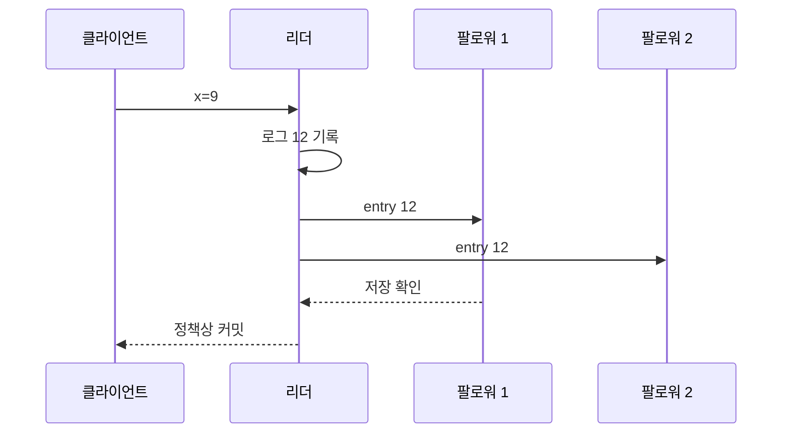

# 03. 복제와 일관성

## 세 노드에서 한 쓰기와 두 읽기를 따라가기

복제본은 같은 논리 데이터를 가진 실행 주체다. 리더 L은 쓰기 순서를 정하고 팔로워 F1, F2는 로그를 저장한 뒤 상태 기계에 적용한다. “저장됨”과 “적용됨”은 다른 중간 상태다.

| 시각 | L | F1 | F2 |
|---:|---|---|---|
| 0 ms | x=1 | x=1 | x=1 |
| 10 ms | x=2 로그 생성 | x=1 | x=1 |
| 18 ms | 로컬 저장 | 로그 x=2 저장 | 메시지 지연 |
| 20 ms | 과반수 커밋·성공 응답 | 적용 대기 | x=1 |
| 25 ms | x=2 적용 | x=2 적용 | x=1 |
| 70 ms | x=2 | x=2 | x=2 적용 |

t=30에 F2에서 아무 검사 없이 읽으면 1이 나온다. 쓰기는 t=20에 이미 성공했으므로 이 읽기는 선형화 조건을 위반한다. 최종 일관성 정책에서는 복제 완료 전 오래된 1을 허용할 수 있다.

## linearizable, causal, eventual의 실제 차이

linearizable은 완료된 연산의 실시간 순서를 보존한다. t=20 쓰기 성공 뒤 t=30 시작한 읽기는 2 이상을 반환해야 한다. 쓰기와 겹쳐 t=15 시작한 읽기는 1 또는 2가 가능하다.

causal consistency는 원인과 결과의 순서를 보존한다. 사용자 A가 게시물 P를 쓴 뒤 댓글 C를 쓰면 C를 본 독자는 P도 봐야 한다. 서로 독립인 좋아요 L1과 L2는 독자별 순서가 달라도 된다.

eventual consistency는 새 쓰기가 멈추고 통신이 회복되면 결국 수렴한다. 영구 단절이나 계속되는 쓰기에서는 모든 복제본이 같은 순간을 약속하지 않는다.

| 관측 | linearizable | causal | eventual |
|---|---|---|---|
| 성공한 x=2 뒤 읽기 | 2 이상 | 세션·인과에 따라 2 | 지연 replica에서 1 가능 |
| 댓글 C를 봄 | 모델 외 업무 관계 | 원인 게시물 P도 봄 | P가 아직 안 보일 수 있음 |
| 독립 L1·L2 순서 | 단일 실시간 순서 | 서로 달라도 됨 | 서로 달라도 됨 |

## 쿼럼 교집합만으로 부족한 이유

N=3, W=2, R=2이면 임의 쓰기·읽기 쿼럼은 한 노드 이상 겹친다. 그러나 읽는 두 노드의 값을 비교하지 않고 첫 응답을 반환하면 오래된 값을 고를 수 있다. 버전·term·timestamp 중 어떤 최신성 규칙을 쓰는지, 동시 쓰기를 어떻게 해결하는지, 완료 시점을 어떻게 정하는지가 추가로 필요하다.

| 노드 | 값 | 버전 |
|---|---:|---:|
| A | 2 | 8 |
| B | 1 | 7 |
| C | 1 | 7 |

읽기 쿼럼 {A,B}가 겹쳐도 B 응답 1을 즉시 반환하면 최신성을 놓친다. 두 응답을 모아 버전 8을 선택해야 한다. 고립된 옛 리더가 임의 버전 9를 만들 수 있는 설계라면 단순 큰 숫자 선택도 안전하지 않다.

## 계산 문제와 완전 해설

### 문제 A: 읽기 결과

쓰기 x=2가 t=40에 성공하고 읽기 R이 t=50에 시작해 1을 반환했다면 선형화 위반이다. R이 t=30에 시작해 t=60 끝났다면 쓰기와 겹치므로 선형화 순서를 R 먼저로 둘 수 있어 1도 가능하다.

### 문제 B: causal 반례

P의 벡터가 `[1,0]`, C가 P를 읽은 뒤 작성되어 `[1,1]`이라면 C만 보이고 P가 안 보이는 관측은 인과 위반이다. C가 P와 무관한 독립 사건 `[0,1]`이면 둘의 표시 순서는 자유다.

### 문제 C: 쿼럼 수

N=5에서 W=3, R=3이면 W+R=6>N이라 교집합이 있다. W=2, R=2면 합 4로 서로 겹치지 않을 수 있다. 첫 조건도 최신 버전 판정과 실패 시 재시도 규칙 없이 자동으로 선형화를 보장하지 않는다.

[← 이전 장](02-time-events-and-ordering.md) · [목차](README.md) · [다음 장 →](04-leaders-quorums-and-partitions.md)

## 복제 흐름

**복제**는 같은 논리 데이터를 여러 장애 영역에 유지하는 과정이다.
리더는 쓰기 순서를 정하고 팔로워는 로그를 받아 적용한다.
입력은 클라이언트 명령이다.
리더가 로그 위치를 배정한다.
복제본은 수신 위치와 적용 위치를 중간 상태로 가진다.
성공 조건을 만족하면 커밋 결과를 낸다.

## 세 일관성 모델

**linearizability**는 각 연산이 호출과 응답 사이 한 순간에 적용된 것처럼 보이는 성질이다.
완료된 쓰기 뒤 시작한 읽기는 그 쓰기보다 과거 값을 볼 수 없다.
**snapshot isolation**은 트랜잭션이 시작 시점의 일관된 스냅샷을 읽게 한다.
그러나 서로 다른 행을 읽고 쓰는 write skew를 허용할 수 있다.
**eventual consistency**는 새 쓰기가 멈추고 통신이 회복되면 복제본이 결국 수렴한다는 목표다.
수렴 전에는 오래된 값을 읽을 수 있다.

t=0에 x=1이다.
t=10에 x=2 쓰기가 시작해 t=30에 성공한다.
t=40에 시작한 선형화 읽기는 1을 반환할 수 없다.
최종 일관성 읽기는 복제 지연 중 1을 반환할 수 있다.
t=5에 시작한 snapshot 트랜잭션은 자신의 스냅샷 1을 읽을 수 있다.

## 동기, 비동기, 반례

동기 복제는 확인을 기다려 지연이 늘지만 커밋 데이터의 장애 내성을 높인다.
비동기 복제는 빨리 응답하지만 리더 장애 때 최근 성공 쓰기를 잃을 수 있다.
복제본 수만 늘린다고 선형화가 생기지 않는다.
snapshot이 모든 트랜잭션을 직렬 순서로 만드는 것도 아니다.

## 점검 문제

### 1. 선형화 읽기의 핵심은?
이미 완료된 쓰기보다 과거 값을 반환하지 않는 실시간 순서다.

### 2. snapshot isolation의 반례는?
두 의사가 서로를 읽고 각자 다른 행의 당직을 해제하는 write skew다.

### 3. 비동기 복제의 위험은?
전달 전 리더가 손실되면 성공 응답한 쓰기가 사라질 수 있다.

## 공식 자료

- [Jepsen Consistency Models](https://jepsen.io/consistency)
- [PostgreSQL Transaction Isolation](https://www.postgresql.org/docs/current/transaction-iso.html)

[← 이전 장](02-time-events-and-ordering.md) · [목차](README.md) · [다음 장 →](04-leaders-quorums-and-partitions.md)
