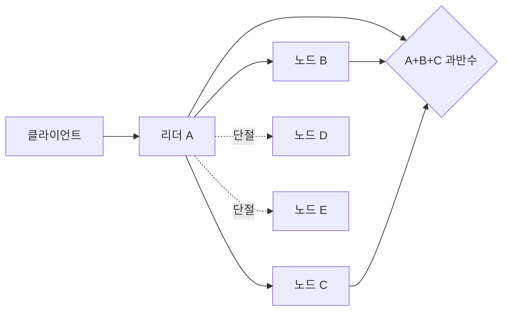

# 04. 리더, 쿼럼, 파티션

## 리더는 주소가 아니라 한 임기의 권한이다

**리더**는 한 임기 동안 쓰기 순서를 제안하는 프로세스다. 특정 IP가 영원히 리더인 것이 아니다. 선거에서 권한을 얻고, 더 높은 임기를 보면 물러난다. 입력은 클라이언트 명령이고, 리더는 로그 위치와 임기를 붙여 복제한다.

**쿼럼**은 결정을 진행하는 데 필요한 참여 집합이다. 5노드 과반수는 3개이며, 임의의 두 3개 집합은 최소 한 노드에서 겹친다. 교집합 노드가 과거 로그를 새 선거에 전달하도록 로그 최신성 검사가 결합된다.

| 단계 | 리더 중간 상태 | 팔로워 중간 상태 | 완료 조건 |
|---|---|---|---|
| 명령 수신 | 새 로그 entry | 없음 | 미완료 |
| 복제 전송 | 노드별 matchIndex 대기 | 디스크 저장 | 미완료 |
| 과반수 확인 | commitIndex 전진 후보 | 저장 확인 | 현재 term 규칙 확인 |
| 적용 | lastApplied 전진 | commit 통지 뒤 적용 | 응답 계약 충족 |

클라이언트 연산 완료는 패킷 전송이나 리더 메모리 기록과 다르다. 시스템이 정한 커밋 조건을 충족하고 성공 응답이 클라이언트에 도착해야 외부 실시간 순서에서 “완료”로 관측된다.

## CAP를 파티션 중 두 요청으로 계산한다

CAP의 C는 일반적인 정확성이 아니라 선형화 가능한 단일 값 관점이다. A는 파티션으로 단절되지 않은 서버가 받은 모든 요청에 결국 성공 또는 일반 응답을 내는 가용성 정의다. P는 네트워크 파티션이 생기는 환경에서도 명세를 논하는 조건이다.

t=0에 x=1이고 5노드가 {A,B,C}와 {D,E}로 단절된다. t=20 왼쪽은 x=2 쓰기를 과반수로 완료한다. t=30 오른쪽이 읽기 요청을 받는다.

| 오른쪽 행동 | 응답 | 선형화 | 파티션 중 가용성 |
|---|---|---|---|
| 로컬 x=1 반환 | 성공 | 완료된 x=2보다 과거라 위반 | 유지 |
| 오류·대기 | 값 거짓말 없음 | 유지 가능 | 그 요청에는 포기 |
| x=2 추측 | 근거 없는 값 | 안전하지 않음 | 형식상 응답 |

비동기 네트워크에서는 침묵이 느린 링크인지 파티션인지 즉시 구별되지 않는다. 그래서 CAP 선택은 운영자가 파티션을 확정한 뒤 한 번 누르는 스위치가 아니다. 통신이 불확실한 동안 요청 처리 규칙에 내장된다.

## 읽기·쓰기 쿼럼 산술의 조건

N=5, W=3, R=3이면 최소 교집합은 `W+R-N=1`이다. N=5, W=2, R=2이면 합이 4라 겹치지 않는 집합이 가능하다. 그러나 `W+R>N`만으로 선형화가 자동 생성되지 않는다. 버전의 정당성, 동시 쓰기 해결, 읽기 응답 수집, 고립된 옛 리더 차단이 필요하다.

| 설정 | 쓰기 지연 모형 | 읽기 지연 모형 | 위험 |
|---|---:|---:|---|
| W=3,R=3 | 세 번째 빠른 응답까지 | 세 번째 빠른 응답까지 | 강한 교집합, 높은 대기 |
| W=5,R=1 | 가장 느린 쓰기까지 | 한 응답 | 느린 노드가 쓰기 지배 |
| W=2,R=2 | 두 응답 | 두 응답 | 교집합 없음 가능 |

숫자는 필요한 응답 수일 뿐 제품 성능 보장이 아니다. 노드 응답이 각각 5, 8, 20, 70, 100 ms라면 W=3의 이론적 확인 시점은 약 20 ms, W=5는 약 100 ms다.

## split brain과 옛 리더

파티션 양쪽에서 프로세스가 자신을 리더라고 부를 수 있다. 안전성의 핵심은 둘 다 새 로그를 커밋하지 못하게 하는 것이다. 5노드에서 3노드 쪽만 과반수를 얻고 2노드 쪽은 쓰기를 거부해야 한다. 옛 리더의 프로세스가 살아 있다는 사실과 유효한 리더 권한은 다르다.

리더 lease로 읽기를 빠르게 할 수 있지만 시계 진행, 프로세스 정지, 새 리더 선출과 lease 겹침 가정이 필요하다. 단순히 “리더에서 읽었다”는 이유만으로 고립된 옛 리더의 오래된 읽기가 안전해지지 않는다.

## 추가 연습 문제와 해설

### 1. 5노드에서 두 노드만 확인한 쓰기를 커밋하면 어떤 집합과 충돌할 수 있는가?
나머지 세 노드가 별도 결정을 만들 수 있고 두 집합은 교차하지 않는다. 과거 결정을 전달할 노드가 없어 안전성이 깨진다.

### 2. 응답 지연이 5,8,20,70,100 ms일 때 과반수 확인 시점은?
5노드 과반수는 3개이므로 세 번째 응답인 약 20 ms다. 로컬 기록 포함 여부와 왕복 정의는 구현 계약을 확인해야 한다.

### 3. 소수 파티션이 x=1을 반환해도 되는 경우는?
명시적으로 stale read를 허용하는 API면 가능하다. 선형화 읽기라고 부를 수는 없다.

### 4. CAP의 P는 “항상 파티션을 선택한다”는 뜻인가?
아니다. 파티션이 발생할 수 있는 네트워크에서 그 조건 중 C와 A를 동시에 만족할 수 없다는 명제의 조건이다.

### 5. W+R>N인데도 첫 응답을 즉시 반환하면 왜 위험한가?
읽기 쿼럼의 최신 노드 응답을 기다리지 않았으므로 교집합 정보를 사용하지 않는다. 필요한 응답을 모아 정당한 최신 버전을 선택해야 한다.

[← 이전 장](03-replication-and-consistency.md) · [목차](README.md) · [다음 장 →](05-raft-logs-and-commit.md)

## 리더와 쿼럼

**리더**는 한 임기 동안 쓰기 순서를 제안하는 노드다.
**쿼럼**은 결정을 진행하는 데 필요한 참여 집합이다.
5개 노드의 과반수는 3개다.
어떤 두 과반수도 최소 한 노드에서 겹친다.
이 교집합이 과거 결정을 새 리더에게 전달하는 재료다.

입력은 로그 항목과 현재 임기다.
리더가 복제를 요청한다.
노드는 로컬 로그에 영속 기록하고 확인한다.
리더는 확인 집합을 센다.
교집합 규칙을 만족하면 커밋을 선언한다.

## 네트워크 파티션과 CAP

**네트워크 파티션**은 일부 노드 집합 사이 메시지가 필요한 시간 안에 오가지 않는 상황이다.
노드가 꺼질 필요는 없다.
CAP의 C는 선형화 가능한 일관성이다.
A는 장애가 아닌 노드가 받은 모든 요청에 결국 응답하는 가용성이다.
P는 파티션 조건에서도 동작 모델을 유지하는 문제다.
선택은 파티션 동안 두 단절 집합이 모두 응답할지, 한쪽을 거부해 단일 최신 순서를 지킬지다.

t=0에 x=1이고 A가 리더다.
t=10에 {A,B,C}와 {D,E}가 끊긴다.
t=20에 왼쪽은 x=2를 과반수로 커밋한다.
t=25에 오른쪽이 1을 반환하면 가용하지만 선형화는 깨진다.
오른쪽이 오류나 대기를 반환하면 최신 순서를 지키지만 그 요청의 가용성을 포기한다.

## 반례

복제 지연이 항상 CAP 파티션은 아니다.
리더가 둘 보여도 한쪽이 쿼럼을 못 얻으면 안전성 위반은 아니다.
CP 시스템도 과반수 쪽에서는 계속 서비스할 수 있다.

## 점검 문제

### 1. 5노드에서 2개로 커밋할 수 있는가?
과반수 규칙이라면 없다. 다른 3개 집합과 교차하지 않을 수 있다.

### 2. CAP 선택이 두드러지는 조건은?
필요한 집합 사이 통신이 끊긴 파티션 동안이다.

### 3. 소수 쪽 읽기는 가능한가?
오래된 읽기를 명시적으로 허용할 수 있지만 선형화 읽기는 아니다.

## 공식 자료

- [Brewer, CAP Twelve Years Later](https://www.infoq.com/articles/cap-twelve-years-later-how-the-rules-have-changed/)
- [Gilbert and Lynch CAP paper](https://users.ece.cmu.edu/~adrian/731-sp04/readings/GL-cap.pdf)

[← 이전 장](03-replication-and-consistency.md) · [목차](README.md) · [다음 장 →](05-raft-logs-and-commit.md)
## 상세 조건: 비동기 네트워크의 CAP

비동기 네트워크에서는 메시지 지연 상한이 없어 침묵만으로 파티션을 확정하지 못한다. CAP의 핵심은 서로 통신하지 못하는 두 집합이 각자 요청을 받았을 때 모든 요청에 답하면서 단일 최신 값도 유지할 수 없다는 점이다.

| 집합 | 보이는 노드 | 요청 | 선형화 선택 | 가용 선택 |
|---|---|---|---|---|
| A,B,C | 서로 보임 | x=2 쓰기 | 과반수 커밋 | 커밋 |
| D,E | 서로만 보임 | x 읽기 | 거부·대기 | 옛값 1 반환 |

왼쪽 쓰기가 성공한 뒤 오른쪽이 1을 최신값으로 답하면 실시간 순서를 위반한다. 오른쪽이 오류나 대기를 반환하면 값의 거짓말은 피하지만 그 요청에 대한 가용성을 포기한다.

N=5, W=3, R=3이면 W+R>N이라 두 쿼럼이 겹친다. N=5, W=2, R=2이면 겹치지 않는 집합이 가능하다. 다만 교집합에서 최신 버전을 비교하는 규칙이 없으면 숫자만으로 선형화가 생기지 않는다.
