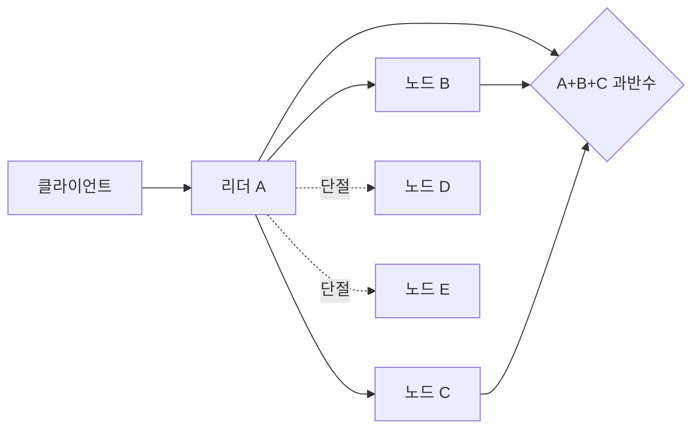

# 04. 리더, 쿼럼, 파티션

[← 이전 장](03-replication-and-consistency.md) · [목차](README.md) · [다음 장 →](05-raft-logs-and-commit.md)

## 리더와 쿼럼

**리더**는 한 임기 동안 쓰기 순서를 제안하는 노드다.
**쿼럼**은 결정을 진행하는 데 필요한 참여 집합이다.
5개 노드의 과반수는 3개다.
어떤 두 과반수도 최소 한 노드에서 겹친다.
이 교집합이 과거 결정을 새 리더에게 전달하는 재료다.

입력은 로그 항목과 현재 임기다.
리더가 복제를 요청한다.
노드는 로컬 로그에 영속 기록하고 확인한다.
리더는 확인 집합을 센다.
교집합 규칙을 만족하면 커밋을 선언한다.

## 네트워크 파티션과 CAP

**네트워크 파티션**은 일부 노드 집합 사이 메시지가 필요한 시간 안에 오가지 않는 상황이다.
노드가 꺼질 필요는 없다.
CAP의 C는 선형화 가능한 일관성이다.
A는 장애가 아닌 노드가 받은 모든 요청에 결국 응답하는 가용성이다.
P는 파티션 조건에서도 동작 모델을 유지하는 문제다.
선택은 파티션 동안 두 단절 집합이 모두 응답할지, 한쪽을 거부해 단일 최신 순서를 지킬지다.

t=0에 x=1이고 A가 리더다.
t=10에 {A,B,C}와 {D,E}가 끊긴다.
t=20에 왼쪽은 x=2를 과반수로 커밋한다.
t=25에 오른쪽이 1을 반환하면 가용하지만 선형화는 깨진다.
오른쪽이 오류나 대기를 반환하면 최신 순서를 지키지만 그 요청의 가용성을 포기한다.

## 반례

복제 지연이 항상 CAP 파티션은 아니다.
리더가 둘 보여도 한쪽이 쿼럼을 못 얻으면 안전성 위반은 아니다.
CP 시스템도 과반수 쪽에서는 계속 서비스할 수 있다.

## 점검 문제

### 1. 5노드에서 2개로 커밋할 수 있는가?
과반수 규칙이라면 없다. 다른 3개 집합과 교차하지 않을 수 있다.

### 2. CAP 선택이 두드러지는 조건은?
필요한 집합 사이 통신이 끊긴 파티션 동안이다.

### 3. 소수 쪽 읽기는 가능한가?
오래된 읽기를 명시적으로 허용할 수 있지만 선형화 읽기는 아니다.

## 공식 자료

- [Brewer, CAP Twelve Years Later](https://www.infoq.com/articles/cap-twelve-years-later-how-the-rules-have-changed/)
- [Gilbert and Lynch CAP paper](https://users.ece.cmu.edu/~adrian/731-sp04/readings/GL-cap.pdf)

[← 이전 장](03-replication-and-consistency.md) · [목차](README.md) · [다음 장 →](05-raft-logs-and-commit.md)
## 상세 조건: 비동기 네트워크의 CAP

비동기 네트워크에서는 메시지 지연 상한이 없어 침묵만으로 파티션을 확정하지 못한다. CAP의 핵심은 서로 통신하지 못하는 두 집합이 각자 요청을 받았을 때 모든 요청에 답하면서 단일 최신 값도 유지할 수 없다는 점이다.

| 집합 | 보이는 노드 | 요청 | 선형화 선택 | 가용 선택 |
|---|---|---|---|---|
| A,B,C | 서로 보임 | x=2 쓰기 | 과반수 커밋 | 커밋 |
| D,E | 서로만 보임 | x 읽기 | 거부·대기 | 옛값 1 반환 |

왼쪽 쓰기가 성공한 뒤 오른쪽이 1을 최신값으로 답하면 실시간 순서를 위반한다. 오른쪽이 오류나 대기를 반환하면 값의 거짓말은 피하지만 그 요청에 대한 가용성을 포기한다.

N=5, W=3, R=3이면 W+R>N이라 두 쿼럼이 겹친다. N=5, W=2, R=2이면 겹치지 않는 집합이 가능하다. 다만 교집합에서 최신 버전을 비교하는 규칙이 없으면 숫자만으로 선형화가 생기지 않는다.
