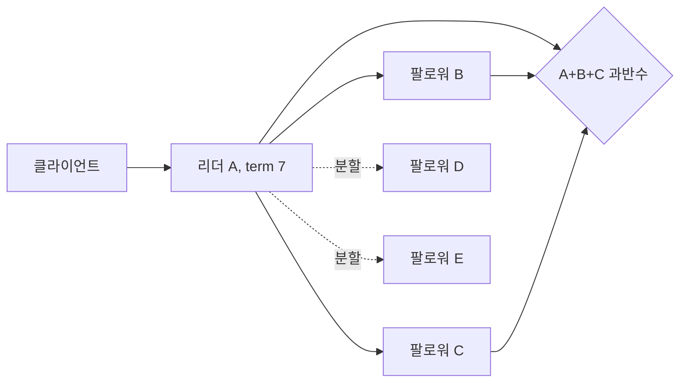

# 04. 리더, 쿼럼, 파티션

분산 시스템에서 서버 두 대가 서로 보이지 않을 때 둘 다 살아 있을 수 있다. 어느 쪽이 최신인지, 누가 쓰기를 받아도 되는지, 응답하지 않는 것이 오류인지 안전한 선택인지는 서버의 생존 여부만으로 정해지지 않는다. 이 장은 다섯 서버 A, B, C, D, E가 `{A,B,C}`와 `{D,E}`로 갈라지는 동안 한 쓰기와 두 읽기, 응답 유실, 복구 뒤 로그 정리를 끝까지 추적한다.

## 결정에 참여하는 객체부터 구분한다

**리더(leader)**는 특정 임기 동안 클라이언트 쓰기의 순서를 제안하고 복제를 조정하도록 선택된 서버다. 처음 리더는 A다. 리더는 영구 주소나 가장 빠른 서버가 아니라, 현재 구성의 승인 규칙을 만족한 역할이다. 더 높은 임기를 관측하면 옛 리더는 물러나야 한다.

**팔로워(follower)**는 리더의 로그 복제 요청을 받고 선거 때 후보에게 표를 주는 서버다. 팔로워는 리더가 아니어도 내구성 로그와 현재 임기, 이미 준 표를 관리한다. 이 상태가 재시작 뒤 사라지면 같은 임기에 여러 후보에게 투표할 수 있어 안전성이 깨진다.

**임기(term)**는 리더 선거 세대를 구분하는 단조 증가 번호다. 여기서는 A가 `term=7` 리더이고 다음 선거에서 C가 `term=8` 후보가 된다. 임기는 벽시계 시간이 아니다. 더 큰 임기는 더 나중 선거 세대라는 뜻이며, 로그 항목의 출처와 낡은 리더 메시지를 구분한다.

**쿼럼(quorum)**은 한 결정을 진행하는 데 필요한 승인 참여 집합이다. 다섯 서버의 **과반수(majority)**는 `floor(5/2)+1=3`대다. 가능한 두 과반수는 최소 한 서버에서 겹친다. 예를 들어 `{A,B,C}`와 `{C,D,E}`는 C에서 만난다. 교집합 서버가 이전 확정 로그를 보유하고 새 후보의 로그 최신성을 검사해야 과거 결정이 다음 임기에 전달된다.

**커밋(commit, 확정)**은 로그 항목을 이후의 유효한 리더들도 보존하고 같은 순서로 적용하기로 결정한 상태다. 리더 메모리에 항목이 생긴 것, 네트워크에 전송한 것, 팔로워 한 대가 저장한 것과 다르다. 이 장의 과반수 규칙에서는 현재 임기의 항목이 세 복제본에 내구성 있게 기록된 뒤 확정 경계를 전진시킨다.

**네트워크 파티션(network partition, 통신 분할)**은 일부 정상 서버 집합 사이의 메시지가 필요한 시간 안에 전달되지 않는 상태다. 케이블 단절뿐 아니라 라우팅 오류, 방화벽 변경, 극심한 지연도 같은 관측을 만들 수 있다. 비동기 네트워크에서 응답 부재만으로 영구 단절과 느린 메시지를 즉시 구별할 수 없다.

**일관성(consistency)**은 여기서 모든 읽기·쓰기가 하나의 원자 레지스터에서 실제 시간 순서를 지킨 것처럼 보이는 선형화 가능성을 뜻한다. 일반적인 “데이터가 타당하다”와 범위가 다르다. **가용성(availability)**은 CAP 정리의 형식적 문맥에서 파티션되지 않은 서버가 받은 모든 요청이 결국 성공·실패를 포함한 임의 답이 아니라, 객체 명세에 맞는 응답으로 끝나는 조건이다. 단순 오류를 즉시 돌려주는 것은 그 데이터 요청의 가용성을 만족했다고 보지 않는다.

## 과반수 교집합이 안전성의 재료가 되는 이유

다섯 서버에서 과반수 크기는 3이다. 서로 겹치지 않는 두 집합의 최대 크기는 각각 2이므로, 크기 3인 두 집합은 적어도 하나가 겹친다. 일반식으로 크기 `Q1`, `Q2`인 두 집합의 최소 교집합은 `Q1+Q2-N`이다. `3+3-5=1`이므로 최소 한 서버다.

하지만 숫자만으로 충분하지 않다. 교집합 서버가 디스크에 기록하기 전에 ack하면 장애 뒤 정보를 잃을 수 있다. 새 리더 선거가 후보의 로그를 비교하지 않으면 교집합 서버가 더 오래된 후보에게 표를 줄 수 있다. 읽기가 첫 응답만 돌려주면 최신 정보가 포함된 쿼럼을 실제로 사용하지 않는다. 쿼럼 산술은 다음 규칙과 결합해야 한다.

1. 투표와 로그를 필요한 내구성 경계까지 저장한다.
2. 한 서버는 같은 임기에 둘 이상의 후보에게 투표하지 않는다.
3. 후보가 확정된 로그를 포함할 만큼 최신인지 검사한다.
4. 현재 리더만 새 항목을 확정하고, 더 높은 임기를 보면 물러난다.
5. 읽기는 현재 권한과 확정 경계를 확인한다.

## 다섯 서버의 분할 전·중·후 전체 추적

초기 상태는 모두 `term=7`, `commitIndex=20`, `x=1`이다. A가 리더다. 교육용 응답 지연은 A 로컬 2ms, B 8ms, C 20ms, D 70ms, E 100ms다. 제품 성능값이 아니다.

| 시각 | A | B | C | D | E | 클라이언트 관측 |
|---:|---|---|---|---|---|---|
| 0ms | 리더 t7, x=1 | x=1 | x=1 | x=1 | x=1 | 정상 |
| 10ms | `set x=2` 수신, index21 생성 | 복제 수신 | 복제 수신 | 전송 중 | 전송 중 | 쓰기 호출 중 |
| 30ms | A·B·C 저장 확인, index21 커밋 | 21 저장 | 21 저장 | 20까지 | 20까지 | 아직 응답 없음 |
| 32ms | 성공 응답 전송 | commit21 적용, x=2 | commit21 적용, x=2 | x=1 | x=1 | 응답 패킷 유실 |
| 40ms | 네트워크가 `{A,B}`와 `{C,D,E}`로 재분할 | A와 통신 | C와 단절 | C와 통신 | C와 통신 | 클라이언트 타임아웃 |
| 70ms | A는 t7 리더라고 믿음 | A를 봄 | t8 선거 시작 | C에 투표 | C에 투표 | - |
| 75ms | t8을 아직 모름 | t7 | C가 `{C,D,E}`로 t8 리더 | t8 | t8 | - |
| 80ms | 새 쓰기 index22 제안, A·B 둘뿐 | 저장하지만 미확정 | x=2, commit21 | x=2 적용 | x=2 적용 | A쪽 쓰기 대기·실패 |
| 90ms | 소수 쪽 읽기면 x=2 가능 | x=2 | 현재 리더 읽기 x=2 | x=2 | x=2 | 계약에 따라 경로 다름 |
| 110ms | 파티션 복구, t8 관측 후 팔로워로 전환 | t8 수용 | t8 리더 | t8 | t8 | - |
| 120ms | 미확정 index22 충돌분 제거 | 로그 정리 | 확정 로그 전달 | 동기화 | 동기화 | 모든 노드 commit21 |
| 130ms | x=2 | x=2 | x=2 | x=2 | x=2 | 수렴 |

30ms에 index21은 `{A,B,C}`에 저장되어 과반수로 확정됐다. 32ms 성공 응답이 유실됐기 때문에 클라이언트는 40ms 타임아웃만 본다. 쓰기 실패로 단정할 수 없다. 같은 요청 ID로 상태를 조회하거나 재시도해야 한다.

40ms의 새 분할은 A를 `{A,B}` 소수 집합에 남기고 C를 `{C,D,E}` 다수 집합에 둔다. A 프로세스는 살아 있고 옛 임기 상태도 유지하지만 새 결정을 확정할 세 번째 ack를 얻지 못한다. 70~75ms에 C는 임기 8에서 D와 E의 표를 받아 새 리더가 된다. C는 index21을 가지고 있으므로 이전 확정 쓰기 x=2를 보존한다.

80ms에 A가 받은 새 쓰기는 A와 B 두 곳에 저장될 수 있어도 과반수 3에 못 미친다. 클라이언트에 성공이라고 답하면 C·D·E 쪽의 새 리더가 다른 index22를 확정할 수 있어 두 결정이 충돌한다. A는 대기하거나 실패를 반환해야 한다. 복구 뒤 A는 더 높은 term=8을 보고 물러나며, 미확정 꼬리 index22는 C의 로그에 맞게 제거될 수 있다. “디스크에 기록됨”이 “커밋됨”과 다른 이유다.

## 리더 선거는 생존자 투표가 아니라 로그 보존 절차다

C가 임기 8을 시작할 때 자기 임기를 내구성 있게 올리고 자신에게 투표한 뒤 D와 E에 요청한다. D와 E는 임기 8에서 아직 투표하지 않았는지, C의 마지막 로그 임기와 인덱스가 자기 것보다 뒤처지지 않았는지 확인한다. 세 표가 모이면 C가 리더다.

만약 C가 index21을 받기 전 분할돼 로그가 20까지인데 D와 E도 20까지라면 `{C,D,E}`가 C를 뽑을 수 있을까? index21이 이미 `{A,B,C}`에 확정됐다는 전제와 모순이다. 확정되려면 C 또는 D/E 중 적어도 하나가 포함되는 모든 새 과반수와 교차해야 한다. 실제 첫 확정 집합이 `{A,B,C}`이고 새 선거 집합이 `{C,D,E}`라면 C가 index21을 가진다. 후보 최신성 규칙이 C의 정보를 보존한다.

반례로 2표만 리더 선출에 충분하다고 하자. `{A,B}`가 A를, `{D,E}`가 D를 서로 다른 임기에 뽑고 각자 두 표로 항목을 확정할 수 있다. 두 집합이 겹치지 않아 과거 결정을 전달할 서버가 없다. 다섯 서버에서 장애 두 대를 견디며 단일 결정을 만들려면 세 표가 필요한 이유다.

## CAP는 파티션 중 두 요청의 결과로 드러난다

**CAP 정리**는 메시지가 유실될 수 있는 비동기 네트워크에서 원자적 읽기·쓰기 객체의 일관성과 모든 요청에 대한 가용 응답을 네트워크 파티션 동안 동시에 보장할 수 없다는 결과다. “C, A, P 중 평소 두 기능을 고른다”는 제품 체크리스트가 아니다. P는 선택 가능한 장식이 아니라 통신 분할이 발생한 실행 조건이다.

분할 직전 x=1이고 `{A,B,C}` 쪽이 x=2 쓰기를 성공시켰다고 하자. 이후 `{D,E}` 소수 쪽이 읽기를 받는다. 그쪽은 x=2를 아직 못 받았고 반대편과 통신할 수 없다.

| 소수 쪽 행동 | 일관성 | CAP 가용성 | 이유 |
|---|---|---|---|
| 로컬 x=1 반환 | 위반 | 응답 유지 | 완료된 x=2보다 과거 |
| 무기한 대기 | 보존 가능 | 위반 | 요청이 끝나지 않음 |
| “현재 읽을 수 없음” 오류 | 거짓 값은 피함 | 데이터 객체 가용성 위반 | 명세상 읽기 결과를 못 줌 |
| x=2라고 추측 | 보장 불가 | 형식적 응답도 정당하지 않음 | 실제 반대편이 x=3일 수 있음 |

다수 쪽은 계속 진행할 수 있으므로 CP 시스템이 모든 파티션에서 전체 중단되는 것은 아니다. 소수 쪽 요청을 희생해 하나의 최신 순서를 지킨다. AP 설계는 양쪽 쓰기와 읽기를 받아 나중에 충돌을 병합할 수 있지만, 파티션 중 하나의 선형화 가능한 값은 포기한다.

CAP의 가용성은 지연시간 SLA나 연간 가동률과도 다르다. 실무에서는 파티션이 없어도 일관성과 지연 사이 선택이 있고, 파티션 중에도 요청 종류·키·지역별로 다른 정책을 쓸 수 있다. 그러나 같은 원자 객체의 같은 요청에 대해 형식적 불가능성이 사라지는 것은 아니다.

## 읽기·쓰기 쿼럼 산술과 숨은 조건

N개 복제본에서 쓰기 ack 수를 W, 읽기 응답 수를 R이라 하자. `W+R>N`이면 임의의 쓰기 집합과 읽기 집합이 겹친다. N=5, W=3, R=3이면 최소 교집합은 1이다. N=5, W=2, R=2이면 `{A,B}`와 `{D,E}`처럼 겹치지 않을 수 있다.

응답 지연이 5, 8, 20, 70, 100ms라면 병렬 요청과 단순 모형에서 W=3은 세 번째 응답인 약 20ms, W=5는 약 100ms에 정해진다. 큐잉, 직렬화, 디스크 동기화, 재전송이 추가되므로 실제 성능 보장은 아니다.

`W+R>N`도 선형화를 자동으로 만들지 않는다. 읽기는 R개 응답을 실제로 모으고, 정당한 버전을 비교하며, 동시 쓰기를 해결하고, 필요하면 오래된 복제본을 수리해야 한다. 느슨한 쿼럼이 원래 담당 복제본이 아닌 임시 노드의 ack를 세면 이후 읽기 집합과 교차하지 않을 수 있다. 리더 기반 합의 쿼럼과 Dynamo식 조정 가능 쿼럼은 이름이 같아도 보장이 다르다.

## 원자 쓰기와 외부 저장소의 경계

합의 로그가 `index21: debit(account,100)`을 확정했다고 해도 상태 기계가 계좌 차감과 감사 레코드를 별도 비원자 쓰기로 처리하면 중간 읽기가 절반만 볼 수 있다. 합의는 명령 순서를 정하며, 한 명령의 로컬 적용은 저장소 트랜잭션이나 원자 상태 교체가 책임진다.

반대로 로컬 DB 트랜잭션만 성공하고 로그 커밋과 연결되지 않으면 옛 리더 A가 소수 파티션에서 만든 변경을 새 리더가 모를 수 있다. 로그 커밋, 로컬 적용, 클라이언트 성공 응답의 순서를 복구 가능하게 설계해야 한다. 이메일·결제 같은 외부 부작용은 합의 로그나 DB 트랜잭션 밖의 시스템이므로 자동 원자성이 없다. 요청 ID, 아웃박스, 펜싱 같은 추가 경계가 필요하다.

클라이언트가 성공 응답을 못 받았어도 index21은 확정됐을 수 있다. 반대로 A의 로컬 DB에 index22가 보여도 과반수 미확정이면 복구 과정에서 사라질 수 있다. 운영자가 디스크 내용을 보고 “성공”이라고 판정하기 전에 term, commitIndex, 요청 ID, 상태 적용 경계를 함께 봐야 한다.

## 파티션 복구는 두 값을 단순 합치는 과정이 아니다

110ms에 연결이 회복되면 서버들은 먼저 더 높은 임기 8과 현재 리더 C를 인식한다. A는 새 쓰기를 중단하고 팔로워가 된다. C는 각 서버의 로그가 어디까지 일치하는지 찾아 확정된 prefix를 유지하고 충돌한 미확정 suffix를 교체한다. A의 index22가 로컬에 있었다는 이유로 C의 로그와 합집합하면 동일 위치에 서로 다른 명령이 생긴다.

AP 시스템에서 양쪽 쓰기를 모두 성공시켰다면 복구는 다르다. 두 버전의 인과 관계를 비교하고, 동시라면 애플리케이션 병합이나 결정적 충돌 해결을 수행한다. 어느 경우든 “네트워크가 붙으면 자동으로 최신값 하나가 보인다”는 설명은 부족하다. 어떤 이력이 성공으로 인정됐고 어떤 규칙으로 수렴하는지가 필요하다.

+## 같은 침묵이 두 실행을 만들기 때문에 CAP 선택이 생긴다

소수 쪽 D가 읽기를 받았다고 하자. D가 보는 네트워크는 두 실행에서 같다.

- 실행 1에서는 반대편 `{A,B,C}`가 x=2를 이미 성공시켰지만 응답과 복제 메시지가 D에 오지 않는다.
- 실행 2에서는 반대편이 아무 쓰기도 받지 않았고 x=1이 여전히 최신이지만 메시지가 D에 오지 않는다.

D의 로컬 상태와 받은 메시지는 두 실행에서 모두 x=1과 침묵뿐이다. D는 미래에 패킷이 올지, 반대편에서 쓰기가 있었는지 알 수 없다. 가용성을 지키려고 즉시 x=1을 반환하면 실행 1에서 선형화를 위반한다. 일관성을 지키려고 기다리면 실행 2에서도 파티션이 끝날 때까지 정상 최신값 1을 주지 못해 가용성을 잃는다. 임의로 x=2를 반환하면 실행 2에서 존재하지 않은 값을 만든다.

이 논증은 운영자가 장애 원인을 몰라서 생긴 실수라기보다 관측 정보가 부족해서 생긴 불가능성이다. 모니터링이 파티션을 빨리 알려 줘도 D에 최신 값 자체를 전달하지는 않는다. 파티션이 해소되거나 서로 교차하는 결정 집합과 통신해야 강한 읽기의 근거가 생긴다.

## 안전성과 진행성을 분리하면 리더가 둘 보이는 로그를 해석할 수 있다

**안전성(safety)**은 서로 충돌하는 두 로그 항목이 같은 위치에서 모두 커밋되는 것처럼 일어나면 안 되는 일이 발생하지 않는 성질이다. **진행성(liveness)**은 통신 가능한 과반수와 충분히 안정된 시간이 주어지면 선거와 요청이 언젠가 끝나는 성질이다.

분할 직후 A와 C가 모두 자신을 리더라고 로그에 쓸 수 있다. A는 아직 term 8을 못 봤고, C는 term 8 선거를 끝냈기 때문이다. 이것만으로 안전성 실패라고 단정하지 않는다. A가 두 표로는 커밋하지 않고 C가 세 표로만 커밋하면 단일 결정은 유지된다. 대신 A쪽 클라이언트는 진행하지 못한다.

선거 타임아웃이 B=150ms, C=180ms, D=220ms라고 하자. B가 먼저 후보가 되어 표를 요청하지만 일부 메시지가 늦어 두 표만 얻고, 30ms 뒤 C도 후보가 되면 표가 갈려 선거가 반복될 수 있다. 무작위 타임아웃은 동시 후보 확률을 낮추지만 안전성 근거는 아니다. 같은 임기 한 표, 과반수, 로그 최신성 규칙이 안전성을 지키고, 타임아웃과 재시도가 진행성을 돕는다.

## 구성 변경 중에는 과반수라는 단어의 분모도 합의해야 한다

기존 구성이 `{A,B,C,D,E}`이고 새 구성이 `{C,D,E,F,G}`라고 하자. 각 서버가 설정 파일을 독립적으로 바꾸면 옛 구성의 과반수 `{A,B,C}`와 새 구성의 과반수 `{E,F,G}`가 겹치지 않는다. 양쪽은 모두 “5대 중 3대”라고 말하지만 서로 다른 결정을 확정할 수 있다.

안전한 재구성은 구성 자체를 합의 상태로 취급한다. 한 방식은 전환 동안 옛 구성과 새 구성 양쪽의 승인 조건을 만족하는 공동 구성을 거치는 것이다. 다른 프로토콜도 가능하지만 불변 조건은 같다. 어떤 유효한 새 결정 집합도 이전 확정 정보를 전달받을 경로 없이 생겨서는 안 된다. 장애 감지기가 E를 의심했다는 이유만으로 분모를 4나 3으로 즉시 줄이면 이 조건을 우회한다.

## 읽기 경로마다 파티션 정책을 명시한다

같은 서비스도 요청 성격에 따라 다른 선택을 할 수 있다. 잔액 차감과 권한 변경은 다수 쪽에서만 선형화 쓰기를 허용하고, 상품 설명은 소수 지역 캐시에서 오래된 읽기를 허용할 수 있다. “시스템은 CP”나 “시스템은 AP”라는 한 라벨보다 객체와 연산별 계약이 정확하다.

| 요청 | 다수 쪽 | 소수 쪽 | 복구 뒤 처리 |
|---|---|---|---|
| 계좌 차감 | 과반수 커밋 후 성공 | 거부·대기 | 미확정 쓰기 폐기 또는 재시도 |
| 상품 설명 읽기 | 최신 또는 캐시 | 명시적 stale 값 허용 | 새 버전으로 갱신 |
| 장바구니 항목 추가 | 버전과 함께 수락 | 정책상 수락 가능 | 동시 버전 병합 |
| 관리자 권한 부여 | 단일 순서로 확정 | 거부 | 감사 로그 대조 |

장바구니처럼 양쪽 쓰기를 받는 경우에도 자동으로 옳은 병합이 생기지 않는다. 같은 상품 수량의 증가인지 절대값 대입인지, 삭제와 추가가 충돌할 때 무엇이 우선인지 정해야 한다. 가용성을 높인 비용은 복구 시점의 충돌 정보와 업무 규칙으로 이동한다.

## 장애 복구 검증은 커밋 prefix와 클라이언트 결과를 함께 본다

복구 뒤 운영자는 다섯 서버의 `currentTerm`, 마지막 로그 `(term,index)`, `commitIndex`, `lastApplied`를 수집한다. 모든 서버의 커밋 prefix가 같은지, 미확정 suffix만 다른지, 상태 기계가 commitIndex까지 적용했는지 확인한다. 단순히 x가 모두 2라고 해서 로그가 안전한 것은 아니다. 우연히 같은 값에 도달했어도 요청 ID나 중간 명령이 다를 수 있다.

클라이언트 결과도 대조한다. 성공 응답을 실제 받은 요청은 새 리더 이력에 남아야 한다. 타임아웃 요청은 커밋됐을 수도 있으므로 요청 ID로 판정한다. 오류 응답 뒤 효과가 남는 API라면 계약과 구현이 어긋난다. 서버 로그, 상태 값, 클라이언트 관측을 함께 봐야 선형화 이력을 재구성할 수 있다.

## 문제와 전체 해설

### 1. 다섯 서버에서 A와 B 두 대의 ack로 쓰기를 커밋하면 어떤 반례가 생기는가?

분할 뒤 나머지 `{C,D,E}` 세 대가 서로 통신해 새 리더를 뽑고 같은 로그 위치에 다른 명령을 확정할 수 있다. `{A,B}`와 `{C,D,E}`는 겹치지 않아 A쪽 결정을 전달할 서버가 없다. 두 ack는 복사본을 늘렸지만 과반수 합의의 안전성은 주지 않는다. 성공 응답은 최소 세 대의 정당한 ack 뒤여야 한다.

### 2. 응답 시간이 5, 8, 20, 70, 100ms일 때 과반수 ack 시점은 언제인가?

다섯 서버의 과반수는 세 대다. 모두 병렬이고 각 숫자가 같은 단계의 완료 시간이라면 세 번째로 빠른 20ms가 이론적 시점이다. 리더 로컬 기록을 다섯 값 중 하나로 세는지, 숫자가 단방향인지 왕복인지, ack가 메모리인지 디스크인지에 따라 실제 의미는 달라진다. 산술 결과와 내구성 계약을 함께 써야 한다.

### 3. 소수 파티션 `{D,E}`가 x=1을 반환해도 되는 경우는 언제인가?

API가 “오래될 수 있는 로컬 읽기”를 명시하고 사용자가 이를 선택했다면 가능하다. 완료된 다수 쪽 x=2보다 과거일 수 있으므로 선형화 읽기라고 부를 수는 없다. 응답에 버전·오래됨 상태를 포함하면 사용자가 판단할 수 있다. 강한 읽기 엔드포인트라면 다수와 통신할 때까지 대기하거나 오류를 내고 해당 요청의 CAP 가용성을 포기해야 한다.

### 4. A의 성공 응답이 유실되어 클라이언트가 타임아웃됐다. 쓰기는 실패했는가?

표의 index21처럼 과반수 커밋 뒤 응답만 유실됐을 수 있다. 반대로 요청이 리더에 도착하지 않았을 수도 있다. 타임아웃은 결과 불확실성이다. 같은 요청 ID로 재시도하거나 결과를 조회하고, 상태 기계가 중복 요청에 같은 결과를 반환해야 한다. 새 요청 ID로 다시 실행하면 중복 부작용이 생길 수 있다.

### 5. 파티션 복구 뒤 A의 미확정 index22를 왜 보존하지 않는가?

A와 B 두 곳만 가진 항목은 클라이언트 성공 조건을 만족하지 않았고, 임기 8의 유효 리더가 같은 위치에 다른 이력을 선택할 수 있다. 두 로그를 합집합하면 모든 복제본이 같은 순서를 적용한다는 불변 조건이 깨진다. 확정 prefix를 보존하고 유효 리더의 로그에 맞춰 미확정 suffix를 제거한다. 로컬 저장과 커밋을 구분해야 한다.

### 6. `W=3,R=3,N=5`이면 언제나 선형화 가능한가?

아니다. 교집합은 최신 정보를 만날 기회를 줄 뿐이다. 읽기가 세 응답을 기다리지 않거나, 버전 정당성을 검사하지 않거나, 고립된 작성자가 임의의 큰 버전을 만들거나, 동시 쓰기 해결이 비결정적이면 오래되거나 충돌한 값을 반환할 수 있다. 합의된 버전 규칙과 읽기 알고리즘, 옛 리더 차단이 함께 필요하다.

### 7. CAP에서 오류 응답도 “응답했으니 가용”이라고 볼 수 있는가?

형식적 가용성은 정상 서버가 받은 연산이 객체 명세에 맞는 결과로 끝나는 것을 요구한다. 읽기 요청에 “파티션이라 읽을 수 없음”만 반환하는 것은 거짓 값을 주지 않아 일관성을 보호하지만, 그 읽기 객체의 가용성을 제공하지 못한다. 운영 SLA의 HTTP 응답률과 CAP의 정의를 섞으면 결론이 바뀐다.

### 8. 리더 A가 살아 있는데 C를 새 리더로 뽑는 것이 split brain인가?

두 프로세스가 자신을 리더라고 생각하는 순간 자체보다 둘 다 상충하는 항목을 커밋할 수 있는지가 안전성의 핵심이다. A는 `{A,B}` 두 대뿐이라 새 항목을 확정하지 못하고, C는 `{C,D,E}` 과반수로 진행한다. 더 높은 임기 메시지가 도착하면 A는 물러난다. A가 소수 ack로 성공을 반환한다면 그때 안전성 위반이 생긴다.

### 9. 로그 항목 하나가 확정되면 외부 결제도 원자적으로 끝났는가?

확정은 복제 로그가 명령을 보존한다는 뜻이다. 결제 API 호출은 별도 시스템이며 호출 전후 프로세스가 멈출 수 있다. 로그에 “결제 의도”를 확정하고 요청 ID로 결제 시스템에서 멱등 처리한 뒤 결과를 다시 기록하는 등의 프로토콜이 필요하다. 합의 쿼럼은 외부 시스템의 트랜잭션 경계를 넓혀 주지 않는다.

## 공식 자료

- [Gilbert and Lynch, “Brewer’s Conjecture and the Feasibility of Consistent, Available, Partition-Tolerant Web Services”](https://groups.csail.mit.edu/tds/papers/Gilbert/Brewer2.pdf)
- [Ongaro and Ousterhout, “In Search of an Understandable Consensus Algorithm”](https://raft.github.io/raft.pdf)
- [Eric Brewer, “CAP Twelve Years Later”](https://www.infoq.com/articles/cap-twelve-years-later-how-the-rules-have-changed/)

[← 이전 장](03-replication-and-consistency.md) · [목차](README.md) · [다음 장 →](05-raft-logs-and-commit.md)
