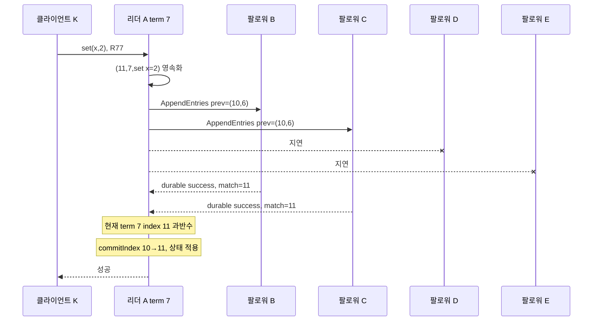

# 05. Raft 로그와 커밋

Raft는 여러 서버가 같은 명령 순서를 선택하도록 만드는 합의 알고리즘이다. 이 장에서는 다섯 노드 A, B, C, D, E가 리더를 뽑고, 클라이언트 명령 하나를 복제하고, 충돌 로그를 되돌린 뒤 성공 응답을 보내는 전 과정을 숫자로 추적한다. 핵심은 “로그에 존재한다”, “과반수에 존재한다”, “커밋됐다”, “상태 기계에 적용됐다”, “클라이언트가 성공을 받았다”를 서로 다른 상태로 보는 것이다.

## 로그를 이루는 객체와 수명

**임기(term)**는 리더 선거 세대를 나타내는 단조 증가 정수다. 각 노드의 `currentTerm`은 지금까지 본 가장 큰 임기이며 안정 저장소에 남는다. 벽시계 시간이 아니고, 더 큰 값은 더 나중 선거 세대를 뜻한다. 낮은 임기의 메시지를 거부하고 옛 리더를 물러나게 하는 데 필요하다.

**인덱스(index)**는 한 로그 안에서 항목의 위치다. 1, 2, 3처럼 증가한다. 같은 index라도 분할 중 서로 다른 미커밋 항목이 잠시 존재할 수 있으므로 index만으로 동일한 역사를 증명하지 못한다.

**로그 항목(log entry)**은 `(index, term, command)` 세 정보를 묶은 내구성 객체다. 예를 들어 `(8,4,set x=7)`은 임기 4 리더가 로그 위치 8에 만든 명령이다. 항목이 다음 리더에게 복제돼도 원래 term은 바뀌지 않는다. 상태 기계에 적용되거나 스냅샷에 포함된 뒤 원본 로그 구간은 압축할 수 있다.

**표(vote)**는 한 노드가 특정 임기에 후보 한 명을 지지했다는 내구성 결정이다. `votedFor`에 저장하고 같은 임기에는 한 후보에게만 준다. 응답 전에 영속화해야 재시작 뒤 두 후보에게 표를 주는 일을 막는다.

**선거 타임아웃(election timeout)**은 팔로워가 유효한 리더 메시지를 기다리는 상한이다. 만료되면 임기를 올리고 후보가 된다. 무작위 범위에서 고르면 여러 후보가 동시에 출마할 확률을 낮춘다. 타임아웃은 리더 사망 증명이 아니라 진행성을 시작하는 추정 장치다.

**RequestVote**는 후보가 임기, 후보 ID, 마지막 로그 index와 term을 보내 표를 요청하는 Raft RPC다. 투표자는 더 높은 임기인지, 같은 임기에 이미 투표했는지, 후보 로그가 자기 로그만큼 최신인지 검사한다.

**AppendEntries**는 리더가 로그를 복제하고 빈 요청으로 하트비트를 보내는 Raft RPC다. 현재 term, 바로 앞 로그의 `prevLogIndex`와 `prevLogTerm`, 새 항목들, `leaderCommit`을 담는다. 팔로워는 앞 경계가 자기 로그와 일치할 때만 항목을 붙인다.

**커밋 인덱스(commitIndex)**는 합의 규칙상 확정된 가장 큰 로그 위치다. 더 큰 값으로만 전진한다. **마지막 적용 인덱스(lastApplied)**는 상태 기계가 실제로 실행한 가장 큰 위치다. `commitIndex=8`, `lastApplied=6`이면 7과 8을 순서대로 적용해야 한다. 합의 완료와 업무 상태 반영을 분리해 복구와 읽기 경계를 설명한다.

| 상태 | 저장 위치 | 관리 주체 | 재시작 뒤 |
|---|---|---|---|
| `currentTerm` | 안정 저장소 | 모든 노드 | 반드시 보존 |
| `votedFor` | 안정 저장소 | 투표자 | 반드시 보존 |
| `log[]` | 안정 저장소 | 리더 제안·팔로워 검증 | 반드시 보존 |
| `commitIndex` | 진행 상태 | 리더 통지와 복구 절차 | 단조롭게 재구성 |
| `lastApplied` | 상태 기계 경계 | 적용 루프 | 상태와 함께 일관되게 복구 |
| `nextIndex[]` | 리더 메모리 | 현재 리더 | 새 리더가 다시 계산 |
| `matchIndex[]` | 리더 메모리 | 현재 리더 | 응답으로 다시 학습 |

## 다섯 노드 선거를 메시지와 디스크 순서로 추적한다

초기에는 모두 팔로워이고 `currentTerm=6`이다. 마지막 로그는 A·B·C가 `(index=10, term=6)`, D·E가 `(9,5)`까지다. 선거 타임아웃은 A=180ms, B=240ms, C=310ms, D=350ms, E=390ms라는 교육용 값이다.

| 시각 | A | B | C | D | E | 결과 |
|---:|---|---|---|---|---|---|
| 0ms | follower t6 | follower t6 | follower t6 | follower t6 | follower t6 | 리더 하트비트 없음 |
| 180ms | timeout, t7과 `votedFor=A` 영속 | 대기 | 대기 | 대기 | 대기 | A가 candidate |
| 182ms | RequestVote(t7,last=10/6) 전송 | 수신 | 수신 | 수신 | 수신 | 투표 검사 |
| 188ms | 자기 표 | A 표 영속·응답 | A 표 영속·응답 | 후보 로그가 더 최신이라 A 표 | 응답 지연 | A가 최소 3표 확보 |
| 190ms | leader t7, 빈 AppendEntries | timeout 재시작 | timeout 재시작 | timeout 재시작 | timeout 재시작 | 단일 리더 |
| 195ms | 팔로워별 `nextIndex=11` | 성공 응답 | 성공 | 성공 | 성공 | 복제 준비 |

A는 임기와 자기 표를 디스크에 쓰기 전에 RequestVote를 보내면 안 된다. 재시작 뒤 term 6으로 돌아가면 같은 선거의 규칙을 깨뜨릴 수 있다. B도 `votedFor=A`를 영속화한 뒤 표를 응답해야 한다. 그렇지 않으면 재시작 후 term 7의 다른 후보에게 다시 투표할 수 있다.

후보 최신성은 마지막 term을 먼저 비교하고, 같으면 마지막 index를 비교한다. 투표자의 마지막 로그가 `(10,6)`일 때 후보 `(12,5)`는 더 길어도 term이 낮아 오래됐다. 후보 `(9,7)`은 index가 짧아도 마지막 term이 높아 더 최신으로 본다. 이 비교가 확정될 수 있는 최신 로그를 가진 후보만 과반수 표를 얻도록 돕는다.

## 한 명령의 append, commit, apply, client ack 전체 표

선거 뒤 모든 노드 로그는 index 10까지 일치하고 x=1이다. 클라이언트 K가 `request_id=R77, set(x,2)`를 보낸다.

| 시각 | A | B | C | D | E | 클라이언트 |
|---:|---|---|---|---|---|---|
| 200ms | `commit=10, applied=10, x=1` | 동일 | 동일 | 동일 | 동일 | 요청 전 |
| 205ms | index11/term7 생성·영속 | 10까지 | 10까지 | 10까지 | 10까지 | 호출 중 |
| 208ms | AppendEntries 전송 | prev(10,6) 검사 | 검사 | 지연 | 지연 | 대기 |
| 216ms | B 성공, `match[B]=11` | index11 영속 | 처리 중 | 10 | 10 | 대기 |
| 223ms | C 성공, A·B·C 3곳 | index11 | index11 영속 | 10 | 10 | 대기 |
| 224ms | `commitIndex=11` | leaderCommit 통지 전 | 통지 전 | 10 | 10 | 아직 응답 없음 |
| 226ms | index11 적용, x=2, `lastApplied=11` | commit11 수신·적용 | commit11 수신 | 10 | 10 | 대기 |
| 228ms | R77 결과 영속 확인 뒤 성공 전송 | x=2 | x=2 적용 | x=1 | x=1 | 성공 수신 |
| 260ms | x=2 | x=2 | x=2 | index11 수신·적용 | index11 수신·적용 | 전체 수렴 |

A는 자신을 포함한 A·B·C 세 곳의 `matchIndex≥11`을 확인했다. index11의 term 7이 현재 term과 같으므로 `commitIndex=11`로 전진한다. 상태 기계는 로그 순서대로 적용한다. 클라이언트 성공을 상태 적용 뒤 보내는 계약이라면 226ms 적용과 R77 결과 기록까지 끝낸 후 228ms에 응답한다.

응답 패킷이 유실되면 클라이언트는 타임아웃을 보지만 index11은 커밋됐을 수 있다. 같은 R77로 재시도하고 상태 기계가 이전 결과를 돌려줘야 중복 명령을 막을 수 있다. Raft 커밋은 네트워크 응답 전달을 보장하지 않는다.

## prevLogIndex와 prevLogTerm으로 충돌 경계를 찾는다

새 리더 A의 로그가 `(1,2),(2,2),(3,4),(4,7)`이고 팔로워 E가 `(1,2),(2,3),(3,3)`이라고 하자. A가 `prevLogIndex=3, prevLogTerm=4`로 index4를 보내면 E의 index3 term3과 달라 실패한다. 리더는 `nextIndex[E]`를 앞당겨 다시 시도한다.

| 시도 | A가 보낸 prev | E의 해당 항목 | 판정 | 다음 행동 |
|---:|---|---|---|---|
| 1 | `(3,4)` | `(3,3)` | 불일치 | 더 앞에서 재시도 |
| 2 | `(2,2)` | `(2,3)` | 불일치 | 더 앞에서 재시도 |
| 3 | `(1,2)` | `(1,2)` | 일치 | E의 index2 이후 충돌 suffix 제거 |
| 4 | `(1,2)` 뒤 A의 2..4 | 새 항목 저장 | 성공 | `matchIndex[E]=4` |

**충돌(conflict)**은 같은 index에 다른 term의 항목이 있거나 필요한 이전 항목이 없는 상태다. 팔로워는 일치하는 prefix 뒤에서 리더 항목과 충돌하는 suffix를 제거하고 리더 로그를 붙인다. 커밋된 prefix를 임의 삭제하는 방식이 아니다. 선거 제한과 커밋 규칙 때문에 유효한 새 리더가 확정 로그를 포함한다.

구현은 매번 한 칸씩 뒤로 갈 수도 있지만 팔로워가 충돌 term과 첫 index를 알려 여러 칸을 건너뛸 수 있다. 이 최적화가 바꾸는 것은 왕복 횟수이고, `(prevLogIndex,prevLogTerm)`으로 공통 역사를 확인하는 안전 조건은 같다.

## 과거 term 항목을 과반수만 보고 직접 커밋하면 안 된다

현재 리더 A의 term이 4이고 index2의 항목 X는 term2에서 만들어졌다고 하자. X가 A, B, C 세 곳에 있어 5노드 과반수다. 그래도 A는 “과반수에 있으니 X를 직접 커밋했다”고 판단하면 안 된다.

반례를 단계별로 보자.

1. term2 리더 A가 X를 만들고 A와 B에만 복제한 뒤 분리된다.
2. term3에서 E가 리더가 되어 자기 로그에 다른 항목 Y를 index2에 만들지만 아직 과반수 커밋하지 못한다.
3. term4에서 A가 다시 리더가 되어 X를 C까지 복제한다. 이제 X는 A·B·C 세 곳이다.
4. 이 시점 A가 실패하면, 로그 최신성 비교 조건에 따라 term3 항목 Y를 가진 E가 다음 임기 리더가 될 수 있는 실행이 존재한다.
5. E가 Y를 다른 노드에 복제하면 X가 덮일 수 있다. 따라서 3단계의 “과거 term X가 현재 과반수”만으로 확정했다고 하면 커밋 항목이 사라지는 모순이 생긴다.

Raft 리더는 현재 term의 항목이 과반수에 저장된 것을 확인할 때만 그 index를 직접 커밋한다. A가 term4의 no-op 또는 명령 Z를 index3에 추가하고 A·B·C에 복제해 index3을 커밋하면, prefix인 X도 간접 커밋된다. 현재 term 항목의 과반수는 이후 선거에서 그 로그를 가진 후보가 과반수와 교차하도록 만든다.

| 단계 | A | B | C | D | E | 직접 커밋 가능? |
|---|---|---|---|---|---|---|
| term4, X만 복제 | `2:X(t2)` | X | X | 없음 | `2:Y(t3)` | X는 과거 term이라 아니오 |
| term4, Z 추가 | `3:Z(t4)` | Z | Z | 없음 | Y | Z는 현재 term 과반수 |
| commitIndex=3 | X,Z 커밋 | X,Z | X,Z | 추후 동기화 | 추후 충돌 제거 | prefix X도 간접 커밋 |

## ReadIndex는 민감한 읽기의 권한 확인이다

**ReadIndex**는 리더가 새 로그 항목을 매번 추가하지 않고도 선형화 가능한 읽기를 제공하도록, 자신이 현재 임기의 유효한 리더임을 과반수 통신으로 확인하고 안전한 커밋 경계를 얻는 절차다. 구체 API는 구현마다 다르지만 핵심 조건은 같다. 옛 리더가 고립된 채 로컬 상태를 최신이라고 반환하지 못해야 한다.

리더는 현재 term에서 적어도 하나의 항목을 커밋해 이전 임기의 확정 경계를 안전하게 알고, 과반수에 하트비트 문맥을 확인한 뒤 읽기 인덱스를 정한다. 로컬 상태 기계가 `lastApplied≥readIndex`가 될 때까지 기다리고 읽는다. 과반수 확인만 하고 적용 대기를 생략하면 commitIndex 11인데 lastApplied 10인 상태에서 x=1을 돌려줄 수 있다.

모든 읽기가 ReadIndex를 필요로 하지는 않는다. 모니터링 캐시처럼 오래된 값을 허용하는 API는 팔로워 로컬 읽기를 제공할 수 있다. 권한, 잔액, 리스 소유자처럼 최신성이 안전 조건인 읽기는 현재 리더 확인과 적용 경계를 요구한다. API 이름에 `stale`, `serializable`, `linearizable` 같은 계약을 분명히 표시해야 한다.

+## 리더 장애 시점에 따라 클라이언트가 아는 사실이 달라진다

같은 index11에서도 A가 멈춘 위치에 따라 결과가 다르다.

| 장애 시점 | 복제 상태 | 새 리더에서 가능한 결과 | 클라이언트 판단 |
|---|---|---|---|
| 로컬 기록 전 | 어디에도 없음 | 명령 없음 | 타임아웃이면 미실행 가능 |
| A에만 기록 | 1곳 | 새 리더 로그에서 사라질 수 있음 | 성공으로 간주 불가 |
| A·B에 기록 | 2곳 | 5노드 과반수 아님, 사라질 수 있음 | 결과 불확실 |
| A·B·C에 현재 term 항목 기록·커밋 | 3곳 | 이후 리더가 보존 | 응답 유실이면 실행됐을 수 있음 |
| 적용·응답 뒤 | 커밋·상태 반영 | 결과 보존 | 성공을 받은 클라이언트는 완료로 취급 |

리더가 과반수 응답을 받은 직후 `commitIndex`를 메모리에 올리기 전에 죽는 경우도 생각해야 한다. 새 리더는 로그와 현재 term의 새 항목을 이용해 커밋 경계를 다시 전진시킬 수 있다. 커밋의 안전성은 옛 리더의 메모리 플래그 하나가 아니라 과반수 로그와 선거 제한에서 나온다. 반대로 클라이언트는 그 내부 사실을 즉시 알 수 없으므로 요청 ID 기반 조회가 필요하다.

새 리더는 당선되자마자 과거 term 항목들의 커밋 여부를 단순 복제 개수로 추정하지 않는다. 현재 term의 no-op 항목을 추가해 과반수에 복제하면 그 위치까지의 prefix를 안전하게 커밋할 수 있다. no-op도 `(index,term,command)` 로그 항목이며 상태 기계 업무를 바꾸지 않더라도 커밋 경계를 확립하는 역할을 한다.

## nextIndex와 matchIndex를 숫자로 갱신한다

리더가 선출되면 각 팔로워의 `nextIndex`를 보통 리더 마지막 index 다음으로 시작한다. 리더 마지막 index가 12라면 `nextIndex[E]=13`, `matchIndex[E]=0`에서 시작할 수 있다. E 로그가 8까지라면 `prevLogIndex=12` 요청은 실패한다. 리더는 충돌 정보를 사용해 9로 낮추고, `prev=(8,term)`이 맞으면 9~12를 한 번에 보낸다.

성공 응답 뒤에만 `matchIndex[E]=12`, `nextIndex[E]=13`으로 올린다. 요청을 보냈다는 이유로 먼저 올리면 유실된 패킷을 저장 완료로 오인한다. 반대로 오래된 실패 응답이 늦게 와서 이미 성공한 matchIndex를 뒤로 내리게 해서도 안 된다. 요청 세대나 현재 진행 상태를 확인해 응답을 적용한다.

`matchIndex`는 리더가 팔로워별로 가진 추정이므로 팔로워가 직접 보내는 “내 커밋 위치”와 같은 값이 아니다. 팔로워는 자기 로그를 저장하고 성공·실패와 충돌 정보를 답한다. 리더가 이 응답을 현재 임기와 요청 문맥 안에서 해석한다.

## AppendEntries 성공은 항목 커밋과 같지 않다

B 한 대가 AppendEntries 성공을 보냈다는 것은 B가 요청의 앞 경계를 확인하고 새 항목을 정해진 내구성 수준까지 기록했다는 뜻이다. A와 B 두 복제본만으로 5노드 커밋은 아니다. 세 번째 C의 성공이 도착하고 현재 term 항목 조건을 확인해야 한다.

팔로워가 `leaderCommit=11`을 받았을 때 자기 마지막 새 항목이 9라면 `commitIndex=min(leaderCommit,lastNewIndex)=9`처럼 보유한 범위까지만 전진한다. 아직 없는 index10~11을 적용할 수 없다. 후속 AppendEntries로 로그를 받은 뒤 커밋 경계를 따라잡는다. 이 제한이 부분 전달 중 존재하지 않는 명령을 적용하는 일을 막는다.

빈 AppendEntries도 단순 생존 신호 이상의 검사를 수행한다. prev 경계를 확인하고 리더의 commitIndex를 전달한다. 하지만 과거에 받은 빈 하트비트 하나를 오래 보관해 현재 리더 권한 증명으로 재사용할 수는 없다. 임기와 현재 과반수 통신 문맥이 필요하다.

## 민감한 읽기와 리더 리스의 차이

일부 구현은 매 읽기마다 과반수 왕복을 줄이려고 리더 리스를 사용한다. 리스는 제한된 시간 동안 다른 리더가 선출되지 않는다는 시간 가정에 기대는 권한이다. 시계 진행률, 프로세스 정지, 메시지 지연 상한이 계약과 맞지 않으면 옛 리더가 리스가 남았다고 믿는 동안 새 리더가 생길 수 있다.

ReadIndex 계열은 현재 임기의 과반수 통신으로 권한을 확인하는 경로다. 리스 읽기는 검증된 시간 가정 아래 빠른 경로가 될 수 있지만, 단순히 `role==leader` 메모리 플래그를 읽는 것과 다르다. 안전이 중요한 시스템은 시간 가정이 깨졌거나 리스 상태가 불명확하면 ReadIndex 또는 로그 장벽 경로로 내려가야 한다.

읽기 결과가 여러 로컬 저장소 객체를 포함한다면 `lastApplied`만 기다리는 것 외에도 상태 기계의 원자적 스냅샷이 필요하다. index11 명령 적용 중 x는 바뀌고 y는 아직 안 바뀐 중간 상태를 읽으면 로그 순서에 존재하지 않는 조합이 나온다. 합의와 로컬 읽기 원자성은 각각 지켜야 한다.

## 문제와 전체 해설

### 1. 투표자 마지막 로그가 `(index10,term6)`이다. 후보 `(12,5)`와 `(9,7)` 중 누가 더 최신인가?

마지막 term을 먼저 비교한다. `(12,5)`는 더 길어도 term5라 오래됐고, `(9,7)`은 짧아도 term7이라 더 최신이다. term이 같을 때만 index를 비교한다. 길이만 고르면 낮은 임기의 긴 미확정 suffix가 확정 가능성이 있는 새 항목을 밀어낼 수 있다.

### 2. B가 term8에서 A에게 표를 보낸 뒤 `votedFor` 저장 전에 재시작하면 무엇이 위험한가?

재시작한 B는 투표 사실을 잊고 같은 term8의 C에게도 표를 줄 수 있다. 서로 다른 두 후보가 각자 과반수를 구성하는 데 B의 표를 중복 사용할 가능성이 생긴다. B는 `currentTerm=8,votedFor=A`를 안정 저장소에 쓴 뒤 응답해야 한다.

### 3. `matchIndex=[12,12,11,8,8]`, 현재 term은 7이고 index11 term7, index12 term7이다. 최대 직접 커밋 위치는?

5노드 과반수는 세 곳이다. index12 이상은 두 곳뿐이라 부족하고 index11 이상은 A,B,C 세 곳이다. index11이 현재 term7이므로 commitIndex를 11까지 직접 전진시킬 수 있다. index12는 더 복제될 때까지 미커밋이다.

### 4. 같은 matchIndex에서 index11의 term이 6이라면 직접 커밋할 수 있는가?

현재 term7 리더는 과거 term6 항목이 세 곳이라는 사실만으로 직접 커밋하지 않는다. term7의 새 항목을 index12에 추가하고 세 곳에 복제해 index12를 커밋하면 prefix index11도 간접 커밋된다. 이 제한이 과거 항목을 다음 리더가 덮는 반례를 막는다.

### 5. AppendEntries의 prev index는 맞지만 prev term이 다르면 왜 거부하는가?

같은 위치 번호에 서로 다른 임기의 항목이 있다는 뜻이라 그 앞 역사가 동일하다고 보장할 수 없다. 팔로워가 받아 붙이면 한 로그 안에 서로 다른 역사 조각이 섞인다. 리더는 더 앞의 `(index,term)` 일치점을 찾고 충돌 suffix를 교체해야 한다.

### 6. `commitIndex=15`, `lastApplied=12`인 리더가 민감한 읽기를 즉시 처리해도 되는가?

아니다. 13~15의 커밋 명령이 읽기 상태에 아직 반영되지 않았다. ReadIndex 등으로 현재 리더 권한과 읽기 경계를 확인한 뒤 `lastApplied≥readIndex`까지 적용하고 읽어야 한다. 그렇지 않으면 유효한 리더에서도 오래된 권한이나 잔액을 반환한다.

### 7. 클라이언트가 타임아웃을 봤으니 같은 송금을 새 요청 ID로 보내도 되는가?

첫 송금이 커밋·적용됐고 응답만 유실됐을 수 있다. 새 ID는 별도 명령으로 두 번 실행될 수 있다. 같은 요청 ID로 재시도하고 상태 기계가 완료 결과를 내구성 있게 중복 제거해야 한다. 외부 결제까지 포함되면 그 시스템의 멱등성 경계도 필요하다.

### 8. 리더 A의 로컬 로그에 항목이 있고 팔로워 한 대도 저장했다. 운영자가 디스크를 보고 커밋됐다고 선언해도 되는가?

5노드라면 두 복제본은 과반수 3에 못 미친다. 더구나 항목 term과 현재 term, 리더의 commitIndex 전진 규칙을 확인해야 한다. 디스크 존재는 복제 사실일 뿐 커밋 결정이 아니다. 복구 도구가 미커밋 suffix를 업무 상태로 강제 적용하면 합의 안전성을 우회한다.

+## 검산할 불변 조건

운영 로그를 볼 때는 숫자가 증가했다는 사실만 확인하지 않는다. 한 임기 한 표인지, 리더 로그의 같은 `(index,term)` prefix가 팔로워에 보존되는지, `lastApplied≤commitIndex≤마지막 로그 index`인지, 클라이언트 성공 항목이 이후 리더 로그에 남는지를 함께 검사한다. term은 선거 세대이고 index는 로그 위치이므로 서로 더하거나 크기를 직접 비교하지 않는다. `term=9,index=4`와 `term=8,index=100`의 최신성도 마지막 term을 먼저 비교한다. 이 불변 조건이 깨진 로그는 성능 저하가 아니라 안전성 조사 대상이다.

## 공식 자료

- [Ongaro and Ousterhout, “In Search of an Understandable Consensus Algorithm”](https://raft.github.io/raft.pdf)
- [Raft 공식 웹사이트](https://raft.github.io/)

[← 이전](04-leaders-quorums-and-partitions.md) · [목차](README.md) · [다음 →](06-consensus-failures-and-snapshots.md)
