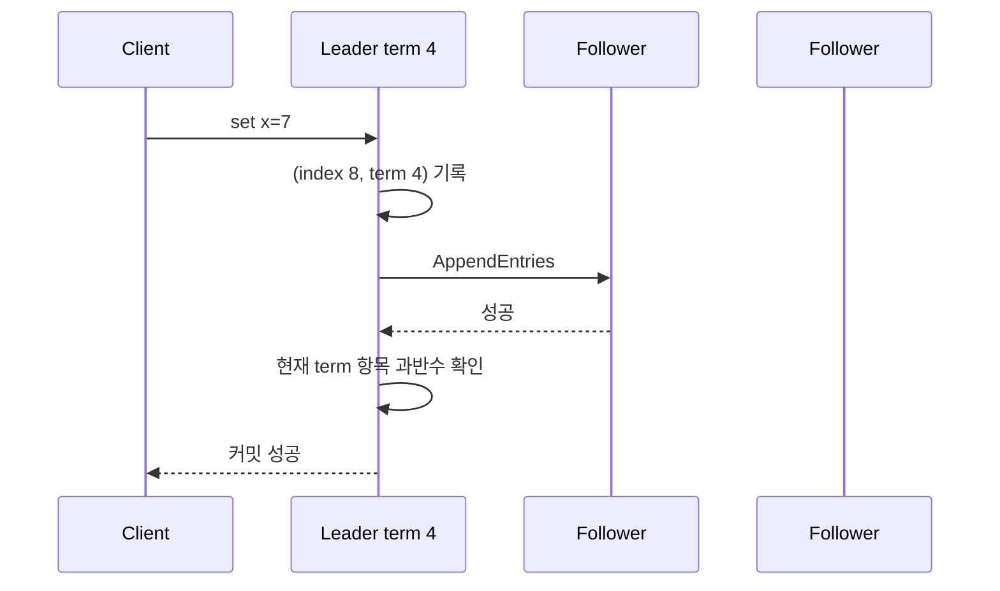

# 05. Raft 로그와 커밋

[← 이전](04-leaders-quorums-and-partitions.md) · [목차](README.md) · [다음 →](06-consensus-failures-and-snapshots.md)

## 상태와 역할

Raft는 복제 상태 기계용 합의 알고리즘이다.
노드는 follower, candidate, leader 중 한 역할이다.
**term(임기)** 은 선거 시대를 나타내는 증가 정수다.
로그 entry는 index, term, command를 가진다.
commitIndex는 커밋이 확인된 가장 큰 로그 위치다.
lastApplied는 상태 기계에 실제 적용한 위치다.

입력 명령을 리더가 현재 term의 entry로 만든다.
팔로워는 앞 index와 term이 맞는지 검사한다.
맞으면 충돌 suffix를 정리하고 entry를 영속 저장한다.
리더는 matchIndex를 노드별 중간 상태로 유지한다.
현재 term의 entry가 과반수에 저장되면 commitIndex를 전진시킨다.
상태 기계가 index 순서로 명령을 적용한다.

## 오래된 term의 함정

5노드에서 term 2의 entry X가 A,B,C에 있다고 하자.
그 사실만으로 새 term 4 리더가 X를 직접 커밋했다고 판정하면 안 된다.
Raft 리더는 **현재 term의 entry**가 과반수에 복제된 조건으로 commitIndex를 전진시킨다.
현재 term entry Y가 X 뒤에 추가되어 과반수에 복제되면 prefix인 X도 함께 커밋된다.
이 규칙은 과거 term entry의 간접 커밋을 안전하게 만든다.

## 로그 항목을 실제 객체로 읽기

**entry(로그 항목)** 는 리더가 복제본 모두에게 같은 순서로 실행시키려는 명령 한 건이다.
entry는 보통 세 정보를 묶는다.

- **index**: 이 노드 로그 안의 위치다. 첫 항목은 1, 다음 항목은 2처럼 증가한다.
- **term**: 그 항목을 처음 만든 리더의 임기다. 항목이 다음 리더로 복사되어도 원래 term은 바뀌지 않는다.
- **command**: 상태 기계가 실행할 업무 명령이다. `set x=7`이나 `transfer A B 10`이 예다.

세 노드의 로그가 다음과 같다고 하자.

| index | 노드 A | 노드 B | 노드 C |
|---:|---|---|---|
| 1 | `(term 2, x=1)` | `(term 2, x=1)` | `(term 2, x=1)` |
| 2 | `(term 2, y=3)` | `(term 2, y=3)` | `(term 3, y=8)` |
| 3 | `(term 4, z=5)` | 없음 | 없음 |

index 1은 세 로그의 같은 **prefix(앞부분)** 에 있다.
index 2부터 A·B와 C의 내용이 다르다.
C의 index 2와 그 뒤에 있을 수 있는 항목은 새 리더 로그와 충돌하는 **suffix(뒷부분)** 다.
suffix를 지운다는 말은 파일 끝의 바이트를 무조건 자른다는 뜻이 아니다.
Raft 로그 저장 계층이 충돌 index부터의 논리 항목을 제거하고 리더 항목으로 다시 기록한다는 뜻이다.

## prevLogIndex와 prevLogTerm 검사를 손으로 따라가기

term 4의 리더 A가 B와 C에 `(index 3, term 4, z=5)`를 보내려 한다.
A는 새 항목 바로 앞의 위치와 임기를 함께 보낸다.
이 예에서는 `prevLogIndex=2`, `prevLogTerm=2`다.

B는 자신의 index 2를 찾는다.
B의 term은 2이므로 검사에 성공한다.
B는 index 3에 새 entry를 붙이고 성공을 답한다.

C도 자신의 index 2를 찾는다.
C의 term은 3이므로 검사에 실패한다.
C는 성공을 답하지 않고 충돌 정보를 보낸다.
리더는 더 앞 위치를 기준으로 다시 시도한다.
공통인 index 1, term 2까지 돌아가면 검사가 성공한다.
C는 충돌한 index 2 이후 suffix를 제거한다.
그 뒤 리더가 보낸 `(2,2,y=3)`과 `(3,4,z=5)`를 순서대로 붙인다.

| 단계 | C의 로그 | 검사 결과 |
|---|---|---|
| 시작 | `(1,2,x=1),(2,3,y=8)` | 아직 검사 전 |
| prev `(2,2)` 검사 | index 2의 실제 term은 3 | 실패 |
| prev `(1,2)` 검사 | index 1의 실제 term은 2 | 성공 |
| suffix 제거·추가 | `(1,2,x=1),(2,2,y=3),(3,4,z=5)` | 리더와 일치 |

index만 검사하면 서로 다른 term의 명령을 같은 역사로 오인할 수 있다.
term만 검사하면 로그의 어느 위치를 확인하는지 알 수 없다.
두 값을 함께 확인해야 “이 앞부분까지 같은 역사”라는 경계를 찾는다.

## matchIndex, commitIndex, lastApplied

**matchIndex** 는 리더가 “이 팔로워가 내 로그와 같은 것으로 확인한 가장 큰 index”를 노드별로 기록한 값이다.
팔로워 디스크 자체의 필드라기보다 리더가 복제 진행도를 추적하는 휘발성 상태다.
예를 들어 A=3, B=3, C=1이면 index 3은 A와 B 두 곳에 있다.
3노드 과반수는 2이므로 복제 개수 조건을 만족한다.

**commitIndex** 는 합의 규칙상 되돌릴 수 없다고 판단한 가장 큰 index다.
리더가 현재 term 4의 index 3을 과반수에서 확인하면 commitIndex를 3으로 올릴 수 있다.
index 1과 2는 prefix이므로 함께 커밋된다.
과거 term 2의 index 2를 “그 항목이 과반수에 보인다”는 이유만으로 직접 커밋한 것이 아니다.
현재 term 항목 index 3의 커밋을 통해 간접 커밋한 것이다.

**lastApplied** 는 상태 기계가 실제 실행한 가장 큰 index다.
commitIndex=3인데 lastApplied=1인 짧은 순간이 가능하다.
노드는 index 2의 `y=3`, index 3의 `z=5`를 순서대로 실행한다.
각 실행 뒤 lastApplied를 2, 3으로 올린다.
클라이언트 결과를 언제 공개하는지는 상태 기계 적용과 응답 계약까지 포함해 정해야 한다.

| 시각 | 사건 | matchIndex `(A,B,C)` | commitIndex | lastApplied |
|---:|---|---|---:|---:|
| 0 ms | 리더가 index 3을 로컬 기록 | `(3,2,1)` | 1 | 1 |
| 8 ms | B가 index 3 저장 확인 | `(3,3,1)` | 3 | 1 |
| 9 ms | 상태 기계가 index 2 적용 | `(3,3,1)` | 3 | 2 |
| 10 ms | 상태 기계가 index 3 적용 | `(3,3,1)` | 3 | 3 |

시간은 교육용 모형이며 Raft의 성능 보장이 아니다.

## 재시작 뒤 남는 상태와 다시 만드는 상태

Raft 논문의 **persistent state(영속 상태)** 는 응답 전에 안정 저장소에 보존되어 재시작 뒤에도 남아야 한다.

- `currentTerm`: 이 노드가 관측한 가장 큰 term이다.
- `votedFor`: 현재 term에 표를 준 후보이며 같은 term 중복 투표를 막는다.
- `log[]`: index, term, command를 가진 로그 항목 배열이다.

**volatile state(휘발성 상태)** 는 메모리에서 다시 만들 수 있는 진행 정보다.
모든 노드는 commitIndex와 lastApplied를 가진다.
리더는 팔로워별 nextIndex와 matchIndex도 가진다.
재시작한 리더는 이 값을 보수적으로 초기화하고 AppendEntries 응답으로 다시 학습한다.

`votedFor`를 메모리에만 두면 재시작한 노드가 같은 term에 두 후보에게 표를 줄 수 있다.
로그를 응답 뒤에만 디스크에 쓰면 저장 확인한 entry가 재시작 후 사라질 수 있다.
반대로 matchIndex를 반드시 디스크에 보존할 필요는 없다.
리더가 팔로워와 로그 검사를 다시 하며 복구할 수 있기 때문이다.

## 선거

follower가 election timeout 동안 유효한 heartbeat를 못 받으면 candidate가 된다.
term을 올리고 자신에게 투표한 뒤 RequestVote를 보낸다.
후보 로그가 투표자보다 최신이어야 표를 받을 수 있다.
과반수 표를 얻은 후보만 leader가 된다.
timeout 무작위화는 동시 출마 충돌을 줄일 뿐 안전성 근거 자체는 아니다.

## 반례

리더 로컬 디스크 기록만으로 커밋되지 않는다.
팔로워가 받았다는 응답도 디스크 영속화 설정에 따라 의미가 달라진다.
오래된 리더가 네트워크에서 고립된 채 자신을 리더라 불러도 쿼럼 없이 새 커밋은 못 한다.

## 문제와 해설

### 1. 5노드 과반수는?
3개다. 임의의 두 3개 집합은 교차한다.

### 2. term 3 entry가 새 리더 포함 3곳에 있으면 자동 커밋인가?
아니다. 새 리더는 현재 term entry의 과반수 복제로 커밋을 전진시킨다.

### 3. commitIndex와 lastApplied가 다른 이유는?
합의 완료와 상태 기계 실행은 별도 단계라 적용이 뒤따를 수 있다.

## 공식 자료

- [Raft 논문](https://raft.github.io/raft.pdf)
- [Raft 웹사이트](https://raft.github.io/)

[← 이전](04-leaders-quorums-and-partitions.md) · [목차](README.md) · [다음 →](06-consensus-failures-and-snapshots.md)
