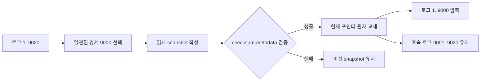

# 06. 합의 장애와 스냅샷

합의 시스템은 오래 실행될수록 로그가 커진다. 로그를 무한히 보관하면 재시작 때 수백만 명령을 다시 적용해야 하고 디스크도 계속 늘어난다. 그렇다고 앞부분을 지우기만 하면 새 노드가 어떤 상태에서 후속 로그를 시작해야 하는지 알 수 없다. 이 장은 로그 index 9,000까지 적용한 상태를 스냅샷으로 만들고, 오래 멈춘 팔로워에게 설치하며, 설치 중 장애와 읽기를 어떻게 처리하는지 끝까지 추적한다.

## 장애와 압축에 필요한 객체

**안전성(safety)**은 서로 다른 두 명령이 같은 로그 위치에서 모두 커밋되는 것처럼 잘못된 결정이 생기지 않는 성질이다. **진행성(liveness)**은 통신 가능한 과반수와 충분히 안정된 시간이 주어지면 선거·복제·요청이 언젠가 끝나는 성질이다. 파티션 중 소수 쪽을 멈추는 것은 진행성을 일부 포기해 안전성을 지키는 선택이다.

**충돌 로그(conflicting log)**는 두 노드의 같은 index에 다른 term의 항목이 있거나 한쪽에만 미커밋 suffix가 있는 상태다. 리더의 AppendEntries가 `prevLogIndex`와 `prevLogTerm`을 보내 공통 prefix를 찾고, 팔로워는 그 뒤의 충돌 suffix를 리더 로그로 교체한다. 유효한 리더가 커밋된 prefix를 덮는 것은 아니다.

**스냅샷(snapshot)**은 상태 기계가 특정 `lastApplied`까지 명령을 실행한 결과와 그 로그 경계를 함께 담은 내구성 이미지다. 대상은 업무 상태, 중복 요청 결과처럼 상태 기계에 속한 메타데이터, `lastIncludedIndex`, `lastIncludedTerm`이다. 노드의 스냅샷 관리기가 만들고 검증하며, 더 새 스냅샷으로 원자 교체할 때까지 유효하다.

**로그 압축(log compaction)**은 스냅샷에 포함되어 다시 재생할 필요가 없는 로그 prefix를 제거하거나 별도 보관해 활성 로그 크기를 줄이는 과정이다. 데이터베이스 값 압축이나 백업과 목적이 다르다. 스냅샷 경계와 복구에 필요한 설정 정보를 안전하게 남긴 뒤 수행한다.

**InstallSnapshot**은 리더가 자기 활성 로그보다 더 뒤처진 팔로워에게 스냅샷과 포함 경계를 전달하는 Raft RPC다. 팔로워는 전송 조각을 임시 영역에 받고 무결성을 검증한 뒤 상태와 로그 경계를 원자적으로 설치한다. 설치 완료 전 중간 상태를 서비스에 노출하지 않는다.

**ReadIndex**는 현재 리더가 과반수 통신으로 자기 권한을 확인하고, 선형화 읽기가 최소한 어디까지 적용되어야 하는지 정하는 읽기 경계다. 민감한 읽기는 `lastApplied≥readIndex`가 된 뒤 수행한다. 역할 변수에 `leader`라고 적혀 있다는 사실만으로 옛 리더의 읽기를 안전하게 만들 수 없다.

## 로그 최신성은 길이가 아니라 마지막 term과 index로 판단한다

투표자는 후보의 `lastLogTerm`을 먼저 비교하고, 같을 때 `lastLogIndex`를 비교한다. 투표자 로그 끝이 `(index=8,term=4)`라고 하자.

| 후보 | lastLogTerm | lastLogIndex | 투표 가능 | 이유 |
|---|---:|---:|---|---|
| A | 3 | 12 | 아니오 | 더 길어도 마지막 term이 낮음 |
| B | 4 | 7 | 아니오 | term은 같지만 index가 짧음 |
| C | 4 | 8 | 예 | 투표자만큼 최신 |
| D | 5 | 6 | 예 | index가 짧아도 마지막 term이 높음 |

낮은 임기의 긴 suffix는 여러 번 고립된 옛 리더가 만든 미커밋 항목일 수 있다. 길이만 보고 후보를 고르면 최신 임기의 항목을 잃을 수 있다. 마지막 term 우선 비교와 과반수 교집합이 커밋 로그를 가진 후보만 당선 가능하게 만든다.

세 노드 A, B, C가 term5 팔로워라고 하자. 선거 타임아웃은 A=180ms, B=260ms, C=330ms다. A가 먼저 만료해 `currentTerm=6,votedFor=A`를 영속화하고 RequestVote를 보낸다. B는 후보 로그 최신성을 검사하고 자기 `votedFor=A`를 영속화한 뒤 표를 준다. A는 자기 표와 B 표, 두 표로 세 노드 과반수를 얻는다. 190ms에 빈 AppendEntries를 보내 C의 타임아웃을 다시 시작한다. 숫자는 교육용이다.

## snapshot은 상태와 경계가 하나의 단위다

index 1~9,020의 로그가 있고 `commitIndex=9020`, `lastApplied=9020`이라고 하자. 노드는 index 9,000에서 스냅샷을 만들기로 한다. 그 이미지에는 index 9,000까지 적용된 업무 상태와 `(lastIncludedIndex=9000,lastIncludedTerm=12)`가 들어간다. 활성 로그에는 9,001~9,020을 남긴다.

| 구성 요소 | 예시 | 필요한 이유 |
|---|---|---|
| 상태 기계 이미지 | `x=27`, 사용자·세션·중복요청 상태 | 1~9000 명령 결과 복원 |
| `lastIncludedIndex` | 9000 | 후속 로그 시작 위치 |
| `lastIncludedTerm` | 12 | 같은 index의 역사 일치 확인 |
| 구성 정보 | index9000 시점의 멤버십 | 재시작·설치 시 승인 집합 해석 |
| 무결성 정보 | checksum·형식 버전 | 잘린 파일·잘못된 버전 거부 |

`lastIncludedIndex`만 있고 term이 없으면 팔로워의 index9000이 다른 임기의 역사인지 구분하기 어렵다. 상태만 있고 중복 요청 결과를 빼면 재시도한 클라이언트 명령을 다시 실행할 수 있다. 애플리케이션 상태 기계가 무엇을 포함하는지 정의해야 한다.

스냅샷은 임시 파일이나 새 세대 디렉터리에 쓴다. 작성 중에는 활성 스냅샷 포인터를 바꾸지 않는다. 모든 상태와 메타데이터를 쓰고 flush, checksum, 형식 검증을 마친 뒤 현재 포인터를 원자적으로 교체한다. 그 뒤에야 index9000 이전 로그를 압축한다. 파일 쓰기 중 프로세스가 죽으면 이전 완성 스냅샷과 로그로 복구하고 불완전 임시 파일은 사용하지 않는다.

## 생성 중 새 커밋이 와도 경계를 섞지 않는다

스냅샷 작성이 100ms 걸리는 동안 index9021~9030이 새로 커밋될 수 있다. 스냅샷은 시작 순간 정한 `lastApplied=9000`의 일관된 상태만 담아야 한다. x는 index9000 상태, y는 index9025 상태처럼 서로 다른 시점의 필드를 섞으면 어떤 로그 prefix에도 해당하지 않는 이미지가 된다.

이를 막는 방법은 상태 기계가 제공하는 원자적 스냅샷, copy-on-write, MVCC 읽기 시점, 짧은 잠금 뒤 불변 이미지 복사 등이다. 선택한 방법은 애플리케이션 저장소의 보장에 달려 있다. Raft가 로그 순서를 합의했다고 로컬 저장소의 다중 필드 읽기가 자동 원자화되지는 않는다.

생성이 끝나면 활성 로그 9001~9030을 유지한다. 스냅샷 경계 이후의 명령은 재시작 때 순서대로 재생한다. 각 적용이 0.2ms인 교육 모형이라면 9,030개 전부 재생은 `9030×0.2=1806ms`, 스냅샷 뒤 30개 재생은 `30×0.2=6ms`다. 스냅샷 파일 읽기 시간은 별도이므로 실제 복구 시간은 이 계산만으로 정해지지 않는다.

## 뒤처진 팔로워에 InstallSnapshot을 적용한다

리더 A의 스냅샷 경계는 `(9000,12)`, 활성 로그는 9001~9030이다. 팔로워 C는 장기 장애 뒤 index7000까지만 가지고 돌아왔다. A가 가진 가장 오래된 활성 로그가 9001이므로 AppendEntries만으로 7001~9000을 보낼 수 없다.

| 시각 | 리더 A | 팔로워 C | 서비스 상태 |
|---:|---|---|---|
| 0ms | `commit=9030`, snapshot 9000 | log·applied=7000 | C는 최신 읽기 제외 |
| 10ms | InstallSnapshot 메타·조각 전송 | 임시 파일에 수신 | 기존 상태로도 민감 읽기 금지 |
| 40ms | 마지막 조각 전송 | checksum 검사 | 설치 전 |
| 45ms | 완료 확인 대기 | `(9000,12)` 상태 원자 교체 | `lastApplied=9000` |
| 50ms | AppendEntries 9001~9030 | prev 경계 검사·로그 저장 | 따라잡는 중 |
| 60ms | `leaderCommit=9030` 전달 | 9001~9030 순차 적용 | `lastApplied=9030` |
| 65ms | C matchIndex=9030 확인 | 최신 상태 광고 | 읽기 후보 복귀 |

C가 자기 로그에 `(9000,12)`와 일치하는 항목 및 그 뒤 suffix를 가지고 있다면 일치하는 후속 로그를 보존할 수 있다. 경계 term이 다르면 다른 역사이므로 충돌하는 로그를 버리고 스냅샷 기준으로 시작한다. 스냅샷 이전 로그는 이미지에 흡수됐으므로 다시 적용하지 않는다.

전송은 여러 조각으로 나뉠 수 있다. 각 조각의 offset과 스냅샷 ID를 확인해야 이전 시도의 조각과 섞이지 않는다. 설치 중 재시작하면 완성 표시가 없는 임시 이미지를 버리고 다시 받거나 검증된 지점부터 재개한다. “파일이 존재한다”와 “설치 완료”를 분리한다.

## 스냅샷 설치 중 읽기와 쓰기의 권한

C가 snapshot 9000을 설치했지만 리더 commitIndex는 9030이다. C에서 민감한 잔액을 읽으면 30개 명령만큼 오래될 수 있다. 설치 완료 직후 무조건 트래픽을 열지 말고 요청 계약에 따라 행동한다.

- 선형화 읽기는 현재 리더의 ReadIndex를 얻고 `lastApplied≥readIndex`인 노드에서 처리한다.
- 세션 읽기는 클라이언트의 최소 index 이상 적용한 노드가 처리한다.
- 명시적 stale 읽기는 응답에 적용 index를 붙여 정책 범위 안에서 허용할 수 있다.
- 쓰기는 유효한 리더로 전달한다. 설치 중인 팔로워가 직접 성공을 만들지 않는다.

옛 리더가 네트워크에서 고립됐지만 메모리 역할이 여전히 leader일 수 있다. 로컬 `commitIndex=9000`에서 권한 정보를 읽어 최신이라고 반환하면 term이 바뀐 뒤의 변경을 놓친다. ReadIndex의 과반수 확인, 안전한 리더 리스, 또는 합의 로그 장벽이 필요한 이유다. 시간 가정이 불확실한 리스만 믿기보다 권한·결제 같은 읽기는 과반수 기반 경로로 낮추는 정책이 안전하다.

## 충돌 suffix 복구와 스냅샷 경계가 만나는 경우

리더 A는 snapshot `(9000,12)` 뒤 `(9001,13),(9002,13),(9003,14)`를 갖고, 팔로워 B는 같은 snapshot 경계 뒤 `(9001,13),(9002,15)`를 갖는다고 하자. A가 `prev=(9002,13)`으로 index9003을 보내면 B의 index9002 term15와 달라 실패한다. A가 `prev=(9001,13)`으로 돌아가면 일치한다. B는 index9002 이후 충돌 suffix를 제거하고 A의 9002~9003을 붙인다.

팔로워가 snapshot 경계보다 앞을 prev로 요구받으면 로컬에 압축된 항목이 없다. 리더와 팔로워는 `(lastIncludedIndex,lastIncludedTerm)`을 가상의 로그 경계처럼 사용한다. 필요한 공통점이 리더의 활성 로그보다 앞이면 리더는 InstallSnapshot으로 전환한다.

커밋된 항목이 충돌 suffix로 제거되어서는 안 된다. 그런 현상이 보이면 선거 제한, 내구성, 구성 변경, 저장소 손상 중 불변 조건이 깨진 것이다. 정상 Raft 복구는 미커밋 꼬리를 정리하고 확정 prefix를 보존한다.

## compaction과 backup은 목적이 다르다

스냅샷과 로그 압축은 현재 합의 상태를 빠르게 복원하기 위한 장치다. 잘못된 `delete all` 명령이 정상적으로 커밋되면 삭제된 상태를 정확히 스냅샷한다. 모든 복제본이 같은 애플리케이션 버그를 실행해도 합의는 성공한다.

**백업(backup)**은 운영 실수, 논리적 삭제, 공통 소프트웨어 결함, 사이트 전체 손실 뒤 과거 시점으로 복구하기 위한 독립 사본이다. 합의 스냅샷을 다른 장애 영역에 보관한다고 자동으로 시점 복구 절차가 되는 것도 아니다. 보존 기간, 암호화, 복원 검증, 합의 클러스터에 다시 넣는 절차를 별도로 설계한다.

압축 직전 스냅샷을 검증하지 않거나 모든 노드가 동시에 같은 구간을 제거하면 손상된 이미지가 유일한 복구 근거가 될 수 있다. 노드별 생성 시점과 보존 세대, 전송 중 체크섬, 복원 시험을 운영 정책에 포함한다.

## 장애 시나리오별 안전한 결과

| 장애 | 위험한 처리 | 안전한 처리 |
|---|---|---|
| snapshot 임시 파일 작성 중 crash | 임시 파일을 현재 상태로 읽음 | 완성 마커·checksum 없으면 이전 세대 사용 |
| 포인터 교체 뒤 로그 삭제 전 crash | 두 세대가 보여 중복 적용 | snapshot ID와 포함 index로 한 경로 선택 |
| 로그 삭제 뒤 snapshot 손상 발견 | 복구 근거 상실 | 삭제 전 검증·이전 세대 보존·백업 |
| InstallSnapshot 중 연결 끊김 | 부분 상태 공개 | 임시 영역 유지 또는 폐기, 원자 교체 전 비공개 |
| 설치 직후 민감 읽기 | 9000 상태를 최신으로 반환 | readIndex까지 적용 후 응답 |
| 옛 리더의 로컬 읽기 | 권한 상실을 모름 | 현재 term 과반수 확인 또는 안전한 리스 |

## ReadIndex 읽기를 메시지 단계로 검증한다

현재 term14의 리더 A가 있고 `commitIndex=9030`, `lastApplied=9027`이라고 하자. 클라이언트가 권한 읽기를 요청한다.

1. A는 읽기 요청에 고유 문맥 `readCtx=Q51`을 붙인다.
2. A는 term14의 AppendEntries heartbeat에 Q51을 실어 B와 C에 보낸다.
3. B와 C가 term14 요청을 인정해 응답하면 A는 자기 자신을 포함한 과반수와 통신했다. 더 높은 term 응답을 받으면 즉시 팔로워가 되어 읽기를 중단한다.
4. A는 확인 시점의 안전한 `readIndex=9030`을 잡는다.
5. A의 상태 기계가 아직 9027까지이므로 9028, 9029, 9030을 순서대로 적용한다.
6. `lastApplied=9030`이 된 뒤 권한 값을 읽어 응답한다.

| 시각 | term·역할 | commitIndex | lastApplied | 읽기 상태 |
|---:|---|---:|---:|---|
| 0ms | A leader t14 | 9030 | 9027 | Q51 수신 |
| 4ms | B,C heartbeat 응답 | 9030 | 9027 | 현재 리더 확인 |
| 5ms | readIndex=9030 고정 | 9030 | 9027 | 적용 대기 |
| 7ms | index9028 적용 | 9030 | 9028 | 대기 |
| 9ms | index9029 적용 | 9030 | 9029 | 대기 |
| 11ms | index9030 적용 | 9030 | 9030 | 읽기 가능 |
| 12ms | t14 유지 | 9030 | 9030 | 권한 응답 |

A가 4ms 과반수 확인 전에 분할돼 옛 리더가 됐다면 Q51을 완료하지 못한다. A가 과반수 확인 뒤 아주 오래 정지했다가 읽는 문제까지 고려해 구현은 확인 문맥의 유효 범위와 term 변화를 검사한다. ReadIndex라는 이름만 호출하고 적용 대기나 현재 term 확인을 생략하면 선형화 보장이 완성되지 않는다.

## 스냅샷에는 구성 상태도 경계에 맞게 들어가야 한다

Raft 멤버십이 index8990에서 `{A,B,C}`, index8995에서 `{A,B,C,D}`로 바뀌고 snapshot 경계가 9000이라면 이미지의 구성 정보는 index9000까지 적용된 구성을 반영해야 한다. 옛 구성만 복원하면 재시작 뒤 쿼럼 분모를 잘못 계산하고, 미래 구성을 미리 넣으면 아직 적용되지 않은 결정을 사용한다.

스냅샷 설치 뒤 팔로워는 포함된 구성과 후속 로그의 구성 변경을 순서대로 복원한다. 구성 변경 항목을 단순 업무 로그와 분리 저장하더라도 같은 합의 경계를 따라야 한다. “서버 주소는 설정 파일에서 다시 읽으면 된다”는 방식은 서로 다른 노드가 다른 구성을 사용하게 할 수 있다.

중복 요청 테이블, 세션 최소 버전, 펜싱 토큰처럼 상태 기계 안전성에 영향을 주는 값도 빠뜨리면 안 된다. x와 y 데이터만 복원하고 `request_id=R77` 완료 기록을 빼면 클라이언트 재시도가 이미 실행한 송금을 다시 적용할 수 있다. 스냅샷 스키마는 보이는 업무 테이블보다 넓을 수 있다.

## 압축 시점은 크기·복구 비용·전송 비용의 균형이다

매 항목마다 스냅샷을 만들면 로그는 작지만 이미지 생성 I/O가 쓰기 경로를 방해한다. 너무 늦게 만들면 재시작 재생과 디스크 사용량이 커진다. 구현은 로그 바이트 수, 마지막 snapshot 뒤 항목 수, 예상 재생 시간, 디스크 여유를 함께 볼 수 있다.

예를 들어 평균 항목이 1KiB이고 100,000개가 쌓이면 약 100,000KiB다. 이를 1024로 나누면 약 97.66MiB다. 항목 적용이 평균 0.15ms라면 전부 재생하는 순수 적용 시간은 `100,000×0.15ms=15,000ms=15s`다. 실제로는 디스크 읽기와 캐시, 명령별 비용이 추가된다. 이 숫자는 임계값 계산 예시이며 제품 권장값이 아니다.

스냅샷 파일 자체가 20GiB라면 뒤처진 팔로워에 전체 이미지를 보내는 비용이 작은 로그 재생보다 클 수 있다. 증분 스냅샷이나 체크포인트 공유를 쓰더라도 최종 설치 이미지의 경계와 무결성을 검증해야 한다. 성능 최적화가 합의 경계를 흐리면 안 된다.

## 두 세대 스냅샷과 crash 지점을 추적한다

현재 완성 세대 S12가 `(index=8000,term=11)`이고 새 S13을 `(9000,12)`로 만드는 경우를 보자.

| crash 지점 | 디스크 상태 | 재시작 선택 |
|---|---|---|
| S13 데이터 절반 작성 | S12 current, S13 tmp | S13 폐기, S12+후속 로그 |
| S13 완성·checksum 전 | S12 current, S13 tmp | 검증 실패면 S12 |
| S13 검증 후 포인터 교체 전 | S12 current, S13 ready | 포인터·세대 규칙으로 S12 또는 안전한 승격 |
| S13 current 교체 후 옛 로그 삭제 전 | S12와 S13, 로그 존재 | current=S13, 9001 이후 재생 |
| S13 current, prefix 삭제 후 | S13과 후속 로그 | S13 검증 뒤 정상 복구 |

포인터 파일 하나를 제자리 덮어쓰다 찢어지면 어느 세대가 current인지 모를 수 있다. 세대 번호와 checksum을 가진 manifest를 새 파일로 완성한 뒤 원자 rename하고, 최소 한 이전 완성 세대를 잠시 유지하는 방식이 복구 선택을 분명히 한다. 구체 원자성은 파일시스템과 데이터베이스의 rename·fsync 보장을 확인해야 한다.

## 손상과 비잔틴 행동은 기본 Raft 장애 모델 밖이다

기본 Raft는 서버가 멈추거나 재시작하고 메시지가 지연·유실·중복되는 crash fault를 다룬다. 디스크가 조용히 다른 바이트를 돌려주거나 노드가 악의적으로 서로 다른 로그에 성공 ack를 보내는 비잔틴 장애를 자동으로 견디지 않는다. checksum은 우발 손상을 발견하는 데 도움을 주지만 손상된 모든 복제본에서 올바른 값을 재구성한다는 보장은 별도다.

스냅샷 checksum 실패가 나오면 그 파일을 억지로 열어 현재 상태로 쓰지 않는다. 정상 복제본에서 다시 설치하거나 검증된 백업으로 복구하며, 클러스터 구성과 커밋 경계를 확인한다. 손상 탐지, 격리, 재동기화 절차가 합의 프로토콜의 가정과 맞아야 한다.

## 문제와 전체 해설

### 1. 투표자 끝이 `(index=10,term=6)`이다. 후보 `(12,5)`와 `(8,7)` 중 누구에게 표를 줄 수 있는가?

마지막 term을 먼저 비교하므로 `(12,5)`는 길어도 오래됐다. `(8,7)`은 index가 짧아도 term7이 더 높아 최신이다. 다른 조건인 currentTerm과 중복 투표 검사도 통과한다면 두 번째 후보에게 표를 줄 수 있다. index만 비교하면 낮은 임기의 미커밋 꼬리가 최신 임기 역사를 밀어낼 수 있다.

### 2. snapshot 9000과 로그 9001~9040이 있다. 재시작 때 몇 항목을 재생하는가?

스냅샷 상태가 index9000까지 정확히 포함한다면 9001부터 9040까지 40개를 순서대로 적용한다. 9000을 다시 적용하면 비멱등 명령이 중복될 수 있고, 9001을 건너뛰면 상태가 빠진다. 포함 index는 재생 시작 경계다.

### 3. `lastIncludedIndex=5000`만 저장하고 term을 빼면 어떤 반례가 생기는가?

두 역사 모두 index5000까지 길지만 한쪽 index5000은 term8, 다른 쪽은 term9일 수 있다. 후속 로그가 어느 prefix와 연결되는지 index만으로 판단할 수 없다. `lastIncludedTerm`을 함께 저장해 AppendEntries와 InstallSnapshot 경계 검사를 해야 한다.

### 4. snapshot 작성 중 x를 읽은 뒤 새 명령이 y를 바꾸고, 이후 y를 읽어 파일을 완성했다. 왜 잘못인가?

x는 옛 index 상태, y는 새 index 상태라 어떤 단일 `lastApplied`에도 해당하지 않는 혼합 이미지가 될 수 있다. 복구 뒤 로그를 재생해도 실제 합의 이력에 없는 상태가 나온다. MVCC 시점 읽기, copy-on-write, 잠금 등으로 선택한 index의 일관된 이미지를 만들어야 한다.

### 5. 팔로워가 snapshot 설치를 마치면 즉시 선형화 읽기를 처리해도 되는가?

아니다. snapshot 경계가 9000인데 현재 commitIndex가 9030이면 30개 뒤처졌다. 현재 리더 권한을 ReadIndex 등으로 확인하고 `lastApplied≥readIndex`까지 따라잡아야 한다. 오래된 읽기를 명시적으로 허용한 API라면 적용 index를 표시하고 별도 경로로 제공할 수 있다.

### 6. InstallSnapshot 중 네트워크가 끊겨 절반 파일만 남았다. 재시작은 무엇을 해야 하는가?

절반 파일에는 완성 마커와 전체 checksum 검증이 없으므로 활성 상태로 사용하지 않는다. 이전 완성 스냅샷과 로그로 서비스하거나, 민감한 서비스는 복구 완료까지 대기하고, 새 전송을 다시 받는다. 조각 ID와 offset이 검증된다면 같은 스냅샷 전송을 안전하게 재개할 수도 있다.

### 7. 스냅샷이 매시간 생성되므로 백업을 없애도 되는가?

스냅샷은 잘못 커밋된 삭제와 공통 버그 결과도 현재 상태로 보존한다. 로그 압축 뒤에는 삭제 전 상태가 사라질 수 있다. 과거 시점 복구와 독립 장애 영역을 위한 백업, 보존 정책, 실제 복원 시험이 별도로 필요하다. 스냅샷은 성능·복구 가속이고 백업은 재해·논리 오류 복구다.

### 8. 옛 리더 A가 로컬 역할을 leader라고 보고 권한 `admin=false`를 반환했지만 새 리더는 이미 `admin=true`를 커밋했다. 무엇이 빠졌는가?

A는 더 높은 term을 아직 못 본 고립 노드일 수 있다. 로컬 역할 플래그만으로 현재 권한을 증명하지 못한다. 과반수와 현재 term을 확인하는 ReadIndex 경로 또는 엄격히 검증된 리더 리스를 사용하고, 상태 기계가 그 읽기 index까지 적용됐는지 확인해야 한다.

### 9. follower B의 충돌 suffix에 운영자가 중요하다고 생각하는 명령이 있다. 수동으로 새 리더 로그에 합쳐도 되는가?

그 항목은 클라이언트에 성공하지 않은 미커밋 제안일 수 있고 같은 index의 새 리더 명령과 충돌한다. 수동 합집합은 단일 로그 순서를 깨뜨린다. 업무상 다시 실행해야 한다면 기존 항목을 커밋으로 조작하지 말고 현재 리더에 새 요청 ID와 명시적 검토를 거쳐 새로운 로그 항목으로 제안해야 한다.

## 공식 자료

- [Ongaro and Ousterhout, “In Search of an Understandable Consensus Algorithm”](https://raft.github.io/raft.pdf)
- [Raft 공식 웹사이트](https://raft.github.io/)
- [etcd 3.7 Maintenance guide](https://etcd.io/docs/v3.7/op-guide/maintenance/)

[← 이전](05-raft-logs-and-commit.md) · [목차](README.md) · [다음 →](07-transactions-and-two-phase-commit.md)
