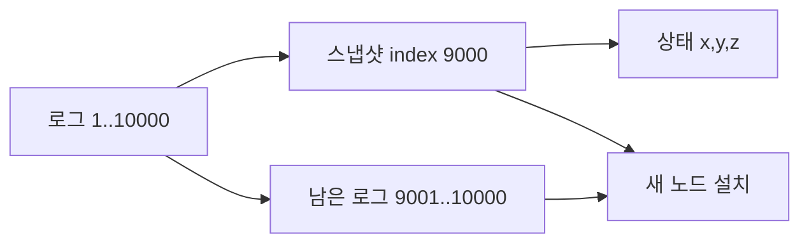

# 06. 합의 장애와 스냅샷

[← 이전](05-raft-logs-and-commit.md) · [목차](README.md) · [다음 →](07-transactions-and-two-phase-commit.md)

## 안전성과 진행성

**safety**는 잘못된 두 결정이 함께 생기지 않는 성질이다.
**liveness**는 조건이 회복되면 결국 결정하는 성질이다.
파티션 동안 소수 쪽을 멈추는 것은 진행성을 줄여 안전성을 지킨다.

## 충돌 로그 복구

팔로워의 이전 term suffix는 새 리더 로그와 다를 수 있다.
AppendEntries는 prevLogIndex와 prevLogTerm을 보낸다.
불일치하면 리더가 앞 위치로 되돌아가 공통 prefix를 찾는다.
팔로워는 충돌 suffix를 버리고 리더 entry를 붙인다.
커밋된 prefix는 선거 제한 때문에 덮어쓰이지 않는다.

## 스냅샷

**snapshot**은 특정 적용 index까지 상태 기계 결과를 압축한 이미지다.
입력은 lastApplied와 애플리케이션 상태다.
노드는 임시 파일에 상태와 메타데이터를 쓴다.
완료 검증 뒤 원자적으로 현재 snapshot으로 바꾼다.
그 index 이전 로그를 제거해 디스크와 재생 시간을 줄인다.
뒤처진 팔로워에는 InstallSnapshot으로 전달할 수 있다.

스냅샷 index가 9,000이고 남은 로그가 1,000개라면 새 노드는 상태를 설치한 뒤 1,000개만 재생한다.
각 적용이 0.2 ms인 교육 모형이면 10,000개는 2초, 1,000개는 0.2초다.
실제 시간은 I/O와 명령 비용에 달린다.

## 장애 경계

스냅샷 파일만 있고 포함 index와 term이 없으면 후속 로그 연결을 검증하기 어렵다.
임시 파일 쓰기 중 죽었는데 불완전 파일을 현재 파일로 읽으면 상태가 손상된다.
스냅샷이 백업을 대신하지 않는다.
모든 복제본의 잘못된 명령 결과도 그대로 담을 수 있다.

## 문제와 해설

### 1. 소수 파티션을 멈추는 목적은?
상충하는 두 커밋을 막아 safety를 지킨다.

### 2. 스냅샷 뒤 로그를 전부 지워도 되는가?
스냅샷 포함 index와 이후 복구·복제에 필요한 로그 경계를 보존해야 한다.

### 3. 스냅샷 설치 중 새 요청은?
구현은 원자적 교체 또는 동기화로 중간 상태 노출을 막아야 한다.

## 공식 자료

- [Raft 논문](https://raft.github.io/raft.pdf)
- [etcd Maintenance](https://etcd.io/docs/v3.5/op-guide/maintenance/)

[← 이전](05-raft-logs-and-commit.md) · [목차](README.md) · [다음 →](07-transactions-and-two-phase-commit.md)
## 상세 추적: 로그 최신성, 선거, 재시작

Raft 투표자는 후보의 마지막 term을 먼저 비교하고, term이 같을 때 마지막 index를 비교한다.

| 후보 | lastLogTerm | lastLogIndex | 투표자 `(4,8)`보다 최신? |
|---|---:|---:|---|
| A | 3 | 9 | 아니오 |
| B | 4 | 7 | 아니오 |
| C | 4 | 8 | 예 |

t=0 세 follower가 term 5다. t=180 ms A의 timeout이 끝난다. A는 term 6과 자기 표를 영속화한다. t=188 B가 최신성을 검사해 투표한다. A는 두 표로 과반수를 얻는다. t=190 heartbeat를 보내 C의 선거를 억제한다. 숫자는 교육용이다.

| 재시작 뒤 남는 상태 | 이유 |
|---|---|
| currentTerm | 낮은 term으로 후퇴 방지 |
| votedFor | 같은 term 중복 투표 방지 |
| log | 확인한 명령 보존 |
| snapshot index·term·상태 | 압축 경계에서 복구 |

index 9,000 snapshot과 로그 9,001..9,020이 있으면 snapshot을 복원한 뒤 뒤 로그를 적용한다. 생성 중 서로 다른 순간의 필드를 섞지 않도록 특정 lastApplied 경계의 일관된 이미지를 임시 파일에 쓰고 검증 뒤 원자 교체한다.
