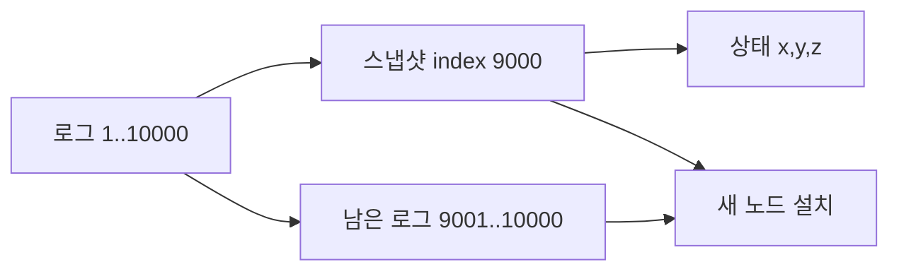

# 06. 합의 장애와 스냅샷

## 로그 최신성은 길이만 비교하지 않는다

투표자는 후보의 마지막 로그 term을 먼저 비교하고, term이 같을 때 마지막 index를 비교한다. 마지막 term이 높은 로그가 더 최신이다. term도 같다면 index가 큰 쪽이 최신이다.

투표자의 끝이 `(index 8, term 4)`라고 하자.

| 후보 | lastLogTerm | lastLogIndex | 투표 가능? | 이유 |
|---|---:|---:|---|---|
| A | 3 | 9 | 아니오 | 길어도 마지막 term이 낮음 |
| B | 4 | 7 | 아니오 | term 같고 index가 짧음 |
| C | 4 | 8 | 예 | 동일하게 최신 |
| D | 5 | 6 | 예 | index가 짧아도 term이 높음 |

이 규칙은 커밋 가능성이 있는 최신 term 항목을 가진 후보만 과반수 표를 얻도록 돕는다. 단순히 로그 항목 수가 많은 후보를 뽑으면 낮은 term의 긴 미커밋 suffix가 더 중요한 최신 항목을 밀어낼 수 있다.

## 선거를 영속 상태와 함께 추적하기

t=0 세 follower가 term 5다. t=180 ms A의 election timeout이 먼저 끝난다. A는 currentTerm=6과 votedFor=A를 디스크에 쓴 뒤 RequestVote를 보낸다. t=188 B는 후보 로그 최신성을 검사하고 votedFor=A를 영속화한 뒤 표를 보낸다. A는 자기 표와 B 표로 3노드 과반수를 얻어 leader가 된다. t=190 heartbeat를 보내 C의 선거 시간을 다시 시작시킨다.

A가 currentTerm을 디스크에 쓰기 전에 요청을 보내고 재시작하면 term이 되돌아갈 수 있다. B가 votedFor를 영속화하기 전에 표를 보내고 재시작하면 같은 term의 다른 후보에게 두 번째 표를 줄 수 있다. 응답 전 영속화가 필요한 이유다.

## snapshot은 상태와 로그 경계를 함께 담는다

**snapshot**은 특정 lastApplied까지 명령을 실행한 상태 기계 이미지다. `lastIncludedIndex`는 포함한 마지막 로그 위치, `lastIncludedTerm`은 그 위치의 term이다. 두 메타데이터가 있어야 뒤 로그와 연결되는 역사를 확인할 수 있다.

예를 들어 snapshot이 `(index 9000, term 12)`이고 남은 로그가 9001~9020이면 재시작은 snapshot 상태를 먼저 복원하고 9001부터 순서대로 적용한다. 9000 이전 로그 9,000개를 매번 재생하지 않는다.

| 복구 단계 | 입력 | 중간 상태 | 결과 |
|---|---|---|---|
| snapshot 읽기 | 파일·index·term | 무결성 검사 | 상태 at 9000 |
| 상태 교체 | 완성 이미지 | 이전/새 상태 중 하나 | lastApplied=9000 |
| 로그 재생 | 9001~9020 | 순차 적용 | lastApplied=9020 |
| 서비스 재개 | 복구 상태 | 읽기·쓰기 허용 | 정상 처리 |

snapshot을 임시 파일에 쓰다 crash하면 불완전 파일을 현재 snapshot으로 사용하면 안 된다. checksum과 메타데이터를 검증하고 포인터를 원자적으로 교체한다. 생성 중 새 커밋이 진행되더라도 snapshot은 선택한 lastApplied 경계의 일관된 상태를 담아야 한다.

## InstallSnapshot과 뒤처진 팔로워

리더가 보유한 가장 오래된 로그보다 팔로워 nextIndex가 앞이라면 AppendEntries만으로 따라잡을 수 없다. 리더는 snapshot과 포함 index·term을 전달한다. 팔로워는 완성된 snapshot을 설치하고, 자기 로그에 같은 index·term이 이어지면 그 뒤 suffix를 보존할 수 있다. 이어지지 않으면 snapshot 이전과 충돌하는 로그를 버린다.

snapshot은 백업이 아니다. 잘못된 삭제 명령이 커밋되면 삭제된 상태를 정확히 snapshot할 수 있다. 로그 압축과 독립적인 시점 복구 백업은 목적이 다르다.

## 추가 연습 문제와 해설

### 1. `(term 6,index 10)` 투표자가 `(7,8)` 후보와 `(6,12)` 후보 중 누구를 최신으로 보는가?
마지막 term을 먼저 보므로 `(7,8)`이 더 최신이다. index 비교는 term이 같을 때만 한다.

### 2. snapshot index 5000 뒤 로그 120개가 있으면 재시작 시 몇 명령을 재생하는가?
snapshot 복원 뒤 5001~5120의 120개다. snapshot 생성 비용과 상태 복원 시간은 별도다.

### 3. lastIncludedIndex만 있고 term이 없으면 무엇이 어려운가?
같은 index에 다른 term의 역사가 있을 때 snapshot 뒤 로그가 같은 prefix인지 검증하기 어렵다.

### 4. snapshot 쓰기 중 crash를 안전하게 다루는 방법은?
임시 파일에 완성하고 무결성을 검증한 뒤 원자적 이름·포인터 교체로 현재 snapshot을 바꾼다.

### 5. snapshot이 있으면 백업이 불필요한가?
아니다. snapshot은 현재 합의 상태의 압축본이라 논리적 삭제와 공통 버그도 포함한다. 과거 복구와 독립 장애를 위한 백업이 별도로 필요하다.

[← 이전](05-raft-logs-and-commit.md) · [목차](README.md) · [다음 →](07-transactions-and-two-phase-commit.md)

## 안전성과 진행성

**safety**는 잘못된 두 결정이 함께 생기지 않는 성질이다.
**liveness**는 조건이 회복되면 결국 결정하는 성질이다.
파티션 동안 소수 쪽을 멈추는 것은 진행성을 줄여 안전성을 지킨다.

## 충돌 로그 복구

팔로워의 이전 term suffix는 새 리더 로그와 다를 수 있다.
AppendEntries는 prevLogIndex와 prevLogTerm을 보낸다.
불일치하면 리더가 앞 위치로 되돌아가 공통 prefix를 찾는다.
팔로워는 충돌 suffix를 버리고 리더 entry를 붙인다.
커밋된 prefix는 선거 제한 때문에 덮어쓰이지 않는다.

## 스냅샷

**snapshot**은 특정 적용 index까지 상태 기계 결과를 압축한 이미지다.
입력은 lastApplied와 애플리케이션 상태다.
노드는 임시 파일에 상태와 메타데이터를 쓴다.
완료 검증 뒤 원자적으로 현재 snapshot으로 바꾼다.
그 index 이전 로그를 제거해 디스크와 재생 시간을 줄인다.
뒤처진 팔로워에는 InstallSnapshot으로 전달할 수 있다.

스냅샷 index가 9,000이고 남은 로그가 1,000개라면 새 노드는 상태를 설치한 뒤 1,000개만 재생한다.
각 적용이 0.2 ms인 교육 모형이면 10,000개는 2초, 1,000개는 0.2초다.
실제 시간은 I/O와 명령 비용에 달린다.

## 장애 경계

스냅샷 파일만 있고 포함 index와 term이 없으면 후속 로그 연결을 검증하기 어렵다.
임시 파일 쓰기 중 죽었는데 불완전 파일을 현재 파일로 읽으면 상태가 손상된다.
스냅샷이 백업을 대신하지 않는다.
모든 복제본의 잘못된 명령 결과도 그대로 담을 수 있다.

## 문제와 해설

### 1. 소수 파티션을 멈추는 목적은?
상충하는 두 커밋을 막아 safety를 지킨다.

### 2. 스냅샷 뒤 로그를 전부 지워도 되는가?
스냅샷 포함 index와 이후 복구·복제에 필요한 로그 경계를 보존해야 한다.

### 3. 스냅샷 설치 중 새 요청은?
구현은 원자적 교체 또는 동기화로 중간 상태 노출을 막아야 한다.

## 공식 자료

- [Raft 논문](https://raft.github.io/raft.pdf)
- [etcd Maintenance](https://etcd.io/docs/v3.5/op-guide/maintenance/)

[← 이전](05-raft-logs-and-commit.md) · [목차](README.md) · [다음 →](07-transactions-and-two-phase-commit.md)
## 상세 추적: 로그 최신성, 선거, 재시작

Raft 투표자는 후보의 마지막 term을 먼저 비교하고, term이 같을 때 마지막 index를 비교한다.

| 후보 | lastLogTerm | lastLogIndex | 투표자 `(4,8)`보다 최신? |
|---|---:|---:|---|
| A | 3 | 9 | 아니오 |
| B | 4 | 7 | 아니오 |
| C | 4 | 8 | 예 |

t=0 세 follower가 term 5다. t=180 ms A의 timeout이 끝난다. A는 term 6과 자기 표를 영속화한다. t=188 B가 최신성을 검사해 투표한다. A는 두 표로 과반수를 얻는다. t=190 heartbeat를 보내 C의 선거를 억제한다. 숫자는 교육용이다.

| 재시작 뒤 남는 상태 | 이유 |
|---|---|
| currentTerm | 낮은 term으로 후퇴 방지 |
| votedFor | 같은 term 중복 투표 방지 |
| log | 확인한 명령 보존 |
| snapshot index·term·상태 | 압축 경계에서 복구 |

index 9,000 snapshot과 로그 9,001..9,020이 있으면 snapshot을 복원한 뒤 뒤 로그를 적용한다. 생성 중 서로 다른 순간의 필드를 섞지 않도록 특정 lastApplied 경계의 일관된 이미지를 임시 파일에 쓰고 검증 뒤 원자 교체한다.
