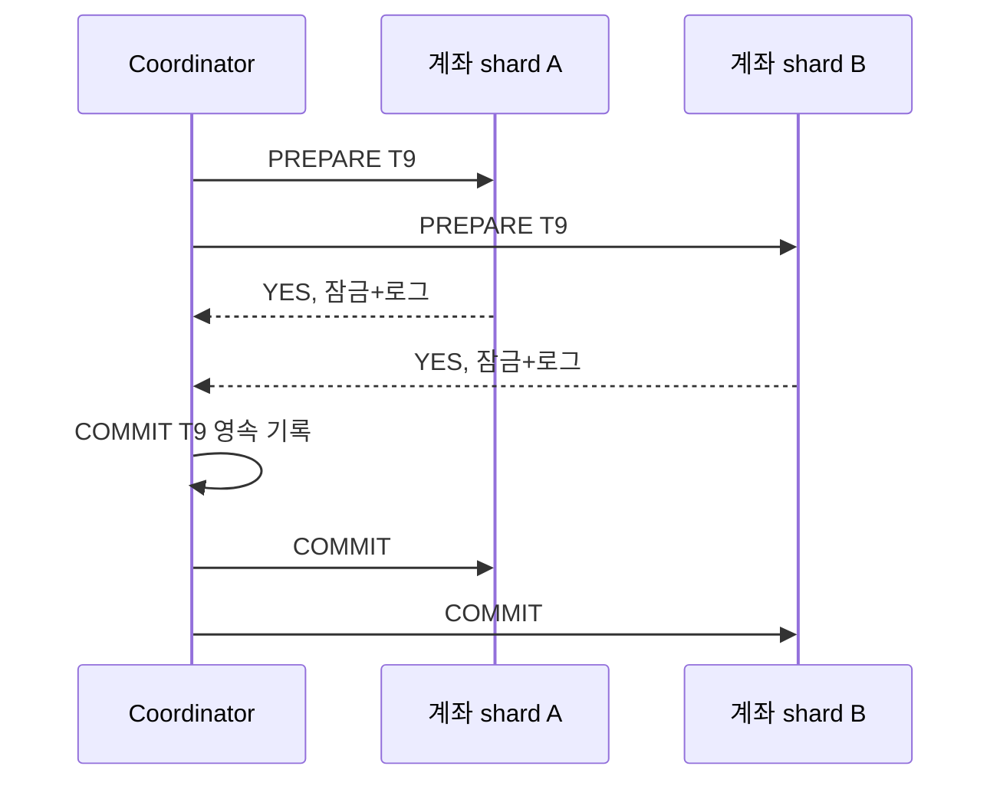

# 07. 트랜잭션과 2단계 커밋

## ACID 트랜잭션과 분산 원자 커밋은 같은 말이 아니다

**트랜잭션**은 여러 읽기·쓰기를 하나의 논리 작업으로 묶는 경계다. ACID의 원자성은 모두 적용하거나 모두 취소한다는 뜻이고, 일관성은 애플리케이션 불변식을 지키는 유효 상태 전이를 뜻한다. 격리성은 동시에 실행되는 거래가 서로 어떤 중간 상태를 보는지 정한다. 지속성은 성공 응답한 결과가 정한 장애 뒤에도 남는 성질이다.

**격리 수준**은 읽기와 동시 실행의 관계다. **분산 원자 커밋**은 여러 저장소 참여자가 같은 commit 또는 abort 결정을 따르게 하는 문제다. 2PC를 사용해도 격리 수준이 자동으로 serializable이 되지 않는다. 각 참여자의 잠금·MVCC 규칙이 별도로 필요하다.

계좌 A shard에서 100을 빼고 B shard에 100을 더하는 송금을 보자. 한쪽만 커밋하면 총액이 깨진다. coordinator는 전역 거래 T9를 만들고 두 participant가 모두 commit 가능한지 묻는다.

## prepare는 “아마 가능”이 아니라 약속을 영속화하는 단계다

participant가 PREPARE T9를 받으면 입력을 검증하고 필요한 잠금을 잡고, commit을 나중에 재현할 변경 정보와 PREPARED 상태를 디스크에 쓴다. 그 뒤 YES를 보낸다. YES는 “지금 메모리에서는 가능하다”가 아니라 “재시작 뒤에도 commit 또는 abort 결정을 따를 준비가 됐다”는 약속이다.

| participant 상태 | 영속 정보 | 허용 행동 |
|---|---|---|
| INIT | 거래 ID | prepare 검사 |
| PREPARED | 변경·잠금·YES 사실 | 전역 결정 대기 |
| COMMITTED | commit 결정·적용 결과 | 잠금 해제 |
| ABORTED | abort 결정·복구 결과 | 잠금 해제 |

t=0 coordinator가 PREPARE를 보낸다. t=10 A가 PREPARED를 기록하고 YES, t=15 B도 YES를 보낸다. t=20 coordinator가 COMMIT을 영속화한다. t=21 결정 전송 전에 crash한다. A와 B의 timeout은 abort 증거가 아니다. 복구 coordinator가 COMMIT 기록을 읽어 재전송해야 한다.

## crash 위치별 결정

| crash 위치 | coordinator 디스크 | participant | 복구 결과 |
|---|---|---|---|
| PREPARE 전 | 없음 | INIT | abort 가능 |
| 일부 YES 뒤 | 결정 없음 | 일부 PREPARED | 복구 규칙에 따라 abort 통지 |
| COMMIT 기록 뒤 | COMMIT | PREPARED | commit 재전송 |
| 적용 뒤 ack 전 | COMMIT | COMMITTED | 중복 commit을 멱등 처리 |

coordinator가 COMMIT을 메모리에만 정하고 한 participant에 전송한 뒤 죽으면 다른 participant와 결정이 갈릴 수 있다. 그래서 결정은 통지 전에 영속화한다. participant도 PREPARED 기록 전에 YES를 보내면 재시작 뒤 약속을 잊는다.

## blocking의 실제 비용

PREPARED participant는 혼자 결정을 추측할 수 없다. coordinator와 결정 기록에 접근할 수 없으면 잠금을 유지한 채 기다릴 수 있다. 이 상태가 2PC의 blocking이다. timeout은 운영 경보를 만들 수 있지만 전역 결정을 바꾸지 않는다.

coordinator 로그를 합의 그룹에 복제하면 단일 장비 장애를 줄일 수 있다. 그러나 어느 기록이 권위 있는지, 새 coordinator가 참여자 목록과 결정을 어떻게 복원하는지 명세해야 한다.

Saga는 각 단계 뒤 실패 시 보상 작업을 실행하는 다른 접근이다. 보상은 시간 역행 rollback이 아니라 새 업무다. 이미 발송한 이메일이나 외부에 공개된 가격은 완전히 되돌릴 수 없다.

## 추가 연습 문제와 해설

### 1. YES 전에 무엇을 저장해야 하는가?
거래 ID, commit 재현 정보, 잡은 잠금과 PREPARED 사실이다. 재시작 뒤 약속을 지킬 수 있어야 한다.

### 2. COMMIT 기록 뒤 coordinator crash 시 복구 결정은?
COMMIT이다. 기록을 읽어 모든 participant에 반복 전송하며 commit 처리는 멱등해야 한다.

### 3. timeout 5초면 prepared 거래를 abort해도 되는가?
아니다. COMMIT이 이미 영속화됐지만 메시지만 유실됐을 수 있다.

### 4. 2PC가 serializable isolation을 보장하는가?
아니다. 원자 결정과 동시 거래의 읽기 규칙은 별도 문제다.

### 5. A만 YES, B는 NO면?
coordinator는 ABORT를 영속화하고 A에 abort를 통지해 준비 상태와 잠금을 해제한다.

[← 이전](06-consensus-failures-and-snapshots.md) · [목차](README.md) · [다음 →](08-sharding-and-reconfiguration.md)

## 원자성과 2PC

트랜잭션의 **원자성**은 여러 변경이 모두 적용되거나 모두 취소되는 성질이다.
2PC(Two-Phase Commit)는 coordinator와 participant가 분산 원자 결정을 맞추는 프로토콜이다.

입력은 거래 ID와 참여자별 변경이다.
prepare 단계에서 참여자는 검사하고 잠금과 준비 로그를 영속화한다.
YES 뒤에는 혼자 abort할 수 없는 중간 상태가 된다.
모두 YES면 coordinator가 COMMIT을 영속 기록한다.
하나라도 NO면 ABORT를 기록한다.
두 번째 단계에서 결정을 참여자에게 보낸다.

## blocking

참여자 A가 YES를 보낸 직후 coordinator와 통신이 끊겼다고 하자.
A는 다른 참여자의 표와 coordinator 결정을 모른다.
임의 commit은 원자성을 깰 수 있고 임의 abort도 이미 기록된 commit과 충돌할 수 있다.
따라서 결정을 배울 때까지 잠금과 prepared 상태를 유지할 수 있다.
이것이 2PC의 blocking 성질이다.
coordinator 로그를 복제하거나 합의 프로토콜을 결합하면 단일 장애를 줄이지만 프로토콜 조건은 더 복잡해진다.

### participant 내부 상태를 따라가기

participant는 단순히 YES 문자열만 돌려주지 않는다.
거래 T9가 바꿀 행, 잡은 잠금, undo/redo 정보, 현재 단계가 로컬 저장소에 남는다.

| 상태 | 디스크에 남은 정보 | 허용 행동 |
|---|---|---|
| INIT | 거래 ID와 작업 시작 | prepare 검사 |
| PREPARED | 변경 재현 정보와 YES 사실 | 전역 결정 대기 |
| COMMITTED | commit 결정과 적용 결과 | 잠금 해제, 결과 반환 |
| ABORTED | abort 결정과 복구 결과 | 잠금 해제 |

t=0에 coordinator가 A와 B에 PREPARE T9를 보낸다.
t=10에 A가 행 잠금과 PREPARED를 디스크에 쓰고 YES를 보낸다.
t=15에 B도 같은 절차를 마친다.
t=20에 coordinator가 COMMIT을 디스크에 쓴다.
t=21에 coordinator가 멈춰 결정 메시지가 전달되지 않는다.
A와 B는 timeout을 보지만 PREPARED를 지우면 안 된다.
복구된 coordinator나 결정 기록의 복제본에서 COMMIT을 배운 뒤 적용한다.

NO를 보낸 participant는 prepare 조건을 충족하지 못한 것이다.
YES를 보낸 participant와 달리 전역 commit에 참여할 준비가 끝나지 않았다.
coordinator는 하나라도 NO이면 ABORT를 선택한다.
그러나 메시지 유실 때문에 참여자별 관측 시각은 다를 수 있다.

### 2PC와 로컬 데이터베이스 경계

coordinator 메모리에만 참여자 목록을 두면 재시작 뒤 누구에게 결정을 재전송할지 모른다.
결정은 참여자 통지 전에 영속화해야 한다.
참여자는 결정 적용 후 확인을 보내고, coordinator는 모든 정리 조건을 만족한 뒤 기록을 수거한다.
준비 거래가 오래 남으면 잠금이 정상 요청을 막으므로 운영자는 임의 삭제보다 결정 복구 경로를 먼저 사용해야 한다.

## 수치 추적

prepare 왕복 20 ms, 결정 영속화 5 ms, commit 왕복 20 ms인 교육 모형은 최소 약 45 ms다.
한 참여자가 200 ms 지연되면 전체 결정이 그 지연을 기다릴 수 있다.
timeout으로 기다림을 끝내도 prepared 결과는 자동 abort가 아니다.

## 반례

2PC는 Raft와 같은 합의 알고리즘 자체가 아니다.
2PC participant가 YES 뒤 독립적으로 결정을 만들 수 없기 때문이다.
데이터베이스 내부 원자 커밋과 외부 이메일 발송을 한 트랜잭션으로 묶지 못하면 outbox 같은 경계 설계가 필요하다.

## 문제와 해설

### 1. YES 전에 무엇을 영속화하는가?
commit 명령을 나중에 수행할 수 있는 변경과 prepared 상태다.

### 2. coordinator 장애 때 왜 막히는가?
참여자가 전역 결정을 모르며 어느 쪽 추측도 원자성을 깰 수 있다.

### 3. timeout은 abort 증거인가?
아니다. 결정 메시지 유실일 수 있어 결과 조회와 복구가 필요하다.

## 공식 자료

- [PostgreSQL PREPARE TRANSACTION](https://www.postgresql.org/docs/current/sql-prepare-transaction.html)

[← 이전](06-consensus-failures-and-snapshots.md) · [목차](README.md) · [다음 →](08-sharding-and-reconfiguration.md)
## 상세 추적: crash 위치별 복구

participant는 YES 전에 거래 ID, 변경 재현 정보, 잠금, PREPARED 상태를 영속화한다. YES 뒤에는 혼자 abort할 수 없다.

| crash 지점 | coordinator 기록 | participant 상태 | 복구 |
|---|---|---|---|
| PREPARE 전 | 없음 | INIT | abort 가능 |
| 일부 YES 뒤 | 결정 없음 | 일부 PREPARED | abort 통지 |
| COMMIT 기록 뒤 | COMMIT | PREPARED | commit 재전송 |
| 적용 뒤 ack 전 | COMMIT | COMMITTED | 중복 commit 멱등 처리 |

t=0 PREPARE 전송, t=10 A가 PREPARED+YES, t=15 B가 PREPARED+YES, t=20 coordinator가 COMMIT 영속화, t=21 coordinator crash라고 하자. timeout은 abort 증거가 아니다. 복구된 coordinator가 COMMIT을 읽어 재전송한다.

coordinator가 COMMIT을 메모리에만 두고 통지하면 참여자별 결정이 갈릴 수 있다. 결정은 통지 전에 영속화해야 한다. participant도 PREPARED 기록보다 YES를 먼저 보내면 재시작 뒤 commit을 수행할 정보를 잃을 수 있다.

2PC는 원자 결정을 맞추며 직렬화 격리를 자동 제공하지 않는다. 보상 가능한 업무의 saga도 과거를 지우는 rollback이 아니라 새 업무다. 이미 보낸 이메일은 완전히 되돌릴 수 없는 반례다.
