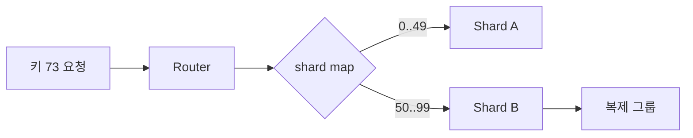

# 08. 샤딩과 재구성

## 키를 어느 shard로 보낼지 결정하기

**shard**는 전체 데이터의 일부를 담당하는 논리 조각이다. range sharding은 `0~999`, `1000~1999`처럼 연속 범위를 나눈다. hash sharding은 키의 hash 값을 bucket 수로 나눈 결과로 위치를 정한다.

사용자 ID 73의 hash 값이 1021이고 shard 수가 4라면 `1021 mod 4=1`이므로 shard 1로 간다. hash 방식은 분산이 고를 수 있지만 범위 질의를 여러 shard에 보낼 수 있다. range 방식은 범위 읽기에 좋지만 시간순 증가 키가 마지막 범위에 몰리는 hot shard를 만들 수 있다.

| 방식 | 입력 | 라우터 계산 | 장점 | 반례 |
|---|---|---|---|---|
| range | key=73 | 50~99 범위 | 범위 질의 | 증가 키 집중 |
| hash | hash=1021 | 1021 mod 4=1 | 균등화 | 범위 산개 |

**shard map**은 키 범위와 담당 replica group의 대응 메타데이터다. 라우터가 읽고 캐시하며, 각 요청에 구성 **epoch**를 붙일 수 있다. 소유자는 오래된 epoch 요청을 거부해 옛 라우터가 이전 shard에 쓰는 것을 막는다.

## snapshot, change log, cutover 전 과정

범위 50~99를 B에서 C로 옮긴다고 하자. 먼저 epoch 7의 B가 계속 요청을 처리하는 동안 index 100 시점 snapshot을 C에 복사한다. 복사 중 B에서 생긴 index 101~130 change log를 C에 재생한다. C가 따라잡으면 짧은 전환 경계에서 새 쓰기를 조정하고 shard map을 epoch 8, owner C로 바꾼다.

| 시각 | B | C | shard map |
|---:|---|---|---|
| 0 | owner, index 100 | 빈 상태 | epoch 7→B |
| 20 | 새 쓰기 101~115 | snapshot 100 복사 | 7→B |
| 40 | index 130 | log 101~130 재생 | 7→B |
| 45 | cutover 경계 | index 130 일치 | epoch 8→C |
| 50 | epoch 8 요청 거부 | 새 owner 처리 | 8→C |

snapshot만 복사하고 바로 전환하면 복사 중 쓰기 101~130을 잃는다. change log만 보내면 초기 전체 상태가 없다. 둘을 연결하는 index가 필요하다.

## hot key와 여러 주소

키 수가 균등해도 요청 수는 균등하지 않다. 한 유명 계정이 전체 요청 40%를 만들면 hash도 그 한 키를 하나의 shard에 둔다. 쓰기 키에 접미사를 붙여 분산하면 읽을 때 여러 조각을 합치는 비용과 정확성 규칙이 생긴다.

consistent hashing은 노드 변화 때 이동 키 수를 줄이는 배치 기법이지 복제, 원자 cutover, 데이터 전송을 자동 제공하는 프로토콜이 아니다.

## 추가 연습 문제와 해설

### 1. hash=2503, shard 8개면 위치는?
`2503 mod 8=7`이므로 shard 7이다.

### 2. snapshot 500 뒤 log 501~540이면 C가 적용할 log 수는?
40개다. 501과 540을 포함해 `540-501+1=40`이다.

### 3. epoch 7 요청이 epoch 8 owner에게 오면?
오래된 라우팅이므로 거부하고 최신 map 재조회를 유도한다.

### 4. range sharding의 증가 키 반례는?
새 키가 마지막 범위에 계속 들어가 마지막 shard만 쓰기 병목이 된다.

### 5. cutover 전에 옛 사본을 삭제하면?
전환 실패 시 복구 원본을 잃을 수 있다. 안전 기간과 참조 확인 뒤 수거한다.

## 두 shard에서 hot key를 옮기는 전 과정

**샤딩**은 key 공간을 여러 server가 나누어 맡는 방법이다. Router는 key를 보고 shard를 고르고 shard server는 자기 범위의 data를 처리한다.

| shard | 범위 | record | 초당 요청 |
|---|---|---:|---:|
| S0 | A~M | 1,000 | 900 |
| S1 | N~Z | 1,000 | 100 |

Record 수는 같지만 A로 시작하는 hot key 때문에 요청은 9:1이다. 균형은 record, byte, QPS, CPU, tail latency 중 무엇을 뜻하는지 밝혀야 한다.

새 S2로 일부 범위를 옮기는 주체별 순서는 다음과 같다.

1. Coordinator가 새 배치 version 42를 준비한다.
2. Source S0가 시작 offset과 snapshot을 고정한다.
3. S2가 snapshot을 복사한다.
4. 복사 중 S0 write는 change log에 남긴다.
5. S2가 log를 offset 순으로 따라잡는다.
6. Coordinator가 routing version 43을 게시한다.
7. 오래된 router 요청은 S0가 S2로 전달한다.
8. 안전 시점 뒤 이전 사본을 정리한다.

```text
t0 snapshot: H=100
t1 S0에 H+10, log offset 501
t2 S2 snapshot 적용: H=100
t3 S2 log 501 적용: H=110
t4 routing 43 게시
t5 새 요청은 S2
```

Log 없이 snapshot만 옮기면 H가 100으로 되돌아간다. Routing을 먼저 바꾸면 data가 준비되지 않은 S2가 요청을 받는다. Dual write는 한쪽만 성공하는 반례가 있어 성공 조건과 repair 절차가 필요하다.

### 완전 해설 문제

1. Record 수가 같으면 균형인가? **해설:** QPS가 9:1일 수 있어 아니다. 여러 자원 지표를 함께 본다.
2. Snapshot 중 write는? **해설:** 시작 offset 뒤 change log를 target이 순서대로 적용해야 한다.
3. 오래된 router는? **해설:** Source가 전달하거나 version 오류로 갱신을 요구한다. 즉시 삭제하면 요청이 실패한다.

[← 이전](07-transactions-and-two-phase-commit.md) · [목차](README.md) · [다음 →](09-retries-idempotency-and-deduplication.md)

## 샤드와 라우팅

**shard**는 전체 키 공간의 일부를 담당하는 데이터 집합이다.
라우터는 입력 키를 shard map에 대입한다.
shard map은 범위와 담당 replica group을 기록한 메타데이터다.
담당 그룹이 명령을 처리하고 결과를 돌려준다.



## 이동의 중간 상태

키 50..99를 B에서 C로 옮긴다고 하자.
먼저 C에 snapshot을 복사한다.
복사 중 발생한 B의 변경 로그를 C에 따라잡힌다.
전환 경계 index를 정한다.
메타데이터 소유권을 B에서 C로 원자적으로 바꾼다.
오래된 라우터 요청은 epoch 검증으로 거절하고 새 위치를 알려 준다.
마지막에 B의 옛 사본을 안전 기간 뒤 제거한다.

epoch는 구성 버전이다.
요청의 epoch 7보다 shard 현재 epoch 8이 크면 오래된 라우팅이다.
그대로 쓰면 두 소유자가 생길 수 있으므로 재조회가 필요하다.

## 균형과 hot key

키 수가 같아도 부하는 같지 않다.
한 유명 사용자 키가 전체 요청의 40%라면 범위 분할만으로 해결되지 않을 수 있다.
키 접미사로 쓰기를 분산하면 읽기 병합 비용이 생긴다.
재샤딩은 데이터 이동 네트워크와 foreground 요청을 경쟁시킨다.

## 반례

consistent hashing은 복제, 원자 소유권 전환, 데이터 복사를 자동 제공하지 않는다.
샤드 수 증가가 단일 hot key를 자동 분할하지 않는다.
복사 완료만 보고 라우팅을 바꾸면 복사 중 변경을 잃을 수 있다.

## 문제와 해설

### 1. shard map의 역할은?
키가 어느 복제 그룹에 속하는지 결정한다.

### 2. epoch 검사가 필요한 이유는?
오래된 라우터가 옛 소유자에 쓰는 split-brain을 막는다.

### 3. 재구성 중 필요한 두 데이터는?
기준 snapshot과 그 뒤 변경 로그다.

## 공식 자료

- [CockroachDB Replication Layer](https://www.cockroachlabs.com/docs/stable/architecture/replication-layer)
- [Dynamo paper](https://www.allthingsdistributed.com/files/amazon-dynamo-sosp2007.pdf)

[← 이전](07-transactions-and-two-phase-commit.md) · [목차](README.md) · [다음 →](09-retries-idempotency-and-deduplication.md)
