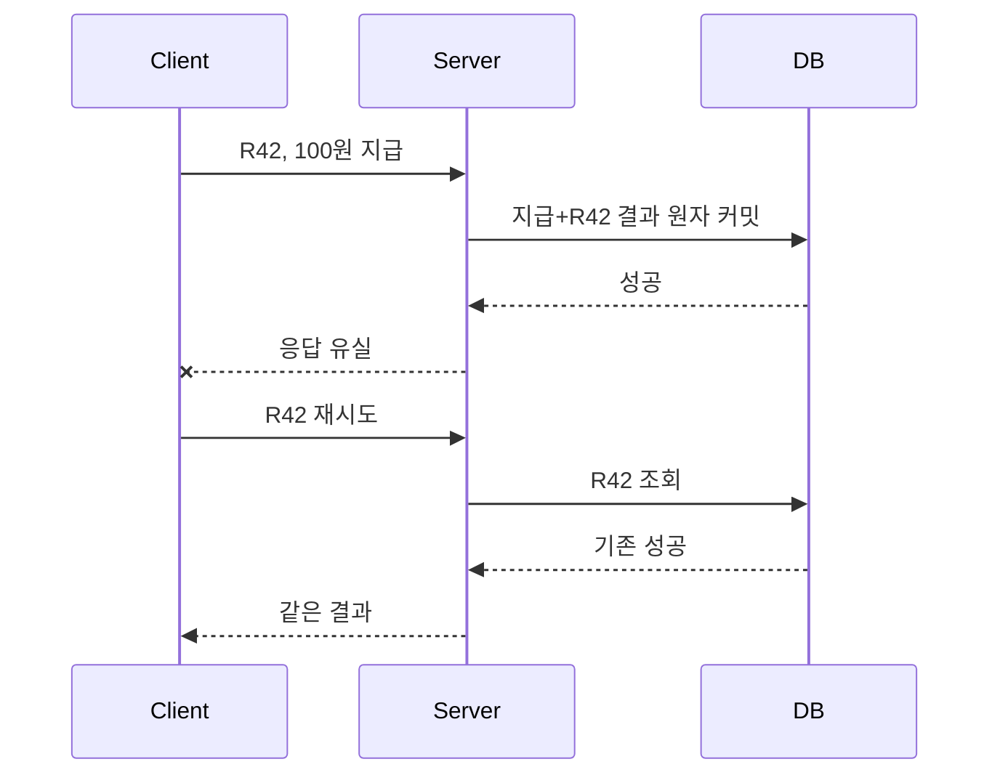

# 09. 재시도, 멱등성, 중복 제거

## 요청 한 번이 두 번 실행되는 실제 과정

**재시도(retry)**는 client가 응답을 받지 못했을 때 같은 목적의 요청을 다시 보내는 일이다. 응답이 없다는 사실은 server가 일을 하지 않았다는 뜻이 아니다. Request가 server에 도착하기 전 사라졌을 수도 있고, 업무 변경을 마친 뒤 response만 network에서 사라졌을 수도 있다.

계좌 A에서 B로 10원을 옮기는 요청을 시간순으로 보자.

| 시각 | client 상태 | server·저장소 상태 |
|---:|---|---|
| t0 | 요청 ID `pay-77` 전송 | 아직 처리 전 |
| t1 | 응답 대기 | A에서 10 차감, B에 10 증가 |
| t2 | timeout | 결과를 commit했지만 응답 packet 유실 |
| t3 | 같은 ID로 retry | 중복 여부를 검사해야 함 |
| t4 | 결과 수신 | 최초 결과를 반환해야 함 |

재시도 요청을 새 업무로 실행하면 A에서 20원이 빠진다. 따라서 **멱등성(idempotency)**은 같은 의도의 요청을 여러 번 적용해도 관찰 가능한 업무 결과가 한 번 적용한 것과 같게 만드는 성질이다. HTTP method 이름만으로 업무 멱등성이 자동 생기지 않는다.

## 영속 중복 제거 기록

Process memory의 `seen_ids` 집합만으로 중복을 막으면 server 재시작 때 기록이 사라진다. 중복 제거 표는 업무 결과와 같은 장애 경계를 견디는 영속 저장소에 두어야 한다.

```text
dedup row
  request_id: pay-77
  request_hash: SHA256(A,B,10,KRW)
  state: COMPLETED
  response: {transfer_id: T900, status: OK}
  created_at: ...
```

주체별 책임은 다음과 같다.

1. Client는 논리적 업무 한 건에 안정적인 request ID를 만든다.
2. API server는 ID와 payload hash를 읽는다.
3. Transaction은 dedup row가 없는지 검사하고, 업무 변경과 dedup 결과를 함께 commit한다.
4. 같은 ID가 다시 오면 저장된 response를 반환한다.
5. 같은 ID인데 payload hash가 다르면 충돌 오류를 반환한다.

## 업무 변경과 dedup 기록의 원자성

**원자성(atomicity)**은 여러 변경이 모두 적용되거나 모두 적용되지 않는 성질이다. 다음 잘못된 순서를 보자.

```text
1. 계좌 잔액 변경 commit
2. process crash
3. dedup row 기록 못 함
4. retry가 새 요청으로 보임
5. 잔액 두 번째 변경
```

반대 순서도 위험하다. Dedup을 `COMPLETED`로 먼저 쓰고 잔액 변경 전에 crash하면 retry는 저장된 성공을 받지만 실제 업무는 적용되지 않았다. 가능한 경우 같은 database transaction 안에서 잔액 변경과 dedup 결과를 함께 commit한다.

외부 결제망처럼 한 transaction에 묶을 수 없는 대상은 `PENDING` 상태, outbox, 상태 조회와 보상 절차가 필요하다. 이것은 단순 unique key보다 넓은 workflow 문제다.

## ID 재사용 충돌

Request ID `pay-77`을 첫 요청 `A→B 10원`에 쓴 뒤 client bug가 `A→C 50원`에도 재사용했다고 하자. ID만 보고 이전 성공을 반환하면 두 번째 의도가 조용히 사라진다. 그래서 canonical payload의 hash를 함께 보관하고 다음처럼 처리한다.

```text
같은 ID + 같은 hash   → 저장된 기존 결과 반환
같은 ID + 다른 hash   → 409 같은 명시적 충돌
새 ID                 → 새 업무 처리
```

Dedup 보존 기간을 하루로 정했다면 하루 뒤 같은 ID의 retry는 새 요청처럼 보일 수 있다. Client 최대 retry 기간, message 보존 기간, 법적 업무 추적 기간보다 짧게 지우지 않도록 정책을 맞춘다.

## 완전 해설 문제

### 문제 1

Server가 성공 commit 뒤 응답만 잃었다. Client는 새 ID로 재시도해도 되는가?

**해설:** 새 ID는 server에 새 업무처럼 보인다. 같은 논리적 업무라면 같은 ID로 retry해야 저장된 결과를 찾을 수 있다. 결론은 안정적인 ID 재사용이다.

### 문제 2

Dedup row를 썼지만 잔액 변경과 별도 transaction이다. 충분한가?

**해설:** 두 commit 사이 crash가 생기면 기록과 업무 상태가 갈라진다. 같은 transaction 또는 PENDING/outbox 같은 명시적 protocol이 필요하다.

### 문제 3

같은 ID와 다른 payload가 왔다. 최초 response를 반환하면 되는가?

**해설:** Client의 ID 재사용 bug를 숨긴다. Payload hash를 비교해 충돌을 명시적으로 거절해야 한다.

[← 이전](08-sharding-and-reconfiguration.md) · [목차](README.md) · [다음 →](10-streams-checkpoints-and-recovery.md)

## 결과 미상에서 시작한다

timeout은 실패 결과가 아니라 결과 미상이다.
클라이언트는 같은 idempotency key로 재시도한다.
서버는 업무 변경과 key→결과 기록을 같은 영속 경계에서 커밋한다.
중복 요청이면 저장된 결과를 반환한다.



**멱등성**은 같은 연산을 여러 번 적용해도 관측 결과가 한 번과 같은 성질이다.
값을 7로 설정은 멱등일 수 있다.
값에 7을 더하기는 보통 멱등이 아니다.
요청 ID 중복 제거는 비멱등 연산을 한 번처럼 보이게 만든다.

## 내구성 경계

업무 변경을 커밋한 뒤 중복 기록 전에 죽으면 재시도가 다시 변경한다.
중복 기록을 먼저 쓰고 업무 변경 전에 죽으면 성공한 것처럼 숨길 수 있다.
둘을 같은 트랜잭션에 넣거나 복구 가능한 상태 기계를 써야 한다.
외부 결제망처럼 같은 로컬 트랜잭션에 못 넣으면 상대의 idempotency key와 상태 조회 계약이 필요하다.

### 요청 기록의 실제 상태

중복 제거 표는 ID 집합 하나로 끝나지 않는다.
서버는 요청 ID, 입력의 식별 가능한 요약, 처리 상태, 최종 결과를 함께 저장할 수 있다.
같은 ID에 다른 금액이 오면 기존 결과를 재사용하지 말고 입력 불일치 오류로 거부해야 한다.

| request_id | 입력 요약 | 상태 | 저장 결과 |
|---|---|---|---|
| R41 | debit:50 | DONE | balance=950 |
| R42 | debit:100 | IN_PROGRESS | 아직 없음 |

R42를 받은 담당 주체는 먼저 같은 ID를 찾는다.
없으면 IN_PROGRESS와 업무 변경을 하나의 트랜잭션 흐름으로 시작한다.
처리가 끝나면 DONE과 응답 내용을 영속화한다.
동시에 온 두 R42는 고유 키 제약이나 행 잠금으로 한 실행만 소유하게 한다.
다른 요청은 완료를 기다리거나 나중에 같은 ID로 조회한다.

### 시간순 재시도

t=0 ms에 클라이언트가 R42를 보낸다.
t=12 ms에 서버가 잔액 1,000에서 900으로 바꾸고 R42=DONE을 함께 커밋한다.
t=13 ms에 응답 전송이 시작되지만 유실된다.
t=100 ms에 클라이언트 timeout이 발생한다.
t=120 ms에 같은 ID와 같은 금액으로 재시도한다.
t=125 ms에 서버가 DONE 결과 900을 읽어 업무 코드를 다시 실행하지 않고 반환한다.

반대로 t=5 ms에 서버가 죽어 트랜잭션이 rollback됐다면 R42 기록과 잔액 변경이 모두 없어야 한다.
재시도는 새 실행의 소유권을 얻어 한 번 처리한다.
한쪽만 남는 구조가 중복 또는 영구 누락을 만든다.

### 중복 제거 범위

한 서버 메모리 캐시만 쓰면 로드 밸런서가 다른 서버로 보낸 재시도를 모른다.
모든 처리 서버가 공유하는 영속 저장소나 같은 키를 같은 파티션으로 보내는 라우팅이 필요하다.
지역 A와 B가 독립 중복 표를 쓰면 같은 ID가 양쪽에서 실행될 수 있다.
정확히 한 번처럼 보인다는 주장은 이 지리적·저장 경계를 명시해야 한다.

## TTL과 재시도 폭풍

중복 기록 TTL이 24시간인데 클라이언트가 25시간 뒤 재시도하면 새 요청으로 처리될 수 있다.
재시도 기간은 기록 보존 기간보다 짧아야 한다.
exponential backoff는 100, 200, 400 ms처럼 간격을 늘린다.
jitter는 동시 클라이언트가 같은 순간 재시도하는 것을 흩는다.

## 반례

HTTP PUT이라는 이유만으로 업무 효과가 자동 멱등은 아니다.
서버가 매번 알림을 보내면 부수 효과는 중복된다.
프로세스 메모리 set은 재시작 때 사라져 내구적 중복 제거가 아니다.

## 문제와 해설

### 1. timeout 뒤 새 ID를 쓰면?
서버가 새 업무 요청으로 보아 중복 효과가 생길 수 있다.

### 2. key만 저장하면 충분한가?
아니다. 결과와 업무 변경의 원자적·내구적 경계가 필요하다.

### 3. jitter의 목적은?
동기화된 재시도로 서버가 다시 과부하되는 것을 줄인다.

## 공식 자료

- [AWS Builders' Library: Making retries safe](https://aws.amazon.com/builders-library/making-retries-safe-with-idempotent-APIs/)

[← 이전](08-sharding-and-reconfiguration.md) · [목차](README.md) · [다음 →](10-streams-checkpoints-and-recovery.md)
