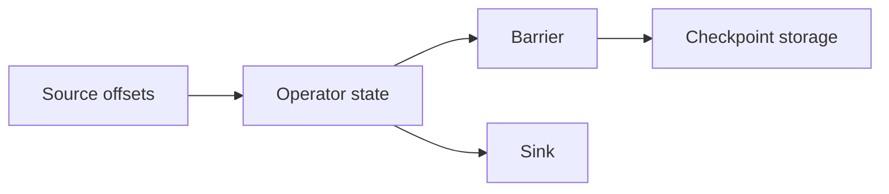

# 10. 스트림, 체크포인트, 복구

## 내부 상태 복구와 외부 sink 게시의 별도 경계

**스트림**은 계속 도착하는 event 흐름이다. Processor는 event를 읽어 합계와 input offset 같은 **상태**를 바꾼다. **체크포인트**는 내부 상태와 다음 입력 위치를 durable storage에 저장한 복구 기준점이다.

| 시각 | offset | 내부 합계 | 외부 sink |
|---:|---:|---:|---:|
| t0 | 100, +5 | 5 | 없음 |
| t1 | 101, +7 | 12 | 12 게시 |
| t2 | checkpoint | sum=12,next=102 | 12 |
| t3 | 102, +3 | 15 | 15 게시 시도 |
| t4 | crash | memory 손실 | 15가 이미 있을 수 있음 |

복구하면 checkpoint의 sum 12에서 offset 102를 다시 읽어 15를 만든다. 그러나 sink가 t3의 15를 이미 받았다면 append를 다시 수행할 때 중복된다.

Checkpoint 성공은 외부 sink commit 성공과 다르다. Exactly-once 결과에는 checkpoint ID를 포함한 idempotent upsert, sink transaction, 또는 고유 record key가 필요하다. Email이나 결제 같은 부작용은 input offset 복구만으로 보호되지 않는다.

**Event time**은 사건 발생 시각이고 **processing time**은 system 처리 시각이다. **Watermark**는 특정 event time 이전 자료가 대부분 도착했다는 진행 추정이다.

Watermark 10:05 뒤 10:03 event가 오면 drop, late side output, window 재계산 중 정책을 고른다. 이미 게시한 집계를 수정할 수 있는지도 sink 계약에 달려 있다.

### 완전 해설 문제

1. Checkpoint 뒤 event는? **해설:** 저장된 offset부터 replay되어 같은 외부 결과를 다시 쓸 수 있다.
2. Sink write 뒤 checkpoint 전 crash는? **해설:** 복구 replay가 중복을 만들므로 sink idempotency가 필요하다.
3. Watermark보다 늦으면 오류인가? **해설:** 정상 지연일 수 있으며 사전에 정한 late-data 정책으로 처리한다.

[← 이전](09-retries-idempotency-and-deduplication.md) · [목차](README.md) · [다음 →](11-membership-failure-detection-and-leases.md)

## 스트림 상태

스트림은 끝나지 않을 수 있는 사건 순서다.
source는 사건을 내고 operator는 변환하며 sink는 결과를 저장한다.
offset은 입력 위치다.
checkpoint는 operator 상태와 일관된 입력 위치의 복구 지점이다.

입력 파티션마다 barrier가 흐른다.
operator는 필요한 입력 barrier가 맞춰질 때 상태 snapshot을 만든다.
coordinator가 모든 snapshot 완료를 기록한다.
장애 뒤 마지막 완료 checkpoint 상태를 읽는다.
저장된 offset부터 입력을 다시 재생한다.

## 수치 추적

checkpoint 20은 offset 1,000과 합계 55를 담는다.
처리기가 offset 1,030, 합계 61에서 죽는다.
복구 시 20을 읽어 합계 55로 돌아간다.
1,001..1,030을 다시 처리한다.
sink가 중복을 막거나 checkpoint와 함께 커밋되지 않으면 출력이 두 번 보일 수 있다.

## event time과 watermark

event time은 사건이 원래 발생한 시각이다.
processing time은 처리기가 본 시각이다.
watermark는 이 시각 이전 사건 대부분이 도착했다고 보는 진행 추정치다.
늦은 사건 허용 범위와 갱신 정책에 따라 결과 수정 여부가 달라진다.

## 반례

checkpoint 파일만 저장하고 source offset을 빼면 정확한 재생 시작점을 모른다.
입력 exactly-once와 외부 sink exactly-once는 같은 주장이 아니다.
watermark는 미래의 늦은 사건이 절대 없다는 증명이 아니다.

## 문제와 해설

### 1. checkpoint에 필요한 두 축은?
operator 상태와 그 상태에 대응하는 입력 위치다.

### 2. 재생이 왜 중복 출력을 만드는가?
장애 전 sink 효과는 남았는데 offset은 과거로 돌아갈 수 있기 때문이다.

### 3. watermark는 물리 시계인가?
아니다. event time 진행에 대한 시스템 정책과 추정이다.

## 공식 자료

- [Apache Flink Dataflow Model](https://nightlies.apache.org/flink/flink-docs-stable/docs/concepts/time/)
- [Spark Streaming Programming Guide](https://spark.apache.org/docs/latest/streaming-programming-guide.html)

[← 이전](09-retries-idempotency-and-deduplication.md) · [목차](README.md) · [다음 →](11-membership-failure-detection-and-leases.md)
