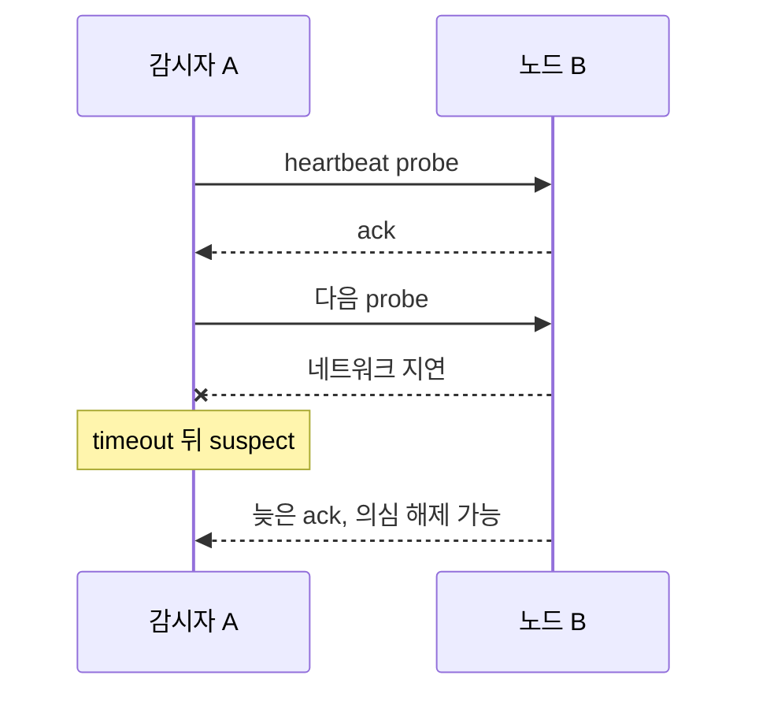

# 11. 멤버십, 장애 감지, 리스

## 응답 없음과 소유권 상실을 구분하기

**멤버십**은 현재 cluster 구성원 목록이고 **장애 감지기**는 heartbeat와 timeout으로 node를 의심한다. Network partition에서는 살아 있는 node도 응답하지 않으므로 장애 의심은 사망 증명이 아니다.

**리스(lease)**는 정해진 기간 동안 자원을 사용할 권리다. Holder A가 갱신하지 못하면 coordinator는 만료 뒤 B에게 줄 수 있지만 A가 실제로 멈췄다는 보장은 없다.

Coordinator 시계가 100 ms 빠르고 A 시계가 100 ms 느리면 1,000 ms lease의 경계 판단이 200 ms 어긋날 수 있다. Network 지연 150 ms까지 겹치면 A와 B가 동시에 holder라고 생각할 수 있다.

이를 막는 값이 단조 증가 **fencing token**이다.

```text
A token=41
lease 만료 뒤 B token=42
storage highest token=42
A의 늦은 write(41) → 거절
B write(42) → 허용
```

Storage나 실제 장치를 바꾸는 마지막 주체가 token을 원자적으로 검사해야 한다. Client끼리 비교하는 것만으로는 늦은 A를 막지 못한다.

| 시각 | A | coordinator | storage |
|---:|---|---|---|
| t0 | 41로 작업 | A 유효 | highest=41 |
| t1 | network 단절 | 갱신 못 봄 | 유지 |
| t2 | 계속 실행 | 만료 판단 | 유지 |
| t3 | 41로 write | B에 42 발급 | 42 먼저 수용 |
| t4 | 성공 착각 | B 활성 | 41 거절 |

TTL이 짧으면 failover는 빠르지만 일시적 지연에도 소유권을 자주 잃는다. 길면 false failover는 줄지만 실제 장애 복구가 늦다.

### 완전 해설 문제

1. Heartbeat timeout이면 사망인가? **해설:** Process pause나 partition일 수 있어 의심 신호일 뿐이다.
2. Token은 어디서 검사하는가? **해설:** 실제 상태를 쓰는 storage·device 경계에서 최고 token과 원자 비교한다.
3. 시계가 정확하면 token이 불필요한가? **해설:** 늦은 message와 이전 holder가 남으므로 stale writer 차단은 여전히 필요하다.

[← 이전](10-streams-checkpoints-and-recovery.md) · [목차](README.md) · [다음 →](12-etcd-spark-iceberg-and-storage.md)

## 멤버십과 감지

멤버십은 현재 시스템 구성원과 식별자, 주소, 역할의 집합이다.
heartbeat는 살아 있음을 알리는 주기 메시지다.
failure detector는 관측 지연을 근거로 노드를 의심하는 모듈이다.
정확한 사망 탐지기가 아니라 오탐과 탐지 시간을 조절한다.



## 리스

**lease**는 정해진 시간 동안 자원 사용 권리를 부여하는 계약이다.
발급자는 만료 뒤 옛 보유자의 권리가 끝났다고 판단한다.
보유자는 자신의 시간이 남았다고 판단할 수 있다.
안전을 위해 시계 오차, 메시지 지연, 프로세스 정지에 대한 가정이 필요하다.

발급자 시각 100에 10초 lease를 줬다고 하자.
보유자는 108에 5초 정지했다가 깨어난다.
자신의 monotonic 측정이 정지를 어떻게 반영하는지에 따라 만료 인식이 다를 수 있다.
외부 저장소는 증가하는 fencing token을 검사해 옛 보유자 쓰기를 거부해야 한다.

token 41 보유자가 멈춘 뒤 새 보유자가 42를 받는다.
옛 프로세스가 깨어 41로 쓰면 저장소가 거부한다.
시간 가정만 믿는 것보다 권한 세대를 데이터 경계에서 검사한다.

### 발급자와 보유자의 시계가 다른 문제

발급자는 자신의 monotonic clock에서 시작과 만료를 계산한다.
보유자에게 “내 시각 110까지”만 보내면 서로 다른 시계 원점 때문에 직접 비교할 수 없다.
보유자는 응답을 받은 로컬 시점부터 허용된 보수적 기간을 계산할 수 있다.
네트워크 왕복, 최대 시계 진행 오차, 프로세스 정지 조건을 안전 여유에서 빼야 한다.

| 시각 | 발급자 상태 | 보유자 상태 | 저장소 행동 |
|---:|---|---|---|
| 0 | token 41 발급 | 41 수신 | 41 허용 |
| 6 | 41 유효 판단 | 긴 정지 시작 | 41 허용 |
| 11 | 41 만료, 42 발급 | 여전히 정지 | 42부터 허용 |
| 13 | 42 소유자 활동 | 옛 41 깨어남 | 41 쓰기 거부 |

표의 숫자는 교육용 논리 시간이다.
실제 lease 길이나 시계 오차 보장이 아니다.

**fencing**은 문 앞에서 옛 소유자를 막는다는 뜻이다.
발급자가 증가 token을 주는 것만으로 충분하지 않다.
파일 서버, 데이터베이스, 장치 제어기처럼 실제 효과를 내는 마지막 주체가 token을 비교해야 한다.
현재 값 42보다 작은 41은 요청 내용이 정상이어도 거부한다.

### 멤버십 변경과 노드 정체성

IP 주소가 같다고 같은 노드 생애라고 가정하면 재설치된 프로세스를 옛 멤버로 오인할 수 있다.
노드 ID와 incarnation 또는 epoch를 함께 사용하면 재시작 세대를 구분할 수 있다.
관측자가 `node7, incarnation 3`을 알고 있는데 `node7, incarnation 4`가 오면 새 생애다.
이전 생애의 지연 heartbeat가 뒤늦게 와도 4를 3으로 되돌리지 않는다.

failure detector의 suspect는 멤버십에서 즉시 영구 삭제한다는 명령과 다르다.
합의 그룹 구성 변경은 별도 안전 절차가 필요하다.
일시 네트워크 지연만으로 두 쪽이 상대를 제거하면 서로 다른 구성으로 진행할 위험이 있다.

## 반례

heartbeat 부재가 사망 증거는 아니다.
lease가 있으면 split brain이 절대 없다는 주장도 조건이 빠졌다.
클라이언트 시계만 검사하고 외부 자원이 fencing token을 무시하면 옛 소유자가 쓸 수 있다.

## 문제와 해설

### 1. timeout을 줄이면?
탐지는 빨라지지만 정상 지연을 장애로 오인할 확률이 늘어난다.

### 2. fencing token은 누가 검사하는가?
실제 상태를 바꾸는 저장소나 자원 서버가 검사해야 한다.

### 3. lease 안전성의 숨은 가정은?
시계 진행 한계, 최대 정지·지연 또는 외부 세대 검증이다.

## 공식 자료

- [Chandra and Toueg Failure Detectors](https://www.cs.cornell.edu/home/halpern/papers/ct.pdf)
- [etcd Concurrency API](https://etcd.io/docs/v3.5/dev-guide/api_concurrency_reference_v3/)

[← 이전](10-streams-checkpoints-and-recovery.md) · [목차](README.md) · [다음 →](12-etcd-spark-iceberg-and-storage.md)
