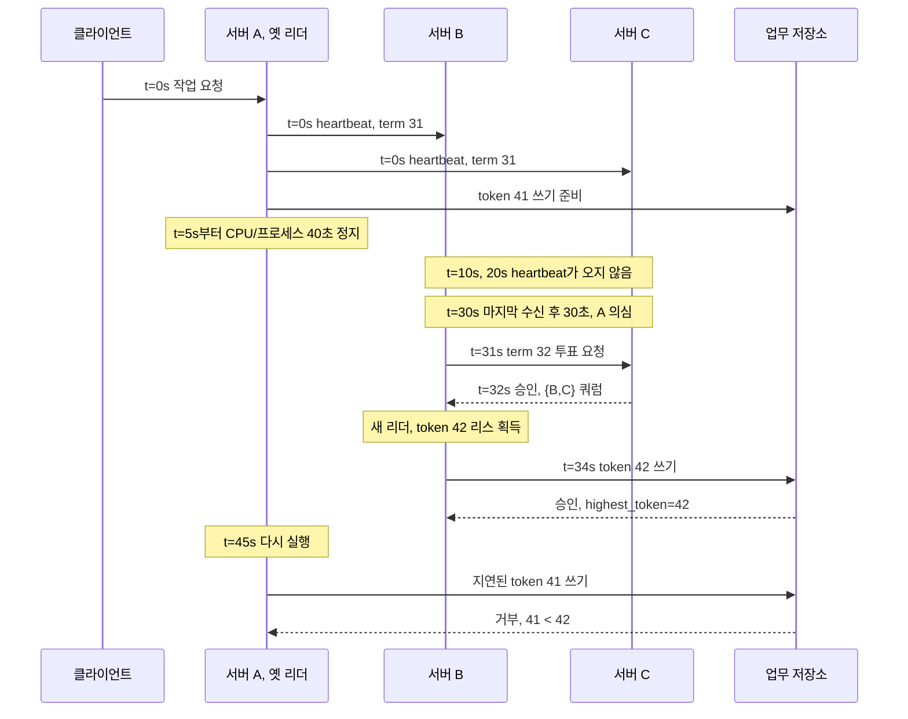

# 11. 멤버십, 장애 감지, 리스

분산 시스템에서 “서버가 살아 있는가?”와 “그 서버가 지금 써도 되는가?”는 서로 다른 질문이다. 이 장에서는 서버 A, B, C로 이루어진 세 대의 조정 클러스터와 작업을 요청하는 클라이언트 한 대를 끝까지 따라간다. A가 잠시 멈추고, 메시지가 늦게 도착하고, B가 새 리더가 된 뒤, A가 다시 움직여 저장소에 쓰려고 하는 상황이다. 이 과정을 이해하면 멤버십, 하트비트, 장애 감지기, 타임아웃, 시계, 리스, 리더, 쿼럼, 펜싱이 각각 어느 객체에 저장되고 누가 관리하며 언제까지 유효한지 구분할 수 있다.

## 먼저 실제 객체를 놓고 용어를 이해한다

**멤버십(membership)**은 “현재 이 합의 그룹의 구성원으로 승인된 서버는 누구인가”를 나타내는 구성 상태다. 이 장의 첫 구성은 `{A, B, C}`, 구성 번호는 `epoch=7`이라고 하자. 이 값은 단순 주소록이 아니다. 합의 프로토콜이 표를 계산할 때 누구의 표를 셀지 결정하는 입력이다. 보통 조정 서비스 자신의 복제 로그나 구성 저장 영역에 기록하고, 합의된 구성 변경 절차가 관리한다. 새 구성이 합의될 때까지 수명은 계속된다. 따라서 A가 40초 동안 응답하지 않아도 `epoch=7`의 멤버십에서 저절로 사라지지 않는다. 지금 멤버십이 필요한 이유는 “A가 느리다” 같은 관측과 “A의 표를 더는 세지 않는다”라는 권한 변경을 분리하기 위해서다.

**하트비트(heartbeat)**는 서버가 다른 서버에게 주기적으로 보내는 “나는 이 실행 세대로 동작하고 있다”라는 작은 생존 알림 메시지다. 예를 들어 A는 B와 C에게 `{node=A, incarnation=12, term=31}`을 보낸다. 메시지는 네트워크 패킷이고, 수신 측 장애 감지기의 메모리에 마지막 수신 시각을 갱신한다. 송신 프로세스가 만들고 상대 서버의 감시 모듈이 관리하며, 다음 메시지가 오거나 관측 상태가 바뀔 때까지만 의미가 있다. 오래된 하트비트는 현재 생존의 증거가 아니다. 재시작할 때 증가시키는 `incarnation`은 같은 주소의 옛 프로세스와 새 프로세스를 구분한다.

**장애 감지기(failure detector)**는 하트비트나 요청 응답이 일정 시간 오지 않았다는 관측을 바탕으로 서버를 `suspect`, 즉 “의심” 상태로 표시하는 모듈이다. B 안의 장애 감지기는 A의 실제 CPU와 전원 상태를 직접 읽지 못한다. B가 가진 것은 “마지막 하트비트를 내 로컬 시간으로 언제 받았는가”뿐이다. 그래서 장애 감지기의 출력은 사망 증명서가 아니라 운영상 추정이다. 이 추정은 리더 선거를 시작하거나 요청 경로를 바꾸는 데 쓰이지만, 그것만으로 멤버십을 삭제하면 안 된다.

**타임아웃(timeout)**은 응답을 기다리는 시간의 상한이다. 이 장의 교육용 정책은 하트비트를 10초마다 보내고, 마지막 하트비트를 받은 뒤 30초가 지나면 의심하는 것이다. 타임아웃은 B와 C의 타이머 객체가 관리하고, 하트비트를 받을 때마다 새로 시작되며, 만료하거나 취소될 때 끝난다. `30초 = 30,000밀리초`이고 `10초 = 10,000밀리초`다. 로그가 밀리초 단위라면 `70,000ms - 40,000ms = 30,000ms = 30s`처럼 같은 단위로 바꾼 뒤 비교해야 한다. 타임아웃은 영원히 기다리지 않고 복구를 시작하게 하지만, A의 실패를 증명하지는 못한다.

**시계(clock)**는 시간을 재는 장치와 그 값을 읽는 운영체제 기능을 함께 뜻한다. 사람이 보는 날짜와 시각인 벽시계는 NTP 보정이나 관리자 변경으로 앞뒤로 뛸 수 있다. 경과 시간을 재는 단조 시계는 같은 부팅 생애 안에서 뒤로 가지 않도록 설계된다. 타임아웃과 로컬 리스 경과 시간에는 단조 시계를 쓰는 편이 맞다. 하지만 A의 단조 시계 값 `812,000ms`와 B의 값 `51,000ms`는 시작점이 다르므로 서로 직접 비교할 수 없다. 또한 구현과 환경에 따라 프로세스 정지나 절전 중 경과가 어떤 시계에 포함되는지 확인해야 한다. “단조”는 뒤로 가지 않는다는 뜻이지, 모든 컴퓨터에서 같은 속도로 완벽히 흐른다는 뜻은 아니다.

**리더(leader)**는 합의 그룹에서 한 시점에 요청 조정, 로그 제안, 작업 배정 같은 역할을 맡도록 선택된 서버다. 여기서는 A가 처음 리더다. 리더라는 말은 가장 빠른 서버나 영구 소유자를 뜻하지 않는다. 특정 임기(term)와 구성에서 다수의 승인을 얻은 조정 역할이다. 리더 상태는 합의 모듈과 임기 번호가 관리하며, 더 높은 임기를 관측하거나 리더 권한을 잃으면 끝난다. 리더가 필요한 이유는 여러 서버가 동시에 서로 다른 순서로 쓰기를 제안하는 혼란을 줄이고 하나의 순서를 만들기 위해서다.

**쿼럼(quorum)**은 결정을 승인하는 데 필요한 구성원 집합이다. 세 멤버 `{A,B,C}`에서 과반수 쿼럼 크기는 2다. `{A,B}`, `{A,C}`, `{B,C}` 가운데 어떤 두 집합도 적어도 한 서버에서 겹친다. 이 **쿼럼 교차(quorum intersection)** 때문에 이전 결정의 정보를 가진 서버가 다음 결정 집합에 포함될 수 있다. 쿼럼은 “항상 같은 두 서버”가 아니라, 현재 멤버십과 규칙으로 계산되는 승인 집합이다. 실제 승인 기록은 각 서버의 복제 로그, 현재 임기, 투표 기록에 남는다.

**리스(lease)**는 발급자가 보유자에게 제한된 기간 동안 자원 사용 권리를 주는 계약이다. 예를 들어 조정 서비스가 A에게 “작업 `invoice-2026-10`을 60초 동안 수행할 권리”를 준다. 리스 레코드는 조정 서비스의 복제 상태에 저장되고, 보유자는 리스 ID와 만료 판단에 필요한 로컬 상태를 가진다. 발급 서비스는 갱신을 받지 못하면 만료시키고 다른 보유자에게 새 리스를 줄 수 있다. 리스가 필요한 이유는 보유자가 영원히 잠든 경우 수동 해제 없이 다른 서버가 일을 이어받게 하기 위해서다. 그러나 리스 서비스가 A의 프로세스를 강제로 종료하는 것은 아니다.

**펜싱(fencing)**은 새 권한을 받은 뒤 옛 권한 보유자의 쓰기를 실제 자원 앞에서 차단하는 방법이다. 조정 서비스는 리스를 발급할 때마다 `41`, `42`, `43`처럼 반드시 증가하는 펜싱 토큰을 준다. 저장소는 자신이 받아들인 가장 큰 토큰을 영속 상태로 관리하며, 더 작은 토큰의 요청을 거부한다. 토큰 수명은 해당 권한 세대와 함께 끝나지만, 저장소의 `highest_token`은 재시작 뒤에도 이전 값보다 작아지면 안 된다. 문 앞의 경비 역할을 저장소가 해야 하는 이유는 늦은 요청이 최종 효과를 내는 장소가 저장소이기 때문이다.

## 회원 목록과 승인 상태는 서로 다른 객체다

세 서버가 참여한다고 할 때 시스템에는 최소 두 종류의 상태가 있다.

| 객체 | 예시 값 | 위치와 관리 주체 | 바뀌는 조건 |
|---|---|---|---|
| 합의 그룹의 멤버십 | `epoch 7 = {A,B,C}` | 조정 서비스의 복제된 구성 로그, 합의 프로토콜 | 구성 변경이 기존 규칙에 따라 합의될 때 |
| 서버의 관측 상태 | `A=suspect, last_seen=40s` | B와 C 각각의 메모리, 장애 감지기 | 하트비트 수신 또는 타임아웃 |
| 투표·로그 승인 상태 | `term=32`, `voted_for=B`, `log_index=918` | B와 C의 내구성 저장소, 합의 모듈 | 선거와 로그 복제 규칙에 따라 |
| 작업 리스 | `job=X, holder=B, token=42` | 리스 서비스의 복제 상태 | 발급, 갱신, 만료, 취소 |
| 저장소의 펜싱 상태 | `job=X, highest_token=42` | 실제 업무 저장소의 내구성 상태 | 더 큰 토큰의 쓰기를 원자적으로 승인할 때 |

`A=suspect`는 B의 관측이다. `epoch 7={A,B,C}`는 합의에 누가 참여하는지를 정하는 구성이다. `term=32, voted_for=B`는 선거 안전성을 지키는 승인 기록이다. `highest_token=42`는 업무 데이터를 보호하는 저장소의 문턱이다. 이들을 한 필드로 합치면 일시적인 지연이 영구 구성 삭제가 되거나, 조정 서비스에서 리스를 잃은 A가 외부 저장소에는 계속 쓸 수 있는 문제가 생긴다.

## A가 멈춘 40초를 메시지 단위로 추적한다

다음 수치는 제품 권장값이나 성능 보장이 아니라 원리를 계산하기 위한 교육용 수치다. 하트비트 주기는 10초, 장애 감지 타임아웃은 30초, A의 일시 정지는 40초다. 네트워크는 일부 메시지를 5초 늦춘다.

`t=0s`에 A는 임기 31의 리더이고, B와 C는 A의 하트비트를 받는다. 클라이언트는 A에게 업무 요청을 보낸다. A는 리스 서비스에서 작업 리스와 토큰 41을 이미 받았다고 하자. A는 결과를 계산한 뒤 저장소로 보낼 요청을 만들지만 아직 저장소가 처리하지 않았다.

`t=5s`에 A의 런타임이 stop-the-world 정지를 시작한다. stop-the-world는 가비지 컬렉션이나 런타임 작업 때문에 애플리케이션 스레드 전체가 멈추는 현상이다. 이 예에서는 40초 동안 멈추므로 A는 `t=45s`에야 다시 실행된다. 그동안 A의 전원은 켜져 있고 메모리도 남아 있다. 네트워크 카드와 운영체제가 일부 일을 할 수도 있지만, 애플리케이션 하트비트와 리스 갱신 코드는 실행되지 않는다. “프로세스가 응답하지 않는다”와 “컴퓨터가 영구 고장났다”가 같은 관측을 만드는 첫 지점이다.

`t=10s`와 `t=20s`에 예정된 하트비트가 오지 않는다. B와 C는 마지막 수신 시각 `0s`를 유지한다. 아직 30초가 지나지 않았으므로 기다린다. `t=30s`가 되면 경과 시간은 `30s - 0s = 30s`다. 로그가 밀리초라면 `30,000ms - 0ms = 30,000ms`다. 정책이 “30초 이상이면 의심”이라면 이제 A를 의심한다. 이 판단은 A의 CPU 정지를 맞혔지만, A가 영구 사망했다는 결론은 아니다. 같은 결과는 A와 B 사이의 네트워크 단절, B의 과부하, 하트비트 패킷 세 개의 유실로도 생긴다.

`t=31s`에 B는 더 높은 임기 32로 선거를 시작한다. B가 자기 자신에게 한 표를 주고 C에게 투표 요청을 보낸다. C는 자신의 내구성 상태를 확인해 임기 32에서 아직 다른 후보에게 투표하지 않았고 B의 로그가 규칙을 만족하면 B에게 투표한다. `t=32s`에 `{B,C}` 두 표가 모인다. 현재 멤버십 `{A,B,C}`의 과반수는 `floor(3/2)+1=2`이므로 B가 리더가 된다. A가 멤버십에서 삭제되어야만 선거할 수 있는 것이 아니다. A를 포함한 기존 구성에서 B와 C가 다수를 이뤘기 때문에 진행할 수 있다.

`t=33s`에 B는 작업 X의 새 리스를 얻고 토큰 42를 받는다. `t=34s`에 B가 `{job=X, token=42, operation=set_result(v2)}`를 업무 저장소에 보낸다. 저장소는 한 원자적 처리 안에서 현재 `highest_token=41`과 요청의 42를 비교하고, 42가 더 크므로 데이터를 기록하면서 `highest_token=42`로 올린다. 비교와 데이터 쓰기가 따로 실행되면 두 요청이 끼어들 수 있으므로 같은 트랜잭션이나 같은 직렬화 지점에서 처리해야 한다.

`t=45s`에 A가 깨어난다. A 메모리에는 자신이 임기 31의 리더였고 토큰 41을 가졌다는 옛 상태가 그대로 있다. A는 정지 중에 B의 선거 메시지를 처리하지 못했다. A의 코드가 “쓰기 직전에 리스 시간이 남았는지” 검사하더라도, 잘못 선택한 시계가 정지 시간을 충분히 반영하지 않거나 검사 뒤 네트워크에서 요청이 오래 지연될 수 있다. A가 토큰 41 요청을 저장소에 보내면 저장소는 `41 < highest_token 42`를 보고 거부한다. 이 거부가 안전성을 완성한다.

## 장애 감지는 왜 완벽할 수 없는가

B가 30초 동안 A의 응답을 못 받았을 때 관측 가능한 사실은 하나다. “B가 보낸 요청에 대해 제한 시간 안에 A의 응답이 B에 도착하지 않았다.” 이 사실만으로는 다음 원인을 구분할 수 없다.

- A 프로세스가 종료되었다.
- A는 실행 중이지만 40초 동안 CPU를 배정받지 못했다.
- A에서 B로 오는 링크만 끊겼다.
- 응답 패킷이 네트워크 큐에서 35초 지연되었다.
- B 자신의 이벤트 루프가 멈춰 이미 도착한 응답을 읽지 못했다.

따라서 현실의 비동기 네트워크에서 타임아웃 기반 장애 감지는 오탐과 늦은 탐지 사이를 조절한다. 타임아웃을 15초로 줄이면 실제 장애 뒤 복구를 빨리 시작하지만, 정상적인 20초 지연도 장애로 의심한다. 60초로 늘리면 40초 일시 정지를 견디지만 실제 장애에도 최소 60초 가까이 기다릴 수 있다. 한 번의 고정 숫자를 진실 판정기로 취급하지 말고, 지연 분포, 정지 시간, 부하, 운영 목표를 관측해 정책을 정해야 한다.

여기서 **안전성(safety)**은 “일어나면 안 되는 일이 결코 일어나지 않는다”는 성질이다. 예를 들면 토큰 41의 옛 보유자가 토큰 42의 결과를 덮어쓰지 않는 것이다. **진행성(liveness)**은 “조건이 회복되면 언젠가 필요한 일이 일어난다”는 성질이다. 예를 들면 A가 사라지고 B와 C가 통신 가능할 때 새 리더가 선출되어 요청 처리를 재개하는 것이다. 타임아웃은 주로 진행성을 위해 쓴다. 타임아웃이 부정확해도 합의 규칙과 펜싱 검사가 안전성을 지켜야 한다. 네트워크가 계속 끊겨 있으면 안전하게 멈추는 시스템은 진행성을 잃을 수 있지만, 서로 다른 두 결과를 동시에 확정해서는 안 된다.

## 쿼럼 교차는 멤버 변경에서 자동으로 유지되지 않는다

고정 구성 `{A,B,C}`의 과반수 둘은 항상 겹친다. 그러나 각 서버가 서로 다른 멤버십을 제멋대로 사용하면 이 성질이 깨진다. A와 B가 옛 구성 `{A,B,C}`에서 C를 장애로 의심해 새 구성 `{A,B,D}`를 만들었다고 생각하고, C와 D가 별도로 `{C,D,E}`를 새 구성으로 사용한다고 하자. 첫 구성의 쿼럼 `{A,B}`와 둘째 구성의 쿼럼 `{C,D}`는 한 서버도 겹치지 않는다. 양쪽이 서로 다른 값을 확정할 수 있다.

그래서 `suspect(C)`를 곧바로 `remove(C)`로 바꾸면 안 된다. 안전한 구성 변경은 옛 구성의 결정과 새 구성의 결정을 연결해야 한다. 구현에 따라 공동 합의처럼 한동안 옛 구성과 새 구성 양쪽의 승인을 요구하거나, 합의 로그에 구성 변경을 순서대로 넣어 하나의 확정된 경로만 따르게 한다. 핵심은 방식 이름보다 불변 조건이다. 어떤 두 유효한 결정 쿼럼도 이전에 확정된 상태를 전달할 교차점을 가져야 한다. 멤버십 객체를 장애 감지기의 메모리와 분리하는 이유가 여기에 있다.

노드 정체성도 주소만으로 정하면 안 된다. `10.0.0.7:9000`에서 A가 종료된 뒤 새 프로세스가 같은 주소를 재사용할 수 있다. `{node_id=A, incarnation=12}`와 `{node_id=A, incarnation=13}`을 구분하면 12가 보낸 늦은 하트비트가 13의 상태를 되돌리는 일을 막을 수 있다. 구성 번호 `epoch`, 합의 임기 `term`, 프로세스 생애 `incarnation`, 작업 권한 세대 `fencing token`은 모두 숫자처럼 보이지만 보호하는 객체가 다르다. 서로 대체할 수 없다.

## 리스 서비스가 정상이어도 옛 쓰기는 저장소에 도착한다

“리스 서비스가 정확히 한 보유자에게만 리스를 준다”는 가정만으로 외부 데이터가 안전해지지 않는 과정을 한 단계씩 보자.

1. 리스 서비스는 A에게 60초 리스를 주고, 자신의 복제 상태에 `holder=A, token=41`을 기록한다.
2. A는 리스가 유효할 때 업무 저장소로 보낼 쓰기 요청을 만든다. 요청은 A의 사용자 공간 버퍼, 커널 소켓 버퍼, 프록시 큐 가운데 한 곳에 머물 수 있다.
3. A가 멈추거나 A와 리스 서비스 사이 네트워크가 끊겨 갱신이 오지 않는다. 리스 서비스는 자신의 규칙대로 41을 만료시킨다.
4. 리스 서비스는 B에게 새 리스와 토큰 42를 준다. 이 순간 리스 서비스 내부 상태는 정확하다. 현재 보유자는 B 하나다.
5. B가 저장소에 먼저 써서 새 결과를 만든다.
6. A가 깨어나거나 지연된 패킷이 풀린다. 리스 서비스는 A에게 다시 권한을 준 적이 없지만, 이미 만들어진 A의 쓰기 요청은 리스 서비스를 거치지 않고 업무 저장소로 간다.
7. 저장소가 토큰을 검사하지 않으면 A의 옛 요청을 정상 요청으로 받아 B의 결과를 덮는다.

리스 서비스는 자신이 관리하는 리스 레코드를 통제할 수 있지만, A의 CPU를 멈추거나 모든 네트워크 큐에서 옛 패킷을 회수하지 못한다. 따라서 실제 부작용을 만드는 저장소, 파일 서버, 메시지 발행기, 장치 제어기가 펜싱 토큰을 검사해야 한다. Martin Kleppmann의 2016년 글은 장시간 프로세스 정지와 지연 패킷 뒤 옛 보유자의 쓰기를 저장소가 거부해야 한다는 예를 설명한다. Chubby 원 논문도 잠금 획득 세대가 낮은 요청을 파일 서버가 거부하는 방식을 제시한다.

### 리스의 시간 가정을 숫자로 확인한다

리스가 시간만으로 안전하려면 무엇이 제한되어 있는지 명시해야 한다. 발급자 시계가 실제 1초 동안 최대 1.01초 진행하고 보유자 시계가 최소 0.99초 진행한다고 보장되며, 메시지 편도 지연이 최대 200밀리초라고 가정해 보자. `200ms = 0.2s`다. 발급자가 60초 뒤 만료시킨다고 해도 보유자가 자기 시계로 60초를 그대로 쓰면 경계에서 권리 인식이 겹칠 수 있다. 보유자는 전송 시간과 시계 진행률 차이를 고려해 더 일찍 사용을 중단해야 한다.

하지만 일반적인 네트워크와 프로세스에는 “모든 지연이 반드시 200ms 이하”나 “모든 정지가 반드시 5초 이하”라는 보장이 없을 수 있다. 이 장의 40초 stop-the-world가 바로 반례다. 단조 시계도 네트워크에 이미 들어간 요청을 취소하지 못한다. 그러므로 시간 가정을 줄여 설명하고 싶을수록 최종 저장소의 펜싱이 더 중요해진다. 펜싱은 시간이 얼마나 흘렀는지를 맞히는 대신 권한 세대의 순서를 검사한다.

다음은 완전한 숫자 추적이다.

| 실제 시각 | 리스 서비스 | A의 상태 | B의 상태 | 저장소 상태와 판정 |
|---:|---|---|---|---|
| 0s | A에 60s, token 41 발급 | 41 수신 | 대기 | `highest=40` |
| 5s | 41 유효 | 쓰기 요청 생성 후 40s 정지 시작 | 대기 | 아직 요청 없음 |
| 30s | A 갱신 없음 | 정지 | 선거 시작 | `highest=40` |
| 33s | 정책상 A 권리 종료, B에 42 발급 | 정지 | 42 수신 | `highest=40` |
| 34s | B 보유 | 정지 | 42로 쓰기 | 42 승인, 데이터 `v2`, `highest=42` |
| 45s | B 보유 | 깨어나 41 요청 전송 | 정상 | 41 거부, 데이터 `v2` 유지 |
| 50s | B 갱신 | A가 거부 응답 수신 | 계속 처리 | `highest=42` |

표의 60초와 `t=33s`가 어긋나 보이는 이유는 두 종류의 권한을 일부러 분리했기 때문이다. 합의 리더 권한은 A의 30초 하트비트 타임아웃 뒤 임기 32 선거로 바뀌었고, 작업 리스 정책은 예제상 새 임기에서 이전 작업 권한을 무효화하고 42를 발급한다고 두었다. 실제 제품은 이 연결 규칙을 명시해야 한다. 단순히 “TTL이 60초인데 33초에 재발급”한다고 구현하면 그 자체가 리스 계약 위반이다. 교육 예제에서는 임기 변경이 작업 리스 세대를 종료한다는 별도 규칙이 있다. 규칙이 없다면 60초 만료까지 기다려야 한다.

## API 성공과 외부 부작용은 같은 사건이 아니다

클라이언트가 B의 `AssignJob` API에서 성공 응답을 받았다고 하자. 이 성공은 조정 서비스가 작업 배정을 합의 로그에 확정했다는 뜻일 수 있다. 그러나 이메일 발송, 결제, 파일 기록 같은 외부 부작용이 정확히 한 번 일어났다는 뜻은 아니다. B가 외부 저장소에 쓰고 응답을 보내기 전에 멈추면 클라이언트는 타임아웃을 본다. 쓰기는 이미 성공했을 수도 있고 아직 실행되지 않았을 수도 있다. 클라이언트가 재시도하면 같은 부작용이 두 번 실행될 수 있다.

**멱등성(idempotency)**은 같은 논리 요청을 여러 번 적용해도 최종 효과가 한 번 적용한 것과 같게 만드는 성질이다. 클라이언트가 `request_id=R77`을 보내고 저장소가 R77의 결과를 기록한 뒤 같은 R77을 다시 받으면 이전 결과를 돌려주는 방식이 한 예다. 멱등성 키는 같은 보유자나 재시도가 만든 중복을 다룬다.

펜싱은 다른 문제를 푼다. 토큰 41을 가진 옛 보유자와 토큰 42를 가진 새 보유자가 서로 다른 요청 ID를 사용해도, 41의 요청을 권한 없는 옛 세대로 거부한다. 따라서 `request_id`만 있고 펜싱이 없으면 옛 리더의 새 요청 ID를 막지 못한다. 펜싱만 있고 멱등성이 없으면 현재 리더 42가 같은 결제 요청을 재시도해 두 번 실행할 수 있다. 외부 효과를 정확히 한 번처럼 보이게 하려면 저장소의 트랜잭션, 멱등성 키, 결과 기록, 재시도 규칙을 함께 설계해야 한다. 서로 다른 두 시스템을 원자적으로 바꿔야 한다면 아웃박스 같은 별도 전달 설계도 필요하다.

## 실제 시스템과 자료를 어느 수준의 근거로 볼 것인가

자료의 시대와 계약 수준을 구분해야 한다.

- **고전적 운영 사례:** 2006년 Chubby OSDI 논문은 구글 내부 잠금 서비스의 설계와 운영 경험을 설명한 원 논문이다. 다수 복제본, 마스터 리스, 세대가 낮은 요청 차단 같은 원리를 배우는 강한 근거다. 다만 2006년 특정 구현의 기본 시간이나 규모 수치를 오늘의 제품 기본값으로 옮기면 안 된다.
- **현재의 안정 API 문서:** etcd 3.7 공식 잠금 문서는 `etcdctl lock`의 동작을 설명하고, etcd API 보장 문서는 리스가 키에 붙고 TTL로 만료되며 수정에 증가하는 revision이 부여된다고 설명한다. 공개된 안정 API의 계약을 확인하는 자료다. etcd의 revision이나 잠금 키를 외부 저장소의 펜싱 값으로 사용할 수 있는지는 그 외부 저장소와의 원자적 검증 경로까지 별도로 설계해야 한다.
- **실무 논증 자료:** Kleppmann의 2016년 글은 프로세스 정지, 네트워크 지연, 시계 가정, 펜싱 토큰을 연결해 설명한다. 표준 명세나 제품 API 계약이 아니라 분산 잠금의 안전성을 검토하는 기술 논증이다.
- **연구 단계와 이론:** 장애 감지기와 비동기 합의에 관한 연구는 어떤 실패 정보를 가정하면 어떤 진행성을 얻는지 모델로 다룬다. 이론의 “완전성”이나 “정확성” 조건을 곧바로 운영 환경의 절대 보장으로 읽으면 안 된다. 실제 제품에서는 지연 분포와 장애 모델을 측정하고, 안전 불변 조건은 타이밍이 흔들려도 깨지지 않게 설계한다.

이 장의 10초, 30초, 40초, 60초, 200밀리초는 계산을 보이기 위한 교육용 값이다. Chubby나 etcd의 권장 성능 수치가 아니며, 특정 배포의 SLA도 아니다.

## 문제와 전체 해설

### 1. B가 A의 하트비트를 세 번 못 받았다. A를 멤버십에서 삭제해도 되는가?

마지막 하트비트가 `t=0s`이고 주기가 10초라면 `t=10s`, `20s`, `30s`의 알림을 못 받은 셈이다. B가 확실히 아는 것은 30초 안에 A의 메시지를 관측하지 못했다는 사실뿐이다. A가 종료됐을 수도 있지만 40초 CPU 정지나 단방향 네트워크 단절도 같은 관측을 만든다. 따라서 B의 장애 감지기는 A를 `suspect`로 표시하고 선거나 우회 절차를 시작할 수 있다. 멤버십 삭제는 현재 구성의 합의 규칙을 통과한 별도 구성 변경이어야 한다. 즉시 삭제하면 다른 파티션이 다른 목록을 만들 수 있다.

### 2. 세 서버 구성에서 A가 응답하지 않을 때 B와 C만으로 새 리더를 뽑는 것이 안전한 이유는 무엇인가?

멤버십은 여전히 `{A,B,C}`이고 과반수 크기는 2다. B와 C의 집합은 유효한 쿼럼이다. 이전에 확정된 모든 과반수도 두 서버 이상이므로 `{B,C}`와 적어도 하나가 겹친다. 새 선거 규칙이 겹치는 서버의 최신 임기와 로그 정보를 검사하면 이전 확정 상태를 무시한 후보를 막을 수 있다. 반례는 각 파티션이 멤버십을 임의로 바꾸는 경우다. `{A,B}`가 `{A,B,D}`를, `{C,D}`가 `{C,D,E}`를 사용하면 두 결정 집합이 겹치지 않을 수 있다.

### 3. 하트비트가 10초 주기이고 타임아웃이 30초다. 마지막 수신 로그가 120,000ms이고 현재가 149,999ms이면 의심해야 하는가?

경과는 `149,999 - 120,000 = 29,999ms`다. `29,999ms ÷ 1,000 = 29.999s`이므로 아직 30초에 도달하지 않았다. 현재가 150,000ms이면 경과가 `30,000ms = 30s`다. 정책이 “이상”이면 그 순간 의심하고, “초과”이면 다음 측정 순간부터 의심한다. 경계 조건을 코드와 문서에서 같게 정의해야 한 틱씩 다른 판정이 생기지 않는다.

### 4. A가 40초 멈췄다가 돌아왔고 자신을 여전히 리더라고 생각한다. A에게 더 높은 임기를 알려 주기만 하면 충분한가?

A가 새 메시지를 받으면 임기 32를 보고 물러날 수 있으므로 앞으로 만들 요청은 줄어든다. 그러나 정지 전에 만든 토큰 41 쓰기가 네트워크나 프록시 큐에 이미 들어갔다면 A의 상태 변경으로 회수되지 않는다. 또한 A가 임기 갱신 메시지를 받기 전에 저장소로 먼저 요청할 수 있다. 저장소가 `highest_token=42`를 원자적으로 검사해 41을 거부해야 이미 출발한 요청까지 막을 수 있다. 리더 사임 알림은 유용하지만 최종 효과 지점의 펜싱을 대신하지 못한다.

### 5. 리스 서비스가 동시에 하나의 보유자만 기록하면 왜 저장소에도 토큰 검사가 필요한가?

리스 서비스의 현재 레코드는 B만 보유자라고 정확히 말할 수 있다. 하지만 옛 보유자 A가 과거에 만든 요청은 별도 네트워크 경로로 저장소에 늦게 도착한다. 저장소가 매번 리스 서비스에 물어보는 설계도 질의와 쓰기 사이에 권한이 바뀌는 경쟁이 있다. 요청에 단조 증가 토큰을 넣고 저장소가 비교와 쓰기를 한 원자적 연산으로 처리하면, 42를 한 번 승인한 뒤 41은 언제 도착해도 거부된다. 반례는 저장소가 토큰을 로그에만 남기고 검사는 하지 않는 경우다. 그때 토큰은 관찰 정보일 뿐 보호 장치가 아니다.

### 6. 단조 시계를 사용하면 펜싱 없이도 리스를 안전하게 만들 수 있는가?

단조 시계는 로컬 경과 시간이 뒤로 가는 문제를 줄인다. 그러나 두 서버의 시계 원점과 진행률은 다르고, 프로세스 정지의 포함 방식도 확인해야 한다. 더 결정적으로 A가 리스 유효 중 보낸 요청이 네트워크에서 지연되어 만료 뒤 도착할 수 있다. A가 보내는 순간 시간을 올바르게 검사했더라도 저장소가 받는 순간에는 B가 새 권한을 가졌을 수 있다. 시간 상한과 지연 상한을 강하게 보장하는 환경이 아니라면 단조 시계만으로 옛 요청을 막을 수 없다. 펜싱은 수신 시점에 권한 세대를 비교한다.

### 7. 클라이언트가 조정 API의 성공 응답을 받았다. 이메일이 정확히 한 번 발송됐다고 결론 내릴 수 있는가?

성공 응답의 계약을 먼저 봐야 한다. 조정 로그에 작업 배정이 확정됐다는 성공일 수 있으며 이메일 서비스의 외부 효과까지 포함하지 않을 수 있다. 작업자가 이메일을 보낸 뒤 결과 기록 전에 멈추면 재시도 작업자가 다시 보낼 수 있다. `request_id`를 이메일 공급자나 자체 발송 기록과 함께 원자적으로 검사하는 멱등성 설계가 필요하다. 펜싱은 옛 작업자 세대를 막지만 현재 작업자의 같은 요청 재시도를 자동으로 합치지 않는다. 따라서 API 성공, 작업 확정, 외부 발송, 결과 기록의 경계를 문서로 구분해야 한다.

### 8. 저장소가 `token >= highest_token`을 허용하면 충분한가?

같은 토큰 42를 가진 보유자가 재시도로 서로 다른 내용을 보내는 경우를 생각해야 한다. `>=`만 검사하면 두 요청 모두 권한 세대상 유효할 수 있다. 같은 논리 요청의 중복을 합쳐야 하면 `(resource, token, request_id)`에 대한 멱등성 규칙이나 기대 버전 비교가 추가로 필요하다. 반대로 `token > highest_token`만 허용하면 같은 토큰으로 여러 정상 쓰기를 수행해야 하는 작업 모델에서는 두 번째 정상 쓰기까지 막는다. 저장소는 먼저 `token < highest_token`을 거부하고, `token > highest_token`이면 세대를 올리며, `token == highest_token`일 때는 그 리스가 허용하는 작업 순서와 멱등성 키를 검사하는 식으로 자원 모델을 명시해야 한다.

### 9. C를 D로 교체할 때 새 구성 `{A,B,D}`를 각 서버 설정 파일에 바로 배포하면 어떤 문제가 생기는가?

배포 중에는 A가 옛 `{A,B,C}`, B가 새 `{A,B,D}`, C가 옛 구성, D가 새 구성을 볼 수 있다. 각자가 다른 분모로 과반수를 계산하면 같은 표의 의미가 달라진다. 장애와 네트워크 분할까지 겹치면 교차하지 않는 집합이 결정을 내릴 수 있다. 안전한 절차는 구성 변경 자체를 합의 로그의 상태 전이로 다루고, 옛 구성에서 새 구성으로 넘어가는 동안 필요한 쿼럼 교차를 보장한다. 설정 파일 배포는 프로세스를 시작할 주소를 알려 줄 수 있지만, 합의된 멤버십 전환을 대신하지 못한다.

## 공식 자료

- [Martin Kleppmann, “How to do distributed locking” (2016)](https://martin.kleppmann.com/2016/02/08/how-to-do-distributed-locking.html)
- [etcd 3.7, How to create locks](https://etcd.io/docs/v3.7/tasks/developer/how-to-create-locks/)
- [etcd 3.7, API guarantees](https://etcd.io/docs/v3.7/learning/api_guarantees/)
- [Mike Burrows, “The Chubby lock service for loosely-coupled distributed systems,” OSDI 2006](https://static.usenix.org/events/osdi06/tech/full_papers/burrows/burrows_html/)
- [Chandra and Toueg, Unreliable Failure Detectors for Reliable Distributed Systems](https://www.cs.cornell.edu/home/halpern/papers/ct.pdf)

[← 이전](10-streams-checkpoints-and-recovery.md) · [목차](README.md) · [다음 →](12-etcd-spark-iceberg-and-storage.md)
