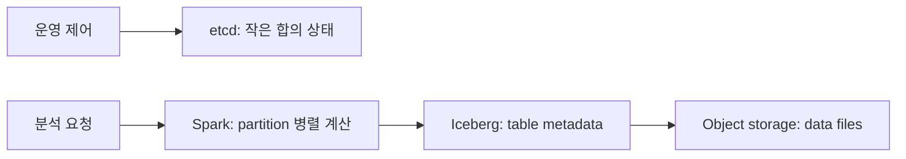

# 12. etcd, Spark, Iceberg와 저장소

## 세 시스템이 보장하는 서로 다른 것

etcd, Spark, Iceberg는 모두 분산 환경에서 쓰이지만 맡는 상태와 성공의 뜻이 다르다. **etcd**는 구성·선출·서비스 발견처럼 작은 제어 상태를 합의로 저장하는 키-값 저장소다. **Spark**는 입력을 여러 partition(병렬 처리 단위인 데이터 조각)으로 나누어 계산하는 분산 처리 엔진이다. **Iceberg**는 data file과 metadata snapshot을 연결하고 현재 테이블 버전을 고르는 테이블 형식이다.



이 장에서 구분할 성공 경계는 네 가지다. Spark task 성공은 한 partition 계산을 마쳤다는 뜻이고, object storage의 PUT 성공은 바이트가 존재한다는 뜻이다. Iceberg commit 성공은 catalog가 가리키는 현재 metadata가 바뀌었다는 뜻이며, etcd transaction 성공은 비교와 쓰기가 합의 상태에 반영되어 revision이 증가했다는 뜻이다. 하나의 성공을 다른 성공으로 대신할 수 없다.

## etcd: revision, 읽기, CAS, lease, watch

etcd는 요청을 Raft 합의 로그로 복제한다. 쿼럼이 로그 항목을 커밋하고 상태 기계가 적용하면 키가 바뀌며 **revision(저장소 전체 변경 순서를 나타내는 논리 번호)**이 증가한다. revision은 초나 밀리초 같은 벽시계 시간이 아니다.

revision의 입력은 개별 키의 시간이 아니라 etcd 저장소에서 성공한 변경 transaction이다. 그래서 `/leader`와 `/config`처럼 서로 다른 키를 바꿔도 같은 전역 순서에서 revision이 전진한다. 키의 `version`은 그 키가 만들어지거나 바뀐 횟수를 비교하는 값이고, revision은 저장소 전체 관측 순서를 잇는 값이므로 둘을 바꾸어 쓰면 안 된다. revision은 etcd가 유지하며 compaction 전까지 watch 재개 위치로 쓸 수 있지만, 실제 시각이나 요청 지연을 담지 않는다. 성공 범위도 “그 revision까지 etcd 제어 상태가 합의·적용되었다”까지이며 Spark 계산이나 object storage 파일의 존재를 포함하지 않는다.

**선형화 읽기(linearizable read)**는 호출 전에 완료된 최신 쓰기를 반영하도록 합의 경계를 확인한다. **직렬화 읽기(serializable read)**는 한 멤버가 이미 적용한 일관된 상태를 빠르게 읽지만 최신 revision보다 뒤처질 수 있다.

| 시각 | 리더 revision | follower 적용 revision | 직렬화 읽기 | 선형화 읽기 |
|---:|---:|---:|---|---|
| 0 | 20 | 20 | rev20 | rev20 |
| 10 | 21 커밋 | 20 | rev20 가능 | rev21 |
| 30 | 21 | 21 | rev21 | rev21 |

최신 권한을 얻는 연산은 “lock이 없어 보인다”는 읽기 뒤에 별도 쓰기를 보내면 안 된다. **CAS(compare-and-swap, 현재 값이 예상과 같을 때만 바꾸는 조건부 쓰기)**로 `version(key)=0` 비교와 `put`을 한 transaction에 넣어야 한다. CAS의 실제 객체는 비교식, 성공 연산, 실패 연산과 결과 revision이며 etcd가 한 transaction 안에서 판단한다.

CAS의 입력은 “내가 앞서 읽은 값” 자체가 아니라 서버가 다시 평가할 비교 조건이다. 예를 들어 `version(/lock)=0`과 `put(/lock,J1)`을 보내면 etcd는 transaction 실행 시점의 권위 상태에서 비교한다. 성공 응답은 비교와 쓰기가 하나의 revision에 원자적으로 반영되었다는 뜻이다. 이후 lease 만료나 다른 transaction으로 값이 바뀌지 않는다는 영구 보장은 아니다. 읽기 결과를 클라이언트가 검사하고 별도 put을 보내는 방식은 그 사이 J1과 J2가 모두 “없음”을 볼 수 있어 CAS와 같은 보장이 아니다.

**lease(기간제 키 수명)**는 lease ID, TTL(time to live, 만료까지 남은 시간), keepalive와 연결된 키로 구성된다. etcd는 TTL이 끝난 키를 제거하지만 그 키를 쓰던 프로세스의 CPU나 네트워크를 멈추지는 않는다. 긴 일시 정지 뒤 옛 소유자가 돌아올 수 있으므로 외부 저장소의 쓰기에도 증가하는 epoch를 확인하는 fencing(낡은 소유자의 쓰기를 거부하는 장치)이 필요하다.

lease의 수명은 grant로 시작하고 keepalive가 유효한 동안 연장되며, etcd가 만료를 확정해 연결 키를 지울 때 권위가 끝난다. 클라이언트가 마지막 keepalive를 보낸 시각이나 자신의 로컬 타이머는 권위 상태가 아니다. TTL 30초도 작업 완료 기한이 아니라 키 수명 계약이다. J1이 40초 동안 멈췄다가 깨어났을 때 이미 계산한 파일은 남을 수 있으므로, 새 epoch 78을 가진 J2의 결과를 보호하려면 실제 게시 CAS가 epoch 77을 거부해야 한다.

watch 소비자는 마지막으로 처리한 revision을 내구 저장소에 기록하고 재연결할 때 다음 revision부터 사건을 요청한다. 요청한 revision이 이미 **compaction(오래된 변경 이력 제거)** 대상이면 중간 사건을 임의로 건너뛰지 않는다. 현재 prefix를 선형화 읽기로 다시 받아 캐시를 재구성하고, 응답 header revision 다음부터 watch한다. watch 수신과 후속 부수 효과 완료도 서로 다르므로 revision과 snapshot ID로 중복을 제거한다.

여기서 캐시는 watch event를 순서대로 적용해 만든 소비자 로컬 상태다. 캐시의 수명은 프로세스보다 길 수 있지만 권위는 etcd에 있다. 서비스 S가 revision 23까지 처리했다고 기록했다면 재시작 입력은 24다. 24~40이 압축되어 24를 받을 수 없고 현재 조회가 revision 41을 반환하면, S는 그 조회 결과 전체로 캐시를 교체하고 42부터 watch한다. 41 이전 event를 추측해 재생하거나 캐시의 일부만 덧붙이면 삭제된 키를 남길 수 있다. 모델 다운로드 같은 후속 작업은 `DOWNLOADING→VERIFIED→ACTIVE` 상태와 checksum을 별도로 관리해야 하며, watch 응답 수신만으로 ACTIVE라고 표시할 수 없다.

## Spark: retry, shuffle, lineage와 checkpoint

Spark driver는 사용자 프로그램과 작업 계획을 관리하고, executor는 worker 노드에서 partition task를 수행한다. **shuffle(같은 키의 데이터를 새 partition으로 옮기는 중간 단계)**의 map 파일이 executor 로컬 디스크에서 사라지면, Spark는 **lineage(출력을 다시 만드는 입력과 변환의 계보)**를 따라 해당 partition을 다시 계산할 수 있다.

재실행은 계산 복구 기능이지 외부 업무 효과의 exactly-once(논리 효과가 정확히 한 번만 남는 성질) 보장이 아니다.

```text
attempt 0: 외부 결제 성공
attempt 0: executor crash, Spark는 성공을 기록하지 못함
attempt 1: 같은 record 재실행
외부 API가 멱등하지 않으면 결제가 두 번 실행됨
```

따라서 task 계산은 가능한 한 순수하게 두고, 외부 호출에는 request ID를 사용한 멱등 처리나 transaction을 둔다. 느린 task를 복제 실행하는 speculative execution에서도 attempt마다 고유 임시 파일을 쓰고 commit 단계가 하나만 채택해야 한다.

**checkpoint(계보 또는 streaming 상태를 내구 저장소에 둔 복구점)**는 긴 재계산 비용을 줄인다. 예를 들어 50단계 중 앞 40단계가 30분 걸리면 유용할 수 있지만 checkpoint 쓰기도 입출력과 지연을 더한다. checkpoint 성공은 Iceberg commit이나 외부 효과 exactly-once를 뜻하지 않는다.

lineage의 입력은 원본 partition과 적용할 변환들의 의존 관계이며 보통 job 실행 동안 driver 계획이 관리한다. lineage로 재계산할 수 있다는 성공 범위는 같은 논리 partition 결과를 다시 만들 수 있다는 뜻이다. executor 로컬 shuffle 파일의 내구 보존, 외부 API 호출 취소나 최종 table 게시까지 보장하지 않는다. checkpoint의 실제 입력은 선택한 중간 데이터나 streaming 상태이고, 출력은 내구 저장소의 복구점이다. 어떤 checkpoint가 언제 삭제되는지는 driver·streaming engine과 보존 정책에 달렸으므로 “checkpoint가 있다”는 말에는 위치, 포함 상태와 수명을 함께 적어야 한다.

## Iceberg: 파일 작성과 snapshot 게시

**Iceberg snapshot(한 테이블 버전에서 유효한 data file 집합을 가리키는 불변 metadata)**은 snapshot ID, manifest list, schema와 부모 snapshot을 담는다. writer는 data file을 object storage에 쓰고, 파일 목록과 통계를 담은 manifest와 metadata file을 만든 뒤, catalog의 현재 metadata pointer를 CAS로 바꾼다. 독자는 그 pointer가 선택한 snapshot을 읽는다.

writer A와 B가 모두 M10을 읽었다고 하자.

| 단계 | A | B | 독자에게 보이는 snapshot |
|---|---|---|---|
| 시작 | M10 읽음 | M10 읽음 | M10 |
| 파일 작성 | file A, M11 | file B, M12 | M10 |
| catalog CAS | M10→M11 성공 | M10→M12 실패 | M11 |
| 재시도 | 완료 | M11 기준 충돌 검사·M13 재계획 | M11 |

B가 같은 M12 게시를 무조건 반복하면 A의 변경을 덮을 수 있다. 최신 snapshot을 읽고 충돌 조건을 검사한 뒤 새 metadata로 재계획해야 한다. CAS가 성공해도 계산 내용, schema, 누락 partition과 파일 손상이 자동으로 옳아지는 것은 아니므로 row count와 업무 불변식은 별도로 검사한다.

object PUT의 입력은 파일 경로와 바이트이며 출력은 저장소가 정한 성공 응답이다. 파일은 lifecycle이나 삭제 정책이 제거할 때까지 독립 객체로 살지만 어느 테이블에 속하는지는 PUT 응답만으로 알 수 없다. manifest는 data file 목록과 통계를, metadata file은 schema·snapshot과 manifest list를 연결한다. catalog pointer는 독자가 어느 metadata를 현재로 선택할지 정한다. 따라서 writer가 관리하는 임시·data·metadata 객체의 수명과 catalog가 관리하는 현재 pointer의 수명을 분리해야 한다.

data file이나 metadata file의 존재는 현재 테이블 게시를 뜻하지 않는다. catalog pointer가 M10이면 독자는 snapshot 30을 본다. 반대로 pointer가 M11인데 M11이나 참조 파일이 손실되면 이미 승인한 결과의 내구 계약이 깨진 심각한 오류다.

## 하나의 요청 R77로 연결하기

요청 R77은 네 partition의 점수를 계산해 Iceberg snapshot 31로 게시하고 서비스 설정을 바꾼다. 시작할 때 etcd는 revision 20과 `run76=DONE`을, Iceberg catalog는 M10과 snapshot 30을 가리킨다.

조정자 J1은 TTL 30초인 lease L700을 얻는다. 이어 lock key의 version이 0일 때만 `owner=J1, epoch=77`을 쓰는 CAS를 실행해 revision 21을 얻는다. J2가 같은 비교를 보내면 이미 key가 있으므로 실패한다. J1은 `run77=RUNNING`을 기록한다.

Spark는 P0~P3의 합계 10, 20, 30, 40을 계산한다. P2 attempt 0이 30을 만든 뒤 executor와 shuffle 파일이 사라지면 lineage로 attempt 1이 다시 30을 만든다. commit protocol이 한 attempt만 채택하므로 논리 합계는 100이다. 외부 counter를 task 안에서 올렸다면 30이 두 번 더해질 수 있다.

Spark는 F77-0과 F77-1을 쓰고 manifest와 M11을 만든다. J1은 현재 epoch가 77인지 확인한 뒤 catalog를 M10에서 M11로 CAS한다. snapshot 31이 게시되면 마지막으로 etcd의 run 상태와 서비스 pointer를 `DONE, snapshot31`로 바꾼다.

| 시각 | etcd | Spark | Iceberg/catalog | 독자 관측 |
|---:|---|---|---|---|
| 0ms | rev20, run76 DONE | 시작 전 | M10/snapshot30 | snapshot30 |
| 8ms | lock CAS, rev21 | driver 계획 | M10 | snapshot30 |
| 12ms | run77 RUNNING, rev22 | P0~P3 실행 | M10 | snapshot30 |
| 40ms | L700 keepalive | P2 재실행, 합계100 | F77 존재 | snapshot30 |
| 55ms | RUNNING | output 완료 | M11 존재, pointer M10 | snapshot30 |
| 60ms | epoch77 확인 | 완료 | M10→M11 성공 | snapshot31 |
| 65ms | DONE,snapshot31, rev23 | 종료 | M11 current | 서비스도 31 |

## 장애와 복구: 권위 상태를 먼저 찾기

| crash 위치 | etcd 권위 | Spark 산출물 | Iceberg 권위 | 복구 결정 |
|---|---|---|---|---|
| lock CAS 전 | run76 | 없음 | M10 | 새 owner가 시작 가능 |
| RUNNING 기록 뒤 | epoch77 | 일부 shuffle | M10 | 같은 run을 재개 |
| data file 뒤 | epoch77 | F77 존재 | M10 | manifest부터 재개하거나 나중에 orphan 정리 |
| M11 작성 뒤 | epoch77 | 완료 | pointer M10 | 아직 미게시, CAS 전부터 재개 |
| M11 CAS 뒤 | RUNNING일 수 있음 | 완료 | pointer M11 | R77·epoch77 검증 뒤 DONE으로 수렴 |
| 서비스 pointer 뒤 응답 유실 | DONE rev23 | 완료 | M11 | 저장된 결과를 다시 반환 |

가장 중요한 경우는 M11 CAS 뒤 J1이 죽는 때다. etcd만 보면 RUNNING이지만 Iceberg에서는 snapshot 31이 현재다. 이는 곧바로 실패가 아니라 결과 미상이다. metadata property에 request ID R77과 epoch77을 기록해 두면 복구기가 우연히 다른 writer가 만든 snapshot과 구별할 수 있다. 동일 요청 결과면 DONE으로 수렴시키고, 다르면 충돌로 올린다. 새 Spark job을 즉시 시작하면 중복 파일과 snapshot을 만들 수 있다.

lease L700이 만료되어 J2가 epoch78을 얻은 뒤 J1이 40초 정지에서 돌아올 수도 있다. J1 메모리의 owner 표시는 권위가 아니다. J1의 게시가 current epoch, catalog base pointer와 서비스 pointer CAS를 모두 통과해야 한다.

## 내구성, 백업과 orphan 정리

저장소 내구성은 성공 응답 뒤 정한 장애에도 바이트가 남는 계약이다. object storage PUT 성공이 lifecycle 삭제, 계정 오작동과 모든 리전 장애까지 자동 보장하지는 않는다. catalog backup과 metadata 보존 없이 data file만 남으면 현재 테이블을 찾기 어렵다.

**orphan file(어느 유효 snapshot에서도 참조하지 않는 고아 파일)**은 현재 snapshot만 보고 지우면 안 된다. 보존 중인 과거 snapshot 어느 것도 참조하지 않고, 진행 중 writer의 파일이 아님을 확인한 뒤 정리한다. speculative attempt에서 선택되지 않은 파일도 같은 검사를 거친다.

백업 대상도 분리한다. etcd 백업은 F77을 만들지 않고, Iceberg metadata와 data file 백업은 Spark 실행 중 accumulator를 복구하지 않으며, Spark checkpoint는 etcd의 최신 owner를 복원하지 않는다. etcd가 revision 22인 백업과 Iceberg snapshot 31을 함께 복구했다면 R77 metadata를 보고 DONE으로 수렴할 수 있다. 반대로 etcd가 DONE31인데 M11이 없다면 정상 성공으로 숨기지 말고 서비스 차단과 사고 처리를 해야 한다.

## 통합 문제와 해설

### 1. follower rev20에서 lock이 없다고 읽었다. 바로 J2가 실행해도 되는가?

아니다. 직렬화 읽기의 반환 상태는 “그 follower가 rev20까지 적용한 일관된 상태”일 뿐 최신 상태라는 뜻이 아니다. J1이 리더에서 rev21로 lock을 얻고 follower가 아직 적용하지 않았다면 J2는 없음으로 읽는다. J2가 이 판단으로 외부 작업부터 시작하면 두 owner가 동시에 실행된다. `version=0` 비교와 put을 같은 etcd transaction으로 보내면 서버가 권위 상태에서 다시 평가하므로 J1이 먼저 얻은 경우 J2 compare가 실패한다. 선형화 읽기를 먼저 하더라도 읽기와 쓰기 사이 경쟁은 남으므로 최종 획득은 transaction compare여야 한다. 이미 획득한 lock 갱신이라면 `version=0` 대신 예상 owner나 epoch를 비교하도록 조건도 바뀐다.

### 2. Spark P2가 두 번 실행됐는데 최종 합계가 100인 이유는?

P2 attempt 0과 1이 모두 값 30을 계산해도 driver의 commit protocol은 한 attempt의 산출물만 논리 결과에 포함한다. 그래서 상태 판단은 `P0=10, P1=20, P2=30 한 번, P3=40`이고 합계는 100이다. “task가 두 번 실행됐으니 합계가 130”이라는 결론은 계산 attempt 수와 채택된 output 수를 혼동한다. 반면 task 안의 외부 API는 Spark commit 경계 밖이라 두 attempt에서 모두 성공할 수 있으므로 request ID나 별도 transaction이 필요하다. 두 attempt가 서로 다른 30을 냈다면 retry 문제가 아니라 비결정적 계산 또는 입력 일관성 문제로 올려야 한다.

### 3. F77과 M11이 존재하면 snapshot 31이 현재인가?

아니다. 상태를 세 층으로 나누면 object storage에 F77 바이트가 있고 metadata 파일 M11이 F77을 가리키지만, catalog current는 여전히 M10이다. 독자의 시작 입력은 catalog pointer이므로 snapshot 30만 찾는다. 파일 존재를 게시 성공으로 판단하면 미완성 writer의 파일까지 현재 데이터로 오인한다. M10→M11 CAS가 성공해야 snapshot 31이 보인다. 단, CAS 성공 뒤 독자가 M11 또는 F77을 읽지 못한다면 게시 여부가 아니라 내구성·가용성 위반이다.

### 4. watch 시작 revision이 compaction됐다면?

compaction 오류는 “변경이 없었다”는 응답이 아니라 요청한 과거 event를 더 이상 제공할 수 없다는 뜻이다. 소비자는 현재 prefix를 선형화 읽기로 받아 삭제까지 반영한 완전한 캐시를 만들고, 그 응답 revision이 41이면 42부터 watch한다. 마지막 revision만 41로 올리고 옛 캐시를 유지하면 24~40 사이 삭제된 키가 남는다. 모든 중간 event가 감사상 필요하다면 watch 복구만으로는 부족하며 compaction 전에 별도 event log를 보존해야 한다.

### 5. lease가 만료되면 J1의 업로드가 자동 중단되는가?

아니다. lease 만료가 직접 바꾸는 상태는 연결된 etcd key다. 이미 실행 중인 J1 프로세스, Spark task와 업로드 연결은 자동으로 중단되지 않는다. 따라서 J1 메모리의 owner 값이나 과거 성공 응답을 믿으면 epoch78의 J2 뒤에 낡은 결과를 게시할 수 있다. 게시 직전 current epoch와 base pointer를 함께 확인하고 서비스 pointer도 조건부 교체해야 한다. 외부 저장소가 fencing token을 받을 수 없다면 조정 계층이 token을 검증한 뒤에만 pointer를 바꾸도록 경계를 설계한다.

### 6. speculative attempt 두 개가 파일을 썼다. 둘 다 table에 넣어도 되는가?

같은 partition을 나타내는 두 파일을 모두 manifest에 넣으면 독자는 두 행 집합을 모두 읽어 논리 중복이 된다. attempt별 고유 임시 파일을 만들고 driver가 채택한 하나만 manifest 입력으로 고른다. 선택되지 않은 파일이 곧바로 삭제 가능하다는 결론도 틀릴 수 있다. 동시 writer나 과거 보존 snapshot이 참조할 수 있으므로 현재 snapshot뿐 아니라 보존 중인 모든 snapshot과 진행 중 작업의 안전 기간을 확인한 뒤 orphan으로 정리한다. 두 파일이 서로 다른 partition을 담았다면 중복 판단 자체가 달라지므로 partition identity를 먼저 비교한다.

### 7. etcd rev23 백업과 Iceberg snapshot 30만 복구됐다. 서비스 pointer 31을 믿어도 되는가?

rev23의 etcd 상태는 서비스가 snapshot31을 가리킨다고 말하지만 복구한 catalog는 snapshot30이다. 먼저 M11, manifest와 모든 참조 data file의 존재·checksum을 검사해 어느 사본이 실제 권위 계약을 만족하는지 판단한다. M11이 온전히 남았다면 catalog를 복구 절차에 따라 다시 연결할 수 있지만, 파일이 없다면 acknowledged 결과 손실이다. 단순히 pointer를 30으로 낮추고 “복구 완료”라고 하면 이미 31 성공을 받은 client의 계약을 숨긴다. 이 경우 서비스 차단, 이전 snapshot의 임시 제공과 사고 상태를 분리해 보고해야 한다.

### 8. etcd에 대형 Parquet를 저장하거나 Spark checkpoint를 Iceberg commit으로 보아도 되는가?

둘 다 안 된다. Parquet 바이트를 etcd에 넣으면 모든 합의 멤버가 대형 값을 로그·복제·snapshot으로 다루고 watch 소비자까지 영향을 받는다. etcd의 성공 범위는 작은 제어 상태에 맞추고 실제 data file은 object storage에 둔다. Spark checkpoint는 계산을 재개할 입력을 보존하지만 현재 테이블 버전을 선택하지 않는다. Iceberg catalog CAS는 snapshot 게시를 선택하지만 Spark의 중간 계산을 복원하지 않는다. 두 기능을 함께 쓸 수는 있어도 객체, 관리자, 수명과 실패 복구 절차를 각각 기록해야 한다.

교육 trace의 수치는 동작 순서를 설명하기 위한 값이며 성능 측정 결과가 아니다.

## 공식 자료

- [etcd Learning](https://etcd.io/docs/v3.5/learning/)
- [Spark Cluster Overview](https://spark.apache.org/docs/latest/cluster-overview.html)
- [Iceberg Reliability](https://iceberg.apache.org/docs/latest/reliability/)

[← 이전](11-membership-failure-detection-and-leases.md) · [목차](README.md) · [다음 →](13-local-models-and-fault-scenarios.md)
