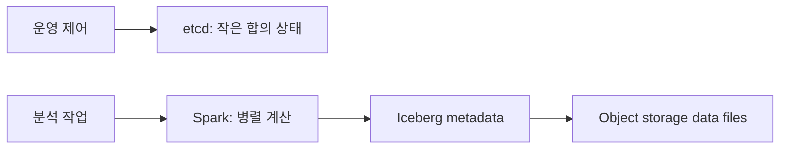

# 12. etcd, Spark, Iceberg와 저장소

## 세 system의 보장 경계를 실제 요청으로 보기

**etcd**는 작은 coordination state를 Raft로 복제하는 key-value store다. **Linearizable read**는 호출 전 완료된 최신 write를 반영하도록 합의 경계를 확인하는 읽기다. **Serializable read**는 한 member의 일관된 revision을 읽지만 최신이 아닐 수 있다.

Leader가 config v2를 revision 20에 commit했는데 follower가 revision 18의 v1이면 serializable read는 v1을 빠르게 반환할 수 있다. Linearizable read는 최신 commit을 확인해 v2를 반환한다. 최신성이 필요한 leader 선출·설정 판단은 읽기 모드를 명시한다.

**Spark task retry**는 실패한 partition 계산을 다시 실행하는 기능이지 업무 부작용의 exactly-once 보장이 아니다.

```text
attempt 1: 외부 결제 성공
attempt 1: executor crash, Spark는 성공 기록 못 함
attempt 2: 같은 record 재실행
외부 API가 멱등하지 않으면 두 번 결제
```

Spark 재시도와 외부 system의 idempotency key·transaction은 별도 책임이다.

**Iceberg** update는 data file 쓰기와 metadata snapshot 게시가 나뉜다.

1. Writer가 Parquet file F1을 object storage에 쓴다.
2. F1을 가리키는 metadata를 만든다.
3. Catalog pointer를 snapshot 30에서 31로 원자 변경한다.
4. Reader가 snapshot 31의 manifest와 file을 읽는다.

F1 뒤 3단계 전에 crash하면 file은 있지만 table에 게시되지 않았다. 반대로 metadata file이 있어도 catalog pointer가 이전 snapshot이면 현재 table이 아니다.

두 writer가 snapshot 30에서 동시에 시작하면 한 compare-and-swap만 먼저 성공한다. 다른 writer는 conflict를 받고 최신 snapshot을 기준으로 재시도한다.

### 완전 해설 문제

1. 최신 config가 필수일 때 serializable read로 충분한가? **해설:** 뒤처진 revision을 받을 수 있으므로 linearizable read가 필요하다.
2. Spark retry가 결제를 exactly-once로 만드는가? **해설:** 외부 성공과 Spark 기록이 갈릴 수 있어 별도 idempotency가 필요하다.
3. Iceberg file upload가 publish 성공인가? **해설:** 아니다. Catalog가 새 snapshot을 원자적으로 가리켜야 reader에게 보인다.

[← 이전](11-membership-failure-detection-and-leases.md) · [목차](README.md) · [다음 →](13-local-models-and-fault-scenarios.md)

## 세 도구는 서로 다른 상태를 맡는다

etcd는 작은 핵심 메타데이터를 합의로 저장하는 키-값 저장소다.
Spark는 분산 데이터 처리 엔진이다.
Iceberg는 데이터 파일과 테이블 snapshot을 연결하는 테이블 형식이다.
세 이름을 모두 “분산 데이터베이스”라고 부르면 책임 경계가 사라진다.



## etcd 요청

클라이언트가 key=/leader, value=node7을 보낸다.
etcd 리더가 Raft 로그 entry로 만든다.
쿼럼 복제와 커밋 뒤 MVCC revision이 증가한다.
상태 기계가 key를 바꾸고 watch 구독자에게 사건을 보낸다.
revision은 전체 저장소 변경 순서를 추적하는 논리 번호다.
대용량 분석 파일 저장용이 아니라 구성, 선출, 서비스 발견 같은 작은 상태에 적합하다.

## Spark 작업

driver는 사용자 프로그램을 실행하고 작업 계획을 만든다.
executor는 worker 노드에서 task를 수행한다.
partition은 병렬 처리 단위 데이터 조각이다.
shuffle은 같은 키 데이터를 새 partition으로 이동시킨다.
task 실패 시 입력과 lineage로 다시 계산할 수 있다.
외부 부수 효과가 있으면 task 재실행 중복을 따로 다뤄야 한다.

## Iceberg 커밋

writer는 새 data file을 object storage에 쓴다.
manifest가 파일 목록과 통계를 기록한다.
metadata file이 현재 snapshot과 schema를 가리킨다.
catalog의 현재 metadata pointer를 조건부로 교체하면 새 snapshot이 보인다.
동시 writer가 옛 pointer를 기준으로 교체하면 충돌해 재계획한다.
파일 업로드 성공만으로 테이블 커밋은 아니다.

## 시간 추적과 반례

t=0 writer A와 B가 snapshot 10을 읽는다.
t=20 A가 snapshot 11 pointer 교체에 성공한다.
t=25 B의 snapshot 12 교체는 기준 pointer가 10이라 실패한다.
B는 11을 읽고 충돌 조건을 검사한 뒤 재시도한다.
object storage에 B 파일이 있어도 metadata가 가리키지 않으면 독자에게 보이지 않는다.

etcd를 데이터 레이크 파일 저장소로 쓰는 것은 크기와 처리량 목적에 맞지 않는다.
Spark checkpoint가 Iceberg 트랜잭션을 자동 보장하지 않는다.
Iceberg snapshot은 실행 중 Spark 메모리 상태 snapshot과 다른 대상이다.

## 문제와 해설

### 1. etcd revision은 wall clock인가?
아니다. 저장소 변경 순서를 나타내는 논리 번호다.

### 2. Spark task 재시도가 위험한 때는?
외부 시스템에 비멱등 부수 효과를 남길 때다.

### 3. Iceberg에서 보이는 커밋 지점은?
catalog가 가리키는 현재 metadata pointer의 원자적 교체다.

## 공식 자료

- [etcd Learning](https://etcd.io/docs/v3.5/learning/)
- [Spark Cluster Overview](https://spark.apache.org/docs/latest/cluster-overview.html)
- [Iceberg Reliability](https://iceberg.apache.org/docs/latest/reliability/)

[← 이전](11-membership-failure-detection-and-leases.md) · [목차](README.md) · [다음 →](13-local-models-and-fault-scenarios.md)
