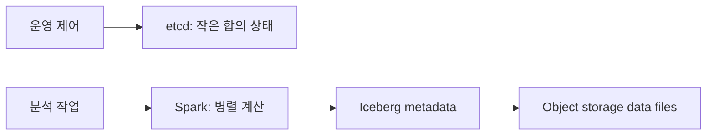

# 12. etcd, Spark, Iceberg와 저장소

## 같은 “분산” 안에서 서로 다른 세 보장

etcd는 작은 제어 상태를 합의 로그로 저장한다. Spark는 입력 partition을 task로 계산하며 실패한 task를 재실행할 수 있다. Iceberg는 data file과 metadata snapshot을 연결하고 catalog pointer를 조건부 교체한다. 세 도구의 성공 지점은 서로 다르다.

### etcd 읽기와 revision

etcd의 revision은 저장소 전체 변경에 따라 증가하는 논리 번호다. wall clock이 아니다. linearizable read는 현재 합의 상태를 확인하는 경로를 사용하고, serializable read는 로컬 멤버의 이미 적용된 상태를 읽어 더 오래된 revision일 수 있다.

| 시각 | 리더 revision | follower 적용 revision | 로컬 읽기 | 선형화 읽기 |
|---:|---:|---:|---|---|
| 0 | 20 | 20 | rev20 | rev20 |
| 10 | 21 커밋 | 20 | rev20 가능 | rev21 |
| 30 | 21 | 21 | rev21 | rev21 |

watch 소비자는 받은 revision을 기록하고 재연결 때 다음 revision부터 요청한다. compaction보다 오래된 revision이면 snapshot성 재조회가 필요하다.

### Spark task retry와 부수 효과

driver가 stage를 만들고 executor가 partition task를 수행한다. task 결과 파일이 원자적 commit protocol에 들어가기 전 executor가 죽으면 다른 executor가 같은 partition을 다시 계산할 수 있다. 순수 변환은 같은 결과를 만들지만 외부 이메일이나 비멱등 API 호출은 두 번 실행될 수 있다.

### Iceberg의 CAS 게시

writer A와 B가 metadata pointer M10을 읽는다. A가 새 data file과 M11을 쓰고 catalog를 `M10이면 M11로` 조건부 교체해 성공한다. B가 M10 기준 M12 교체를 시도하면 현재 값이 M11이므로 실패한다. B는 M11을 읽고 충돌 검증 뒤 새 metadata를 만든다.

| 단계 | A | B | 독자에게 보이는 snapshot |
|---|---|---|---|
| 시작 | M10 읽음 | M10 읽음 | M10 |
| 파일 작성 | file A | file B | M10 |
| CAS | M10→M11 성공 | M10→M12 실패 | M11 |
| 재시도 | 완료 | M11 기준 재계획 | M11 |

data file 업로드 성공은 table commit이 아니다. 현재 catalog pointer가 가리키는 metadata에 포함되어야 독자가 본다.

## 추가 문제와 해설

### 1. revision 30이 30초인가?
아니다. 논리 변경 순서다.

### 2. follower가 rev29일 때 최신 rev30을 반드시 읽어야 하면?
linearizable read 계약을 사용한다.

### 3. Spark task가 두 번 실행돼도 안전한 조건은?
계산이 순수하거나 외부 효과가 멱등·중복 제거 경계 안에 있어야 한다.

### 4. Iceberg CAS 실패는 data file 실패인가?
아니다. 파일은 존재할 수 있지만 현재 table metadata에 게시되지 않았다.

### 5. etcd에 대형 분석 파일을 저장하면?
작은 합의 제어 상태라는 목적과 맞지 않아 로그·복제 비용을 키운다.

## 세 system의 보장 경계를 실제 요청으로 보기

**etcd**는 작은 coordination state를 Raft로 복제하는 key-value store다. **Linearizable read**는 호출 전 완료된 최신 write를 반영하도록 합의 경계를 확인하는 읽기다. **Serializable read**는 한 member의 일관된 revision을 읽지만 최신이 아닐 수 있다.

Leader가 config v2를 revision 20에 commit했는데 follower가 revision 18의 v1이면 serializable read는 v1을 빠르게 반환할 수 있다. Linearizable read는 최신 commit을 확인해 v2를 반환한다. 최신성이 필요한 leader 선출·설정 판단은 읽기 모드를 명시한다.

**Spark task retry**는 실패한 partition 계산을 다시 실행하는 기능이지 업무 부작용의 exactly-once 보장이 아니다.

```text
attempt 1: 외부 결제 성공
attempt 1: executor crash, Spark는 성공 기록 못 함
attempt 2: 같은 record 재실행
외부 API가 멱등하지 않으면 두 번 결제
```

Spark 재시도와 외부 system의 idempotency key·transaction은 별도 책임이다.

**Iceberg** update는 data file 쓰기와 metadata snapshot 게시가 나뉜다.

1. Writer가 Parquet file F1을 object storage에 쓴다.
2. F1을 가리키는 metadata를 만든다.
3. Catalog pointer를 snapshot 30에서 31로 원자 변경한다.
4. Reader가 snapshot 31의 manifest와 file을 읽는다.

F1 뒤 3단계 전에 crash하면 file은 있지만 table에 게시되지 않았다. 반대로 metadata file이 있어도 catalog pointer가 이전 snapshot이면 현재 table이 아니다.

두 writer가 snapshot 30에서 동시에 시작하면 한 compare-and-swap만 먼저 성공한다. 다른 writer는 conflict를 받고 최신 snapshot을 기준으로 재시도한다.

### 완전 해설 문제

1. 최신 config가 필수일 때 serializable read로 충분한가? **해설:** 뒤처진 revision을 받을 수 있으므로 linearizable read가 필요하다.
2. Spark retry가 결제를 exactly-once로 만드는가? **해설:** 외부 성공과 Spark 기록이 갈릴 수 있어 별도 idempotency가 필요하다.
3. Iceberg file upload가 publish 성공인가? **해설:** 아니다. Catalog가 새 snapshot을 원자적으로 가리켜야 reader에게 보인다.

[← 이전](11-membership-failure-detection-and-leases.md) · [목차](README.md) · [다음 →](13-local-models-and-fault-scenarios.md)

## 세 도구는 서로 다른 상태를 맡는다

etcd는 작은 핵심 메타데이터를 합의로 저장하는 키-값 저장소다.
Spark는 분산 데이터 처리 엔진이다.
Iceberg는 데이터 파일과 테이블 snapshot을 연결하는 테이블 형식이다.
세 이름을 모두 “분산 데이터베이스”라고 부르면 책임 경계가 사라진다.



## etcd 요청

클라이언트가 key=/leader, value=node7을 보낸다.
etcd 리더가 Raft 로그 entry로 만든다.
쿼럼 복제와 커밋 뒤 MVCC revision이 증가한다.
상태 기계가 key를 바꾸고 watch 구독자에게 사건을 보낸다.
revision은 전체 저장소 변경 순서를 추적하는 논리 번호다.
대용량 분석 파일 저장용이 아니라 구성, 선출, 서비스 발견 같은 작은 상태에 적합하다.

## Spark 작업

driver는 사용자 프로그램을 실행하고 작업 계획을 만든다.
executor는 worker 노드에서 task를 수행한다.
partition은 병렬 처리 단위 데이터 조각이다.
shuffle은 같은 키 데이터를 새 partition으로 이동시킨다.
task 실패 시 입력과 lineage로 다시 계산할 수 있다.
외부 부수 효과가 있으면 task 재실행 중복을 따로 다뤄야 한다.

## Iceberg 커밋

writer는 새 data file을 object storage에 쓴다.
manifest가 파일 목록과 통계를 기록한다.
metadata file이 현재 snapshot과 schema를 가리킨다.
catalog의 현재 metadata pointer를 조건부로 교체하면 새 snapshot이 보인다.
동시 writer가 옛 pointer를 기준으로 교체하면 충돌해 재계획한다.
파일 업로드 성공만으로 테이블 커밋은 아니다.

## 시간 추적과 반례

t=0 writer A와 B가 snapshot 10을 읽는다.
t=20 A가 snapshot 11 pointer 교체에 성공한다.
t=25 B의 snapshot 12 교체는 기준 pointer가 10이라 실패한다.
B는 11을 읽고 충돌 조건을 검사한 뒤 재시도한다.
object storage에 B 파일이 있어도 metadata가 가리키지 않으면 독자에게 보이지 않는다.

etcd를 데이터 레이크 파일 저장소로 쓰는 것은 크기와 처리량 목적에 맞지 않는다.
Spark checkpoint가 Iceberg 트랜잭션을 자동 보장하지 않는다.
Iceberg snapshot은 실행 중 Spark 메모리 상태 snapshot과 다른 대상이다.

## 문제와 해설

### 1. etcd revision은 wall clock인가?
아니다. 저장소 변경 순서를 나타내는 논리 번호다.

### 2. Spark task 재시도가 위험한 때는?
외부 시스템에 비멱등 부수 효과를 남길 때다.

### 3. Iceberg에서 보이는 커밋 지점은?
catalog가 가리키는 현재 metadata pointer의 원자적 교체다.

## 공식 자료

- [etcd Learning](https://etcd.io/docs/v3.5/learning/)
- [Spark Cluster Overview](https://spark.apache.org/docs/latest/cluster-overview.html)
- [Iceberg Reliability](https://iceberg.apache.org/docs/latest/reliability/)


## 하나의 실제 요청에서 세 경계를 연결하기

요청 R77은 입력 네 partition의 점수를 계산해 Iceberg snapshot 31로 게시하고 서비스 설정을 바꾼다. 초기 etcd revision은 20, Iceberg catalog는 M10과 snapshot 30을 가리킨다. 조정자 J1은 TTL 30초 lease L700을 얻고, lock key의 version이 0일 때만 owner=J1, epoch=77을 쓰는 CAS를 실행한다. J2가 같은 비교를 하면 current revision이 이미 21이므로 실패한다.

**CAS(compare-and-swap, 현재 값이 예상과 같을 때만 바꾸는 조건부 쓰기)**의 실제 객체는 비교식, 성공 연산, 실패 연산과 결과 revision이다. etcd가 Raft로 관리하고 한 transaction 동안 판단한다. **lease(기간제 키 수명)**의 실제 객체는 lease ID, TTL, keepalive와 연결 key다. etcd가 만료를 관리하지만 J1 프로세스 자체를 죽이지 않는다. 긴 pause 뒤 J1이 돌아올 수 있으므로 Iceberg와 서비스 pointer도 epoch를 검사한다.

Spark driver는 partition P0~P3의 합계 10, 20, 30, 40을 계산한다. **lineage(출력을 다시 만드는 입력·변환 계보)**는 driver 계획에 있고 job 동안 산다. **shuffle(같은 key 데이터를 새 partition으로 옮기는 중간 단계)**은 map 파일과 fetch 정보로 존재한다. P2 attempt0이 출력 30을 만든 뒤 executor가 죽고 shuffle 파일도 사라지면 lineage로 attempt1이 다시 30을 만든다. 최종 논리 합계는 100이다. task 안에서 외부 counter를 올렸다면 30이 두 번 더해질 수 있으므로 계산은 순수하게 두고 게시를 별도 commit으로 한다.

Spark **checkpoint(계산 계보 또는 streaming 상태를 내구 저장소에 둔 복구점)**는 긴 재계산을 줄인다. 관리자와 수명은 checkpoint 종류에 따라 driver나 streaming engine, job 보존 정책이 정한다. checkpoint 성공은 Iceberg table commit도 외부 효과 exactly-once도 아니다.

Spark는 F77-0과 F77-1을 object storage에 쓰고 manifest와 M11을 만든다. **Iceberg snapshot(그 테이블 버전에서 유효한 data file 집합을 가리키는 불변 metadata)**은 snapshot ID, manifest list, schema와 부모 snapshot으로 존재한다. writer가 만들고 catalog pointer가 현재 버전을 선택한다.

| 시각 | etcd | Spark | Iceberg/catalog | 독자 관측 |
|---:|---|---|---|---|
| 0ms | rev20, run76 DONE | 시작 전 | M10/snapshot30 | snapshot30 |
| 8ms | J1 CAS 성공 rev21 | driver 계획 | M10 | snapshot30 |
| 12ms | run77 RUNNING rev22 | P0~P3 실행 | M10 | snapshot30 |
| 40ms | L700 keepalive | P2 재실행, 합계100 | F77 파일 존재 | snapshot30 |
| 55ms | run77 RUNNING | output 완료 | M11 존재, pointer M10 | snapshot30 |
| 60ms | 소유 epoch77 확인 | 완료 | CAS M10→M11 성공 | snapshot31 |
| 65ms | run77 DONE,snapshot31 CAS rev23 | 종료 | M11 current | 서비스도 31 |

data file upload, metadata 작성, catalog CAS는 다른 사건이다. M11 파일이 있어도 pointer가 M10이면 현재 table은 snapshot30이다. **저장소 내구성**은 성공 응답 뒤 정한 장애에도 바이트가 남는 계약이며, object storage 파일·catalog·etcd는 서로 다른 삭제와 복구 정책을 가진다.

## 동시 writer와 lease 만료 반례

writer B도 M10을 읽고 M12를 만들었다. J1이 t=20에 M10→M11 CAS를 성공시키면 B의 t=25 M10→M12 CAS는 실패한다. B는 M11을 읽고 충돌을 검사해 M13으로 재계획해야 한다. 같은 M12를 무조건 반복하면 J1 변경을 덮을 수 있다.

L700이 30초에 만료되고 J2가 epoch78을 얻은 뒤 J1이 40초 pause에서 돌아와도 메모리의 owner 표시는 권위가 아니다. etcd lease는 lock key를 지우지만 CPU와 네트워크를 차단하지 않는다. J1은 current epoch와 catalog base pointer, 서비스 pointer CAS를 모두 통과해야 한다. lease와 외부 저장소 fencing을 구분한다.

Iceberg commit 뒤 etcd DONE 전 crash하면 table은 31인데 run은 RUNNING일 수 있다. 이는 실패가 아니라 결과 미상이다. 복구기는 snapshot metadata의 run ID R77, catalog current와 etcd epoch를 조회해 같은 결과를 DONE으로 수렴시킨다. 새 Spark job을 즉시 시작하면 중복 파일과 snapshot을 만들 수 있다.

## 내구성과 정리

object storage PUT 성공은 lifecycle 삭제, 계정 오작동과 리전 장애까지 자동 보장하지 않는다. catalog backup과 metadata 보존이 없으면 data file만으로 현재 table을 찾기 어렵다. orphan 정리는 현재 snapshot뿐 아니라 보존 중인 과거 snapshot 어느 것도 참조하지 않는 파일만 지운다.

etcd에는 작은 제어 상태만 둔다. 대형 Parquet를 합의 로그에 넣으면 복제, snapshot과 watch 비용이 커진다. Spark executor 로컬 디스크의 shuffle은 재계산 가능한 중간 상태이며 유일한 최종 사본이 아니다.

## 추가 완전 풀이

### 문제 6. follower rev20에서 lock이 없다고 읽었다. 바로 J2가 실행해도 되는가?

**풀이:** serializable read는 옛 값일 수 있다. lock version=0 비교와 put을 같은 etcd transaction으로 보내야 한다. J1이 rev21에 먼저 얻었다면 J2 compare가 실패한다.

### 문제 7. Spark P2가 두 번 실행됐는데 최종 합계는 왜 100인가?

**풀이:** output commit이 채택한 한 attempt의 30만 shuffle에 들어가면 10+20+30+40=100이다. 외부 비멱등 API는 두 attempt에서 모두 실행될 수 있으므로 별도 request ID가 필요하다.

### 문제 8. F77과 M11이 존재하면 snapshot31을 현재라고 말할 수 있는가?

**풀이:** 아니다. catalog pointer가 M10이면 독자는 30을 본다. M10→M11 조건부 교체가 게시 경계다.

### 문제 9. Spark checkpoint 성공이 Iceberg commit 성공인가?

**풀이:** 아니다. checkpoint는 Spark 계산 복구점이고, Iceberg는 catalog CAS가 성공해야 게시된다. 서로 다른 관리자·객체·수명을 가진다.

### 문제 10. watch 시작 revision이 compaction됐다면?

**풀이:** 중간 사건을 건너뛰지 말고 현재 key 집합을 다시 읽어 캐시를 만들고 응답 revision 다음부터 watch한다. 처리 revision을 영속화한다.

### 문제 11. lease가 만료되면 J1의 file upload도 자동 중단되는가?

**풀이:** 아니다. J1은 계속 실행할 수 있다. 새 epoch와 catalog CAS, 서비스 pointer compare가 낡은 게시를 거부해야 한다.


## 실패 위치별 복구 상태표

| crash 위치 | etcd 권위 | Spark 산출물 | Iceberg 권위 | 복구 결정 |
|---|---|---|---|---|
| lock CAS 전 | run76 | 없음 | M10 | 새 owner가 시작 가능 |
| run77 RUNNING 뒤 | epoch77 | 일부 shuffle | M10 | 같은 run을 재개 |
| data file 뒤 | epoch77 | F77 존재 | M10 | manifest부터 재개 또는 orphan 정리 |
| M11 작성 뒤 | epoch77 | 완료 | pointer M10 | CAS 전이므로 아직 미게시 |
| M11 CAS 뒤 | RUNNING일 수 있음 | 완료 | pointer M11 | R77 검증 뒤 DONE 수렴 |
| serving pointer 뒤 응답 유실 | DONE rev23 | 완료 | M11 | 저장 결과 반환 |

각 줄에서 성공의 뜻이 다르다. Spark task 성공은 partition 계산 완료, object PUT 성공은 바이트 존재, Iceberg commit 성공은 current metadata 교체, etcd transaction 성공은 제어 상태 revision 증가다. 클라이언트 API 성공은 이 경계들을 정한 순서로 확인한 뒤 별도 응답으로 보낸다.

M11 CAS 뒤 J1이 죽은 줄이 가장 중요하다. etcd만 보면 RUNNING이라 실패처럼 보이고 Iceberg만 보면 snapshot31이 현재다. metadata property에 request ID R77과 epoch77을 기록하면 복구기가 우연히 다른 writer가 만든 snapshot인지 구별할 수 있다. 동일 요청의 결과라면 DONE으로 기록한다. 다른 결과라면 충돌 상태로 올리고 자동 덮어쓰지 않는다.

## etcd watch와 압축을 실제 소비자에 연결하기

서비스 S는 /serving/model을 watch하고 마지막 처리 revision 23을 로컬 내구 저장소에 남긴다. 재시작 뒤 24부터 요청한다. revision 24~40이 compaction됐는데 S가 24를 요구하면 etcd는 과거 사건 전부를 줄 수 없다. S는 현재 prefix를 linearizable하게 읽어 snapshot을 재구성하고 응답 header revision 41 다음부터 watch한다.

watch는 같은 사건이 재전달되거나 연결 경계에서 재조회가 필요할 수 있다. S가 모델 다운로드를 시작하는 부수 효과는 revision과 snapshot ID로 중복 제거한다. watch 응답을 받았다는 사실과 모델 파일을 완전히 설치했다는 사실도 다르다. 설치 상태를 DOWNLOADING, VERIFIED, ACTIVE로 관리하고 checksum 뒤 ACTIVE로 바꾼다.

## Spark shuffle과 checkpoint의 장애 비용

P2 map output이 executor 로컬 디스크에만 있고 downstream fetch 전에 노드가 사라지면 upstream P2를 lineage로 다시 계산한다. downstream reduce가 절반을 읽었다고 부분 결과를 최종 상태에 섞지 않고 같은 stage attempt 경계를 다시 수행한다. shuffle service가 파일을 보존하는 구성인지, executor 제거와 함께 사라지는지 명시한다.

lineage가 50단계이고 앞 40단계 계산이 30분 걸린다면 checkpoint는 복구 비용을 줄일 수 있다. 그러나 checkpoint 쓰기 자체가 I/O와 job 지연을 더한다. 어디서 끊을지는 상태 크기, 장애 빈도와 재계산 비용으로 정한다. “checkpoint를 켰으니 안전”이 아니라 어떤 데이터와 metadata가 어느 저장소에 저장됐는지 확인한다.

speculative execution은 느린 partition의 attempt0과 attempt1을 동시에 돌릴 수 있다. 두 attempt가 같은 최종 파일 이름에 비원자적으로 쓰면 손상될 수 있다. attempt별 고유 임시 파일을 쓰고 driver 또는 table commit이 한 결과만 manifest에 포함한다. 선택되지 않은 파일은 즉시 삭제보다 snapshot 참조 검사를 거쳐 정리한다.

## 세 저장소의 복구 목표를 분리한다

etcd 백업은 제어 상태를 복구하지만 object storage의 F77을 만들지 않는다. Iceberg metadata와 data file backup은 table을 복구하지만 Spark driver의 실행 중 accumulator를 복구하지 않는다. Spark checkpoint는 계산을 재개하지만 etcd의 최신 owner를 복원하지 않는다. 재해 복구 계획은 세 객체의 일관된 시점과 재연결 절차를 적는다.

예를 들어 etcd는 revision22 백업, Iceberg는 이미 snapshot31인 상태로 복구될 수 있다. run77은 RUNNING이지만 metadata의 R77을 확인해 DONE으로 수렴한다. 반대로 etcd가 DONE31인데 storage에서 M11이 손실됐다면 성공 응답의 내구 계약이 깨진 심각한 오류다. 이전 snapshot30으로 pointer를 되돌리는 것만으로 이미 제공한 결과가 자동 정당화되지는 않는다.

## 추가 완전 풀이

### 문제 12. etcd rev23 백업과 Iceberg snapshot30만 복구됐다. 서비스 pointer31을 그대로 믿어도 되는가?

**풀이:** 안 된다. 제어 pointer가 가리키는 M11과 data file이 실제로 존재하고 checksum이 맞는지 확인한다. 없다면 acknowledged 결과 손실이다. 복구 정책에 따라 서비스 차단, 이전 snapshot 임시 전환과 사고 처리를 수행하되 정상 성공으로 숨기지 않는다.

### 문제 13. speculative attempt 두 개가 각각 파일을 썼다. 둘 다 table에 넣어도 되는가?

**풀이:** 같은 partition의 동일 논리 결과라면 둘 다 넣으면 중복이다. commit protocol이 채택한 attempt 파일만 manifest에 포함한다. 다른 파일은 어느 snapshot도 참조하지 않을 때 orphan 정리한다.

### 문제 14. Iceberg CAS가 충돌하지 않았으면 데이터 내용도 자동으로 옳은가?

**풀이:** 아니다. CAS는 base pointer 경쟁을 제어한다. Spark 계산 버그, 잘못된 schema, 빠진 partition과 손상 파일은 별도 검증 대상이다. row count, partition completeness와 업무 invariant를 commit 전후 확인한다.

## 보장 검토표

- etcd revision은 논리 변경 순서이며 wall clock이 아니다.
- 최신 권한에는 linearizable read나 transaction compare를 쓴다.
- lease 만료와 외부 writer 차단을 구분한다.
- Spark retry가 외부 부수 효과를 반복할 수 있음을 기록한다.
- file, metadata, catalog pointer의 성공을 각각 관측한다.
- 가상 수치는 교육 trace이며 성능 실험 결과가 아니다.

[← 이전](11-membership-failure-detection-and-leases.md) · [목차](README.md) · [다음 →](13-local-models-and-fault-scenarios.md)
