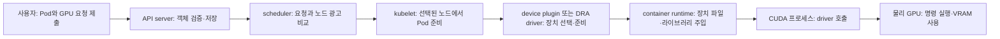
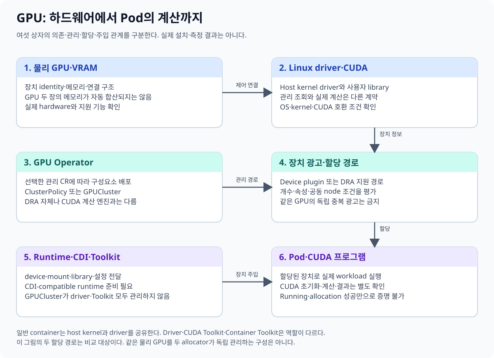
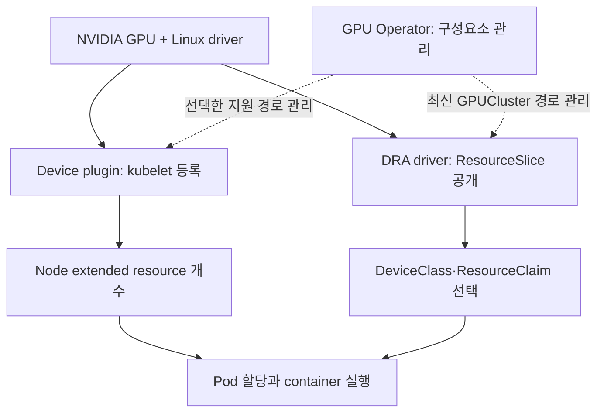

# 00. 전체 지도: GPU가 있어도 Pod가 못 쓰는 이유

**GPU(Graphics Processing Unit, 그래픽 처리 장치)**는 많은 계산을 병렬로 처리하는 하드웨어이며, 이 책에서는 서버의 AI 계산에 쓰는 장치를 다룬다. **Kubernetes**는 여러 서버, 즉 **노드(node)**에서 프로그램 실행을 관리한다. 실행 파일과 설정을 운영체제의 격리·자원 관리 기능으로 묶어 실행한 **컨테이너(container)**를 같은 노드에 함께 배치하는 단위가 **Pod(파드)**다.

**API(Application Programming Interface)**는 프로그램이 다른 시스템에 요청하고 결과를 받는 약속이다. Kubernetes에서는 Pod나 장치 요청을 정해진 형식의 **API 객체**로 저장하고, 여러 관리 프로그램이 그 객체의 상태를 읽고 갱신한다. **DRA(Dynamic Resource Allocation, 동적 자원 할당)**는 Pod가 필요한 장치의 조건을 API 객체로 요청하면 조건에 맞는 실제 장치를 선택·예약하고, 노드의 장치 드라이버가 사용을 준비하는 경로다. DRA 요청이 저장됐다는 사실과 GPU 계산이 성공했다는 사실은 서로 다른 단계다.

노트북에서 GPU를 직접 쓰는 프로그램과 여러 서버에서 장치를 배정받는 프로그램은 하드웨어와 드라이버를 사용한다는 공통점이 있다. 후자에는 어떤 노드에 장치가 있는지 알리는 **장치 광고**, 실행할 노드를 고르는 **스케줄링**, 장치를 요청에 배정하는 **할당**, 컨테이너가 접근할 수 있도록 하는 **준비**가 더 필요하다. 이 책은 하드웨어 장착부터 실제 계산까지 각 단계의 입력·출력·실패를 연결한다.
## 00.1 한 요청이 지나가는 전체 경로

이 책에서 **GPU**는 화면을 그리는 막연한 “그래픽 기능”이 아니라, 서버의 PCI Express 버스에 꽂혀 수천 개의 계산 코어와 자체 메모리를 가진 물리 장치다. 자체 메모리는 흔히 VRAM이라고 부른다. VRAM은 CPU가 쓰는 주 메모리와 다른 칩에 있으며, 모델 가중치와 계산 중간값이 이곳에 놓인다. Kubernetes가 “GPU 1개”를 배정해도 VRAM 용량이나 계산 시간까지 자동으로 공평하게 나누는 것은 아니다.

**커널 드라이버**는 Linux 커널 안에서 GPU를 제어하는 코드다. 커널은 운영체제의 핵심 부분이며 모든 컨테이너가 같은 노드의 커널을 공유한다. 드라이버는 PCI 장치를 발견하고, 명령을 장치에 전달하며, 프로세스가 열 수 있는 `/dev/nvidia0`, `/dev/nvidiactl` 같은 **장치 파일**을 만든다. 장치 파일은 디스크의 일반 파일이 아니라 “이 번호의 커널 드라이버에 요청을 전달하라”는 입구다. 따라서 CUDA 라이브러리가 컨테이너 이미지에 들어 있어도 호스트 드라이버가 없으면 계산은 시작되지 않는다.

**CUDA 사용자 공간 라이브러리**는 애플리케이션 프로세스 안에서 실행되는 코드다. 행렬 곱 같은 호출을 커널 드라이버가 이해하는 요청으로 바꾼다. “사용자 공간”은 커널이 아닌 일반 프로세스가 실행되는 메모리 영역을 뜻한다. 라이브러리는 이미지 안에 들어갈 수 있지만 실제 장치 접근은 호스트의 드라이버와 장치 파일을 통과한다. 이 경계가 “이미지는 같은데 한 노드에서만 실패한다”는 현상을 설명한다.

**컨테이너 런타임**은 이미지의 파일을 풀고 namespace와 cgroup을 설정하여 프로세스를 시작하는 호스트 프로그램이다. namespace는 프로세스가 볼 PID·네트워크·마운트 이름 공간을 분리하고, cgroup은 CPU와 메모리 같은 자원 사용을 묶는다. GPU 장치를 배정받았다고 해서 이 두 Linux 기능만으로 GPU가 저절로 보이지는 않는다. 런타임은 배정 결과에 따라 필요한 장치 파일과 라이브러리 경로를 컨테이너에 연결해야 한다.

**Kubernetes**는 여러 서버를 하나의 클러스터로 관리하는 제어 시스템이다. 사용자는 Pod라는 API 객체에 원하는 상태를 쓴다. Pod는 같은 노드에서 함께 실행되고 네트워크와 일부 볼륨을 공유하는 컨테이너 묶음이다. API 객체는 etcd에 저장되는 선언이고, 실제 GPU는 노드 안에 있다. 선언과 물리 장치 사이를 이어 주는 주체가 device plugin 또는 DRA driver다.

첫 화살표에서 YAML 문자열은 API 객체가 된다. 둘째 화살표에서 scheduler는 실제 CUDA를 실행하지 않고 “이 노드가 필요한 단위를 광고했는가”만 판단한다. 셋째와 넷째 화살표에서 kubelet과 장치 관리 구성요소가 구체적인 GPU를 고른다. 마지막 두 화살표에서 비로소 호스트의 장치 파일을 연 프로세스가 물리 GPU에 명령을 보낸다. 어느 한 단계라도 빠지면 같은 “GPU를 못 쓴다”는 증상이 생기지만 고칠 위치는 서로 다르다.

## 00.2 객체와 프로그램의 위치를 구분한다

**Device plugin**은 각 GPU 노드에서 실행되는 공급자 프로그램이다. 보통 DaemonSet이 노드마다 Pod 하나씩 배치한다. plugin은 kubelet의 Unix socket에 등록하고 건강한 GPU 수를 `nvidia.com/gpu` 같은 **확장 자원**으로 알린다. 확장 자원은 Kubernetes 기본 CPU·메모리 외에 공급자가 정의한 정수 자원 이름이다. Pod가 `limits: {nvidia.com/gpu: 1}`을 요청하면 scheduler는 숫자를 비교하고, kubelet은 plugin에 어느 장치를 컨테이너에 넣을지 묻는다.

**DRA**, 즉 Dynamic Resource Allocation은 장치 요구를 API 객체로 더 명시적으로 표현하는 경로다. **ResourceClaim**은 “이 Pod가 어떤 속성의 장치를 빌리고 싶다”는 요청 객체이고, **DeviceClass**는 관리자가 허용한 선택 정책을 이름으로 제공한다. **ResourceSlice**는 driver가 현재 사용 가능한 장치를 API에 광고하는 객체다. DRA driver는 노드 쪽에서 선택된 장치를 준비하고 해제한다. Claim이 존재한다는 사실은 드라이버 설치나 장치 파일 생성까지 대신하지 않는다.

**GPU Operator**는 GPU 노드에 필요한 여러 구성요소를 설치하고 계속 맞추는 Kubernetes 운영 소프트웨어다. Operator는 API를 지켜보다가 원하는 설정과 실제 DaemonSet 상태가 다르면 다시 생성하거나 갱신한다. 이 반복을 **reconciliation**, 즉 조정이라고 한다. Operator가 사용하는 **CRD**는 CustomResourceDefinition의 약자로, Kubernetes API에 새 객체 형식과 필드 검증 규칙을 등록한다. CRD는 데이터 형식을 추가할 뿐 그 자체가 드라이버를 설치하지 않는다. 실제 행동은 CRD 객체를 watch하는 controller가 한다.

**NFD**, Node Feature Discovery는 노드의 하드웨어·커널 특성을 조사해 label로 기록하는 구성요소다. label은 `키=값` 형태의 표식이며 scheduler나 Operator가 어떤 노드에 GPU 구성요소를 놓을지 판단할 때 쓴다. **validator**는 드라이버, toolkit, CUDA 작업 경로가 실제로 동작하는지 검사하는 Pod다. “DaemonSet이 Ready”와 “샘플 CUDA가 계산 완료”를 구분하기 위해 필요하다.

| 대상 | 실제 위치 | 입력 | 남기는 상태 | 수명 |
| --- | --- | --- | --- | --- |
| GPU | 노드 PCIe 장치 | 드라이버 명령 | VRAM·장치 상태 | 서버 장착 기간 |
| 커널 드라이버 | 호스트 커널 | 장치 파일 호출 | 커널 모듈·device file | 부팅·모듈 수명 |
| Pod 객체 | API server/etcd | YAML spec | spec·status | 삭제할 때까지 |
| device plugin | GPU 노드의 Pod | 장치 inventory | Node 확장 자원 | Pod 재시작 가능 |
| ResourceClaim | Kubernetes API | 장치 조건 | allocation 상태 | 정책에 따른 Claim 수명 |
| Operator controller | 클러스터의 Pod | CRD와 실제 상태 | DaemonSet·status | Deployment 수명 |
| CUDA 프로세스 | 컨테이너 | 데이터·kernel launch | 출력·오류 | 프로세스 수명 |

## 00.3 1개 Pod가 계산을 시작하는 수치 시간표

노드 `gpu-a`에 24 GiB GPU 두 장이 있고 plugin이 건강한 장치 2개를 광고했다고 가정한다. 아래는 교육용 시간표이며 실제 클러스터 명령을 실행했다는 뜻이 아니다.

| 시각 | 주체 | 입력 | 중간 상태 | 관찰 결과 |
| --- | --- | --- | --- | --- |
| t=0 s | 사용자 | GPU 1개를 요청한 Pod | API 검증 대기 | Pod Pending |
| t=0.1 s | API server | 올바른 YAML | etcd에 spec 저장 | 객체 생성 |
| t=0.3 s | scheduler | 요청 1, `gpu-a` 가용 2 | 가용량을 2→1로 예약 | `spec.nodeName=gpu-a` |
| t=0.5 s | kubelet | 할당된 Pod | plugin의 Allocate 또는 DRA 준비 호출 | 장치 ID 선택 |
| t=0.7 s | runtime | 장치 ID·CDI 정보 | mount와 device 허용 설정 | 컨테이너 생성 |
| t=1.0 s | 애플리케이션 | CUDA 초기화 | library가 `/dev/nvidia0` 열기 | GPU context 생성 |
| t=2.0 s | GPU | 행렬 입력 | VRAM 8 GiB 사용 | 결과 반환 |
| t=3.0 s | kubelet | 프로세스 종료 0 | container 종료 기록 | Job이면 완료 판단 |

scheduler가 1개를 예약했다는 사실은 24 GiB가 비어 있음을 증명하지 않는다. time-slicing 구성이면 광고된 “2단위”가 물리 GPU 두 장이 아니라 공유 replica일 수도 있다. MIG 구성이면 한 물리 GPU가 여러 하드웨어 격리 인스턴스로 나뉠 수 있다. 따라서 숫자의 단위가 무엇인지 공급자 설정과 함께 읽어야 한다.

실패를 역으로 추적해 보자. Pod가 `Pending`이고 event에 `Insufficient nvidia.com/gpu`가 있으면 scheduler 이전의 광고·용량 문제다. Pod가 `Running`인데 `/dev/nvidia0`이 없으면 Allocate 결과나 runtime 주입 경계를 본다. 장치 파일이 있지만 CUDA가 “driver version is insufficient”를 내면 사용자 라이브러리와 호스트 드라이버 호환성을 본다. 계산이 시작된 뒤 OOM이면 스케줄러가 아니라 VRAM 예산과 모델 크기를 본다.

## 00.4 전용, MIG, time-slicing, MPS는 같은 약속이 아니다

**전용 할당**은 보통 한 할당 단위가 한 물리 GPU를 가리키도록 구성한 경우다. 그래도 다른 시스템 프로세스가 장치를 전혀 사용하지 않는다고 자동 보장되지는 않는다. **MIG**, Multi-Instance GPU는 지원 GPU를 하드웨어 수준 인스턴스로 나누어 각 인스턴스에 계산 자원과 메모리 구획을 제공한다. 인스턴스 종류마다 메모리 크기와 연산 자원이 다르므로 “MIG 1개”도 프로파일을 알아야 한다.

**time-slicing**은 여러 작업이 같은 GPU를 번갈아 쓰도록 광고 단위를 늘리는 방식이다. 동시에 요청이 들어오면 대기 시간이 늘 수 있고 VRAM이 강하게 격리된다는 뜻도 아니다. **MPS**, Multi-Process Service는 여러 CUDA 프로세스의 작업을 한 서버 프로세스를 통해 함께 실행하여 동시성을 높이는 기술이다. MPS를 켰다는 사실만으로 사용자별 메모리·지연·오류 격리 계약이 생기지는 않는다.

예를 들어 물리 GPU 1개를 time-slicing replica 4개로 광고하면 네 Pod가 각각 `nvidia.com/gpu: 1`을 받아 모두 Running이 될 수 있다. 각 작업이 단독일 때 100 ms 걸리고 완전히 직렬로 경쟁한다면 네 작업이 동시에 부하를 보낼 때 한 요청의 대기 포함 시간은 단순 모델에서 최대 약 400 ms가 된다. 실제 값은 kernel 길이와 스케줄링에 따라 달라진다. 광고 성공은 성능 격리의 증거가 아니다.

IWQoS 2024의 GPU sharing 연구는 특정 workload, 하드웨어, 스케줄링 정책 아래에서 처리량과 지연을 측정한 연구다. 그 결과를 Kubernetes 기본 scheduler나 모든 GPU에 자동 적용되는 보장으로 읽으면 안 된다. 연구를 사용할 때는 비교한 정책, 모델 크기, 부하 분포, 평가 지표를 먼저 적고 자신의 환경에서 다시 측정한다.

## 00.5 호환성과 지원의 의미

NVIDIA GPU Operator 26.7 지원 표는 운영체제, Kubernetes, container runtime, GPU 종류 조합의 지원 범위를 알려 준다. 표에 있다는 것은 해당 조합이 공급자의 지원·시험 범위라는 뜻이다. 특정 모델의 처리량, tail latency, 멀티테넌트 격리를 보장한다는 뜻은 아니다. 설치 전에 커널 버전, 드라이버 분기, runtime, 보안 정책을 함께 대조한다.

Kubernetes DRA는 1.34에서 GA가 된 역사와 1.35 문서의 stable 및 feature gate locked 표기를 구분한다. GA는 API가 안정 단계에 들어간 시점이고, locked는 해당 릴리스에서 기능 게이트를 사용자가 임의로 끄지 못하는 상태를 말한다. 이 정보만으로 특정 NVIDIA driver가 설치되어 있거나 모든 DRA 기능을 구현했다고 결론내릴 수 없다.

## 00.6 완전 풀이 문제

**문제 1.** `gpu-a`와 `gpu-b`가 각각 GPU 2개를 광고한다. 이미 `gpu-a`에 2개를 요청한 Pod가 있고 새 Pod가 1개를 요청한다. 어디에 배치되는가?

**해설.** scheduler가 보는 가용량은 `gpu-a: 2-2=0`, `gpu-b: 2-0=2`다. 새 요청 1은 `gpu-a`에는 맞지 않고 `gpu-b`에는 맞는다. 다른 affinity나 taint 조건이 없다는 가정에서 `gpu-b`가 후보가 된다. 이는 GPU 모델과 성능이 같다는 결론이 아니라 정수 자원 조건만 통과했다는 결론이다.

**문제 2.** Pod가 Running이고 `nvidia-smi`도 성공하지만 학습이 CUDA OOM으로 끝났다. 어느 계층을 먼저 조사하는가?

**해설.** 장치 발견, 배치, 주입, 관리 API 호출은 이미 통과했다. 모델 14 GiB, optimizer 8 GiB, 활성값 peak 6 GiB라면 합계 28 GiB로 24 GiB 장치에 맞지 않는다. 실제 allocator 오버헤드도 있으므로 batch 크기, 정밀도, sharding, peak 측정을 조사한다. CPU memory limit 증가는 이 VRAM 부족의 직접 해결이 아니다.

**문제 3.** CRD를 적용했는데 driver DaemonSet이 생기지 않았다. 왜 CRD 자체를 재시작해도 해결되지 않는가?

**해설.** CRD는 API 형식과 검증 규칙이다. 행동 주체는 그 객체를 watch하는 Operator controller다. controller가 없거나 RBAC 권한이 없거나 reconciliation이 실패하면 DaemonSet 생성이 일어나지 않는다. controller 로그, custom resource status와 event를 함께 본다.

**문제 4.** 물리 GPU 1개가 replica 4개로 광고되어 네 Pod가 모두 할당되었다. 이것이 VRAM 4분할을 증명하는가?

**해설.** 아니다. time-slicing의 광고 단위는 접근 기회를 표현할 수 있지만 고정 VRAM 구획을 만들지 않는다. 각 Pod가 10 GiB를 동시에 요구하면 24 GiB 장치에서 총 요구 40 GiB가 충돌할 수 있다. MIG처럼 메모리 구획을 제공하는 방식인지 설정을 확인해야 한다.

**문제 5.** ResourceClaim이 `Allocated=True`인데 컨테이너가 장치 파일 open 실패를 낸다. 어떤 경계를 분리하는가?

**해설.** Claim 선택은 API와 scheduler 단계가 끝났음을 뜻한다. 이후 노드 driver의 prepare, kubelet과 runtime의 CDI 처리, 장치 파일 존재와 권한이 남아 있다. Claim status, driver 노드 로그, runtime 설정, 컨테이너 mount·device 목록을 순서대로 비교한다. 할당 성공과 프로세스 사용 성공은 서로 다른 관찰값이다.

## 00.1 먼저 이름의 대상을 나눈다

| 이름 | 무엇을 가리키는가 | 이 이름만으로 알 수 없는 것 |
| --- | --- | --- |
| GPU | 병렬 계산을 수행하는 물리 장치 | 어떤 Pod가 사용할 수 있는지 |
| VRAM | GPU가 계산에 사용하는 장치 메모리 | host RAM 사용량·container memory limit |
| Node | Kubernetes에 등록된 서버 | 그 안의 GPU 준비 상태 |
| Pod | 같은 node에 함께 배치하는 container 묶음 | CUDA 프로그램의 계산 성공 |
| Driver | 운영체제·프로그램이 장치를 제어하는 소프트웨어 | scheduler의 자원 할당 정책 |
| CUDA | NVIDIA GPU 프로그래밍·실행 생태계 | Kubernetes 객체의 배치 상태 |
| Device plugin | kubelet에 장치 자원을 알리는 확장 구현 | 모든 장치 속성의 표준 요청 문법 |
| GPU Operator | GPU 구성요소를 선언에 맞춰 관리하는 controller | 모든 최신 GPU 기능의 동일한 지원 단계 |
| DRA | 장치 요청·선택·할당·준비를 연결하는 Kubernetes 경로 | NVIDIA driver 자체의 설치 성공 |
| NVIDIA DRA Driver | DRA 경로에 NVIDIA 장치를 연결하는 구현 | 모든 vendor 장치의 일반적 동작 |
| CDI | runtime에 장치와 관련 설정을 전달하는 규격 | 독립 VRAM·성능·장애 격리 보장 |

약어를 외우기보다 이 대상 중 **누가 누구에게 무엇을 전달하는가**를 설명한다. 예를 들어 GPU Operator라는 controller가 GPU kernel의 수학 계산을 수행하는 것은 아니다.

## 00.2 작은 교육용 서버 예시

node-a에 GPU 두 장이 있고 각각 광고된 메모리가 24 GiB라고 가정한다. 프로그램 하나가 30 GiB를 한 장치에 할당하려고 한다. 서버 전체 GPU 메모리는 합계 48 GiB지만, 이것만으로 한 GPU의 30 GiB 할당이 가능해지지는 않는다.

프로그램이 두 GPU로 모델을 분할하는 실행 구조를 구현해야 할 수 있다. Kubernetes에서 GPU 두 개를 배정받았다고 모델이 자동 분할되는 것도 아니다. **자원 할당과 모델 병렬화**는 별도다. Unified Memory나 특수 메모리 연결을 사용하면 조건이 추가되며, 단순 합계만으로 성능과 성공을 보장할 수 없다.

다음은 교육용 단계 표다. 같은 행의 성공이 다음 행을 자동 보장하지 않는다.

| 단계 | 질문 |
| --- | --- |
| 물리 장치 | 서버가 GPU PCI 장치를 인식하는가? |
| Node driver | 그 장치를 사용할 driver가 준비됐는가? |
| Runtime | container에 필요한 device·library를 전달할 수 있는가? |
| Inventory | device plugin 또는 DRA driver가 사용할 장치를 공개했는가? |
| Allocation | 이 Pod 요청에 맞는 장치를 배정했는가? |
| Preparation | 배정 장치를 node에서 container 시작에 맞게 준비했는가? |
| Application | 실제 CUDA 계산과 결과 확인이 성공하는가? |

이 그림은 학습 순서다. 모든 설치가 이 시간 순서로 한 번씩만 끝난다는 뜻은 아니다. 실제 controller는 상태를 계속 관찰하고 재시도한다.

## 00.3 기존 device plugin과 DRA는 어디에 놓나

기존 device plugin 경로는 kubelet에 장치를 등록하고 Node의 extended resource 개수로 요청을 받는다. DRA는 ResourceSlice·DeviceClass·ResourceClaim으로 inventory와 요청을 구조화한다. 선택한 GPU를 실제 container에 연결하려면 어느 경로든 node driver와 runtime 준비가 필요하다.

위 두 가지 가지는 경로를 비교하기 위한 것이다. 같은 물리 GPU를 양쪽이 독립적으로 할당하도록 동시에 광고하는 설치 지침이 아니다. 최신 Operator의 관리 모드 제약은 [03장](03-gpu-operator-components.md)과 [10장](10-deployment-compatibility-and-gitops.md)에서 설명한다.

Kubernetes 1.37의 DRA extended-resource 지원에서는 기존 개수 요청을 DRA backend가 처리할 수도 있다. 따라서 `nvidia.com/gpu`라는 글자 하나만 보고 내부 구현 경로까지 확정하지 않는다. 이 구분은 [02장](02-device-plugin-path.md)에서 다룬다.

## 00.4 연구에서 왜 중요한가

GPU 배정 대기 시간이 긴 문제, 배정 후 CUDA가 실패하는 문제, 계산은 되지만 VRAM이 부족한 문제, 여러 GPU의 통신이 느린 문제는 관측 대상이 다르다. 이들을 모두 “GPU가 안 된다”로 기록하면 원인을 비교하기 어렵다.

실험 기록에 물리 GPU identity·할당 경로·driver/runtime 버전·프로그램 입력·메모리·통신·결과를 함께 남긴다. Operator가 설치된 사실은 연구 성능의 결과가 아니고, claim이 할당된 사실도 계산 정확성의 결과가 아니다.

## 00.5 처음 읽는 사람의 준비 순서

1. [Kubernetes Pod 장](../kubernetes/03-pods-and-namespaces.md)에서 node·Pod·container를 구분한다.
2. [Kubernetes 자원 장](../kubernetes/08-resources-scheduling.md)에서 CPU/RAM request·limit을 읽는다.
3. [AI 인프라 교재](../../ai/learning/ai-infrastructure/README.md)에서 GPU 메모리와 모델의 관계를 확인한다.
4. 이 책 01~03에서 Linux·CUDA·기존 plugin·Operator를 연결한다.
5. 04~07에서 DRA 객체·할당·CDI를 따라간다.

**문제:** `ResourceClaim`이 있으면 GPU driver는 없어도 되는가? **해설:** 아니다. 요청 객체와 실제 GPU 제어 소프트웨어는 서로 다른 대상이다.

**문제:** Pod가 Running이면 모델 학습도 성공했는가? **해설:** 아니다. container 프로세스가 실행 중이라는 상태와 CUDA 초기화·계산·학습 지표는 별도로 관찰한다.

공식 자료: [Kubernetes DRA 개념](https://kubernetes.io/docs/concepts/resource-management/dynamic-resource-allocation/), [NVIDIA Operator DRA 경로](https://docs.nvidia.com/datacenter/cloud-native/gpu-operator/26.7/dra-intro-install.html).

[다음: Linux·CUDA·컨테이너](01-gpu-linux-cuda-container.md) · [목차](README.md)
