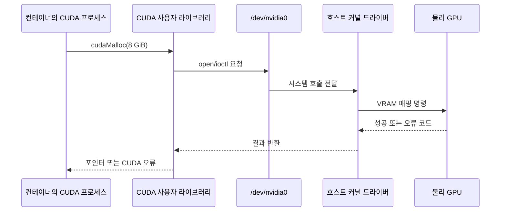
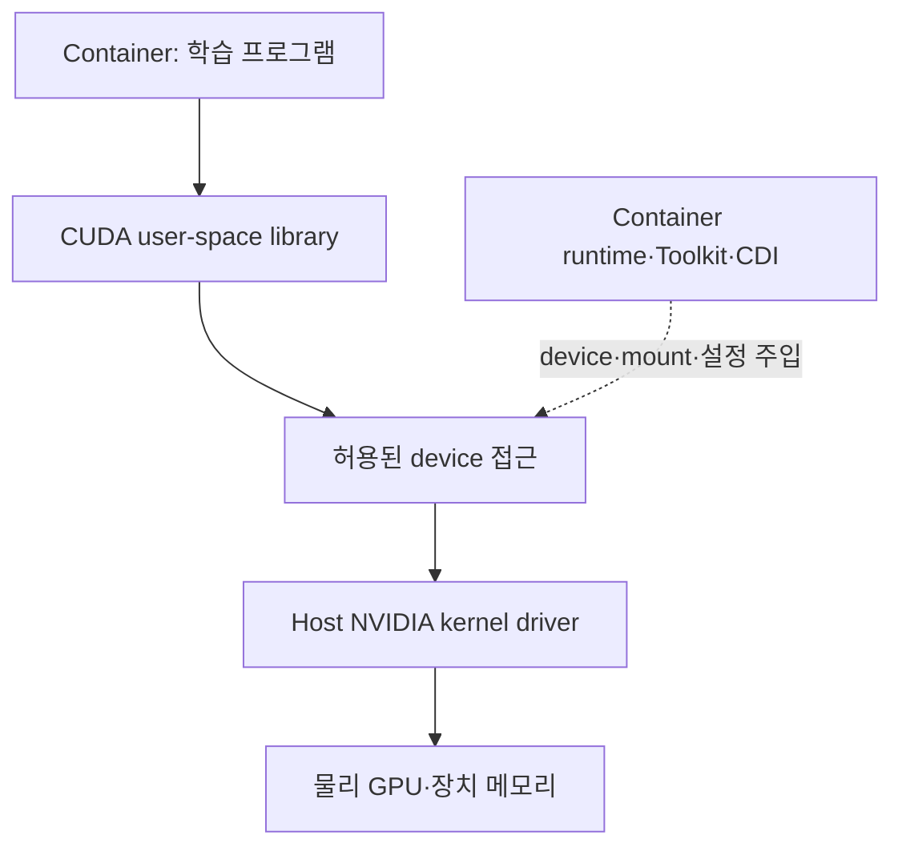
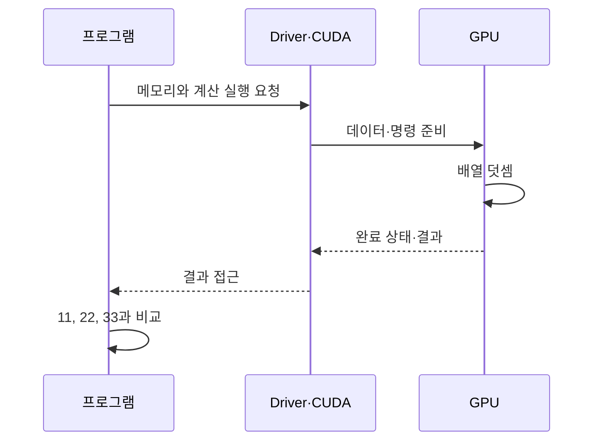

# 01. Linux·CUDA·컨테이너: 장치가 보이는 것과 계산되는 것

GPU를 container에서 사용하는 일은 프로그램에 GPU 주소를 문자열로 알려 주는 것으로 끝나지 않는다. host의 kernel driver, 프로그램이 사용하는 user-space library, container의 device 접근과 runtime 설정이 함께 필요하다.
## 01.1 물리 장치에서 애플리케이션까지, 이름을 실제 대상으로 연결한다

먼저 **GPU 하드웨어**는 노드 안의 PCI Express 장치다. 연산 코어, 명령 처리 장치, VRAM을 갖고 있지만 Linux 프로세스가 PCI 주소에 직접 명령을 쓰지는 않는다. 잘못된 프로세스가 장치를 망가뜨리지 않도록 운영체제가 접근을 중재해야 하기 때문이다.

그 중재자는 **NVIDIA 커널 드라이버**다. 커널 드라이버는 Linux 커널에 로드되는 모듈이며 PCI 장치를 발견하고 메모리 매핑, 명령 제출, 오류 처리를 담당한다. 드라이버가 준비되면 `/dev/nvidia0`, `/dev/nvidiactl`, `/dev/nvidia-uvm` 같은 **장치 파일**이 호스트에 나타난다. `/dev`는 커널 장치의 입구를 파일 이름처럼 제공하는 디렉터리다. 애플리케이션이 장치 파일을 열면 일반 파일 데이터를 읽는 것이 아니라 커널 드라이버에 시스템 호출을 보낸다.

**CUDA**는 NVIDIA GPU용 프로그래밍 플랫폼이다. CUDA 사용자 공간 라이브러리는 컨테이너 안의 일반 프로세스 메모리에 로드되어 `cudaMalloc`, kernel launch 같은 호출을 드라이버 요청으로 바꾼다. 여기서 **kernel**이라는 말이 두 뜻으로 쓰인다. Linux kernel은 운영체제 핵심이고, CUDA kernel은 GPU에서 여러 thread가 실행하는 계산 함수다. 문맥을 분리해야 한다.

**컨테이너 이미지**는 프로그램과 라이브러리 파일을 읽기 전용 layer로 묶은 배포물이다. **컨테이너**는 runtime이 그 이미지에 쓰기 가능한 layer, namespace, cgroup을 붙여 시작한 프로세스다. 이미지는 실행 중인 프로세스가 아니며 호스트 커널 드라이버를 품고 있는 가상 머신도 아니다. 컨테이너 안에 CUDA toolkit이 있어도 호스트의 GPU 드라이버가 없으면 물리 장치를 제어할 수 없다.

첫 화살표는 같은 프로세스 안의 함수 호출이다. 둘째 화살표부터 사용자 공간과 커널 공간의 경계를 넘는다. 장치 파일은 GPU 데이터 자체가 아니라 요청 통로다. 마지막 응답이 성공해야 애플리케이션이 GPU 메모리 주소를 사용할 수 있다. `nvidia-smi`가 장치 목록을 읽는 데 성공했다는 사실은 특정 CUDA kernel과 필요한 라이브러리 조합까지 모두 검증하지 않는다.

## 01.2 runtime과 CDI가 컨테이너 경계를 여는 과정

**컨테이너 런타임**은 kubelet의 요청을 받아 container 프로세스를 만드는 호스트 프로그램이다. containerd나 CRI-O가 예다. kubelet과 runtime 사이의 **CRI**, Container Runtime Interface는 Kubernetes가 서로 다른 runtime을 같은 방식으로 호출하기 위한 gRPC 규약이다. gRPC는 프로그램 사이에서 구조화된 요청과 응답을 주고받는 통신 방식이다.

GPU 할당 결과에는 어느 장치를 컨테이너에 보여 줄지에 대한 정보가 필요하다. **CDI**, Container Device Interface는 장치 공급자가 “이 논리 장치를 선택하면 어떤 device file, mount, 환경 설정을 넣어라”를 JSON 명세로 표현하는 규약이다. CDI 명세는 보통 호스트 파일 시스템에 있고 runtime이 읽는다. CDI 이름만 Pod에 기록했다고 장치가 생기는 것이 아니다. runtime이 CDI를 지원하고 명세 파일이 존재하며 그 안의 호스트 경로도 실제로 존재해야 한다.

시간 순서로 보면 다음과 같다.

| 시각 | 주체 | 입력 | 바뀌는 상태 | 실패 증거 |
| --- | --- | --- | --- | --- |
| t=0 | scheduler | GPU 요청과 노드 광고 | Pod의 nodeName 결정 | Pending event |
| t=0.2 | kubelet | 선택된 Pod | plugin Allocate 또는 DRA prepare 호출 | kubelet/driver 오류 |
| t=0.4 | 장치 구성요소 | 장치 ID | CDI 장치 이름·준비 상태 | Claim status 또는 plugin 응답 |
| t=0.6 | runtime | container spec와 CDI 이름 | `/dev/nvidia0` 허용, library mount | create-container 오류 |
| t=0.8 | Linux | namespace·cgroup 설정 | PID 1 시작 | container Waiting |
| t=1.0 | 애플리케이션 | CUDA 초기화 | context와 VRAM 할당 | CUDA 오류 코드 |

**mount**는 호스트의 파일이나 디렉터리를 컨테이너 파일 트리의 특정 경로에 연결하는 작업이다. **capability**는 Linux root 권한을 작은 권한 단위로 나눈 것이다. 일반적인 GPU 사용은 무조건 privileged container를 요구하지 않는다. 필요한 device 접근과 mount만 주입하는 편이 권한 경계를 더 명확히 한다. 보안 정책이 device 접근이나 mount를 막으면 runtime 단계에서 실패할 수 있다.

## 01.3 버전 호환성은 숫자 하나의 대소 비교가 아니다

세 버전을 분리한다. 첫째는 호스트 **driver version**으로 커널 모듈과 사용자 드라이버 인터페이스의 능력을 나타낸다. 둘째는 이미지의 **CUDA runtime/toolkit version**으로 애플리케이션이 연결하는 라이브러리 집합을 나타낸다. 셋째는 PyTorch 같은 **framework build**가 어떤 CUDA 계열을 대상으로 빌드되었는지다.

예를 들어 애플리케이션이 CUDA 12 계열 라이브러리를 요구하는데 호스트 드라이버가 그 기능을 지원하지 않으면 장치 파일이 보여도 초기화가 실패할 수 있다. 반대로 드라이버가 새롭다고 이미지 안의 누락된 `libcudart.so`가 자동 생성되지는 않는다. 공급자 호환성 표를 확인하고 실제 노드에서 driver, image library, framework build를 각각 기록해야 한다.

| 관찰 | 확인된 것 | 아직 확인되지 않은 것 |
| --- | --- | --- |
| PCI 목록에 GPU 표시 | 하드웨어가 버스에서 발견됨 | driver 정상 여부 |
| `/dev/nvidia0` 존재 | driver가 device node를 제공 | 컨테이너 주입·CUDA 호환 |
| `nvidia-smi` 성공 | 관리 경로가 driver와 통신 | 특정 framework 계산 |
| CUDA sample 성공 | 그 sample의 계산 경로 | 실제 모델 VRAM·성능 |
| 학습 step 완료 | 해당 입력 한 번의 전체 경로 | 장시간 안정성·격리 |

## 01.4 메모리 이동과 계산을 한 요청으로 추적한다

CPU가 읽는 **host RAM**과 GPU가 직접 계산에 사용하는 **VRAM**은 별도 자원이다. 데이터 loader가 파일에서 2 GiB batch를 host RAM으로 읽고, CUDA가 이를 VRAM으로 복사한 뒤 GPU kernel이 계산한다고 가정한다. 이 과정에는 저장장치→page cache→프로세스 buffer→GPU VRAM이라는 여러 복사와 대기가 있을 수 있다.

1. Python 프로세스가 입력 파일을 읽는다. Linux page cache가 디스크 블록을 RAM에 보관한다.
2. framework가 2 GiB host tensor를 만든다. 이 사용량은 container memory cgroup에 잡힌다.
3. CUDA library가 복사 명령을 driver에 제출한다. pinning을 사용하면 DMA에 적합하도록 host page가 고정될 수 있다.
4. GPU의 DMA engine이 데이터를 VRAM으로 옮긴다. DMA는 CPU가 모든 byte를 직접 복사하지 않고 장치가 메모리 전송을 수행하는 방식이다.
5. CUDA kernel이 VRAM의 입력을 읽어 결과를 만든다.
6. 완료 신호가 stream에 기록되고 애플리케이션이 동기화할 때 오류나 결과를 받는다.

**CUDA stream**은 GPU 작업의 순서를 표현하는 명령 대기열이다. 한 stream 안에서는 순서 관계가 있지만, 여러 stream 사이의 동시 실행과 완료 순서는 의존성을 명시해야 한다. CPU 함수 호출이 반환됐다는 사실과 GPU 계산 완료는 항상 같은 순간이 아니다. 비동기 호출 뒤 동기화 지점에서 이전 오류가 드러날 수 있다.

24 GiB GPU에 모델 가중치 12 GiB, optimizer 상태 8 GiB, 활성값 6 GiB, 임시 작업 공간 2 GiB가 동시에 필요하면 단순 peak는 28 GiB다. scheduler가 GPU 1개를 성공적으로 배정해도 이 계산은 들어가지 않는다. 반대로 host RAM limit 8 GiB에서 data loader가 10 GiB를 쓰면 container가 OOMKilled될 수 있으며 GPU VRAM을 줄이지 않아도 발생한다.

## 01.5 MIG, time-slicing, MPS의 물리적 차이

**MIG**, Multi-Instance GPU는 지원 GPU 한 장을 여러 GPU instance로 나누는 하드웨어 기능이다. 각 instance는 정해진 계산 자원과 메모리 구획을 갖는다. MIG profile은 구획 크기를 나타내는 이름이다. Operator의 MIG Manager는 노드 설정을 원하는 profile로 바꾸는 구성요소이며, 재구성 중 기존 workload를 중단해야 할 수 있다. “MIG 자원을 요청했다”와 “노드가 원하는 profile로 이미 구성됐다”를 분리한다.

**time-slicing**은 여러 container가 같은 장치에 접근하도록 논리 replica를 광고하고 GPU 실행 시간을 나눠 쓰는 방식이다. 하드웨어 메모리 구획을 새로 만드는 것과 다르다. **MPS**는 Multi-Process Service의 약자로 여러 CUDA 프로세스의 명령 제출을 하나의 서비스가 조정하여 동시 실행 효율을 높인다. 이 셋은 처리량, 지연, 메모리 격리, 오류 영향 범위가 다르다.

단독 실행 80 ms인 kernel을 두 Pod가 time-slicing으로 계속 제출한다고 하자. 완전 직렬이라는 단순 모델에서는 각 Pod의 요청 간격이 약 160 ms까지 늘 수 있다. 실제 GPU는 kernel 중첩과 스케줄링을 하므로 값은 측정해야 한다. replica 두 개가 성공적으로 할당됐다는 사실만으로 80 ms SLO가 보장되지 않는다.

## 01.6 실패를 계층별로 증명한다

“CUDA가 안 된다”를 한 문장으로 두지 않는다. 장치가 PCI 목록에 없으면 하드웨어·펌웨어·가상화 전달부터 본다. PCI에는 있지만 device file이 없으면 kernel module load와 driver 로그를 본다. 호스트에는 device file이 있지만 container에 없으면 plugin/DRA 결과와 runtime/CDI 주입을 본다. 파일은 있지만 permission denied면 보안 정책과 device 권한을 본다. 초기화 오류면 driver-library 호환을 본다. 계산 중 OOM이면 VRAM peak를 본다. 성능만 느리면 sharing 경합, 데이터 전송, CPU 공급, topology를 측정한다.

Operator validator 성공은 정해진 검사를 통과했다는 강한 증거지만 모든 애플리케이션의 버전·입력·장시간 부하를 대신하지 않는다. NVIDIA 지원 표의 지원 조합은 기능 지원 범위다. 실제 처리량과 tail latency는 워크로드로 검증한다.

## 01.7 완전 풀이 문제

**문제 1.** 이미지 안에 최신 CUDA toolkit이 있지만 호스트에 NVIDIA driver가 없다. 왜 실패하는가?

**해설.** toolkit은 사용자 공간 library와 개발 도구다. 물리 GPU를 제어할 커널 모듈과 `/dev/nvidia*` 입구를 만들지 않는다. 호출을 전달할 주체가 없으므로 초기화가 실패한다. GPU 노드의 지원되는 driver를 먼저 준비해야 한다.

**문제 2.** 호스트에서 `nvidia-smi`는 성공하지만 container에서는 장치 파일이 없다. 가장 가까운 실패 경계는 어디인가?

**해설.** 하드웨어와 호스트 driver 관리 경로는 확인됐다. kubelet의 allocation 결과, CDI 명세, runtime GPU 설정과 device mount를 본다. 애플리케이션 모델 코드를 먼저 바꾸는 것은 증거와 맞지 않는다.

**문제 3.** 24 GiB GPU에서 가중치 10, optimizer 10, 활성값 5 GiB가 동시에 필요하다. scheduler 할당은 성공했다. 결과는?

**해설.** 단순 peak 25 GiB로 물리 용량 24 GiB를 넘는다. allocator 오버헤드 전에도 부족하다. GPU 개수 예약 성공은 VRAM 적합성 검사가 아니므로 batch 감소, optimizer sharding, 낮은 정밀도 같은 메모리 설계를 검토한다.

**문제 4.** time-slicing replica 4개가 보이므로 각 Pod가 VRAM 4분의 1을 독점한다고 주장했다. 무엇이 틀렸는가?

**해설.** replica는 공유 가능한 할당 단위를 늘리는 설정이다. 고정 VRAM partition은 아니다. 메모리 격리가 필요하면 지원 GPU의 MIG profile 같은 별도 기능과 그 제약을 검토한다.

**문제 5.** CPU 호출 직후 시간을 재니 CUDA kernel이 1 ms라고 나왔다. 실제 요청은 20 ms였다. 이유와 측정법은?

**해설.** kernel launch는 비동기일 수 있어 CPU는 제출 뒤 바로 반환한다. stream 동기화나 CUDA event로 완료 시점을 포함해 측정해야 한다. 데이터 전송과 queue 대기를 포함할지 측정 범위도 명시한다.

## 01.1 Host와 container의 경계를 먼저 그린다

일반 Linux container는 host kernel을 공유한다. container image 안에 라이브러리와 프로그램을 넣을 수 있어도, image 하나가 독립된 host kernel과 물리 GPU driver를 가지는 것은 아니다. VM 기반 sandbox는 추가 경계가 있으므로 별도 지원 구성을 확인한다.

| 계층 | 예 | 역할 |
| --- | --- | --- |
| 학습 프로그램 | PyTorch 코드, CUDA 예제 | 입력과 계산을 정의 |
| 사용자 공간 라이브러리 | CUDA runtime·driver API library | GPU 호출·호환 기능 제공 |
| Device node | `/dev/nvidia0`, `/dev/nvidiactl` 등 | kernel 장치 인터페이스 접근 |
| Kernel module | NVIDIA kernel driver·UVM 관련 구성 | GPU 제어와 메모리 기능 구현 |
| Runtime 연결 | containerd·CRI-O와 CDI/Toolkit | container spec에 접근 설정 전달 |
| GPU hardware | 계산 엔진·장치 메모리 | 실제 명령과 데이터 처리 |

경로와 파일은 구현·기능에 따라 달라질 수 있다. 모든 NVIDIA GPU 프로그램이 표의 모든 파일을 같은 방식으로 사용하는 것은 아니다.

## 01.2 Driver, CUDA Toolkit, Container Toolkit은 다르다

**NVIDIA driver**는 GPU를 운영체제와 프로그램에 연결한다. **CUDA Toolkit**은 CUDA 프로그램 개발·실행을 위한 compiler·library·도구 묶음이다. **NVIDIA Container Toolkit**은 GPU 접근을 container runtime에 연결하는 소프트웨어 묶음이다.

이름이 비슷해도 설치 대상과 역할은 다르다. `nvcc`는 CUDA compiler이고 `nvidia-smi`는 GPU 상태를 보는 관리 도구다. 두 명령 중 하나가 없는 것이 곧 물리 GPU가 없다는 뜻은 아니다. 실행 image에는 compiler를 넣지 않고 필요한 runtime library만 넣을 수도 있다.

공식 [Container Toolkit 아키텍처](https://docs.nvidia.com/datacenter/cloud-native/container-toolkit/latest/arch-overview.html)는 container runtime·library·CLI가 어떤 역할을 맡는지 설명한다. 설치 패키지 이름과 내부 runtime 구성요소 이름을 같은 개념으로 외우지 않는다.

## 01.3 프로그램에서 GPU까지 가는 한 번의 계산

두 숫자 배열 `a=[1,2,3]`, `b=[10,20,30]`을 더한다고 가정한다. 결과는 `[11,22,33]`이다. 다음은 전형적인 설명용 흐름이다.

1. CPU 쪽 프로그램이 배열과 실행할 kernel을 준비한다.
2. GPU가 사용할 메모리를 확보하고 필요한 값을 전달한다.
3. GPU에 kernel 실행을 요청한다.
4. GPU 계산 완료와 필요한 동기화 조건을 확인한다.
5. 결과를 읽어 예상 값과 비교한다.

실제 프레임워크는 메모리 pool, 비동기 stream, Unified Memory, 재사용 buffer 등을 쓸 수 있다. 그래서 매 호출마다 반드시 같은 복사·동기화가 발생한다고 단정하지 않는다. 위 흐름의 목적은 **배열 계산과 관리 API 조회가 서로 다른 작업**임을 보이는 것이다.

## 01.4 nvidia-smi 성공이 증명하는 범위

`nvidia-smi`가 GPU 이름과 사용량을 출력하면 관리 경로의 접근이 확인된 것이다. 그것만으로 workload에 필요한 CUDA 메모리 할당·kernel 실행·결과가 모두 성공했다고 판단하지 않는다.

저장소의 [2026-08-24 GPU 운영 기록](../../kubernetes/gpu/twinx-kiss-gpu-node-onboarding-2026-08-24.md)은 실제로 `nvidia-smi`는 성공했지만 DRA 경로의 CUDA vectorAdd가 실패한 사례를 기록한다. 당시 CDI 명세에 UVM device 일부가 빠진 준비 순서 문제가 있었다. 이것은 그 환경에서 관찰한 원인이지 모든 CUDA 실패의 원인이 UVM이라는 뜻은 아니다.

| 관찰 | 알 수 있는 것 | 다음 확인 |
| --- | --- | --- |
| Host에서 관리 도구 성공 | host 관리 경로 접근 | container에서도 접근 가능한가? |
| Container에서 관리 도구 성공 | 해당 container의 관리 경로 접근 | 실제 CUDA 초기화·메모리·계산 결과 |
| CUDA 예제 결과 일치 | 그 예제의 계산 경로 | 실제 모델과 입력·메모리 규모 |
| 모델 한 step 성공 | 그 실행의 한 step | 지속 실행·통신·checkpoint·재현성 |

## 01.5 CUDA 버전 숫자를 읽는 법

host driver 버전, image의 CUDA runtime 버전, 프레임워크가 빌드된 CUDA 버전, 개발 toolkit의 compiler 버전은 별도로 기록한다. `nvidia-smi`의 CUDA 표시를 image 안에 설치한 toolkit 목록으로 해석하지 않는다.

CUDA에는 문서로 정의된 minor/forward compatibility 경로가 있다. 그러나 아무 driver와 아무 CUDA image를 섞어도 된다는 의미는 아니다. 필요한 driver 최소 버전·GPU 지원·기능 제한을 [CUDA Compatibility](https://docs.nvidia.com/deploy/cuda-compatibility/latest/index.html)에서 확인한다. 최신 번호로만 크기 비교하는 대신 실제 지원 조합을 쓴다.

교육용 기록 표를 다음과 같이 만들 수 있다. 값은 실습 후 관찰로 채우며 임의로 적지 않는다.

| 대상 | 기록할 값 |
| --- | --- |
| Host | OS·kernel·GPU driver 버전 |
| GPU | 모델·UUID·MIG 구성·PCI 위치 |
| Runtime | containerd/CRI-O·CDI 지원·Toolkit |
| Workload | image digest·CUDA runtime·framework |
| 계산 | 입력·기대 결과·실제 결과·오류 |

## 01.6 VRAM과 host RAM의 OOM

host RAM은 CPU와 프로세스가 쓰는 시스템 메모리다. VRAM은 GPU 작업이 사용하는 장치 메모리다. Kubernetes의 일반 `resources.limits.memory`는 container host-memory 제한이다. 그 값이 곧 GPU VRAM 제한을 설정하는 것은 아니다.

교육용 24 GiB GPU에서 모델과 optimizer가 16 GiB, 활성값과 임시 buffer가 10 GiB를 요구하면 단순 합계 26 GiB다. 실제 peak·재사용·allocator 동작을 측정해야 하지만 메모리 예산이 이미 빡빡하다는 것을 알 수 있다. GPU 두 장이 있다는 사실만으로 이 한 장의 부족이 자동 해결되지 않는다.

반대로 데이터 loader가 host RAM을 많이 써 container가 OOMKilled됐으면 VRAM을 늘리는 것이 직접적인 해결책은 아닐 수 있다. 오류 계층을 먼저 분리한다.

**문제:** CUDA 개발 image가 있으므로 host driver가 필요 없는가? **해설:** 일반 container는 host kernel과 driver를 사용한다. image 안의 사용자 공간 library와 host driver는 별도다.

**문제:** `nvidia-smi`가 성공했는데 CUDA가 실패하면 모순인가? **해설:** 아니다. 관리 API 접근과 실제 계산에 필요한 기능·device·library 경로는 다를 수 있다.

[이전: 전체 지도](00-map-and-prerequisites.md) · [다음: Device plugin](02-device-plugin-path.md) · [목차](README.md)
