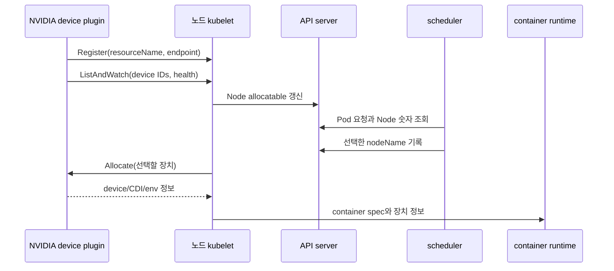
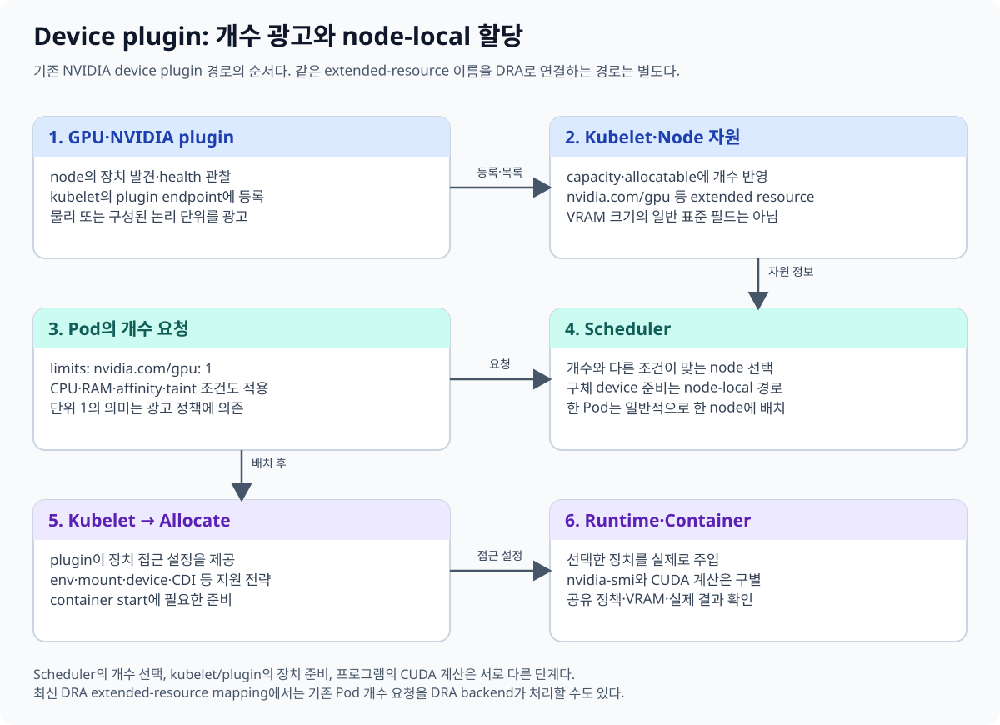
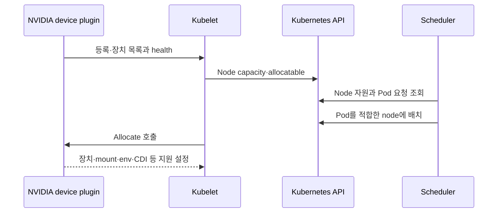
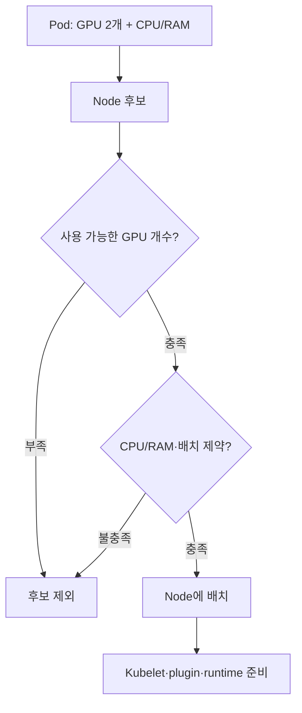

# 02. 기존 device plugin 경로: nvidia.com/gpu: 1의 의미

이 장은 **device plugin이 NVIDIA GPU를 Node extended resource로 공개하는 경로**를 먼저 설명한다. Kubernetes 1.37에서는 같은 extended-resource 이름을 DRA backend와 연결할 수도 있다. YAML의 이름과 내부 할당 구현을 구별한다.
## 02.1 먼저 “장치를 광고한다”의 실제 뜻

Kubernetes scheduler는 모든 GPU의 vendor 명령을 직접 실행하지 않는다. scheduler는 API에 기록된 자원 이름과 숫자를 비교하는 중앙 제어 프로그램이다. 노드의 실제 GPU를 알고 있는 쪽은 그 노드에서 실행되는 **device plugin**이다. device plugin은 장치를 발견하고 건강 상태를 kubelet에 전달하는 공급자 프로그램이다. NVIDIA plugin은 보통 DaemonSet의 Pod로 모든 GPU 노드에 하나씩 배치된다.

**kubelet**은 각 노드에서 Pod 실행을 책임지는 호스트 프로세스다. API server에서 자신에게 할당된 Pod를 보고 container runtime을 호출한다. device plugin과 kubelet은 노드 로컬의 **Unix domain socket**으로 통신한다. socket은 두 프로세스가 byte 메시지를 주고받는 커널 객체이고, Unix domain socket은 네트워크 IP 대신 파일 시스템 경로 이름을 사용한다. 이 경로는 보통 kubelet device-plugin 디렉터리 아래에 있다. socket 파일이 있다는 사실과 plugin 프로세스가 정상 응답한다는 사실은 구분해야 한다.

**확장 자원**, extended resource는 CPU와 memory 외에 공급자가 만든 정수 자원 이름이다. `nvidia.com/gpu`에서 앞부분은 다른 공급자와 이름이 충돌하지 않게 하는 domain이고 뒤는 resource 이름이다. scheduler에게 이 숫자는 “이름 있는 단위 몇 개가 남았는가”다. VRAM byte, FLOPS, 지연 보장을 내장해서 해석하지 않는다.



Register는 “앞으로 이 자원 이름의 요청은 이 plugin endpoint로 보내라”는 등록이다. ListAndWatch는 현재 장치 목록과 건강 변화를 계속 전달하는 스트림이다. Allocate는 이미 노드가 정해진 뒤 구체적인 장치를 container에 연결하는 데 필요한 정보를 얻는 호출이다. scheduler가 plugin socket에 직접 접속하는 구조가 아니다.

## 02.2 등록부터 광고까지의 중간 상태

GPU ID `GPU-A`, `GPU-B` 두 개가 건강하다고 가정한다.

| 시각 | 주체 | 입력 | 중간 상태 | 외부 관찰 |
| --- | --- | --- | --- | --- |
| t=0 s | plugin | NVML 등으로 두 장 발견 | 메모리 inventory `{A:Healthy,B:Healthy}` | 아직 Node 숫자 없음 |
| t=0.1 | plugin | resource name과 endpoint | kubelet registration 상태 | socket 등록 |
| t=0.2 | plugin | ListAndWatch 응답 | kubelet device manager cache | healthy=2 |
| t=0.4 | kubelet | cache 합계 | Node status 갱신 요청 | capacity=2, allocatable=2 |
| t=0.6 | API server | Node status | etcd에 새 resourceVersion | scheduler가 2를 읽음 |
| t=5.0 | plugin | `GPU-B` 오류 감지 | B=Unhealthy | 다음 갱신에서 healthy=1 |

**inventory**는 장치 ID와 속성·건강을 모은 목록이다. plugin의 메모리, kubelet의 device manager cache, API의 Node status는 서로 다른 복사본이므로 갱신 사이에 짧은 지연이 있을 수 있다. resourceVersion은 API 객체가 변경될 때 달라지는 버전 표식이다. 이것은 GPU firmware 버전이 아니다.

`capacity`는 노드가 가진 전체 자원량이고 `allocatable`은 Pod에 배정할 수 있다고 kubelet이 광고하는 양이다. 이미 Pod에 배정된 양은 scheduler의 cache에서 빼서 계산한다. 장치가 unhealthy가 됐다고 실행 중 프로세스가 안전하게 다른 GPU로 자동 이동하는 것은 아니다. 기존 Pod의 실제 오류와 새 Pod의 스케줄 가능 여부를 각각 확인한다.

## 02.3 요청 2개를 숫자로 배치한다

두 노드가 다음과 같다고 하자.

| 노드 | 광고 allocatable | 이미 요청된 GPU | 새로 계산한 가용량 |
| --- | ---: | ---: | ---: |
| `node-a` | 4 | 3 | 1 |
| `node-b` | 2 | 0 | 2 |

Pod X가 `nvidia.com/gpu: 2`를 요청하면 `node-a`는 `4-3=1`이라 부족하고 `node-b`는 `2-0=2`라 맞는다. 따라서 다른 taint, affinity, CPU, memory 조건이 없으면 `node-b`만 후보가 된다. Pod Y가 GPU 1개를 요청하면 두 노드 모두 숫자상 후보가 될 수 있다.

확장 자원은 정수 단위로 요청한다. `0.5`를 써서 GPU 절반을 뜻하게 할 수 없다. time-slicing을 쓰는 구성은 plugin이 논리 replica를 정수로 더 많이 광고한다. 예를 들어 물리 GPU 1개를 4 replica로 광고하면 Node 숫자는 4가 될 수 있다. 이때 숫자 1은 물리 GPU 전체가 아니라 구성된 공유 단위다. 요청 YAML만 보고 격리 방식을 단정할 수 없다.

보통 확장 자원은 limit에 적고 request도 같은 값으로 취급된다. CPU처럼 request 1, limit 2로 overcommit하는 의미와 다르다. 자원이 어느 container에 필요한지도 중요하다. Pod의 두 container 중 학습 container만 GPU를 요청했다면 allocation과 주입도 그 container spec에 연결된다.

## 02.4 노드 선택 뒤 Allocate가 하는 일

scheduler가 `node-b`를 선택했다고 장치 파일이 즉시 container에 생기는 것은 아니다. kubelet의 device manager는 checkpoint와 현재 할당을 참고해 아직 쓰지 않은 장치 ID를 고르고 plugin의 Allocate를 호출한다. **checkpoint**는 kubelet이 재시작해도 이미 어떤 Pod/container에 장치를 배정했는지 복구하기 위한 노드 로컬 상태 파일이다. 이것은 클러스터 전체의 백업이 아니며 사용자가 직접 편집할 설정 파일도 아니다.

Allocate 응답은 구현에 따라 device node, mount, 환경 변수 또는 CDI 장치 이름을 포함할 수 있다. **device node**는 `/dev/nvidia0`처럼 커널 드라이버의 입구다. **mount**는 호스트 파일을 container 파일 트리에 연결한다. **환경 변수**는 프로세스가 시작할 때 전달되는 이름-값 문자열이다. **CDI**는 runtime이 장치 주입 규칙을 읽는 표준 명세다.

container runtime은 이 정보를 Linux container spec에 합쳐 프로세스를 만든다. plugin이 GPU 계산을 대신 수행하지 않는다. plugin은 장치를 발견하고 할당 정보를 주며, 실제 CUDA 호출은 container 프로세스→사용자 library→호스트 kernel driver→GPU 순서로 흐른다.

다음은 교육용 요청 예다. 실제 클러스터에 적용했다는 뜻이 아니다.

```yaml
apiVersion: v1
kind: Pod
metadata:
  name: trainer
spec:
  restartPolicy: Never
  containers:
    - name: train
      image: example.invalid/train:cuda
      resources:
        limits:
          nvidia.com/gpu: 1
```

`resources.limits`는 container의 자원 요구다. `nvidia.com/gpu: 1`은 이 container에 그 이름의 단위 하나를 배정하라는 뜻이다. 이미지 주소가 예시이므로 그대로 실행되지 않는다. 이 YAML에는 GPU 모델, VRAM 최소 크기, topology 조건이 없다. 그런 표현력이 필요하면 node label/affinity 또는 DRA의 장치 속성 선택을 검토한다.

## 02.5 재시작, 삭제, plugin 장애의 수명

Pod 안의 container가 재시작하면 Pod UID와 노드 배치는 그대로이고 kubelet은 같은 Pod의 allocation을 유지하는 것이 일반적이다. Pod를 삭제하고 controller가 새 Pod를 만들면 새 UID이므로 scheduler와 allocation 과정이 다시 일어난다. container restart와 Pod replacement를 구분해야 “장치가 바뀌었는가”를 올바르게 해석할 수 있다.

plugin Pod가 잠시 재시작해도 실행 중 GPU process가 곧바로 사라지는 것은 아니다. 장치 파일을 이미 연 프로세스와 plugin 프로세스는 다르다. 그러나 새 allocation, health 갱신, kubelet 재등록에는 영향을 줄 수 있다. kernel driver가 reset되거나 GPU 자체에 치명 오류가 생긴 경우는 실행 중 process에도 직접 영향을 준다.

plugin이 반복 재시작해 socket 등록이 끊기면 Node의 광고가 stale하거나 새 Pod Allocate가 실패할 수 있다. 원인 증거는 plugin log, kubelet log, Node status, Pod event에 나뉜다. 하나의 로그만 보고 전체 경로를 추정하지 않는다.

## 02.6 기존 device plugin과 DRA의 경계

**DRA**, Dynamic Resource Allocation은 장치 요청과 선택 결과를 API 객체로 표현하는 방식이다. **ResourceClaim**은 workload가 요구하는 장치 조건과 할당 상태를 가진 객체다. **DeviceClass**는 관리자가 허용한 selector와 정책을 공통 이름으로 제공한다. **ResourceSlice**는 DRA driver가 node/pool의 device와 속성을 광고하는 객체다. **DRA driver**는 선택된 장치를 node에서 prepare하고 사용 종료 뒤 unprepare하는 공급자 구성요소다.

기존 plugin 경로에서 주된 scheduler 입력은 Node의 정수 확장 자원이다. DRA에서는 API의 device inventory와 Claim 조건을 이용해 더 풍부한 선택을 할 수 있다. 하지만 두 경로 모두 실제 kernel driver와 runtime 주입을 필요로 한다. ResourceClaim은 `/dev/nvidia0`을 만드는 프로그램이 아니다.

| 단계 | 기존 device plugin | DRA |
| --- | --- | --- |
| 광고 단위 | Node의 확장 자원 정수 | ResourceSlice의 device·속성 |
| workload 요청 | container resources limit | ResourceClaim/Template 연결 |
| 선택 기록 | kubelet allocation/checkpoint 중심 | Claim allocation status |
| 노드 준비 | Allocate 응답과 runtime | driver prepare 후 runtime |
| 해제 | Pod/container 수명에 결합 | Claim 정책과 Pod 사용 수명 고려 |

Kubernetes 1.34에서 DRA가 GA가 되었다는 것은 안정 API 단계에 들어갔다는 역사다. 1.35 문서에서 stable/locked feature gate가 보인다는 것은 해당 릴리스의 gate 상태다. 특정 NVIDIA DRA driver가 모든 GPU와 기능을 지원한다는 뜻은 아니다. NVIDIA GPU Operator 26.7 지원 표와 DRA 설치 문서에서 운영체제, Kubernetes, runtime, GPU 조건을 함께 확인한다.

DRA prepare가 **terminal failure**를 보고할 수 있다. terminal은 같은 요청을 그대로 반복해도 성공할 수 없는 영구 실패라는 의미다. 예를 들어 선택된 장치가 요구 capability를 근본적으로 제공하지 않거나 관리자가 고쳐야 하는 구성 불일치가 해당할 수 있다. 네트워크 지연 같은 일시 오류와 구분해야 controller가 무한 재시도로 자원을 낭비하지 않는다.

## 02.7 공유와 연구 결과를 읽는 한계

MIG instance, time-slicing replica, MPS participant는 모두 “GPU 1단위”처럼 광고될 수 있지만 물리적 의미가 다르다. MIG는 지원 하드웨어의 partition이고, time-slicing은 실행 시간을 공유하며, MPS는 여러 프로세스 명령을 서비스가 조정한다. plugin 등록 성공은 성능 격리나 VRAM 한도의 증거가 아니다.

IWQoS 2024 GPU sharing 연구는 특정 workload와 GPU, 비교 정책에서 sharing 효율과 QoS를 측정한다. 논문의 workload 분포와 metric을 보지 않고 “replica 수를 늘리면 항상 처리량이 선형 증가한다”고 일반화하면 안 된다. 단독 latency 50 ms인 작업 4개가 하나의 GPU에서 직렬 경합하면 단순 상한 모델은 200 ms다. 실제 동시성은 kernel과 메모리 특성에 따라 측정한다.

## 02.8 완전 풀이 문제

**문제 1.** plugin은 healthy GPU 4개를 보냈는데 API의 Node status는 아직 2다. 무엇을 결론낼 수 있는가?

**해설.** plugin inventory와 API 상태 사이 갱신이 아직 완료되지 않았을 수 있다. ListAndWatch 수신, kubelet device manager cache, Node status update와 resourceVersion을 순서대로 확인한다. scheduler는 API/cache의 숫자로 판단하므로 즉시 4개를 쓸 수 있다고 단정하지 않는다.

**문제 2.** allocatable 8, 기존 요청 6인 노드에 새 Pod가 GPU 3개를 요청한다. GPU 모델이 충분히 빠르면 배치되는가?

**해설.** 정수 가용량은 `8-6=2`로 요청 3보다 작다. 속도가 빠르다는 사실은 확장 자원 산술을 바꾸지 않는다. 다른 노드가 없으면 Pending이며 event에 부족 자원 근거가 남는다.

**문제 3.** Pod가 Pending이고 plugin 로그에는 Allocate 호출이 없다. 이것이 plugin 버그의 증거인가?

**해설.** Allocate는 scheduler가 노드를 정한 뒤 kubelet이 호출한다. 아직 Pending이면 node affinity, taint, CPU/memory, GPU 광고 부족 때문에 그 단계에 도달하지 않았을 수 있다. scheduler event와 Node allocatable을 먼저 본다.

**문제 4.** container가 재시작할 때마다 다른 GPU가 반드시 선택된다는 주장은 왜 틀렸는가?

**해설.** 같은 Pod UID의 container restart는 기존 node와 device allocation을 유지할 수 있다. Pod 삭제 후 새 UID가 생기면 새 scheduling/allocation이 수행된다. restart count와 Pod UID, kubelet checkpoint를 함께 봐야 한다.

**문제 5.** Claim이 할당됐으나 DRA prepare가 terminal failure가 되었다. 단순 재시도가 왜 충분하지 않은가?

**해설.** terminal은 동일 조건의 반복으로 회복되지 않는다고 driver가 판단한 상태다. 선택 장치 capability, node 구성, driver/runtime 호환을 수정하거나 Claim 조건을 바꿔야 한다. 일시적 timeout과 분류를 섞으면 불필요한 재시도만 늘어난다.

## 02.1 왜 plugin이 필요한가

Kubernetes core가 모든 vendor GPU의 초기화와 device 파일을 직접 구현하지는 않는다. vendor의 device plugin은 node의 장치를 발견하고 kubelet에 등록한다. kubelet은 건강한 장치 등 plugin이 전달한 정보를 Node의 resource 상태에 반영한다.

**Extended resource, 확장 자원**은 CPU·memory 외의 이름 있는 자원이다. `nvidia.com/gpu`는 그 이름의 예다. 기본 extended-resource 개수는 정수이며 scheduler가 과다 배정하지 않도록 계산한다. GPU의 실제 공유 방식은 광고하는 plugin의 별도 정책에 달려 있다.





이 경로의 등록·ListAndWatch·Allocate는 [Kubernetes Device Plugins](https://kubernetes.io/docs/concepts/extend-kubernetes/compute-storage-net/device-plugins/)의 API 책임을 따른다. Scheduler는 개수와 배치 조건을 검토하고, node-local kubelet과 plugin이 구체 장치 준비에 관여한다.

## 02.2 Pod 예시를 줄별로 읽기

아래 YAML은 개념 예시다. 이번 교재 작성 때 적용하지 않았고 기존 연구실 context에 적용하는 지침도 아니다. image tag는 예시이며 실제 재현 기록에는 digest를 남긴다.

```yaml
apiVersion: v1
kind: Pod
metadata:
  name: gpu-observation-example
spec:
  restartPolicy: Never
  containers:
    - name: observe
      image: nvidia/cuda:12.8.1-base-ubuntu22.04
      command: ["nvidia-smi"]
      resources:
        limits:
          nvidia.com/gpu: 1
```

| 줄 | 의미 |
| --- | --- |
| `kind: Pod` | container를 배치하는 API 객체 |
| `restartPolicy: Never` | 이 관찰 예제의 container 자동 재시작 정책 |
| `image` | container filesystem·프로그램의 출처 |
| `command: nvidia-smi` | 관리 경로 조회; CUDA 계산 예제가 아님 |
| `limits.nvidia.com/gpu: 1` | 광고된 자원 한 단위 요청 |

GPU extended resource는 `limits`에만 적으면 그 값이 request로 사용된다. request와 limit을 함께 적으면 같은 값을 사용해야 한다. CPU의 `100m`처럼 GPU를 `0.1`로 적는 기본 정수 자원 모델이 아니다. GPU 요청 방법은 [Kubernetes GPU scheduling](https://kubernetes.io/docs/tasks/manage-gpus/scheduling-gpus/)도 참고한다.

## 02.3 단위 1이 항상 물리 GPU 한 장인가

기본 full-GPU device plugin 구성에서는 한 단위가 GPU 장치 하나에 대응할 수 있다. 그러나 MIG나 time-slicing으로 광고 방식을 바꾸면 자원 이름과 한 단위의 의미도 달라질 수 있다.

**교육용 예:** 물리 GPU 한 장을 time-slicing replica 4개로 광고하면 scheduler가 보는 자원 수는 4가 될 수 있다. 네 Pod가 각각 1을 요청해도 GPU가 물리적으로 네 장으로 늘어난 것은 아니다. 각 Pod에 VRAM 1/4이 독립 보장된다는 의미도 아니다.

따라서 조사할 때 Node capacity의 숫자만 쓰지 말고 plugin configuration·MIG profile·sharing policy를 함께 기록한다. 자세한 격리는 [08장](08-sharing-mig-timeslicing-mps.md)에서 설명한다.

## 02.4 개수 조건과 배치 조건을 동시에 본다

node-a에 GPU 두 개, node-b에 GPU 한 개가 있다고 가정한다. Pod 하나가 두 개를 요청하면 node-a가 개수 조건을 만족한다. 하지만 다음 조건 때문에 배치가 여전히 실패할 수 있다.

- node-a에 taint가 있고 Pod에 대응 toleration이 없다.
- CPU/RAM request를 만족할 allocatable 자원이 부족하다.
- node affinity·node selector·volume의 zone 조건이 맞지 않는다.
- 이미 다른 workload가 해당 GPU 자원을 할당받았다.



두 GPU를 받았다고 둘 사이 NVLink가 있거나, 프로그램이 자동으로 두 process를 만들거나, 두 GPU로 모델이 나뉘는 것은 아니다. 할당·topology·프레임워크 실행 구조를 별도로 설명한다.

## 02.5 Runtime 연결 방식은 하나가 아니다

device plugin Allocate 응답은 지원하는 구현에 따라 device·mount·환경 변수·CDI 이름 등의 설정을 제공할 수 있다. “Device plugin은 환경 변수만, DRA는 CDI만”처럼 기존 plugin의 CDI 지원을 지워 설명하지 않는다.

NVIDIA plugin의 device-list 전략과 sharing 구성은 [공식 NVIDIA device plugin 저장소](https://github.com/NVIDIA/k8s-device-plugin)에서 해당 release의 내용을 확인한다. container 안에 선택한 장치를 실제로 주입하는 과정은 [07장](07-cdi-and-runtime.md)에 연결한다.

## 02.6 nvidia.com/gpu가 DRA backend를 사용할 수도 있다

Kubernetes 1.37에서 DRA extended-resource 경로는 안정화됐다. DeviceClass의 `spec.extendedResourceName`에 기존 자원 이름을 연결하면, 개수 기반 Pod 요청도 지원 DRA driver를 통해 할당할 수 있다. 이때 명시적인 ResourceClaim YAML을 사용자가 항상 만들어야 하는 것은 아니다.

이 기능은 같은 물리 GPU를 서로 독립적인 allocator 두 개에 맡기라는 의미가 아니다. Operator의 관리 모드, DeviceClass mapping, Node 광고, 실제 inventory를 함께 확인한다. [Kubernetes 1.37 DRA 변경](https://kubernetes.io/blog/2026/09/03/kubernetes-v1-37-dra-updates/)과 [DeviceClass API](https://kubernetes.io/docs/reference/kubernetes-api/resource/device-class-v1/)가 이 전환 경로를 설명한다.

| 보이는 요청 | 가능한 구현 확인 |
| --- | --- |
| `nvidia.com/gpu: 1` | 기존 device plugin 또는 구성된 DRA extended-resource backend |
| `resources.claims` | 명시적 Claim/Template 소비 경로 |
| Node GPU 개수 | 무엇이 어떤 단위로 광고했는지 추가 확인 |
| ResourceSlice | 어느 DRA driver·pool·node·device의 광고인지 확인 |

## 02.7 이해 확인

**문제:** `nvidia.com/gpu: 2`면 GPU 메모리를 정확히 두 배로 한 주소 공간에 합쳐 주는가? **해설:** 아니다. 자원 두 단위를 요청한 것이며 실제 장치 종류·sharing·프로그램 메모리 구조가 별도로 있다.

**문제:** GPU 요청을 0으로 바꾸면 CUDA program의 메모리 문제가 해결되는가? **해설:** 요청은 자원 할당 조건이다. 모델·batch·allocator·VRAM 사용 문제의 해결책과 같지 않다.

[이전: Linux·CUDA](01-gpu-linux-cuda-container.md) · [다음: GPU Operator](03-gpu-operator-components.md) · [목차](README.md)
