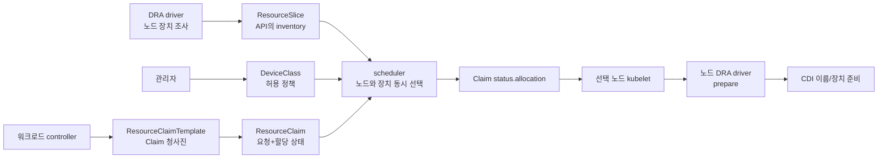
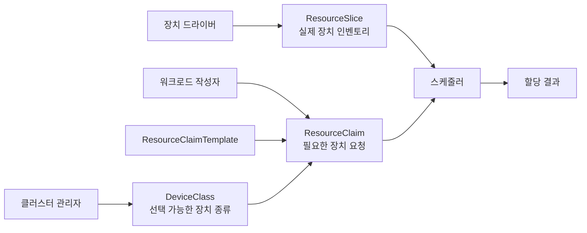
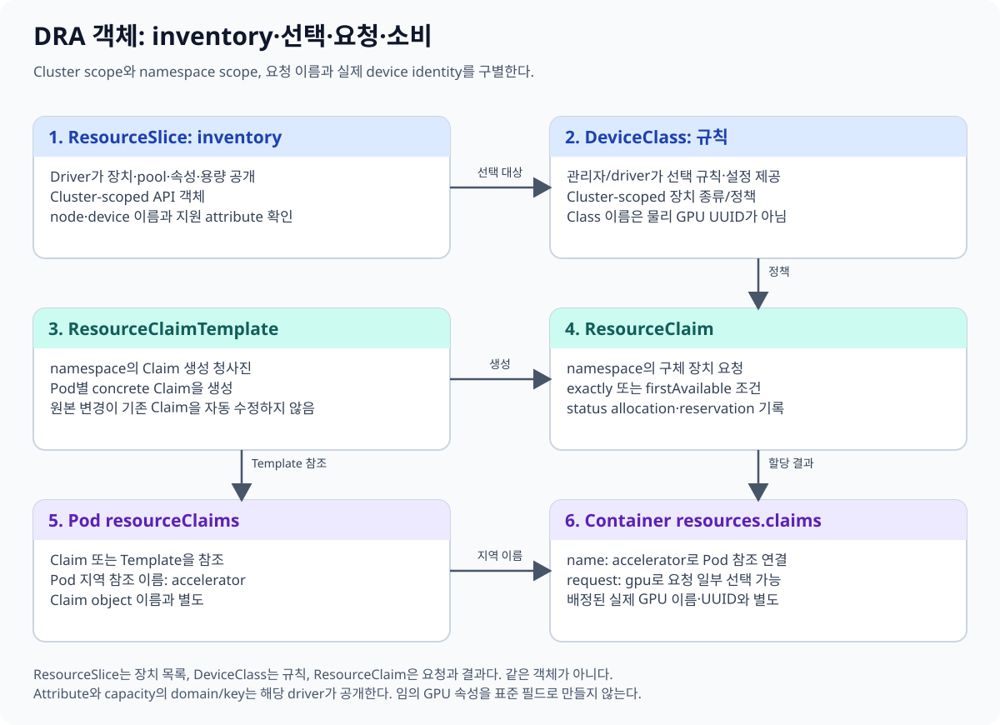
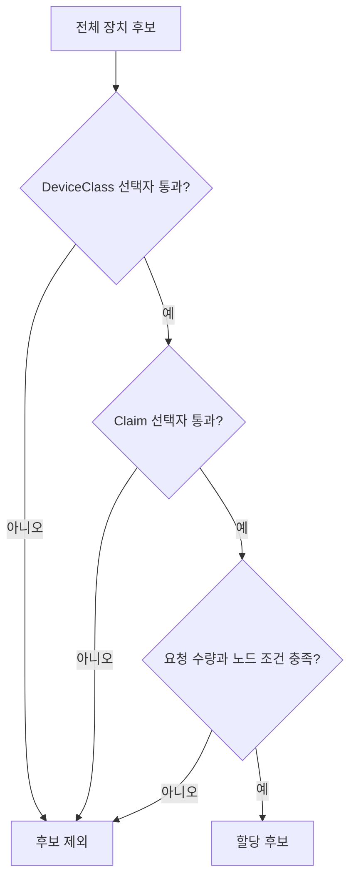
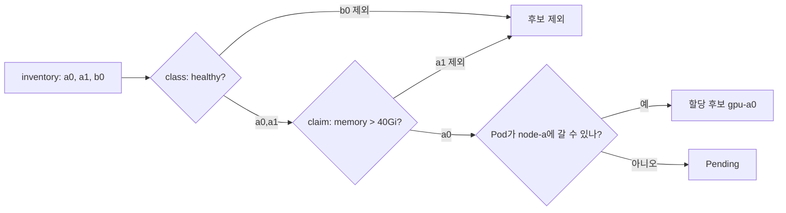
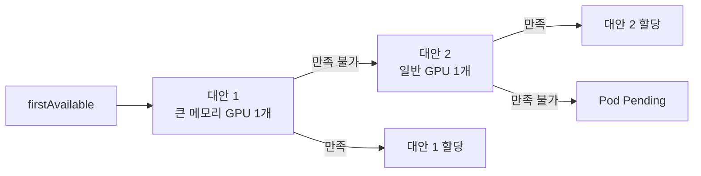

# 04. DRA의 핵심 객체와 요청 언어

[← 이전 장](03-gpu-operator-components.md) · [다음 장 →](05-dra-allocation-lifecycle.md)
## 0. 이 장에서 다루는 객체가 실제로 있는 곳

**DRA**는 Dynamic Resource Allocation의 약자이며, Pod가 GPU 같은 장치를 요구하고 Kubernetes가 장치까지 함께 선택하도록 하는 API와 실행 절차다. “동적”이라는 말은 실행 중 아무 장치나 즉시 바꾼다는 뜻이 아니다. Pod를 배치할 때 현재 광고된 장치와 요청 조건을 맞추고, 그 결과를 API 객체에 기록하며, 선택된 노드에서 장치를 준비한다는 뜻이다.

DRA를 이해하려면 네 객체를 실제 저장 위치와 작성 주체로 구분해야 한다. **DeviceClass**는 클러스터 관리자가 API server에 만드는 클러스터 범위 객체다. 장치 종류와 선택 정책에 공통 이름을 붙여 사용자가 vendor별 세부 표현을 매번 복사하지 않도록 한다. **ResourceSlice**는 DRA driver가 API server에 게시하는 장치 inventory 객체다. inventory는 장치 이름, 어느 노드나 pool에 속하는지, 선택에 쓸 속성과 capacity를 모은 목록이다. **ResourceClaim**은 workload가 원하는 장치 조건과 실제 할당 결과를 함께 담는 namespace 범위 객체다. **ResourceClaimTemplate**은 Deployment처럼 여러 Pod를 만드는 controller가 Pod마다 새 Claim을 만들 때 사용하는 청사진이다.

이 객체들은 `/dev/nvidia0` 같은 호스트 장치 파일이 아니다. API server가 검증하고 etcd에 저장하는 선언과 상태다. 실제 장치 파일은 GPU 노드의 Linux 파일 시스템에 있고, driver와 kubelet이 선택 결과에 따라 컨테이너에 연결한다. API 객체가 존재한다는 사실과 장치가 노드에서 준비됐다는 사실을 분리해야 한다.



첫 화살표는 물리 장치를 API inventory로 표현한다. 가운데 세 화살표는 관리자 정책, workload 요구, 실제 공급을 scheduler 입력으로 합친다. scheduler는 결과를 Claim status에 기록한다. 마지막 화살표들은 선택된 노드에서 kubelet과 driver가 장치 파일과 CDI 정보를 준비하는 실행 단계다.

## 0.1 2노드·3장치에서 객체가 답하는 질문

교육용 클러스터를 다음처럼 고정한다.

| 노드 | 장치 | 메모리 속성 | 공유 형태 | 광고 주체 |
| --- | --- | ---: | --- | --- |
| `node-a` | `gpu-a0` | 80 GiB | full GPU | NVIDIA DRA driver |
| `node-a` | `gpu-a1` | 24 GiB | full GPU | NVIDIA DRA driver |
| `node-b` | `gpu-b0` | 40 GiB | MIG instance | NVIDIA DRA driver |

driver는 이 세 장치를 하나 이상의 ResourceSlice로 게시한다. **pool**은 driver가 여러 Slice에 걸쳐 장치 inventory를 관리할 때 사용하는 논리 묶음이다. Slice 하나가 갱신되어도 pool의 generation과 장치 이름을 이용해 일관된 inventory를 판단한다. 사용자가 임의로 Slice를 작성하면 실제 driver 상태와 어긋나므로, Slice의 소유자는 driver다.

관리자는 `gpu.nvidia.com` DeviceClass를 만든다. 이 Class가 NVIDIA driver의 장치를 허용한다고 가정한다. Class는 “80 GiB 장치 하나를 지금 예약했다”는 기록이 아니다. 여러 Claim이 재사용하는 정책 입구다.

Pod A는 메모리 40 GiB 이상인 장치 하나를 요구한다. 후보는 `gpu-a0` 80 GiB와 `gpu-b0` 40 GiB다. Pod A가 full GPU만 요구한다면 `gpu-b0`은 MIG instance라 제외되어 `node-a/gpu-a0`만 남는다. Pod B가 24 GiB 이상이고 MIG도 허용한다면 남은 `gpu-a1`과 `gpu-b0`이 후보가 된다. 이처럼 “GPU 1개”라는 수량만으로는 표현하기 어려운 조건을 Claim 요청과 장치 속성이 연결한다.

**capacity**는 장치가 제공한다고 driver가 광고한 수치형 능력이다. byte 단위 메모리처럼 정량 조건에 사용할 수 있다. capacity 광고가 애플리케이션의 실제 peak 메모리를 자동 측정하는 것은 아니다. 모델 38 GiB와 임시 buffer 6 GiB가 필요하면 40 GiB 장치는 산술상 44 GiB를 담지 못한다. Claim selector가 40 GiB 이상을 통과해도 애플리케이션 설계가 실패할 수 있다.

## 0.2 Claim과 Template의 수명 차이

직접 만든 ResourceClaim은 명시적으로 삭제할 때까지 남을 수 있고 여러 Pod 사용 정책은 API 규칙에 따라 제한된다. Template은 장치를 소유하지 않는다. Pod를 만들 때 실제 Claim을 생성하기 위한 spec 복사본이다. Deployment가 replica 2를 만들면 Template 하나에서 서로 다른 Claim 두 개가 생길 수 있다. 두 Pod가 우연히 같은 Claim을 공유한다고 가정하면 안 된다.

| 대상 | 생성 주체 | spec의 뜻 | status의 뜻 | 종료 시점 |
| --- | --- | --- | --- | --- |
| DeviceClass | 관리자 | 허용 driver·selector 정책 | 일반 workload 할당 상태 아님 | 관리자가 삭제 |
| ResourceSlice | DRA driver | 현재 device inventory | driver 세대와 node 정보 | driver가 갱신·삭제 |
| ResourceClaimTemplate | 사용자/controller | 새 Claim의 청사진 | 장치 할당을 직접 저장하지 않음 | 템플릿 삭제 |
| ResourceClaim | 사용자 또는 Pod용 controller | 장치 요구 | 선택된 device allocation | 수명 정책과 소유 관계에 따라 |
| Pod | workload controller | Claim 참조와 container 사용 | scheduling·실행 상태 | 삭제·교체 |

Pod A가 삭제되면 노드 driver는 사용 장치를 unprepare한다. **unprepare**는 container에 쓰도록 만든 노드 로컬 준비 상태를 해제하는 작업이다. Claim 자체가 남는 정책이라면 allocation 기록이 즉시 사라진다고 단정할 수 없다. 반대로 Pod용 Template에서 생성된 Claim은 Pod 수명에 결합될 수 있다. 객체 owner reference와 API status를 함께 확인한다.

## 0.3 선택 조건과 “등록 가능”의 한계

selector는 후보를 거르는 조건식이다. 속성 이름이 driver가 실제 광고한 schema와 맞아야 한다. 존재하지 않는 속성을 요구하면 “가장 비슷한 장치”로 완화하지 않고 후보가 0개가 될 수 있다. DeviceClass selector와 Claim selector가 모두 있으면 둘을 함께 만족해야 한다.

장치가 ResourceSlice에 등록됐다는 사실은 driver가 inventory로 표현했다는 뜻이다. CUDA 계산 성공, VRAM 격리, 지연 SLO, 서로 다른 Pod 사이의 오류 격리까지 보장하지 않는다. MIG instance는 하드웨어 구획을 제공하지만 profile별 메모리와 계산 자원이 다르다. time-slicing replica는 같은 물리 GPU에 접근 시간을 공유할 수 있으며 고정 VRAM partition이 아니다. MPS는 여러 CUDA process의 명령을 조정하지만 독립 GPU를 새로 만드는 기술이 아니다.

## 0.4 버전 문구를 읽는 법

Kubernetes DRA가 1.34에서 GA가 되었다는 것은 안정 API 단계에 들어간 역사적 시점이다. GA는 General Availability의 약자이며 일반 사용을 위한 안정성 약속을 뜻한다. 1.35 문서의 `stable`은 해당 기능 단계이고 `locked`는 feature gate를 사용자가 끌 수 없도록 고정한 상태다. **feature gate**는 Kubernetes binary가 특정 기능을 켜거나 끄는 설정이다. GA 시점, 현재 API 버전, gate 잠금은 서로 다른 사실이다.

이 안정성은 특정 vendor driver가 설치됐다는 뜻이 아니다. Kubernetes API server와 scheduler가 DRA를 지원해도 NVIDIA driver, 노드 plugin, runtime, CDI, GPU 모델 조합이 맞지 않으면 실행은 실패한다. NVIDIA GPU Operator 26.7의 platform matrix는 지원 조합을 확인하는 근거이며 성능 보증표가 아니다.

## 0.5 추가 완전 풀이 문제

**문제 1.** `node-a`의 80 GiB full GPU와 `node-b`의 40 GiB MIG가 있다. Claim이 `memory >= 40 GiB`와 `full GPU`를 모두 요구한다. 후보는 무엇인가?

**해설.** 메모리 조건만 보면 둘 다 통과하지만 공유 형태 조건에서 MIG가 제외된다. 따라서 `node-a/gpu-a0` 하나다. scheduler는 이 장치와 Pod의 CPU·메모리·affinity 조건을 함께 만족하는지 본 뒤 노드를 결정한다.

**문제 2.** ResourceClaimTemplate 하나로 replica 2 Deployment를 만들었다. 장치 하나만 두 Pod가 자동 공유하는가?

**해설.** Template은 Claim 청사진이다. Pod별로 생성되는 Claim은 별도 요청과 allocation을 가진다. 공유가 필요하면 driver의 지원 방식과 API 정책을 명시해야 하며 Template 하나라는 이유만으로 같은 장치를 뜻하지 않는다.

**문제 3.** ResourceSlice에 3개가 보이는데 Claim 후보는 0개다. 고장이라고 단정할 수 있는가?

**해설.** inventory 존재와 selector 만족은 다르다. DeviceClass와 Claim selector, node 접근 가능성, 이미 할당된 상태를 순서대로 비교한다. 존재하지 않는 속성이나 너무 높은 capacity 조건이면 정상적으로 후보 0개가 된다.

**문제 4.** Claim status에 allocation이 기록되면 `/dev/nvidia0`이 이미 컨테이너에 있는가?

**해설.** 아니다. allocation은 어떤 장치를 어느 노드에서 쓸지 정한 API 상태다. 이후 kubelet이 node driver의 prepare를 호출하고 runtime이 CDI 편집을 적용해 container를 생성해야 한다. 각 단계의 실패 상태와 로그 위치가 다르다.

**문제 5.** Kubernetes 1.35에서 DRA gate가 locked라면 Operator 26.7이 모든 GPU에서 작동하는가?

**해설.** locked는 Kubernetes 기능 gate 상태일 뿐 vendor 구현과 플랫폼 지원을 보장하지 않는다. Operator와 DRA driver 지원 표에서 OS, kernel, runtime, GPU 모델, Kubernetes 조합을 확인하고 실제 준비와 CUDA 검증을 수행한다.

> 이 장의 목표는 Dynamic Resource Allocation(DRA)이 어떤 객체로 장치를 표현하고, 사용자가 어떤 방식으로 GPU를 요청하는지 이해하는 것이다.

## 1. 왜 새로운 객체가 필요한가

기존의 단순한 정수형 리소스 요청은 `GPU 1개`처럼 수량을 표현하기 쉽다.
그러나 실제 GPU 선택에는 다음 조건이 필요할 수 있다.

- 메모리가 40 GiB보다 큰 장치
- 특정 기능을 제공하는 장치
- 같은 노드에서 함께 사용할 수 있는 여러 장치
- 여러 대안 중 클러스터가 만족시킬 수 있는 첫 번째 대안

DRA는 장치 인벤토리, 장치 종류, 애플리케이션의 요청, 실제 할당 결과를 서로 다른 객체와 필드로 나눈다.



## 2. 네 객체를 먼저 구분한다

| 객체 | 범위 | 주 작성 주체 | 답하는 질문 |
|---|---|---|---|
| `DeviceClass` | 클러스터 | 관리자 또는 드라이버 배포 구성 | 어떤 종류의 장치를 선택할 수 있는가? |
| `ResourceSlice` | 클러스터 | DRA 드라이버 | 어느 노드에 어떤 장치가 있는가? |
| `ResourceClaim` | 네임스페이스 | 사용자 또는 컨트롤러 | 이 워크로드는 어떤 장치를 원하는가? |
| `ResourceClaimTemplate` | 네임스페이스 | 사용자 | Pod마다 어떤 Claim을 만들어야 하는가? |

`DeviceClass`와 `ResourceSlice`에는 네임스페이스가 없다.
여러 네임스페이스의 워크로드가 같은 클러스터 장치 풀을 보기 때문이다.

`ResourceClaim`과 `ResourceClaimTemplate`은 네임스페이스 객체다.
따라서 Pod와 Claim을 연결할 때 네임스페이스 경계를 함께 고려해야 한다.

## 3. DeviceClass: 선택 정책의 이름

`DeviceClass`는 특정 GPU 한 대를 가리키는 이름이 아니다.
관리자가 제공하는 장치 종류와 공통 선택 정책의 진입점이다.

예를 들어 워크로드가 `gpu.nvidia.com`이라는 DeviceClass를 참조할 수 있다.
그 이름은 드라이버와 클러스터 구성이 제공하는 클래스이며, 실제 물리 GPU UUID는 아니다.

DeviceClass에는 선택자(selector)를 둘 수 있다.
선택자는 해당 클래스로 요청할 수 있는 장치 후보를 제한한다.

## 4. ResourceSlice: 스케줄러가 보는 인벤토리

`ResourceSlice`는 DRA 드라이버가 게시하는 장치 목록이다.
일반 사용자가 수작업으로 유지하는 자산 대장이 아니다.

ResourceSlice가 표현할 수 있는 정보의 예는 다음과 같다.

- 장치가 연결된 노드 또는 노드 집합
- 장치별 속성(attribute)
- 공유 가능한 용량(capacity)
- 드라이버가 장치를 식별하는 이름

속성은 모델명이나 기능처럼 비교 가능한 정보다.
용량은 메모리처럼 양을 비교하거나 나눌 수 있는 정보에 쓰일 수 있다.
어떤 속성과 용량을 게시하는지는 드라이버 구현과 구성에 달려 있다.



## 5. CEL 선택자

DRA는 장치 선택 조건에 CEL(Common Expression Language)을 사용한다.
CEL 표현식은 스케줄러가 후보 장치를 거르는 조건이며, 임의의 셸 명령을 실행하지 않는다.

개념적인 조건은 다음과 같다.

```text
device.capacity["example.com"].memory.isGreaterThan(quantity("40Gi"))
```

이 조건은 드라이버가 `example.com` 아래에 `memory` 용량을 실제로 게시할 때만 의미가 있다.
필드 이름을 추측해서 쓰면 요청이 만족되지 않는다.
먼저 ResourceSlice와 해당 드라이버 문서를 확인해야 한다.



선택자는 후보를 고르는 필터다.
선택자 자체가 장치를 예약하거나 성능 순위를 자동으로 계산하는 것은 아니다.

### 5.1 장치 세 개가 CEL 필터를 통과하는 과정

추상적인 “후보 장치” 대신 ResourceSlice가 다음 세 장치를 게시했다고 가정하자. 속성·용량 key는 교육용이며 실제 NVIDIA DRA 드라이버가 게시한 exact key와 schema를 먼저 확인해야 한다.

| device name | node | model attribute | memory capacity | healthy attribute |
|---|---|---|---:|---|
| `gpu-a0` | `node-a` | `L40S` | 48 GiB | `true` |
| `gpu-a1` | `node-a` | `A10` | 24 GiB | `true` |
| `gpu-b0` | `node-b` | `L40S` | 48 GiB | `false` |

관리자는 DeviceClass에서 healthy 장치만 허용하고, 사용자는 Claim에서 40 GiB 초과를 요구한다고 하자. 개념 조건은 다음 두 층이다.

```text
DeviceClass selector:
  device.attributes["example.com"].healthy == true

Claim selector:
  device.capacity["example.com"].memory.isGreaterThan(quantity("40Gi"))
```

필터는 순서대로 후보 집합을 줄인다.

```text
ResourceSlice inventory
  {gpu-a0, gpu-a1, gpu-b0}

DeviceClass healthy filter
  gpu-a0: true  → 유지
  gpu-a1: true  → 유지
  gpu-b0: false → 제외
  결과 {gpu-a0, gpu-a1}

Claim memory > 40Gi filter
  gpu-a0: 48Gi → 유지
  gpu-a1: 24Gi → 제외
  결과 {gpu-a0}

Pod node constraints와 교집합
  node-a 허용 → gpu-a0 할당 후보
  node-b만 허용 → 후보 0, Pending
```



여기서 값을 바꾸는 주체를 구별한다. 드라이버는 발견한 장치와 게시 가능한 attribute/capacity를 ResourceSlice에 반영한다. 관리자는 DeviceClass 정책을 바꾼다. 워크로드 작성자는 Claim 조건을 바꾼다. 스케줄러는 이 입력을 읽어 allocation 결과를 쓰지만, GPU의 실제 메모리 용량을 수정하지 않는다.

`count: 2`를 추가하면 최종 후보가 `gpu-a0` 하나뿐이므로 실패한다. 총 inventory가 세 개라는 사실이나 memory 합이 `48+24+48=120 GiB`라는 사실은 해결책이 아니다. 개별 장치 조건을 만족하는 후보 두 개가 필요하며, 함께 배치해야 한다면 node 조건도 동시에 만족해야 한다.

`firstAvailable`로 `40Gi 초과 1개`, 그다음 `20Gi 초과 1개`를 두었다면 첫 대안은 `gpu-a0`, 두 번째 대안은 `gpu-a0`과 `gpu-a1`이 후보가 된다. 첫 대안이 만족 가능한 동안 두 번째 후보의 수가 더 많다는 이유로 A10을 고르지 않는다. 대안 순서는 성능 점수가 아니라 사용자가 표현한 선호다.

반례로, `healthy=true`가 ResourceSlice에 남아 있다고 지금도 하드웨어가 정상이라고 영구 보장되지는 않는다. 게시 지연이나 노드 단절이 있을 수 있고, allocation 이후 Prepare에서 실패할 수도 있다. Inventory snapshot, Claim allocation, node prepare는 서로 다른 시점의 증거다.

## 6. ResourceClaim: 장치 사용 의사

ResourceClaim의 `spec.devices.requests`에는 하나 이상의 요청을 넣을 수 있다.
각 요청에는 요청 내부에서 사용하는 이름과 DeviceClass, 수량 또는 선택 조건이 들어간다.

단순한 예를 말로 쓰면 다음과 같다.

> `gpu`라는 요청으로 `gpu.nvidia.com` DeviceClass에서 정확히 한 개를 원한다.

여기서 `gpu`는 요청의 지역 이름이다.
실제 GPU의 UUID나 PCI 주소가 아니다.

## 7. exactly, count, firstAvailable

### exactly

`exactly`는 한 가지 요구 조건을 정확히 기술한다.
DeviceClass, 선택자, 할당 모드와 수량을 조합한다.

### count

`count: 1`은 후보 장치 중 한 개를 요구한다.
`count: 2`라고 해서 자동으로 두 GPU가 동일한 성능이나 토폴로지를 가진다는 뜻은 아니다.
그 조건이 필요하면 드라이버가 제공하는 선택 정보와 정책을 함께 설계해야 한다.

### firstAvailable

`firstAvailable`은 순서가 있는 여러 대안을 제공한다.
첫 번째 대안을 만족할 수 없으면 다음 대안을 검토할 수 있다.

예를 들어 다음 의도를 표현할 수 있다.

1. 우선 큰 메모리 GPU 한 개
2. 불가능하면 일반 GPU 한 개

이는 장치 성능을 점수화해 최적 GPU를 찾는 일반 목적 알고리즘이 아니다.
명시된 대안 순서를 따라 만족 가능한 요청을 찾는 구조다.



## 8. 세 종류의 이름을 섞지 않는다

초보자가 가장 자주 혼동하는 부분이다.

| 이름 | 예 | 의미 |
|---|---|---|
| Claim 안의 요청 이름 | `gpu` | `spec.devices.requests[].name`의 지역 이름 |
| Pod의 Claim 참조 이름 | `accelerator` | Pod 안에서 Claim을 부르는 이름 |
| 실제 장치 식별자 | 드라이버가 정한 값 | 할당된 물리 또는 논리 장치를 드라이버가 식별하는 값 |

Pod의 컨테이너는 `accelerator`라는 Pod 지역 이름을 참조할 수 있다.
그 참조가 Claim 안의 `gpu` 요청을 사용하도록 연결된다.
실제 GPU 식별자는 스케줄러와 드라이버가 할당 결과에 기록한다.

이 세 이름이 우연히 같은 문자열일 수는 있지만 의미는 다르다.

## 9. 작은 예시

노드 A에 장치 `dev-a`, 노드 B에 장치 `dev-b`가 있다고 가정한다.
두 장치 모두 같은 DeviceClass 후보이며 `dev-a`만 메모리 조건을 만족한다.

| 단계 | 결과 |
|---|---|
| Claim이 40 GiB 초과 조건을 요청 | `dev-a`만 후보가 됨 |
| 다른 Pod 조건이 노드 B만 허용 | 공통 노드 후보가 사라짐 |
| 스케줄링 결과 | Claim과 Pod가 할당되지 않고 Pending 가능 |

장치 조건만 따로 만족하면 충분하지 않다.
Pod의 CPU·메모리, affinity, taint, 장치 위치가 모두 같은 노드에서 함께 만족되어야 한다.

## 10. 흔한 오해

**“DeviceClass 하나가 GPU 한 장이다.”**
아니다. DeviceClass는 장치 종류와 선택 정책의 이름이다.

**“ResourceSlice를 사용자가 직접 만들어 GPU를 등록한다.”**
일반적으로 드라이버가 실제 인벤토리를 게시하고 갱신한다.

**“CEL이 가장 빠른 GPU를 알아서 선택한다.”**
CEL은 표현된 조건으로 후보를 필터링한다.

**“count가 2면 두 GPU의 NVLink 연결까지 보장한다.”**
수량만으로는 그런 토폴로지 조건을 보장하지 않는다.

**“Claim 이름이 GPU UUID다.”**
Claim과 요청 이름은 Kubernetes 객체 및 지역 참조 이름이다.

## 11. 확인 문제와 해설

### 문제 1

여러 네임스페이스에서 공통으로 사용하는 장치 인벤토리는 어느 객체에 게시되는가?

**해설:** `ResourceSlice`다. 클러스터 범위 객체이며 보통 DRA 드라이버가 게시한다.

### 문제 2

Pod마다 독립된 Claim을 만들고 싶을 때 출발점으로 적합한 객체는 무엇인가?

**해설:** `ResourceClaimTemplate`이다. 워크로드 컨트롤러가 Pod에 맞는 Claim을 생성하는 데 사용한다.

### 문제 3

`firstAvailable`에 세 대안을 적으면 스케줄러가 세 대안을 성능 벤치마크해 최고 점수를 고르는가?

**해설:** 아니다. 선언된 순서와 만족 가능성을 따르는 대안 요청이며 일반적인 벤치마크나 자동 최적화 기능이 아니다.

## 12. 공식 자료

- [Kubernetes: How DRA works](https://kubernetes.io/docs/concepts/resource-management/dynamic-resource-allocation/how-dra-works/)
- [Resource management for Pods and containers](https://kubernetes.io/docs/concepts/configuration/manage-resources-containers/)
- [ResourceClaim v1 API](https://kubernetes.io/docs/reference/kubernetes-api/workload-resources/resource-claim-v1/)

[← 이전 장](03-gpu-operator-components.md) · [다음 장 →](05-dra-allocation-lifecycle.md)
