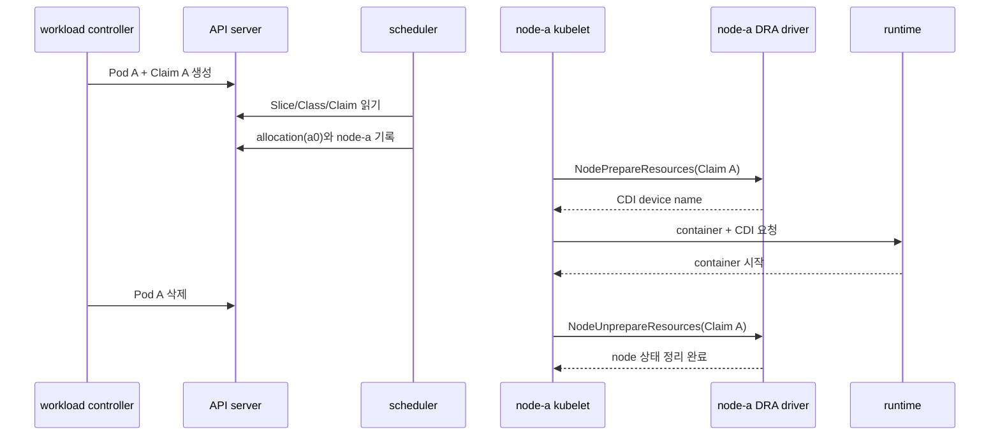
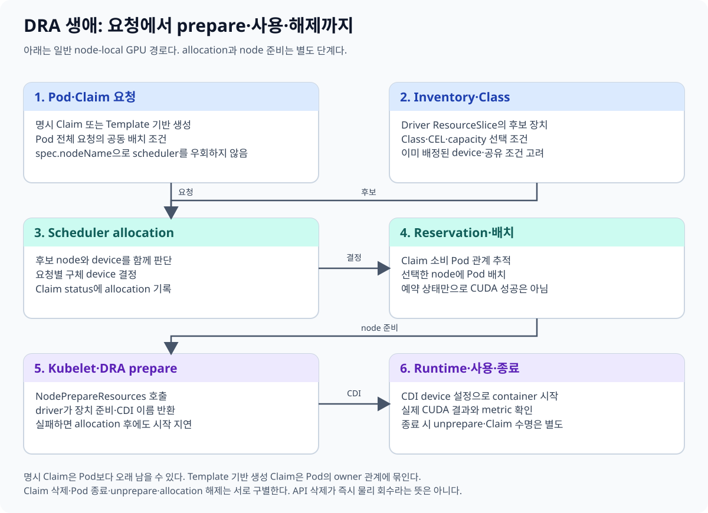
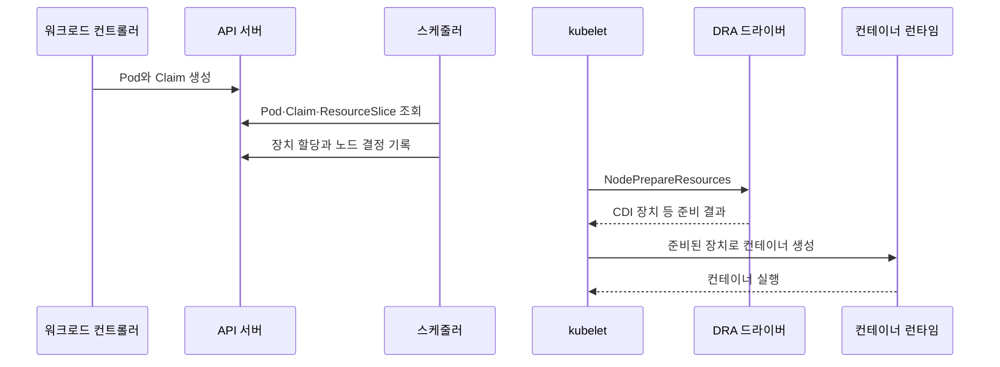
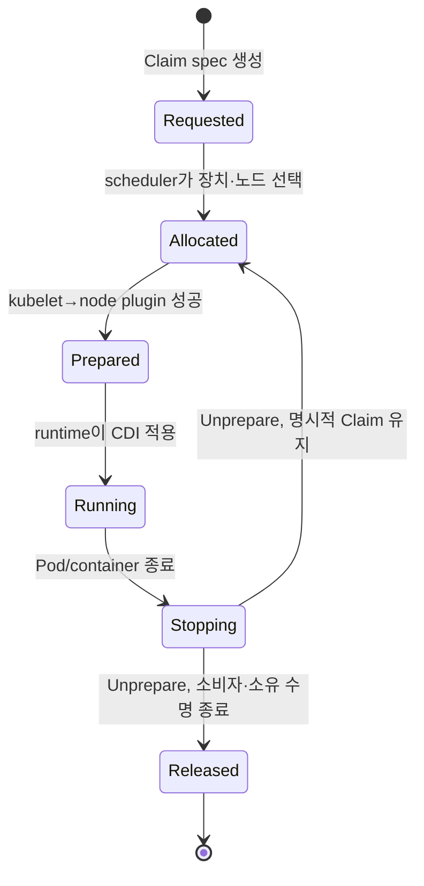
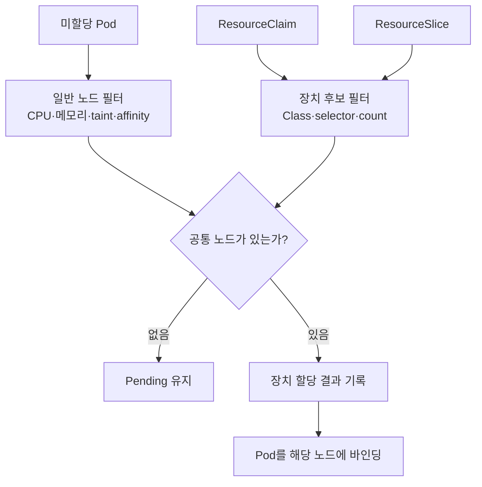
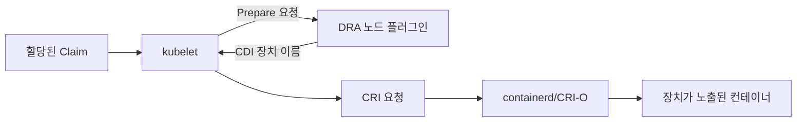

# 05. DRA 할당의 전체 생명주기

[← 이전 장](04-dra-concepts-and-objects.md) · [다음 장 →](06-dra-yaml-walkthrough.md)
## 0. 생명주기는 “선택”과 “사용 준비”와 “정리”를 잇는다

**할당**, allocation은 scheduler가 ResourceClaim의 요구와 ResourceSlice의 장치 inventory를 비교해 사용할 장치를 선택하고 그 결과를 Claim status에 기록하는 단계다. **준비**, prepare는 선택된 노드의 kubelet이 DRA driver에게 “이 Claim의 장치를 이 노드의 Pod가 실제로 쓰게 만들어 달라”고 요청하는 단계다. **주입**, injection은 container runtime이 CDI 정보에 따라 device file과 mount를 container 설정에 합치는 단계다. **해제**, unprepare는 마지막 사용이 끝난 뒤 node에 만든 준비 상태를 되돌리는 단계다. 네 단계는 서로 다른 주체와 실패 증거를 가진다.

Claim의 spec은 사용자가 원하는 조건이고 status는 시스템이 관찰하거나 결정한 결과다. 사용자가 status를 원하는 값으로 써서 물리 GPU를 얻는 구조가 아니다. scheduler와 controller가 API server를 통해 status를 갱신하고, kubelet과 node driver는 노드 로컬 상태를 다룬다.

## 0.1 2노드·3장치·2Pod의 전체 시간표

`node-a`에는 `gpu-a0` 80 GiB와 `gpu-a1` 24 GiB가 있고, `node-b`에는 `gpu-b0` 40 GiB MIG instance가 있다고 하자. Pod A는 full GPU 40 GiB 이상, Pod B는 24 GiB 이상이며 MIG도 허용한다. 각 Pod는 ResourceClaimTemplate에서 자기 Claim을 하나씩 받는다.

| 시각 | 주체 | 읽는 입력 | 쓰는 상태 | 결과 |
| --- | --- | --- | --- | --- |
| t=0.0 | Deployment controller | Pod template·Claim template | Pod A/B와 Claim A/B 생성 | 두 Claim 미할당 |
| t=0.2 | scheduler | 두 Pod, 두 Claim, 세 device | 후보 집합 계산 | A={a0}, B={a0,a1,b0} |
| t=0.3 | scheduler | 충돌하지 않는 조합 | Claim A allocation=`a0` | Pod A node-a |
| t=0.4 | scheduler | A가 점유한 뒤 남은 후보 | Claim B allocation=`b0` | Pod B node-b |
| t=0.6 | node-a kubelet | Pod A와 Claim A status | NodePrepareResources 호출 | a0 준비 중 |
| t=0.7 | node-b kubelet | Pod B와 Claim B status | NodePrepareResources 호출 | b0 준비 중 |
| t=0.9 | 각 node driver | 장치 ID와 Claim UID | node-local state·CDI 이름 | prepare 성공 |
| t=1.1 | container runtime | container spec·CDI 이름 | device/mount/env 병합 | container 생성 |
| t=1.5 | CUDA process | library와 device file | GPU context·VRAM | 계산 시작 |
| t=10 | Pod B 삭제 | 사용 종료 | container 제거 | unprepare 가능 |
| t=10.3 | node-b kubelet/driver | Claim B 사용 없음 | node-local 준비 해제 | b0 재사용 가능 |

scheduler가 Pod B에 `b0`을 고른 것은 하나의 가능한 결과다. 점수화와 다른 제약에 따라 `a1`을 고를 수도 있다. 중요한 불변식은 같은 exclusive device를 충돌하는 두 Claim에 동시에 주지 않는 것과 Pod의 노드 선택이 device 접근 가능성과 일치하는 것이다.



## 0.2 prepare의 멱등성과 재시도

**멱등성**, idempotence는 같은 요청을 여러 번 받아도 최종 상태가 한 번 처리한 것과 같아야 한다는 성질이다. 네트워크가 끊기면 kubelet은 driver가 준비를 끝냈는지 응답만 잃었는지 알 수 없다. 따라서 같은 Claim UID와 device ID로 prepare를 다시 호출할 수 있다. driver가 매번 별도 GPU partition을 새로 만들면 누수가 생긴다. 이미 준비됐는지 node-local state를 확인하고 같은 결과를 반환해야 한다.

일시 실패는 재시도로 회복될 가능성이 있다. 예를 들어 runtime socket이 2초 동안 응답하지 않거나 device node 생성이 아직 끝나지 않은 경우다. 반면 **terminal failure**는 같은 입력을 반복해도 성공하지 않는다고 driver가 판단한 실패다. 선택된 장치가 요구 capability를 제공하지 않거나 복구에 관리자 설정 변경이 필요한 경우가 예다. terminal을 일시 오류처럼 무한 재시도하면 Pod가 계속 대기하고 운영자가 원인을 놓친다.

| 실패 위치 | 대표 상태 | 자동 재시도 의미 | 필요한 증거 |
| --- | --- | --- | --- |
| 후보 선택 | Claim 미할당·Pod Pending | inventory 갱신 시 재평가 가능 | Claim condition, scheduler event |
| API status 기록 | conflict/timeout | resourceVersion을 다시 읽고 재시도 | API audit·scheduler log |
| prepare | 일시 gRPC 오류 | 같은 Claim로 멱등 재호출 | kubelet·driver log |
| prepare | terminal failure | 조건·구성 수정 전 반복 무의미 | Claim/Pod condition, driver reason |
| runtime injection | container create error | CDI spec·runtime 수정 필요 | runtime log, spec 파일 |
| CUDA 시작 | library/driver 오류 | container 반복만으로 회복 안 될 수 있음 | app log, driver version |
| unprepare | 일시 정리 실패 | 사용 없음 확인 후 재시도 | driver node state |

## 0.3 삭제와 unprepare에서 데이터 손실을 막는 순서

unprepare는 단순히 Claim API 객체를 삭제하는 일이 아니다. driver가 만든 node-local device 준비, mount, partition 또는 접근 상태를 해제하는 호출이다. 실행 중 container가 여전히 장치 파일을 사용한다면 먼저 container를 정지하고 참조가 사라졌는지 확인해야 한다. 준비를 먼저 풀면 process가 I/O 오류를 만나거나 공유 장치의 다른 사용자에게 영향을 줄 수 있다.

Pod가 삭제 요청을 받으면 kubelet은 container 종료 절차를 수행한다. 모든 관련 container가 멈추고 해당 Claim을 쓰는 local Pod가 없음을 확인한 뒤 NodeUnprepareResources를 호출한다. 성공 응답 뒤 장치는 다음 할당에 사용할 수 있다. driver가 재시작했다면 Claim UID와 저장된 node state를 바탕으로 이미 정리됐는지 판단해야 한다.

Claim을 여러 Pod가 사용할 수 있는 정책에서는 Pod 하나가 끝났다고 즉시 unprepare하면 안 된다. 마지막 local 사용자까지 사라졌는지 참조 수명 규칙을 따른다. 반대로 Pod가 사라졌는데 준비 상태가 영원히 남으면 장치 누수가 생긴다. API 객체 수명, kubelet의 desired state, driver의 actual state를 조정해야 한다.

## 0.4 성능과 격리는 생명주기 성공 뒤의 별도 질문이다

Pod A와 B가 모두 Running이고 prepare가 성공해도 성능 격리가 증명되지는 않는다. `gpu-b0`이 MIG instance라면 profile 범위의 하드웨어 구획이 있지만, 같은 PCIe link나 CPU·network 경로에서 경합할 수 있다. time-slicing이면 두 Claim이 논리적으로 할당돼도 같은 GPU 실행 시간을 공유하며 tail latency가 커질 수 있다. MPS도 동시 제출을 돕지만 모든 오류와 메모리를 tenant별로 완전 격리하는 계약은 아니다.

단독 50 ms인 작업 둘이 time-slicing 장치에서 완전 직렬로 경쟁하면 단순 시간표는 A 0–50 ms, B 50–100 ms가 되어 B 응답이 100 ms다. 실제 GPU 동시성은 workload에 따라 달라 측정해야 한다. allocation status는 이 성능 값을 저장하지 않는다.

## 0.5 추가 완전 풀이 문제

**문제 1.** Claim allocation은 `gpu-a0`으로 기록됐지만 Pod가 node-b에 묶였다. prepare가 성공할 수 있는가?

**해설.** `gpu-a0`이 node-a에만 접근 가능하다면 node-b driver는 준비할 수 없다. scheduler는 device와 node를 함께 선택해야 한다. 수동 nodeName 변경이나 stale inventory가 있는지 Pod spec, Claim status, ResourceSlice node 정보를 대조한다.

**문제 2.** driver가 prepare를 완료했지만 응답이 손실되어 kubelet이 재호출했다. 두 번째 호출에서 새 partition을 또 만들면 어떤 문제가 생기는가?

**해설.** 같은 Claim에 자원이 중복 생성되어 capacity 누수와 잘못된 정리가 발생한다. Claim UID와 device ID를 키로 기존 상태를 찾아 같은 성공 결과를 반환하는 멱등 처리가 필요하다.

**문제 3.** Pod B가 삭제됐지만 같은 Claim을 쓰는 Pod C가 node-b에서 실행 중이다. 즉시 unprepare해야 하는가?

**해설.** 아니다. 아직 local 사용자가 있으므로 장치 준비를 유지해야 한다. 마지막 참조가 끝난 뒤 unprepare한다. Claim 공유 정책과 kubelet desired state를 함께 판단한다.

**문제 4.** Claim은 할당됐고 prepare도 성공했는데 container create가 실패했다. scheduler가 다른 GPU를 고르면 해결되는가?

**해설.** 실패 지점은 runtime/CDI 주입이다. CDI spec 누락, runtime 지원, device path와 권한을 먼저 확인한다. 장치 자체 capability 문제가 아니라면 재할당은 원인을 우회하지 못한다.

**문제 5.** DRA가 stable이므로 terminal failure는 없다는 주장이 왜 틀렸는가?

**해설.** stable은 API 성숙도다. 잘못된 selector, 지원되지 않는 device capability, driver/runtime 조합 문제 같은 운영 실패는 여전히 있다. terminal은 프로토콜이 실패를 분류하는 방식이며 안정 API와 모순되지 않는다.

> 이 장의 목표는 템플릿에서 Claim이 생기고, 스케줄러가 장치를 할당하고, 노드의 드라이버가 컨테이너 실행 환경을 준비한 뒤 정리하는 순서를 이해하는 것이다.

## 1. 할당은 한 번의 API 호출이 아니다

DRA 장치 사용은 여러 컴포넌트가 이어서 수행하는 상태 전이의 연속이다.

1. Claim이 존재한다.
2. 스케줄러가 Pod와 장치가 함께 들어갈 노드를 찾는다.
3. 할당 결과가 Claim 상태에 기록된다.
4. 선택한 노드의 kubelet이 드라이버에 장치 준비를 요청한다.
5. 컨테이너 런타임이 준비된 장치 정보를 적용한다.
6. Pod가 종료되면 준비 상태를 해제한다.





### 1.1 객체와 노드 상태를 누가 언제 바꾸는가

생명주기를 이해하려면 “DRA가 처리한다” 대신 작성 주체를 붙여야 한다. Pod 하나가 템플릿 Claim으로 GPU 하나를 쓰는 교육용 시간표를 보자.

| 시각 | 주체 | 읽는 것 | 쓰거나 바꾸는 것 | 아직 보장하지 않는 것 |
|---|---|---|---|---|
| t0 | Deployment/Pod controller | Pod template | Pod와 Pod용 ResourceClaim 생성 | 장치 선택 |
| t1 | scheduler | Pod, Claim spec, DeviceClass, ResourceSlice | Claim allocation과 Pod node 결정 | 노드 준비 |
| t2 | API server | scheduler의 갱신 요청 | allocation/reservation 상태 저장 | CDI 적용 |
| t3 | 선택 노드 kubelet | bound Pod와 allocated Claim | node plugin에 Prepare 호출 | CUDA 계산 |
| t4 | DRA node plugin | allocation의 장치 ID | 노드 준비 상태, CDI 장치 결과 | container 시작 |
| t5 | container runtime | CRI 요청과 CDI spec | OCI device/mount/env 구성 후 container 생성 | 모델 정확도 |
| t6 | kubelet | container 종료와 Claim 사용 관계 | Unprepare 호출 | Claim 객체 삭제 |
| t7 | driver/controller | 소비자 없음, 해제 가능 상태 | 장치 재사용 가능 상태와 Claim 상태 정리 | 보안 삭제 정책 |

이 흐름에는 API 객체 상태와 노드 로컬 상태가 함께 있다. API server가 저장한 `status.allocation`은 다른 컴포넌트가 읽을 durable record다. 반면 `/dev` 장치 접근, CDI spec, driver 내부 prepare record는 선택 노드에 존재할 수 있다. API 객체를 봤다고 노드 파일까지 존재한다고 추정하면 안 된다.



명시적 Claim이면 `Stopping → Allocated`처럼 장치 allocation을 객체에 남긴 채 새 소비자를 기다리는 설계가 가능할 수 있다. 템플릿에서 만들어져 Pod 수명에 묶인 Claim이면 owner 관계와 controller 정책에 따라 객체까지 정리되는 흐름이 자연스럽다. 정확한 deallocation 시점은 claim의 allocation mode와 현재 API 의미, driver 동작을 확인한다.

실패가 생기면 마지막으로 완료한 전이를 찾는다.

```text
Claim status에 allocation 없음
  → Requested 구간: class, slice, selector, Pod 배치 조건 조사

allocation 있음, Pod가 ContainerCreating
  → Allocated~Prepared 구간: kubelet과 node plugin Prepare 조사

Prepare 성공 기록, runtime create 실패
  → Prepared~Running 구간: CDI spec lookup과 OCI 적용 조사

Pod 종료, 장치가 새 Claim에 잡히지 않음
  → Stopping~Released 구간: reservedFor, Unprepare, driver 정리 조사
```

재시도에서는 같은 호출이 다시 올 수 있다는 점도 중요하다. Kubelet이나 controller는 장애 뒤 원하는 상태를 맞추기 위해 Prepare/Unprepare를 재시도할 수 있다. Node plugin은 “이미 같은 Claim과 장치를 준비했다”는 경우를 중복 mount나 중복 CDI entry로 폭발시키지 않도록 현재 상태와 요청 identity를 대조해야 한다. 운영자는 재시도 로그 여러 줄을 서로 다른 GPU 여러 개가 할당된 증거로 세지 않는다.

반례로, allocation이 기록된 직후 node가 사라지면 scheduler의 선택 자체는 과거에 성공했어도 Prepare는 시작하지 못한다. 반대로 runtime이 container를 만들었다가 kubelet 응답 전에 재시작되면 실제 node 상태와 API 관찰 사이에 잠깐 차이가 날 수 있다. 조정 시스템에서는 한 순간의 단일 필드보다 시간순 event와 반복 후 수렴 여부가 더 강한 증거다.

## 2. 단계 0: 명시적 Claim 또는 템플릿

Claim을 제공하는 방식은 두 가지로 이해하면 쉽다.

### 명시적 ResourceClaim

사용자가 ResourceClaim을 먼저 만들고 Pod가 그 객체를 이름으로 참조한다.
여러 Pod가 재사용하도록 설계할 수도 있지만 동시 사용 가능 여부와 공유 의미는 드라이버 및 요청 정책을 확인해야 한다.

### ResourceClaimTemplate

Pod 명세가 ResourceClaimTemplate을 참조한다.
워크로드 컨트롤러가 Pod에 대응하는 ResourceClaim을 생성한다.
각 Pod에 독립된 Claim이 필요할 때 적합하다.

템플릿 자체가 할당되는 것은 아니다.
템플릿으로부터 만들어진 실제 ResourceClaim이 할당 상태를 가진다.

## 3. 단계 1: Claim 생성과 대기

API 서버에 ResourceClaim이 저장되면 아직 실제 장치가 정해지지 않을 수 있다.
Claim의 명세는 의도이고, 상태는 관측된 할당 결과다.

이 시점에 확인할 것은 다음과 같다.

- 참조한 DeviceClass가 존재하는가
- DRA 드라이버가 ResourceSlice를 게시했는가
- 요청 수량과 선택 조건을 만족할 장치가 있는가
- Claim과 Pod의 참조 이름이 올바르게 연결됐는가

## 4. 단계 2: 스케줄러의 공동 판단

스케줄러는 GPU만 따로 고른 다음 노드를 찾지 않는다.
Pod의 일반 리소스 및 배치 조건과 장치 위치를 함께 만족시켜야 한다.



예를 들어 GPU 후보가 노드 A에만 있는데 Pod의 node affinity가 노드 B만 허용하면 공통 해가 없다.
각 조건을 별도로 보면 만족하는 것처럼 보여도 Pod는 Pending일 수 있다.

스케줄러의 정확한 내부 순서와 점수 계산은 Kubernetes 버전과 구현에 따라 달라질 수 있다.
사용자는 선언된 제약과 최종 상태를 기준으로 관찰해야 한다.

## 5. 단계 3: allocation 상태

스케줄러가 장치를 선택하면 ResourceClaim의 상태에 할당 결과가 기록된다.
여기에는 선택된 장치와 관련 정보가 포함될 수 있다.

명세와 상태를 구분한다.

| 위치 | 의미 |
|---|---|
| `spec` | 사용자가 원한 장치 조건 |
| `status.allocation` | 시스템이 선택한 실제 할당 결과 |

할당이 기록됐다는 사실만으로 컨테이너에서 CUDA가 정상 동작한다고 결론 내릴 수 없다.
노드 준비와 런타임 구성이 뒤에 남아 있다.

## 6. reservation과 reservedFor

Claim 상태에는 어떤 소비자가 해당 할당을 사용하도록 예약되었는지를 나타내는 정보가 관리된다.
`reservedFor`는 Claim을 사용하는 Pod 같은 소비자와 할당의 관계를 추적하는 데 쓰인다.

예약은 수명주기와 안전한 정리에 중요하다.
아직 사용하는 소비자가 있는데 할당을 즉시 회수하면 실행 중인 워크로드가 깨질 수 있기 때문이다.

그러나 `reservedFor`를 보고 다음을 과장하면 안 된다.

- 모든 종류의 장치 공유가 자동 격리된다는 뜻이 아니다.
- 사용자가 객체를 삭제하는 순간 하드웨어가 즉시 초기화된다는 보장이 아니다.
- 애플리케이션 데이터나 GPU 메모리의 보안 삭제 정책을 대신하지 않는다.

정확한 해제 동작은 Kubernetes와 드라이버 수명주기를 함께 확인한다.

## 7. 단계 4: kubelet의 Prepare

Pod가 특정 노드로 배치되면 그 노드의 kubelet이 DRA 드라이버에 할당된 장치 준비를 요청한다.
이 과정은 흔히 `NodePrepareResources` 흐름으로 설명된다.

드라이버는 장치를 컨테이너에서 사용할 수 있도록 필요한 노드 측 작업을 수행한다.
구체적인 작업은 드라이버마다 다르며 다음을 포함할 수 있다.

- 장치 노드 접근 정보 준비
- 마운트 또는 환경 구성 결정
- CDI(Container Device Interface) 장치 이름 반환
- 드라이버 내부 상태 갱신

Prepare 성공은 실제 CUDA 커널 계산 성공과 같은 검증이 아니다.
이는 컨테이너 실행에 필요한 장치 노출 준비 단계다.

## 8. CDI와 컨테이너 런타임

CDI는 컨테이너 런타임에 장치 구성을 전달하는 표준화된 방식이다.
DRA 드라이버가 준비 결과로 CDI 장치 식별자를 제공하면 kubelet과 런타임이 이를 사용해 컨테이너 구성을 완성할 수 있다.



CDI 파일이나 레지스트리 상태에 문제가 있으면 Claim은 할당됐어도 컨테이너 시작이 실패할 수 있다.
따라서 문제를 `스케줄링 실패`와 `노드 준비 실패`로 분리해야 한다.

## 9. 단계 5: 컨테이너 실행

컨테이너가 시작된 뒤에는 여러 검증 수준이 있다.

1. 장치 파일이나 라이브러리가 보인다.
2. `nvidia-smi` 같은 관리 도구가 장치를 나열한다.
3. 런타임 API가 장치를 초기화한다.
4. 실제 CUDA 연산이 성공한다.
5. 애플리케이션의 성능과 정확성이 기대를 만족한다.

앞 단계가 성공했다고 뒤 단계가 자동으로 증명되지는 않는다.

## 10. 단계 6: Stop과 Unprepare

Pod와 컨테이너 사용이 끝나면 kubelet은 드라이버에 장치 준비 해제를 요청한다.
이를 `NodeUnprepareResources` 흐름으로 이해할 수 있다.

드라이버는 노드 측 준비 상태를 정리한다.
정리가 완료되고 Claim을 사용하는 소비자가 없어지면 할당 해제 및 객체 정리로 이어질 수 있다.

노드 장애나 네트워크 단절이 있으면 정리가 즉시 완료되지 않을 수 있다.
운영자는 API 상태와 노드·드라이버 로그를 함께 확인해야 한다.

## 11. 템플릿 Claim의 수명

템플릿 기반 Claim은 워크로드 컨트롤러가 Pod를 위해 만든다.
Pod 교체와 스케일 변화에 따라 Claim 생성과 정리가 연동될 수 있다.

예를 들어 Deployment의 Pod 두 개가 각각 템플릿 Claim을 사용하면 일반적으로 Pod별 Claim이 만들어진다.
Pod가 교체될 때 이전 Claim과 새 Claim의 수명도 관찰해야 한다.

`ResourceClaimTemplate` 객체 하나를 모든 Pod가 직접 공동 할당받는 구조로 이해하면 안 된다.

## 12. 명시적 Claim의 수명과 재사용

명시적으로 만든 Claim은 Pod 삭제와 별개로 남을 수 있다.
따라서 다음 워크로드가 같은 Claim을 다시 참조하는 설계를 할 수 있다.

다만 재사용 전에 확인할 사항이 있다.

- 이전 소비자의 예약이 해제됐는가
- 드라이버가 해당 장치 재사용을 지원하는가
- 장치 내부 상태를 애플리케이션이 어떻게 초기화하는가
- 민감한 데이터가 장치 메모리에 남을 가능성에 대한 정책이 있는가

Kubernetes 객체의 재사용 가능성과 애플리케이션 상태의 안전한 재사용은 별개의 문제다.

## 13. 작은 실패 사례

### 사례 A: Claim은 Pending

DeviceClass 이름 오타 또는 만족할 ResourceSlice가 없다.
스케줄러 이벤트와 Claim 상태부터 확인한다.

### 사례 B: Claim은 할당됐지만 Pod가 ContainerCreating

노드 플러그인의 Prepare, CDI, 컨테이너 런타임 구간을 확인한다.

### 사례 C: 컨테이너는 Running이지만 CUDA 실패

이미지의 사용자 공간 라이브러리, 호스트 드라이버 호환성, 실제 CUDA 테스트를 확인한다.
Running은 GPU 계산 성공을 뜻하지 않는다.

## 14. 흔한 오해

**“스케줄러가 GPU를 할당하면 장치 설정도 모두 끝난다.”**
노드의 kubelet·DRA 드라이버·CDI·런타임 단계가 남아 있다.

**“Pod를 지우면 명시적 Claim도 항상 지워진다.”**
명시적 Claim은 별도 객체로 남을 수 있다. 소유 관계와 정책을 확인해야 한다.

**“Unprepare는 GPU 메모리의 보안 삭제를 보장한다.”**
그런 보장은 DRA 수명주기만으로 단정할 수 없다.

## 15. 확인 문제와 해설

### 문제 1

Claim 상태에 allocation이 있는데 Pod가 시작하지 못한다. 가장 먼저 어느 경계를 나눠 볼 것인가?

**해설:** 스케줄링은 통과했으므로 kubelet Prepare, DRA 노드 플러그인, CDI, 컨테이너 런타임 순서로 범위를 좁힌다.

### 문제 2

Deployment의 각 Pod가 독립 장치를 요구한다. 명시적 Claim 하나보다 어떤 방식이 자연스러운가?

**해설:** ResourceClaimTemplate을 Pod 명세에서 참조해 Pod별 Claim이 생성되도록 하는 방식이다.

### 문제 3

컨테이너에서 `nvidia-smi`가 성공하면 연구 코드의 CUDA 계산도 검증된 것인가?

**해설:** 아니다. 장치 열거와 실제 CUDA 연산은 다른 검증 단계다.

## 16. 공식 자료

- [Kubernetes: How DRA works](https://kubernetes.io/docs/concepts/resource-management/dynamic-resource-allocation/how-dra-works/)
- [ResourceClaim v1 API](https://kubernetes.io/docs/reference/kubernetes-api/workload-resources/resource-claim-v1/)
- [Container Device Interface](https://github.com/cncf-tags/container-device-interface)

[← 이전 장](04-dra-concepts-and-objects.md) · [다음 장 →](06-dra-yaml-walkthrough.md)
