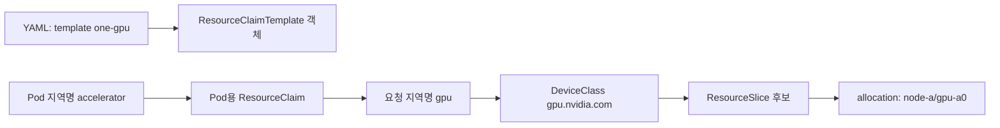
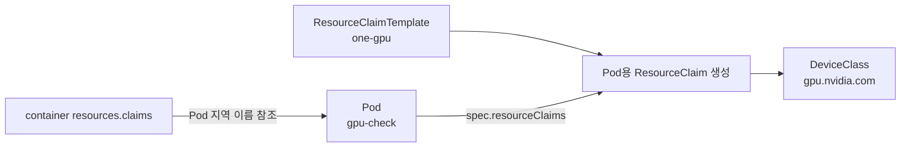
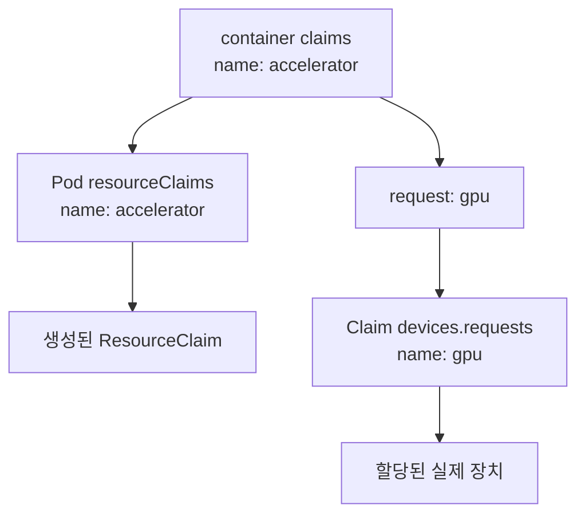
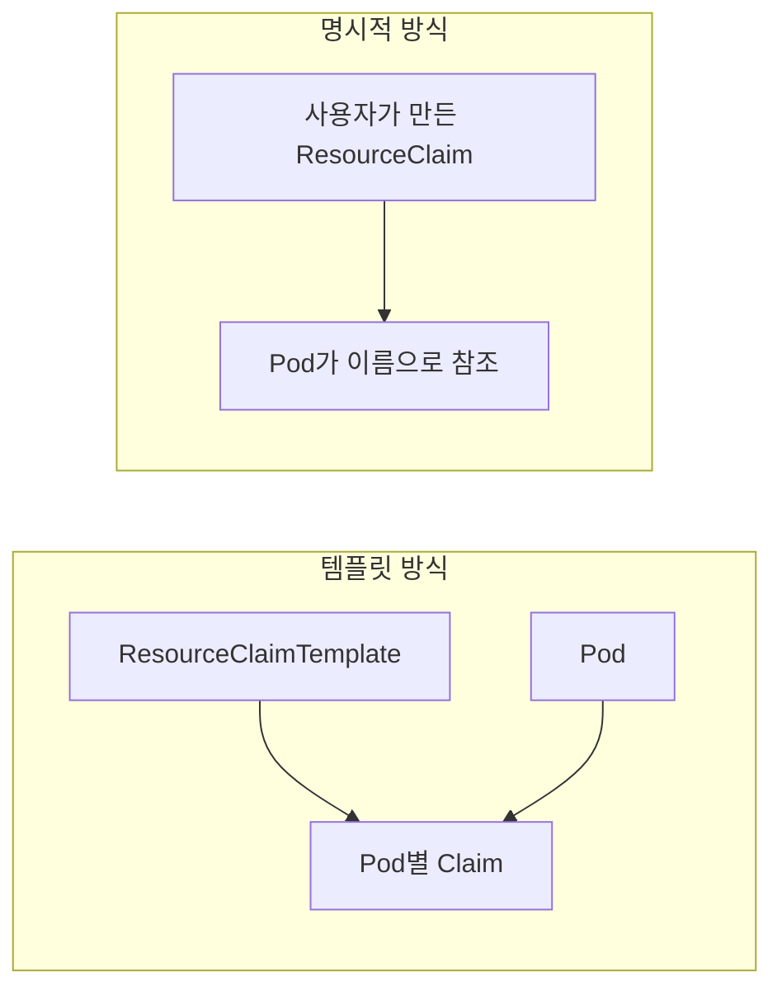

# 06. DRA YAML을 한 줄씩 읽기

[← 이전 장](05-dra-allocation-lifecycle.md) · [다음 장 →](07-cdi-and-runtime.md)
## 0. YAML은 물리 GPU가 아니라 API 객체를 만든다

**YAML**은 사람이 읽기 쉬운 들여쓰기 기반 데이터 형식이다. Kubernetes API server는 YAML을 그대로 저장하지 않고 JSON 형태의 API 객체로 변환해 schema를 검증한다. `apiVersion`은 사용할 API 그룹과 버전, `kind`는 객체 종류, `metadata`는 이름과 namespace, `spec`은 사용자가 원하는 상태를 뜻한다. DRA YAML을 적용한다고 GPU driver나 `/dev/nvidia0`이 자동 설치되는 것은 아니다. 이미 driver가 ResourceSlice로 광고한 장치를 Claim이 요청하는 것이다.

**ResourceClaimTemplate**은 Claim을 만드는 청사진이다. 실제 장치를 예약하는 객체가 아니므로 status에 allocation을 직접 갖지 않는다. **ResourceClaim**은 장치 요구와 할당 결과를 가진 namespace 객체다. **DeviceClass**는 관리자가 허용한 장치 선택 정책의 클러스터 객체다. **ResourceSlice**는 driver가 장치 inventory를 게시하는 클러스터 객체다. Pod YAML은 이 객체들의 이름을 참조하지만 실제 장치 ID를 사용자가 임의로 정하지 않는다.

## 0.1 세 종류의 이름을 왼쪽에서 오른쪽으로 추적한다

예제의 `one-gpu`, `accelerator`, `gpu`가 비슷해 보이지만 서로 다른 이름 공간에 있다.

1. `one-gpu`는 API server에서 찾는 ResourceClaimTemplate 객체 이름이다.
2. `accelerator`는 한 Pod spec 안에서 Claim을 가리키는 지역 이름이다.
3. `gpu`는 한 Claim spec 안의 device request를 가리키는 지역 이름이다.
4. `gpu.nvidia.com`은 DeviceClass 객체 이름이다.
5. `gpu-a0` 같은 실제 device 이름은 ResourceSlice와 allocation status에서 시스템이 연결한다.



이 화살표를 거꾸로 읽으면 오류를 찾기 쉽다. container의 `resources.claims[].name`이 `accelerator`와 다르면 Pod 내부 연결이 끊긴다. `request`가 `gpu`와 다르면 Claim 내부 요청 연결이 끊긴다. DeviceClass 이름이 없으면 후보 정책을 찾지 못한다. ResourceSlice가 없거나 selector를 만족하지 않으면 실제 device 후보가 없다.

## 0.2 두 Pod와 세 device로 YAML 결과를 계산한다

`node-a`에 80 GiB `gpu-a0`, 24 GiB `gpu-a1`, `node-b`에 40 GiB MIG `gpu-b0`이 광고됐다고 가정한다. Pod A의 Claim은 full GPU이면서 40 GiB 이상을 요구하고, Pod B는 24 GiB 이상을 요구하며 MIG를 허용한다.

Pod A selector가 `memory >= 40Gi`와 `type == full`이라면 후보는 `gpu-a0` 하나다. Pod B 후보는 세 장치지만 Pod A 할당 뒤에는 `gpu-a1`, `gpu-b0`이 남는다. scheduler가 Pod B에 `gpu-b0`을 고르면 각 Claim status에는 서로 다른 allocation이 기록되고 Pod A는 node-a, Pod B는 node-b에 묶인다.

다음은 구조를 배우기 위한 축약 예다. selector 속성 이름은 driver가 실제 ResourceSlice에 게시한 schema와 맞아야 하며, 그대로 운영 환경에 적용하지 않는다.

```yaml
apiVersion: resource.k8s.io/v1
kind: ResourceClaimTemplate
metadata:
  name: large-full-gpu
spec:
  spec:
    devices:
      requests:
        - name: compute
          exactly:
            deviceClassName: gpu.nvidia.com
            allocationMode: ExactCount
            count: 1
            selectors:
              - cel:
                  expression: >-
                    device.capacity['gpu.nvidia.com'].memory.isGreaterThan(quantity("40Gi"))
```

**CEL**, Common Expression Language은 API 객체의 값을 안전한 식으로 비교하는 언어다. expression은 프로그램을 임의 실행하는 shell이 아니라 후보 device 속성을 평가하는 조건이다. 위 예의 `isGreaterThan`은 40 GiB와 같은 값을 포함하지 않는다. 40 GiB 이상을 의도한다면 공식 API가 제공하는 비교식의 정확한 의미를 확인해 경계를 표현해야 한다.

`count: 1`은 selector를 통과한 device 한 단위를 요구한다. 물리 GPU 한 장, MIG instance 하나, 공유 replica 하나 중 무엇을 단위로 광고하는지는 driver 구성에 달려 있다. YAML의 숫자만으로 격리 수준을 알 수 없다.

## 0.3 API 승인 뒤 상태가 바뀌는 시간표

| 시각 | 주체 | 읽는 필드 | 쓰는 필드·상태 | 관찰 |
| --- | --- | --- | --- | --- |
| t=0.0 | API server | YAML 전체 | Template와 Pod spec 저장 | 문법·schema 승인 |
| t=0.1 | Pod용 controller | `resourceClaimTemplateName` | 실제 Claim 생성 | Claim 존재, 아직 미할당 |
| t=0.3 | scheduler | Claim request, Class, Slice | 후보와 node 계산 | Pod Pending |
| t=0.4 | scheduler | 선택 결과 | Claim `status.allocation` | device와 node 결정 |
| t=0.5 | scheduler | Pod 제약 | Pod `spec.nodeName` | node-a로 bind |
| t=0.7 | kubelet | Claim allocation | prepare 요청 | container 미생성 가능 |
| t=0.9 | node driver | device ID | CDI/노드 준비 상태 | prepare 성공 또는 실패 |
| t=1.1 | runtime | CDI와 container spec | device node·mount 병합 | container 시작 |
| t=1.5 | 애플리케이션 | CUDA library | context와 계산 | 성공 또는 app 오류 |

API server가 YAML을 받았다는 것은 t=0 단계만 통과한 것이다. Pod가 Pending이면 Claim 생성, 후보 선택, node 조건 중 어디에서 멈췄는지 본다. allocation이 있어도 prepare가 실패할 수 있고, prepare가 성공해도 runtime injection이나 CUDA 호환에서 실패할 수 있다.

## 0.4 ClaimTemplate과 명시적 Claim을 고르는 기준

replica마다 독립 장치를 원하면 Template이 자연스럽다. Deployment replica 2는 보통 서로 다른 Pod용 Claim 두 개를 만들므로 장치 수명도 각 Pod에 연결하기 쉽다. 반대로 관리자가 미리 예약한 Claim을 특정 작업이 이어서 사용해야 한다면 명시적 ResourceClaim을 참조할 수 있다. 이때 Pod 삭제 뒤 Claim이 남는지, 다음 사용 전에 device 상태를 어떻게 정리하는지 운영 책임을 정해야 한다.

Template 객체를 삭제했다고 이미 만들어진 Pod와 Claim이 모두 즉시 사라진다고 단정하지 않는다. Kubernetes owner reference와 controller 동작을 확인한다. 명시적 Claim을 두 Pod가 동시에 참조할 수 있는지도 API의 sharing 조건과 driver capability에 달려 있다. 이름이 같다고 안전한 동시 사용이 보장되지 않는다.

## 0.5 실패 문구를 필드 연결로 환원한다

`DeviceClass not found`는 `deviceClassName`이 가리키는 클러스터 객체가 없다는 뜻이다. `no suitable devices`는 Class는 찾았지만 ResourceSlice 장치가 selector, capacity, node 조건 또는 기존 할당 때문에 후보가 되지 못했다는 뜻일 수 있다. `request not found`는 container의 `request` 지역 이름과 Claim의 `devices.requests[].name` 연결을 본다. prepare 실패는 YAML schema가 아니라 선택 노드의 driver 상태를 본다.

재시도 가능한 API conflict나 일시적인 driver 통신 오류와, 같은 조건으로는 회복되지 않는 terminal failure를 구분한다. 존재하지 않는 capability를 요구하는 selector는 기다린다고 생기지 않는다. 관리자가 조건을 고치거나 해당 장치를 제공해야 한다. 반면 driver Pod가 재시작 중이면 정상화 뒤 prepare가 멱등 재시도로 성공할 수 있다.

## 0.6 버전과 지원 조건을 YAML 위에서 확인한다

`resource.k8s.io/v1`이라고 적었다는 사실은 이 manifest가 안정 API 형태를 요구한다는 뜻이다. 클러스터가 그 API를 제공하는지 먼저 확인해야 한다. DRA가 Kubernetes 1.34에서 GA가 된 역사, 1.35에서 stable 및 locked gate로 표시되는 상태, 현재 클러스터가 노출하는 API는 서로 구분한다.

Kubernetes API 지원만으로 NVIDIA driver의 DeviceClass 이름, capacity key, selector 식이 자동 결정되지 않는다. NVIDIA DRA driver와 GPU Operator 26.7의 지원 문서에서 Kubernetes, OS, runtime, GPU 조합을 확인하고 실제 ResourceSlice schema를 읽어야 한다. 공식 예제의 필드를 자신의 driver 버전에 그대로 가정하지 않는다.

## 0.7 추가 완전 풀이 문제

**문제 1.** Template 이름은 `one-gpu`, Pod 지역 이름은 `accelerator`, request 이름은 `gpu`다. container가 `name: one-gpu`를 참조하면 무엇이 잘못되는가?

**해설.** container의 `resources.claims[].name`은 Template 객체 이름이 아니라 Pod의 `spec.resourceClaims[].name`인 `accelerator`를 참조해야 한다. API 객체와 Pod 지역 이름 공간을 섞은 오류다.

**문제 2.** `isGreaterThan(quantity("40Gi"))` 조건에서 정확히 40 GiB device가 선택되는가?

**해설.** 아니다. 표현은 40 GiB 초과를 요구한다. 40 GiB를 포함하려면 driver schema와 CEL API에 맞는 이상 조건을 작성해야 한다. 경계값 하나 때문에 후보가 0개가 될 수 있다.

**문제 3.** YAML 적용 성공과 Claim allocation 성공 중 어느 것이 `/dev/nvidia0` 존재를 보장하는가?

**해설.** 둘 다 단독으로 보장하지 않는다. allocation 뒤 kubelet prepare와 runtime CDI injection이 완료되어야 container에서 device file을 볼 수 있다. 각 단계의 condition과 log를 확인한다.

**문제 4.** Deployment replica를 2로 늘렸는데 GPU가 하나뿐이다. Template이 있으므로 두 Pod가 자동 time-share하는가?

**해설.** 아니다. 각 Pod용 Claim이 독립 device를 요구하면 하나만 할당되고 다른 하나는 Pending일 수 있다. time-slicing은 driver가 공유 단위를 광고하도록 별도 구성해야 하며 고정 VRAM 격리를 뜻하지 않는다.

**문제 5.** DRA API가 stable이면 vendor capacity key가 모든 driver에서 같은가?

**해설.** 아니다. 안정 API는 객체 구조와 호환성 약속이다. vendor별 device 속성과 capacity domain은 driver가 게시한다. 실제 ResourceSlice와 해당 driver 공식 문서를 근거로 selector를 작성한다.

> 이 장에서는 Kubernetes `resource.k8s.io/v1` API로 NVIDIA GPU 한 개를 요청하는 교육용 YAML을 읽는다. GPU 없는 노트북이나 운영 클러스터에 그대로 적용하지 않는다.

## 1. 예제의 전제

이 예제는 다음 조건을 전제로 한다.

- Kubernetes 클러스터가 사용하는 DRA 기능과 `resource.k8s.io/v1` API를 지원한다.
- NVIDIA DRA 드라이버가 설치되어 있다.
- `gpu.nvidia.com` DeviceClass와 장치 ResourceSlice가 준비되어 있다.
- 이미지 레지스트리에 접근할 수 있다.

하나라도 빠지면 YAML 문법이 맞아도 Pod가 실행되지 않는다.
기능 성숙도와 버전 조건은 [14장](14-versions-and-feature-status.md)에서 따로 확인한다.

## 2. 전체 구조

템플릿 기반 요청은 두 문서로 구성한다.

1. `ResourceClaimTemplate`: GPU 요청의 청사진
2. `Pod`: 템플릿으로 만들어진 Claim을 사용



## 3. 전체 교육용 YAML

같은 예제를 [dra-one-gpu.yaml](examples/dra-one-gpu.yaml) 파일로 제공한다. 두 객체는 같은 namespace에서 연결하며, 이 파일은 준비된 GPU 학습 환경에서 읽는 API 예시다. 이번 교재 작성 과정에서는 적용하지 않았다.

```yaml
apiVersion: resource.k8s.io/v1
kind: ResourceClaimTemplate
metadata:
  name: one-gpu
spec:
  spec:
    devices:
      requests:
        - name: gpu
          exactly:
            deviceClassName: gpu.nvidia.com
            allocationMode: ExactCount
            count: 1
---
apiVersion: v1
kind: Pod
metadata:
  name: gpu-check
spec:
  restartPolicy: Never
  resourceClaims:
    - name: accelerator
      resourceClaimTemplateName: one-gpu
  containers:
    - name: check
      image: nvidia/cuda:12.8.1-base-ubuntu22.04
      command: ["bash", "-lc", "nvidia-smi"]
      resources:
        claims:
          - name: accelerator
            request: gpu
```

이 예제는 읽기 위한 예제다.
여기서는 실행하거나 실제 GPU 동작을 측정했다고 주장하지 않는다.

## 4. ResourceClaimTemplate 머리 부분

```yaml
apiVersion: resource.k8s.io/v1
kind: ResourceClaimTemplate
metadata:
  name: one-gpu
```

`apiVersion`은 이 객체가 Kubernetes의 안정 `resource.k8s.io/v1` API 형태를 사용한다고 선언한다.
클러스터 버전과 기능 구성이 이를 지원해야 한다.

`kind`는 이것이 실제 할당 상태를 가진 Claim이 아니라 Claim을 만들기 위한 템플릿임을 뜻한다.

`metadata.name: one-gpu`는 Pod가 템플릿을 찾을 때 사용하는 Kubernetes 객체 이름이다.
GPU의 제품명이나 UUID가 아니다.

## 5. spec 안의 spec

```yaml
spec:
  spec:
    devices:
```

`ResourceClaimTemplate` 바깥쪽 `spec` 안에 새 ResourceClaim의 명세가 들어간다.
그래서 `spec.spec`가 반복된다.

- 첫 번째 `spec`: 템플릿의 명세
- 두 번째 `spec`: 템플릿에서 생성될 ResourceClaim의 명세

오타처럼 보이지만 객체 구조상 필요한 중첩이다.

## 6. requests와 지역 이름

```yaml
requests:
  - name: gpu
```

한 Claim은 여러 장치 요청을 가질 수 있다.
여기서는 요청 하나를 만들고 그 지역 이름을 `gpu`로 정했다.

`gpu`는 뒤에서 컨테이너의 `request` 필드가 참조한다.
실제 장치 식별자가 아니다.

## 7. exactly와 ExactCount

```yaml
exactly:
  deviceClassName: gpu.nvidia.com
  allocationMode: ExactCount
  count: 1
```

각 줄의 의미는 다음과 같다.

| 필드 | 의미 |
|---|---|
| `exactly` | 한 가지 정확한 장치 요구 조건 |
| `deviceClassName` | 후보를 가져올 DeviceClass |
| `allocationMode: ExactCount` | 지정한 수량을 정확히 요구 |
| `count: 1` | 장치 한 개 요청 |

`gpu.nvidia.com`은 NVIDIA DRA 드라이버 문서가 사용하는 DeviceClass 이름이다.
클러스터에 해당 객체가 실제로 존재해야 한다.

`count: 1`은 GPU 메모리 크기나 모델을 지정하지 않는다.
그런 조건이 필요하면 지원되는 선택자를 추가한다.

## 8. Pod의 resourceClaims

```yaml
spec:
  resourceClaims:
    - name: accelerator
      resourceClaimTemplateName: one-gpu
```

`resourceClaims`는 이 Pod가 사용할 Claim들을 선언한다.

`name: accelerator`는 Pod 명세 안에서 사용하는 지역 이름이다.
템플릿 이름과 달라도 된다.

`resourceClaimTemplateName: one-gpu`는 앞에서 만든 템플릿 객체를 참조한다.
컨트롤러는 이 템플릿으로 Pod용 ResourceClaim을 만든다.

## 9. 컨테이너의 claims

```yaml
resources:
  claims:
    - name: accelerator
      request: gpu
```

여기에는 이름이 두 개 나온다.

- `name: accelerator`: Pod의 `spec.resourceClaims[].name`과 같다.
- `request: gpu`: Claim 내부 `devices.requests[].name`과 같다.

즉 `accelerator`는 **어느 Claim인가**를 고르고, `gpu`는 **그 Claim의 어느 요청인가**를 고른다.



두 이름을 모두 `gpu`로 쓸 수도 있지만, 서로 다른 역할을 배우기 위해 예제에서는 다르게 썼다.

## 10. 이미지와 명령의 한계

```yaml
image: nvidia/cuda:12.8.1-base-ubuntu22.04
command: ["bash", "-lc", "nvidia-smi"]
```

고정 태그를 사용해 예제의 사용자 공간을 구체적으로 만들었다.
그래도 이미지와 호스트 드라이버의 호환성은 환경별로 확인해야 한다.

`nvidia-smi` 성공은 다음 정도를 확인한다.

- 도구가 실행된다.
- 드라이버 관리 인터페이스로 장치를 열거할 수 있다.

CUDA 커널 계산, 프레임워크 학습, 수치 정확성, 성능을 검증하지는 않는다.
실제 CUDA 계산 검증은 별도의 작은 프로그램이나 프레임워크 테스트가 필요하다.

## 11. 메모리 용량 선택자 추가 예시

NVIDIA DRA 드라이버가 게시하는 메모리 용량을 사용한다면 요청에 선택자를 추가할 수 있다.

```yaml
selectors:
  - cel:
      expression: >-
        device.capacity['gpu.nvidia.com'].memory.isGreaterThan(quantity("40Gi"))
```

이 표현식은 GPU 메모리 용량이 40 GiB보다 큰 후보만 남긴다.
`40Gi` 이상이 아니라 **초과** 조건이라는 점에 유의한다.

이 필드는 모든 DRA 드라이버에 공통으로 존재하는 임의의 이름이 아니다.
NVIDIA 드라이버가 게시하는 정확한 도메인과 capacity 이름을 공식 문서 및 ResourceSlice에서 확인해야 한다.

## 12. 명시적 ResourceClaim 대안

Pod마다 새 Claim을 만들 필요가 없으면 `ResourceClaim`을 직접 만들 수 있다.
Pod에서는 `resourceClaimTemplateName` 대신 기존 Claim을 참조하는 필드를 사용한다.



명시적 Claim은 Pod 삭제 후에도 남을 수 있으므로 예약 해제, 재사용 정책, 최종 삭제 책임을 정해야 한다.
템플릿 방식은 컨트롤러가 Pod별 수명 관리를 돕지만 운영 중 생성된 Claim 상태를 여전히 관찰해야 한다.

## 13. Extended Resource와의 관계

전통적인 GPU 요청은 다음처럼 보인다.

```yaml
resources:
  limits:
    nvidia.com/gpu: 1
```

DRA는 DeviceClass, ResourceClaim, 선택자, 구조화된 할당 상태를 사용한다.
두 API의 표현 방식과 수명주기는 다르다.

Kubernetes에는 확장 리소스 요청을 DRA 백엔드 할당으로 연결하기 위한 기능도 존재한다.
따라서 `nvidia.com/gpu`라는 문자열만 보고 항상 특정 내부 구현이라고 단정하지 않는다.
클러스터의 기능 설정, DeviceClass 및 드라이버 배포 방식을 확인한다.

## 14. 적용 전에 읽기 전용으로 확인할 것

GPU 없는 노트북에는 이 YAML을 적용하지 않는다.
클러스터에서도 먼저 다음을 읽기 전용으로 확인한다.

```text
kubectl api-resources | grep -E 'resourceclaim|deviceclass|resourceslice'
kubectl get deviceclasses
kubectl get resourceslices
kubectl -n <namespace> get resourceclaims
```

위 명령은 학습용 예시이며 여기서는 실행하지 않았다.
운영 환경에서는 정확한 컨텍스트와 네임스페이스를 먼저 확인한다.

## 15. 흔한 오류

**`spec.spec` 하나를 지웠다.**
템플릿과 생성될 Claim 명세의 중첩이므로 둘 다 필요하다.

**컨테이너의 `name`에 `gpu`를 썼지만 Pod Claim 이름은 `accelerator`다.**
`resources.claims[].name`은 Pod의 Claim 지역 이름과 맞아야 한다.

**`request`를 생략하거나 실제 GPU UUID를 넣었다.**
`request`는 Claim 내부 요청 이름인 `gpu`를 참조한다.

**Pod가 Running이므로 CUDA가 검증됐다고 판단했다.**
Running, 장치 열거, 실제 CUDA 계산은 서로 다른 검증 단계다.

## 16. 확인 문제와 해설

### 문제 1

`one-gpu`, `accelerator`, `gpu`는 각각 무엇인가?

**해설:** 템플릿 객체 이름, Pod 안의 Claim 지역 이름, Claim 안의 장치 요청 이름이다.

### 문제 2

두 GPU를 정확히 요청하려면 가장 직접적으로 어느 값을 바꾸는가?

**해설:** `allocationMode: ExactCount`를 유지하고 `count`를 `2`로 바꾼다. 두 GPU의 토폴로지까지 자동 보장되지는 않는다.

### 문제 3

메모리 선택자에서 속성 이름을 임의로 `vram`이라고 바꿔도 되는가?

**해설:** 아니다. 드라이버가 실제 게시하는 capacity 경로를 사용해야 한다.

## 17. 공식 자료

- [Kubernetes: How DRA works](https://kubernetes.io/docs/concepts/resource-management/dynamic-resource-allocation/how-dra-works/)
- [ResourceClaim v1 API](https://kubernetes.io/docs/reference/kubernetes-api/workload-resources/resource-claim-v1/)
- [NVIDIA DRA driver: Allocating GPUs](https://dra-driver-nvidia-gpu.sigs.k8s.io/docs/guides/gpu-allocation/allocating-gpus/)

[← 이전 장](05-dra-allocation-lifecycle.md) · [다음 장 →](07-cdi-and-runtime.md)
