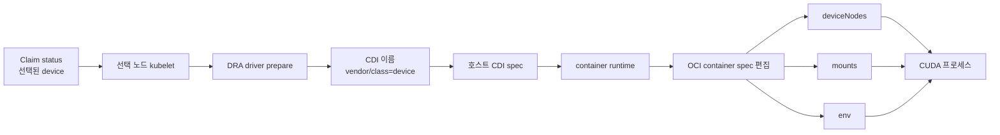
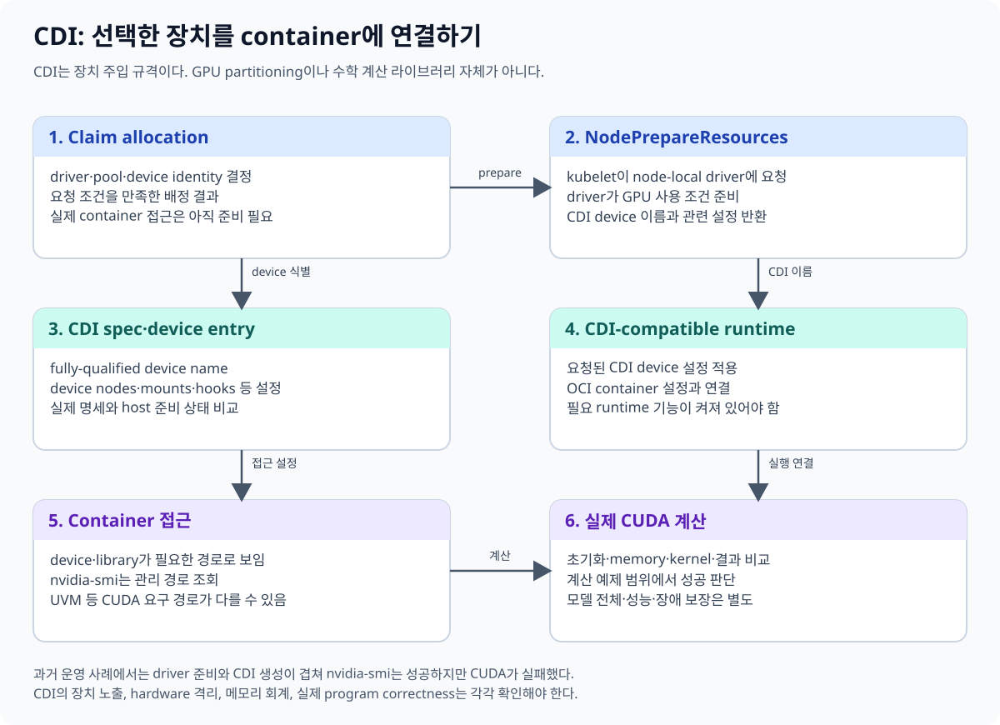
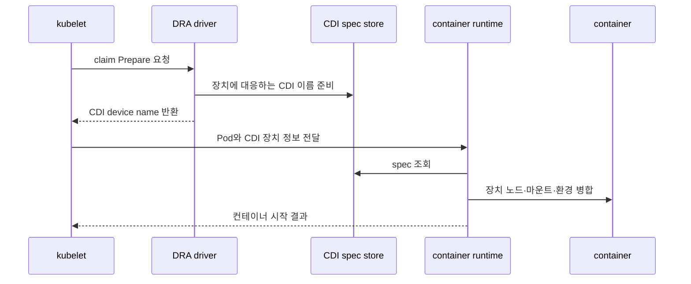
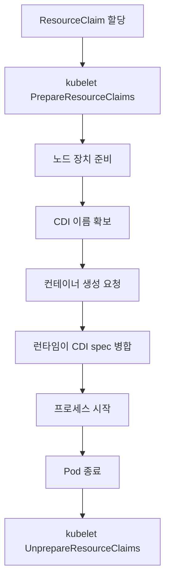
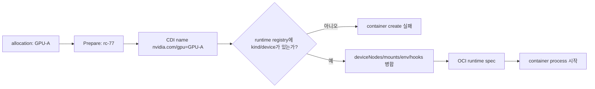

# 07. CDI와 컨테이너 런타임

CDI(Container Device Interface)는 컨테이너에 장치를 넣기 위한 표준 명세다.
## 07.0 CDI가 필요한 이유를 Linux 객체부터 이해한다

**CDI**, Container Device Interface는 장치 공급자가 컨테이너 runtime에 전달할 장치 주입 규칙의 표준 형식이다. 여기서 **장치 주입**은 선택된 GPU를 container 프로세스가 사용할 수 있도록 container 설정에 device file, mount, 환경 변수 같은 항목을 더하는 작업이다. CDI는 GPU를 고르는 scheduler도 아니고 GPU를 제어하는 kernel driver도 아니다. 이미 선택된 논리 장치 이름을 실제 container 설정으로 번역하는 계약이다.

Linux의 **device file**은 `/dev/nvidia0`처럼 kernel driver에 요청을 전달하는 특별한 파일이다. **mount**는 호스트 파일이나 디렉터리를 container 파일 트리의 경로에 연결하는 설정이다. **환경 변수**는 프로세스가 시작될 때 받는 이름과 문자열 값이다. **hook**은 runtime 생명주기의 정해진 시점에 보조 작업을 실행하는 확장 지점이다. hook은 강한 권한을 가질 수 있으므로 어떤 binary가 어떤 시점에 실행되는지 검토해야 한다.

**CDI spec**은 이러한 편집을 JSON이나 YAML 문서로 표현한 호스트 파일이다. 장치 공급 도구가 생성·갱신하고 CDI를 지원하는 runtime이 읽는다. spec 파일은 Kubernetes API 객체가 아니며 etcd에 저장되는 ResourceClaim도 아니다. 노드마다 존재하므로 node-a의 파일이 정상이어도 node-b에는 없거나 오래될 수 있다.



**OCI container spec**은 runtime이 실제 container 프로세스를 만들 때 쓰는 Linux 실행 설정이다. namespace, cgroup, mount, device 허용, process 환경 등이 들어 있다. CDI runtime은 원래 OCI spec을 지우지 않고 선택된 장치의 container edits를 병합한다.

## 07.1 fully-qualified name은 무엇을 가리키는가

`nvidia.com/gpu=GPU-1234` 같은 CDI 이름은 세 부분이다. `nvidia.com`은 공급자 domain, `gpu`는 장치 kind, `GPU-1234`는 그 kind 안의 device name이다. **fully-qualified**는 다른 공급자와 종류의 같은 이름이 충돌하지 않도록 세 부분을 모두 썼다는 뜻이다.

이 이름은 `/dev/nvidia0` 경로와 같지 않다. GPU UUID 같은 안정 식별자를 CDI device name으로 쓰고, spec이 현재 호스트의 `/dev/nvidia0`과 필요한 보조 device를 연결할 수 있다. 커널이 탐색 순서를 바꿔 device index가 달라져도 공급자 도구가 spec을 다시 생성해 대응할 수 있다. 실제 이름 형식은 설치된 NVIDIA toolkit과 driver 문서를 확인한다.

## 07.2 2노드·3장치·2Pod가 runtime에 도달하는 시간표

`node-a`에는 `gpu-a0`, `gpu-a1`, `node-b`에는 MIG instance `gpu-b0`이 있다. scheduler가 Pod A의 Claim을 `gpu-a0`, Pod B의 Claim을 `gpu-b0`에 할당했다고 하자.

| 시각 | 노드/주체 | 입력 | 중간 상태 | 결과 |
| --- | --- | --- | --- | --- |
| t=0.0 | API/scheduler | Claim A/B와 Slice | A→a0, B→b0 allocation | Pod node 결정 |
| t=0.3 | node-a kubelet | Claim A status | prepare(A) 요청 | driver 호출 |
| t=0.3 | node-b kubelet | Claim B status | prepare(B) 요청 | driver 호출 |
| t=0.5 | 각 DRA driver | device ID·Claim UID | node-local 준비 | CDI 이름 반환 |
| t=0.7 | 각 runtime | OCI spec·CDI 이름 | spec 파일 lookup | edit 병합 |
| t=0.8 | Linux runtime | 병합된 spec | namespace·mount·device 설정 | container process 시작 |
| t=1.0 | CUDA library | device file open | kernel driver context | GPU 사용 |
| t=10 | Pod B 종료 | 사용 참조 없음 | container 제거 후 unprepare | b0 준비 해제 |

node-a runtime은 node-a의 CDI spec만 읽는다. 중앙 API에 CDI 이름이 올바르게 기록돼도 그 노드 파일이 누락되면 container create가 실패한다. node-b의 MIG device는 물리 GPU 전체와 다른 device nodes나 설정을 요구할 수 있으므로 공급자 생성 spec을 임의로 축약해 복사하지 않는다.

## 07.3 prepare, CDI 생성, runtime 읽기의 수명

DRA driver의 **prepare**는 선택된 장치를 이 노드에서 Pod가 쓰도록 만드는 단계다. 구현은 device 활성화, partition 확인, 권한 준비, CDI 이름 결정 등을 수행할 수 있다. prepare가 끝나기 전에 runtime이 오래된 CDI spec을 읽으면 필요한 UVM device나 mount가 빠질 수 있다. 따라서 driver는 필요한 node 상태와 spec 갱신을 끝낸 뒤 성공을 반환해야 한다.

runtime은 container 생성 시 CDI 이름을 resolve한다. **resolve**는 이름에 해당하는 spec entry를 찾아 container edits로 바꾸는 작업이다. container가 이미 시작된 뒤 CDI 파일만 바꾼다고 실행 중 process의 mount와 device 허용이 자동 갱신되는 것은 아니다. 새 container 생성이나 명시적인 재시작이 필요한 이유다.

Pod가 끝나면 container를 먼저 정지하고 DRA driver가 unprepare한다. unprepare는 Claim의 node-local 준비를 해제하지만, 다른 Pod가 같은 공유 device를 사용 중이면 그 사용을 깨뜨리면 안 된다. driver는 Claim UID와 참조 상태를 구분해야 한다. CDI spec 전체를 무조건 삭제하면 같은 노드의 다른 container 생성도 실패할 수 있다.

## 07.4 CDI edit 각각의 역할과 위험

`deviceNodes`는 container 안에 보일 장치 경로와 접근 권한을 지정한다. `/dev/nvidia0` 하나만 보이면 충분하다고 가정하지 않는다. 제어 장치나 UVM 장치가 필요한 workload가 있다. UVM은 Unified Virtual Memory의 약자로 CPU와 GPU 메모리 주소 관리에 관련된 NVIDIA kernel 기능이다.

`mounts`는 host library나 socket, 설정 파일을 container 경로에 연결할 수 있다. host library를 image library 위에 덮으면 호환성을 맞출 수 있지만 어떤 파일이 최종으로 보이는지 추적하기 어려울 수 있다. mount source가 host에 없으면 runtime 단계에서 실패한다.

`env`는 `NVIDIA_VISIBLE_DEVICES`처럼 library나 toolkit이 읽는 힌트를 전달할 수 있다. 환경 변수만으로 kernel의 device 접근 권한이 생기지는 않는다. 반대로 device file이 보여도 올바른 사용자 library가 없으면 CUDA 초기화가 실패할 수 있다.

`hooks`는 container 시작 전후에 보조 처리를 수행할 수 있다. hook binary 누락, 실행 권한, 보안 정책, timeout이 실패 원인이 된다. 가능한 경우 declarative device node와 mount를 선호하고 hook 의존성을 운영 증거로 기록한다.

## 07.5 같은 증상에서 다른 원인을 가르는 표

| 증상 | 가능한 경계 | 구분할 증거 |
| --- | --- | --- |
| Claim 미할당 | selector·Slice·scheduler | Claim condition, scheduler event |
| prepare 실패 | node driver·device health | kubelet과 DRA driver log |
| `unresolvable CDI device` | 이름 불일치·spec 누락 | 요청 CDI 이름과 spec kind/device |
| container create mount 오류 | host source 누락 | runtime log와 host path |
| container 안 device 없음 | edit 미병합·device 권한 | 최종 OCI spec, container `/dev` |
| `permission denied` | Linux device cgroup·LSM | runtime 정책, audit log |
| CUDA driver mismatch | user library와 host driver | image library·driver version |
| 실행 중 Xid 오류 | GPU/driver runtime fault | kernel/GPU health event |

**LSM**, Linux Security Module은 AppArmor나 SELinux처럼 kernel에서 접근 정책을 검사하는 틀이다. CDI가 device node를 요청해도 LSM이나 runtime 정책이 거부할 수 있다. 문제를 해결하려고 container 전체를 privileged로 바꾸기 전에 필요한 경로와 거부 근거를 확인한다.

## 07.6 재시도와 terminal failure

CDI spec 파일을 쓰는 순간 runtime이 읽으면 부분 파일을 볼 위험이 있다. 공급자 도구는 임시 파일을 완성한 뒤 원자적으로 이름을 교체하는 방식처럼 일관된 갱신을 사용해야 한다. 일시적인 파일 갱신이나 runtime reload 지연은 재시도로 회복될 수 있다.

반면 선택된 device capability가 workload 요구와 맞지 않거나 runtime이 필요한 CDI version을 지원하지 않는다면 같은 container create를 반복해도 성공하지 않는다. 이는 구성 변경이 필요한 영구 실패다. DRA prepare의 terminal failure와 runtime create error는 표현 위치가 다를 수 있으므로 Claim condition, Pod status, kubelet/runtime log를 함께 본다.

driver가 prepare 성공 응답을 보낸 뒤 kubelet이 응답을 잃으면 같은 요청이 재시도될 수 있다. CDI spec 생성도 멱등해야 한다. 같은 Claim 재시도마다 서로 다른 device name을 만들거나 기존 entry를 무한 추가하면 정리와 재현성이 깨진다.

## 07.7 CDI는 성능 격리를 만들지 않는다

CDI가 두 Pod에 서로 다른 MIG device 이름을 전달했다면 각 container가 해당 instance에 접근하도록 연결하는 데 도움을 준다. 그러나 MIG profile을 실제로 만든 주체는 GPU/driver와 관리 구성요소다. time-slicing device 이름 두 개가 같은 물리 GPU로 연결되면 CDI는 그 공유를 숨기거나 성능을 보장하지 않는다. MPS server를 사용하는 구성도 별도 daemon과 policy가 필요하다.

단독 CUDA kernel 40 ms인 두 Pod가 같은 time-sliced GPU에서 완전 직렬로 실행되면 두 번째 요청은 대기 포함 80 ms가 될 수 있다. CDI spec이 정상이라는 사실은 이 queueing delay를 설명하거나 제한하지 않는다. 장치 등록 가능성과 SLO는 별도 측정 대상이다.

## 07.8 버전과 지원 범위

CDI spec version은 CDI 문서 형식과 runtime 해석 능력의 계약이다. Kubernetes DRA API version, NVIDIA driver version, CUDA version과 같은 숫자가 아니다. 각 계층의 버전을 별도로 기록한다. runtime이 생성된 CDI version을 지원하는지 확인한다.

Kubernetes DRA의 1.34 GA 역사와 1.35 stable/locked 상태는 API 측 사실이다. GPU Operator 26.7과 NVIDIA DRA driver가 해당 OS, Kubernetes, runtime, GPU에서 지원되는지는 공급자 platform matrix와 설치 문서를 별도로 확인한다. API 안정성이 runtime CDI 지원을 자동 설치하지 않는다.

## 07.9 추가 완전 풀이 문제

**문제 1.** Claim allocation에는 `gpu-a0`이 있지만 runtime이 `nvidia.com/gpu=gpu-a0`을 resolve하지 못한다. 어디를 보는가?

**해설.** allocation 선택은 끝났으므로 node-a의 CDI spec 디렉터리, spec의 kind와 device name, runtime CDI 지원 및 reload 상태를 비교한다. scheduler가 다른 장치를 고르는 문제로 바로 환원하지 않는다.

**문제 2.** CDI spec에 환경 변수만 있고 deviceNodes가 없다. 변수에 GPU UUID가 있으므로 kernel 접근도 가능한가?

**해설.** 아니다. 환경 변수는 사용자 공간 프로그램의 힌트다. Linux device 접근은 장치 파일과 runtime의 device 허용이 필요하다. 공급자 spec이 필요한 edit를 모두 포함했는지 본다.

**문제 3.** 실행 중 container의 CDI 파일을 수정했다. 새 mount가 즉시 나타나는가?

**해설.** 일반적으로 container 생성 때 OCI spec에 병합된 mount는 실행 중 파일 변경으로 자동 추가되지 않는다. 새 container 생성 또는 지원되는 명시적 절차가 필요하다. 파일 현재값과 실행 중 namespace 상태를 구분한다.

**문제 4.** Pod B가 끝나 CDI entry를 삭제했더니 Pod C 재시작이 실패했다. 가능한 원인은?

**해설.** 공유 device 또는 공통 spec을 다른 사용자가 필요로 하는데 참조 확인 없이 삭제했을 수 있다. Claim별 준비 상태와 device 공통 entry의 소유권을 나누고 마지막 사용자 뒤에 정리해야 한다.

**문제 5.** CDI 주입과 `nvidia-smi`가 성공했으므로 두 tenant의 p99 latency가 격리됐다고 말할 수 있는가?

**해설.** 아니다. 이는 장치 접근과 관리 API 경로의 성공 증거다. time-slicing, MPS, MIG profile, PCIe·CPU 경합에 따라 지연이 달라진다. tenant별 부하에서 p50/p99와 오류율을 측정해야 한다.
장치 공급자가 “어떤 장치 노드, 환경 변수, 마운트, hook이 필요한가”를 CDI 규격 파일로 표현하고,
CDI를 지원하는 런타임이 그 정의를 컨테이너 설정에 합친다.

CDI 자체는 CUDA도 아니고 GPU 격리 기술도 아니다.
CDI는 장치 주입 방법을 표준화한다.



## 7.1 CDI 장치 이름

CDI 장치는 fully-qualified device name으로 식별한다.

```text
vendor.com/class=device-name
```

교육용 예는 다음과 같다.

```text
nvidia.com/gpu=GPU-1234
```

`nvidia.com`은 공급자, `gpu`는 장치 종류, `GPU-1234`는 특정 장치 이름에 해당한다.
실제 이름과 지원 방식은 NVIDIA Toolkit이 만든 CDI spec을 확인해야 한다.

CDI 공식 명세는 [CNCF CDI 저장소](https://github.com/cncf-tags/container-device-interface)에서 관리된다.

## 7.2 spec에는 무엇이 있는가

개념적인 CDI spec은 다음 정보를 담는다.

```yaml
cdiVersion: "0.8.0"
kind: "nvidia.com/gpu"
devices:
  - name: "GPU-1234"
    containerEdits:
      deviceNodes:
        - path: /dev/nvidia0
      env:
        - NVIDIA_VISIBLE_DEVICES=GPU-1234
```

이 예시는 구조 설명용이며 실제 NVIDIA 생성 파일의 전체 표현이 아니다.
버전, 장치 노드, 마운트와 hook은 플랫폼 구성에 따라 달라진다.

## 7.3 런타임 주입 흐름



DRA에서 kubelet은 선택된 claim을 노드에서 사용할 수 있도록 준비한다.
드라이버는 장치 준비 결과에 CDI 장치 이름을 포함할 수 있다.
런타임은 그 이름으로 spec을 찾아 컨테이너 구성을 만든다.

NVIDIA Container Toolkit의 CDI 지원은
[공식 CDI 문서](https://docs.nvidia.com/datacenter/cloud-native/container-toolkit/latest/cdi-support.html)를 참고한다.

## 7.4 prepare와 컨테이너 시작은 같은 단계가 아니다



할당은 “어느 장치를 쓸지” 결정하는 제어 평면 단계다.
prepare는 그 노드에서 장치를 사용할 수 있게 만드는 단계다.
CDI 주입은 컨테이너 생성 설정에 장치 접근 요소를 합치는 단계다.

이 구분은 장애 분석에 유용하다.

| 증상 | 먼저 볼 경계 |
|---|---|
| claim이 할당되지 않음 | 스케줄러·DRA controller |
| claim은 할당됐지만 prepare 실패 | kubelet·노드 DRA plugin |
| prepare 성공 후 컨테이너 생성 실패 | CDI spec·runtime |
| 컨테이너가 시작됐지만 CUDA 실패 | driver·library·application |

## 7.5 UVM과 CDI 갱신 경합

NVIDIA Unified Virtual Memory(UVM) 장치 노드가 늦게 생기거나,
CDI spec 생성 시점과 장치 초기화 시점이 어긋나면 경합이 나타날 수 있다.

예를 들어 다음 순서를 생각하자.

1. Toolkit이 CDI spec을 생성한다.
2. 드라이버 초기화가 아직 끝나지 않아 UVM 관련 장치가 빠진다.
3. kubelet prepare가 성공한 것으로 보인다.
4. 런타임이 오래된 CDI spec으로 컨테이너를 만든다.
5. 애플리케이션이 UVM 장치를 요구할 때 실패한다.

이 문제를 “DRA가 GPU를 잘못 골랐다”라고만 해석하면 원인을 놓친다.
장치 준비 시점, CDI spec 갱신, 런타임이 읽은 spec을 함께 확인한다.

## 7.6 숫자로 보는 교육 예

노드에 GPU가 2개 있고 CDI 이름이 각각 다음과 같다고 하자.

```text
nvidia.com/gpu=GPU-A
nvidia.com/gpu=GPU-B
```

Pod P1의 claim이 GPU-A를, P2의 claim이 GPU-B를 받았다.
P1 런타임 요청에는 GPU-A의 fully-qualified name만 들어가야 한다.

| Pod | claim 결과 | CDI 이름 | 예상 장치 |
|---|---|---|---|
| P1 | GPU-A | `nvidia.com/gpu=GPU-A` | `/dev/nvidia0` 계열 |
| P2 | GPU-B | `nvidia.com/gpu=GPU-B` | `/dev/nvidia1` 계열 |

CDI spec이 두 장치를 모두 정의한다고 해서 P1에 둘 다 주입되는 것은 아니다.
런타임에 요청된 CDI 장치 이름이 컨테이너별 주입 범위를 정한다.

### 7.6.1 Prepare 결과가 실제 파일 편집으로 풀리는 예

GPU-A의 claim이 이미 할당됐다고 가정하자. Node plugin의 Prepare 결과와 CDI spec을 연결하면 다음 두 조각이 있다.

```text
Prepare 결과의 논리 참조
  claim uid: rc-77
  CDI device: nvidia.com/gpu=GPU-A

노드 CDI registry의 정의
  kind: nvidia.com/gpu
  device name: GPU-A
  container edits:
    /dev/nvidia0 추가
    /dev/nvidiactl 추가
    필요한 library mount 또는 hook
    NVIDIA_VISIBLE_DEVICES=GPU-A 같은 환경 편집
```

CDI registry 파일의 기본 검색 경로와 NVIDIA가 생성한 파일 이름은 runtime·Toolkit 설정에 따라 확인해야 한다. 중요한 점은 kubelet이 `/dev/nvidia0`을 문자열로 추측하는 것이 아니라 fully-qualified name을 넘기고, CDI-aware runtime이 registry에서 같은 kind와 device name을 찾아 편집을 합친다는 것이다.



다음은 교육용으로 줄인 CDI 문서와 OCI 편집 결과다. 실제 NVIDIA spec에는 더 많은 장치 노드와 mount, hook이 들어갈 수 있다.

```yaml
cdiVersion: "0.8.0"
kind: "nvidia.com/gpu"
devices:
  - name: "GPU-A"
    containerEdits:
      deviceNodes:
        - path: /dev/nvidia0
        - path: /dev/nvidiactl
      env:
        - NVIDIA_VISIBLE_DEVICES=GPU-A
```

```text
런타임이 container 생성 직전에 얻는 효과
  Linux devices: /dev/nvidia0, /dev/nvidiactl 접근 항목
  Environment:   NVIDIA_VISIBLE_DEVICES=GPU-A
  요청하지 않은 GPU-B 항목: 없음
```

오류 위치도 구체적으로 갈린다.

| 관찰 | 의미 | 다음 확인 |
|---|---|---|
| Prepare가 CDI name을 못 만듦 | node plugin이 allocation을 준비하지 못함 | plugin log, 장치 초기화 |
| CDI name은 반환됐지만 registry에 없음 | 이름과 spec snapshot 불일치 | 생성 시각, registry 검색 경로 |
| spec은 있으나 `/dev/nvidia0` 없음 | 오래된 spec 또는 driver device node 문제 | host device node, spec 재생성 |
| container에 node는 있으나 library load 실패 | 주입 이후 사용자 공간 경계 | image library와 host driver 호환성 |
| library load 후 kernel 실패 | 실행 경계 | 실제 CUDA 오류와 GPU 상태 |

CDI spec을 갱신했다고 이미 실행 중인 컨테이너의 OCI 구성이 자동으로 다시 작성되는 것도 아니다. Container creation 시점에 적용된 편집은 그 컨테이너의 수명 동안 유지된다. 장치 정의가 바뀌었다면 새 container가 어느 spec generation을 읽었는지 확인해야 한다.

반례로, `NVIDIA_VISIBLE_DEVICES=GPU-A` 환경 변수만 수동으로 넣었다고 CDI 주입과 같아지지 않는다. 필요한 device node, library mount, hook, cgroup 허용이 빠질 수 있다. 반대로 `/dev/nvidia0` 하나만 bind mount했다고 UUID와 minor number의 대응이 재부팅 후에도 같은지 보장되지 않는다. 논리 ID와 실제 편집을 CDI spec 한 곳에서 연결하는 이유다.

## 7.7 CDI가 보장하지 않는 것

CDI는 다음을 자동으로 보장하지 않는다.

- 장치의 보안 격리 강도
- GPU 메모리의 공정한 분배
- CUDA와 드라이버 버전 호환성
- NCCL 통신 성능
- claim 할당 정책의 적절성
- 애플리케이션의 수치 정확성

MIG, IOMMU, cgroup, 드라이버 기능과 Kubernetes 정책은 별도 계층에서 작동한다.

## 7.8 흔한 오해

**오해 1: CDI는 NVIDIA 전용이다.**
CDI는 공급자 중립 명세이며 NVIDIA는 이를 GPU 주입에 사용한다.

**오해 2: CDI 이름은 Linux 장치 경로다.**
CDI 이름은 spec의 논리 식별자다. spec이 실제 장치 노드와 설정을 연결한다.

**오해 3: CDI가 있으면 CUDA가 자동 설치된다.**
CDI는 주입 규격이다. 애플리케이션 이미지와 호스트 드라이버 호환성은 별도로 맞춘다.

**오해 4: prepare 성공은 애플리케이션 성공을 뜻한다.**
prepare 이후에도 런타임 주입, 라이브러리 로딩, 커널 실행 단계에서 실패할 수 있다.

## 7.9 확인 문제

1. fully-qualified CDI 장치 이름의 세 부분은 무엇인가?
2. DRA claim 할당과 CDI 주입의 차이는 무엇인가?
3. UVM 장치가 늦게 만들어졌을 때 어떤 세 요소를 함께 확인해야 하는가?
4. CDI가 GPU 격리를 보장한다고 말할 수 없는 이유는 무엇인가?

### 해설

1. 공급자, 장치 종류, 장치 이름이다.
2. claim 할당은 사용할 장치를 고르고, CDI 주입은 선택된 장치를 컨테이너 설정에 반영한다.
3. 장치 준비 시점, CDI spec 갱신 결과, 런타임이 실제 읽은 spec이다.
4. CDI는 장치 접근에 필요한 편집을 전달할 뿐 격리 메커니즘 자체가 아니기 때문이다.

---

[이전 장](06-dra-yaml-walkthrough.md) · [다음 장](08-sharing-mig-timeslicing-mps.md)
