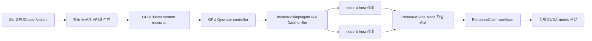
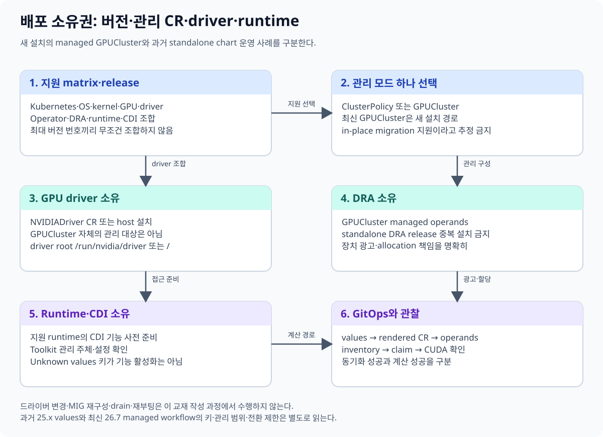
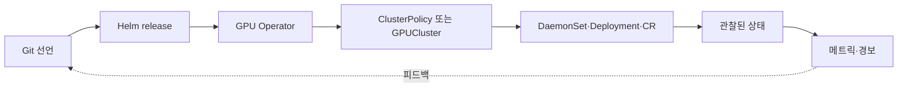
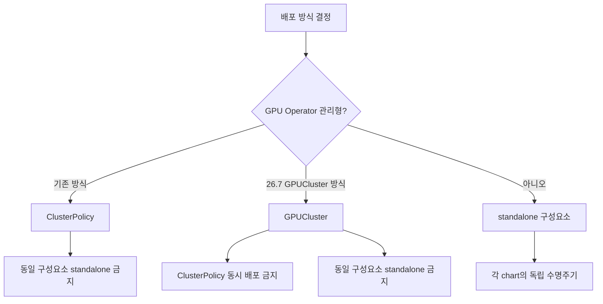

# 10. 배포, 호환성, GitOps

GPU 플랫폼 배포에서 가장 중요한 질문은 “어떤 YAML을 적용할까?”보다
## 10.0 배포 객체와 실제 노드 프로그램을 분리한다

**GPU Operator**는 Kubernetes API의 원하는 상태를 읽고 GPU node에 필요한 driver, container toolkit, device plugin, DRA driver, exporter 같은 구성요소를 배포·조정하는 controller다. controller는 API server를 watch하는 일반 Pod로 실행된다. 실제 kernel module은 GPU node의 Linux kernel에 있고, `/dev/nvidia*` 장치 파일도 node 파일 시스템에 있다. Operator Pod 안에 모든 GPU가 존재하는 것이 아니다.

**ClusterPolicy** 또는 최신 관리형 구성의 **GPUCluster**는 GPU 플랫폼의 원하는 구성을 적는 custom resource다. custom resource는 CRD가 Kubernetes API에 추가한 객체 형식이고, 실제 객체는 etcd에 저장된다. CRD는 필드 schema를 등록할 뿐 driver를 설치하지 않는다. 그 객체를 watch하는 Operator controller가 DaemonSet과 Deployment를 만들고 상태를 갱신한다.

**DaemonSet**은 선택된 각 node에 Pod 하나씩을 유지하는 workload controller다. driver container, toolkit, device plugin처럼 node마다 필요한 프로그램에 사용한다. **Deployment**는 정해진 replica 수의 교체 가능한 Pod를 유지하는 controller로 Operator 본체나 중앙 service에 흔히 쓴다. 어떤 구성요소가 host를 바꾸는 privileged DaemonSet인지, API만 보는 controller인지 구분해야 장애 범위를 안다.

## 10.1 원하는 상태와 관찰 상태의 전체 경로



Git 파일은 desired state의 원본일 수 있지만 node의 실제 kernel 상태를 직접 보여 주지 않는다. API의 GPUCluster status는 controller가 본 조정 결과다. DaemonSet Ready는 Pod가 준비 조건을 통과했다는 뜻이다. ResourceSlice는 driver가 device를 광고했다는 뜻이다. Claim allocation은 scheduler가 device를 선택했다는 뜻이다. CUDA test와 workload metric이 실제 계산 성공과 성능을 보여 준다.

**GitOps**는 Git에 저장한 선언을 controller가 cluster와 계속 비교해 맞추는 운영 방식이다. Git commit이 배포 성공을 뜻하지 않는다. GitOps controller의 sync, Operator reconciliation, node DaemonSet rollout, GPU 검증을 차례로 관찰해야 한다.

## 10.2 두 node 배포의 수치 trace

node-a에는 GPU 두 장, node-b에는 GPU 한 장이 있다고 하자. 기존 host driver를 OS image가 관리하고, Operator는 toolkit·device plugin·DRA driver를 관리하도록 정했다.

| 시각 | 주체 | 입력 | 실제 변화 | 증거 |
| --- | --- | --- | --- | --- |
| t=0 | GitOps controller | GPUCluster 선언 | API 객체 생성/갱신 | sync revision |
| t=2 s | Operator | desired spec | 세 DaemonSet 생성 | ownerReference |
| t=5 s | scheduler | node label·taint | node-a/b에 Pod 배치 | DaemonSet desired=2 |
| t=15 s | toolkit Pod | host runtime 설정 | runtime hook/CDI 준비 | Pod log |
| t=20 s | DRA driver | 세 GPU 탐색 | ResourceSlice 게시 | device inventory=3 |
| t=22 s | validator | 장치 열거/샘플 검사 | component condition | 성공 또는 reason |
| t=30 s | workload | Claim 2개 | scheduler allocation | Claim status |
| t=33 s | kubelet/runtime | prepare·CDI | container 생성 | kubelet·DRA 드라이버의 준비 RPC 결과와 runtime log |
| t=35 s | app | CUDA kernel | 실제 결과·latency | application metric |

GPUCluster Ready가 t=22에 나타나도 t=35의 모델 계산과 성능은 별도 검증이다. 반대로 workload 실패가 곧 Operator controller 장애라는 뜻도 아니다. image library와 driver 호환, Claim selector, CDI, VRAM peak 중 어디서 멈췄는지 본다.

## 10.3 소유권 충돌이 왜 위험한가

host driver를 OS image와 Operator가 동시에 관리하면 서로 다른 버전의 kernel module과 library를 번갈아 설치할 수 있다. NFD를 중앙 플랫폼 팀과 Operator가 각각 설치하면 같은 node label을 중복 갱신하거나 webhook·RBAC 이름이 충돌할 수 있다. device plugin을 standalone chart와 Operator가 둘 다 배포하면 같은 kubelet resource name과 socket을 경쟁할 수 있다.

따라서 구성요소마다 최종 소유자를 한 명 정한다. “비활성화” field를 values에 썼다고 실제 중복 Pod가 사라졌는지 확인해야 한다. 기존 release의 orphan DaemonSet이나 host file이 남을 수 있다. ownerReference, Helm release label, DaemonSet selector와 host path를 증거로 본다.

## 10.4 버전 행렬을 축으로 읽는다

**호환성 행렬**, compatibility matrix는 여러 축의 조합을 지원하는지 정리한 표다. GPU Operator 26.7 platform matrix를 읽을 때 Operator 버전만 보지 않는다.

- Kubernetes 버전과 배포판
- Linux distribution, kernel과 HWE 여부
- GPU model과 architecture
- NVIDIA driver branch
- containerd 또는 CRI-O 같은 runtime
- toolkit, device plugin, DRA driver
- MIG, MPS, confidential container 같은 선택 기능

표에 지원된다고 써 있어도 모든 조합의 성능을 보장하지 않는다. 지원은 설치·기능 문제에 대해 공급자가 시험하고 지원하는 범위다. 특정 모델의 throughput, p99, 전력 효율은 workload benchmark로 검증한다.

Kubernetes DRA가 1.34에서 GA가 된 역사와 1.35에서 stable/locked로 표시되는 feature gate 상태도 구분한다. API 안정성이 GPU Operator 버전의 자동 호환을 뜻하지 않는다. Operator release notes와 DRA driver 지원 범위를 같은 행에 맞춘다.

## 10.5 안전한 rollout과 rollback

두 node를 동시에 바꾸면 cluster의 GPU capacity가 한꺼번에 사라질 수 있다. 먼저 canary node 하나를 label로 골라 driver/toolkit/plugin 조합을 검증하고, Claim allocation과 CUDA sample, 실제 workload metric까지 통과한 뒤 확대한다. **canary**는 전체 배포 전에 작은 대상에서 같은 변경을 시험하는 방식이다.

kernel driver 변경은 단순 application Pod update보다 위험하다. 실행 중 GPU context가 끊길 수 있으므로 drain과 workload checkpoint 정책이 필요하다. **drain**은 node의 일반 workload를 다른 node로 이동시키기 위해 퇴거시키는 운영 절차다. 이 교재에서는 실제 cluster 명령을 실행하지 않는다.

rollback은 Git revision만 되돌리는 것으로 끝나지 않을 수 있다. host kernel module, CDI file, runtime config가 이미 변경됐으면 이전 Operator spec과 실제 host 상태가 맞는지 확인한다. database schema처럼 downgrade가 제한된 component도 release note를 따른다.

## 10.6 한 physical GPU에 두 workload가 있을 때

time-slicing replica 2를 선언해 node-b GPU 한 장을 두 Pod가 받았다고 하자. GitOps sync, Operator Ready, ResourceSlice 2단위, Claim 두 개의 allocation 기록, NodePrepareResources RPC, CDI 주입까지 모두 성공할 수 있다. 표준 `NodePrepared` condition은 없으며 준비 RPC의 결과는 kubelet·DRA 드라이버 로그에서 확인한다. 그 뒤 두 CUDA process가 각각 14 GiB를 요구하면 24 GiB VRAM에서 충돌한다. 단독 60 ms kernel도 동시 부하에서 queue 때문에 120 ms에 가까워질 수 있다.

배포 선언은 공유 정책을 활성화했음을 보여 주고 ResourceSlice는 논리 광고 결과를 보여 준다. 성능 격리와 memory safety는 workload metric, DCGM, 오류 로그로 확인한다. MIG profile을 사용하면 다른 경계가 생기지만 NIC·CPU·PCIe 같은 node 자원은 여전히 공유될 수 있다.

## 10.7 상태와 로그가 답하는 질문

GPUCluster condition은 Operator가 전체 구성의 desired/observed 상태를 어떻게 판단했는지 보여 준다. DaemonSet status는 node별 Pod 배치·Ready 수를 보여 준다. driver Pod log는 kernel module 준비, toolkit log는 runtime 설정, DRA driver log는 inventory와 prepare, kubelet log는 Pod·device 조정, runtime log는 CDI resolve와 container create를 설명한다. application log는 CUDA와 모델 오류를 설명한다.

한 로그의 “success”를 전체 성공으로 확대하지 않는다. component마다 입력과 출력 경계를 연결한다.

## 10.8 추가 완전 풀이 문제

**문제 1.** Git에는 driver 비활성화가 있는데 node에서 두 driver 관리 Pod가 보인다. 무엇을 확인하는가?

**해설.** 현재 sync revision, 다른 Helm release나 standalone 설치, DaemonSet ownerReference와 selector를 본다. 선언 하나만 읽고 실제 소유자가 하나라고 단정하지 않는다.

**문제 2.** Operator Ready이고 ResourceSlice에 GPU 3개가 있다. 실제 학습 성공이 증명됐는가?

**해설.** 아니다. 제어면 조정과 inventory 광고가 통과했다. Claim allocation, prepare, CDI/runtime, CUDA library 호환, VRAM과 모델 계산을 계속 검증한다.

**문제 3.** 두 node의 driver를 동시에 갱신했더니 모든 GPU Job이 멈췄다. 어떤 배포 설계가 부족했는가?

**해설.** canary, node 단위 rollout, workload drain/checkpoint, capacity budget이 부족했다. 먼저 한 node에서 전체 경로를 검증하고 서비스 가능한 GPU를 남기며 확대해야 한다.

**문제 4.** platform matrix에 지원됨으로 표시됐으므로 p99 100 ms가 보장되는가?

**해설.** 아니다. 지원 표는 버전·플랫폼 기능 범위다. sharing mode, model, batch, 동시 tenant 조건에서 p99를 직접 측정해야 한다.

**문제 5.** Git rollback 뒤에도 container create가 실패한다. 왜 가능한가?

**해설.** host driver, CDI spec, runtime config 같은 node 상태가 이미 바뀌었거나 이전 release와 호환되지 않을 수 있다. Git desired state, Operator status, node 실제 파일·module·runtime을 다시 대조한다.
“각 구성요소의 소유자는 누구이며 어떤 버전 조합을 지원하는가?”다.

이 장은 GPU Operator 26.7.1의 `GPUCluster` 관리형 워크플로를 기준 사례로 삼되,
모든 환경에 같은 설정을 복사하지 않는다.



## 10.1 먼저 소유권 표를 만든다

| 구성요소 | 가능한 소유자 | 한 환경의 최종 소유자 |
|---|---|---|
| GPU driver | GPU Operator / OS image / 별도 드라이버 관리자 | 하나 |
| Container Toolkit | GPU Operator / 노드 이미지 / 별도 배포 | 하나 |
| Device Plugin | GPU Operator / standalone chart | 하나 |
| DRA driver | GPU Operator / standalone chart | 하나 |
| NFD | GPU Operator / 공용 NFD 설치 | 하나 |
| DCGM Exporter | GPU Operator / 관측 스택 | 하나 |

여기서 “하나”는 같은 기능을 중복 배포하지 않는다는 뜻이다.
중앙 플랫폼 팀이 NFD를 관리하고 GPU Operator가 그 설치를 사용하도록 하는 구성은 가능하다.

## 10.2 선언과 관찰을 분리한다

Git의 Helm values는 원하는 상태다.
클러스터에서 실제 생성된 DaemonSet, Pod, CR 상태는 관찰된 상태다.



Git에 `enabled: true`가 있어도 Pod가 정상이라는 뜻은 아니다.
반대로 클러스터에서 수동으로 고친 값은 다음 GitOps 동기화 때 원래 선언으로 돌아갈 수 있다.

## 10.3 26.7.1 GPUCluster 워크플로

이 경로에서 `GPUCluster` 자체는 GPU driver를 관리하지 않는다. 아래 driver-CR 토글은 별도 `NVIDIADriver` CR을 생성하는 선택이다. 이미 host driver를 설치한 경우 공식 문서의 pre-installed driver 경로와 `driver.enabled=false`를 따른다. CDI-compatible runtime은 별도 준비 조건이다.

GPU Operator 26.7.1에서 GPUCluster 관리형 워크플로를 선택하는 설치 토글은 다음과 같다.

```text
--version v26.7.1
--set clusterPolicy.deployCR=false
--set gpuCluster.deployCR=true
--set driver.nvidiaDriverCRD.enabled=true
```

이 예는 해당 버전의 공식 절차를 읽기 위한 핵심 토글이다.
release 이름, namespace, repository 설정과 환경별 values는 별도로 필요하다.
[NVIDIA 26.7 DRA 설치 문서](https://docs.nvidia.com/datacenter/cloud-native/gpu-operator/26.7/dra-intro-install.html)를 그대로 기준으로 삼는다.

`GPUCluster`를 선택할 때 기존 `ClusterPolicy` CR도 동시에 배포하면 안 된다.
두 객체가 같은 하위 구성요소를 관리하려 하면 소유권이 모호해진다.

## 10.4 서로 배타적인 배포 경계



다음 조합은 피한다.

- `ClusterPolicy`와 `GPUCluster`가 동시에 같은 클러스터를 소유
- Operator가 DRA driver를 관리하는데 standalone DRA chart도 설치
- Operator가 device plugin을 관리하는데 별도 device plugin DaemonSet도 설치
- 노드 이미지가 드라이버를 관리하는데 Operator driver 설치도 활성화

## 10.5 in-place migration으로 가정하지 않는다

기존 ClusterPolicy 환경을 GPUCluster로 바꾸는 작업은 단순 CR 종류 변경이 아니다.
지원되는 무중단 in-place migration이라고 가정해서는 안 된다.

안전한 설계는 다음 단계를 별도의 변경으로 취급한다.

1. 현재 구성요소와 소유권을 목록화한다.
2. 지원 버전과 플랫폼 매트릭스를 확인한다.
3. 새 관리 모델의 원하는 상태를 별도 환경에서 검증한다.
4. GPU 워크로드 중단과 claim 수명 영향을 평가한다.
5. 복구 기준과 이전 상태 재구축 절차를 만든다.
6. 승인된 변경 창에 전환한다.

이 교재는 실제 클러스터에 파괴적인 전환 명령을 실행하는 실습을 제공하지 않는다.

## 10.6 드라이버 root 경로

컨테이너화된 드라이버 환경에서는 드라이버 컨테이너가 노출하는 root가
`/run/nvidia/driver`로 보일 수 있다.
호스트에 사전 설치된 드라이버는 호스트 root `/`를 기준으로 다룰 수 있다.

| 드라이버 관리 | 대표 root 해석 |
|---|---|
| Operator의 컨테이너화 드라이버 | `/run/nvidia/driver` |
| 호스트 사전 설치 드라이버 | `/` |

이 차이는 Toolkit, 검증, 라이브러리 탐색 설정에 영향을 준다.
경로를 복사하기 전에 실제 드라이버 소유 방식과 chart 값의 의미를 확인한다.

## 10.7 호환성은 축이 여러 개다

“Operator 최신 버전”만으로 호환성을 판단할 수 없다.

- Kubernetes 버전
- Linux 배포판과 커널
- GPU 모델과 아키텍처
- NVIDIA driver branch
- container runtime과 Toolkit
- MIG, DRA, MNNVL 같은 선택 기능
- CSP 또는 가상화 환경

최신 지원 조합은
[GPU Operator 플랫폼 지원 매트릭스](https://docs.nvidia.com/datacenter/cloud-native/gpu-operator/latest/platform-support.html)에서 확인한다.
Kubernetes와 DRA의 alpha·beta·GA 상태는 [14장](14-versions-and-feature-status.md)에서 따로 다룬다.

## 10.8 GitOps 저장소 구조 예

```text
clusters/
  research-a/
    gpu-operator/
      release.yaml
      values.yaml
      ownership.md
      compatibility.md
```

`ownership.md`에는 각 구성요소의 소유자를 쓴다.
`compatibility.md`에는 확인한 지원 매트릭스 날짜와 링크, 선택 버전을 쓴다.
values 파일만 남기면 나중에 왜 해당 토글을 선택했는지 알기 어렵다.

개념적인 선언은 다음처럼 환경 의도를 드러낸다.

```yaml
gpuPlatform:
  operatorVersion: v26.7.1
  apiModel: GPUCluster
  driverOwner: gpu-operator
  draOwner: gpu-operator
  nfdOwner: platform-team
```

이 YAML은 실제 GPU Operator CRD가 아니라 소유권 문서 예시다.

## 10.9 변경 전후 관찰 항목

| 시점 | 확인할 내용 |
|---|---|
| 변경 전 | 실행 중 GPU Pod, claim, 노드 드라이버, GPU 건강 |
| 동기화 중 | Operator 오류, CR 상태, DaemonSet rollout |
| 변경 후 | 노드별 driver/toolkit/plugin, CDI spec, 할당 시험 |
| 일정 시간 후 | Xid 오류, 할당 실패율, 재시작, 성능 기준 |

성공 기준은 “Helm 명령이 0으로 끝남”이 아니다.
원하는 하위 구성요소가 정확히 하나씩 있고, 노드와 워크로드 경로가 정상이어야 한다.

## 10.10 숫자로 보는 중복 배포

GPU 노드가 20대인 클러스터에서 device plugin DaemonSet을 두 개 배포했다고 하자.
각 DaemonSet이 노드마다 Pod 하나를 만들면 플러그인 Pod는 40개가 된다.

숫자가 두 배라는 사실보다 심각한 문제는 두 인스턴스가 같은 kubelet registration과
장치 상태를 다루려 할 수 있다는 점이다.
이 경우 “고가용성 2개”가 아니라 중복 소유다.

## 10.11 흔한 오해

**오해 1: Helm release가 Ready면 GPU 전체 경로도 정상이다.**
Operator와 하위 노드 구성요소, 실제 GPU 워크로드까지 단계별로 확인한다.

**오해 2: ClusterPolicy와 GPUCluster를 잠시 같이 두면 안전하다.**
동일 구성요소 소유가 겹치는 기간 자체가 위험하다.

**오해 3: standalone chart와 Operator 관리형을 같이 설치하면 이중화된다.**
같은 노드 기능의 중복 컨트롤러와 DaemonSet은 충돌 원인이 된다.

**오해 4: latest 문서의 값을 과거 버전에도 적용할 수 있다.**
설치한 chart 버전의 문서와 지원 매트릭스를 고정해서 본다.

## 10.12 확인 문제

1. 선언된 상태와 관찰된 상태는 어떻게 다른가?
2. GPUCluster 워크플로에서 ClusterPolicy 배포를 끄는 이유는 무엇인가?
3. `/run/nvidia/driver`와 `/`의 차이는 무엇에서 비롯되는가?
4. 지원 매트릭스를 확인할 때 최소 네 가지 축을 말하라.
5. device plugin 두 개를 배포하는 것이 고가용성이 아닌 이유는 무엇인가?

### 해설

1. 선언은 Git과 CR에 기록한 목표이고 관찰은 클러스터가 실제 만든 리소스와 상태다.
2. 두 API가 같은 GPU 플랫폼 구성요소를 동시에 소유하는 일을 막기 위해서다.
3. 드라이버가 컨테이너화되어 별도 root에 노출되는지, 호스트에 직접 설치됐는지의 차이다.
4. Kubernetes, OS·커널, GPU, driver, runtime·Toolkit, 선택 기능 등이 있다.
5. 동일 kubelet 장치 등록과 노드 자원을 서로 다른 인스턴스가 중복 관리하기 때문이다.

---

[이전 장](09-topology-and-compute-domains.md) · [다음 장](11-observability-and-troubleshooting.md)
