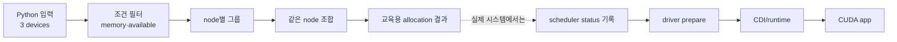
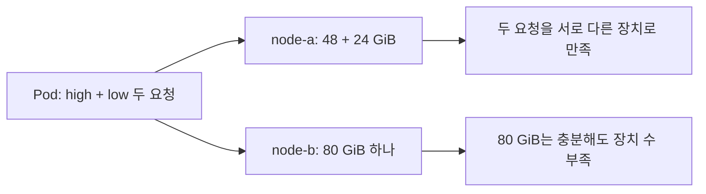
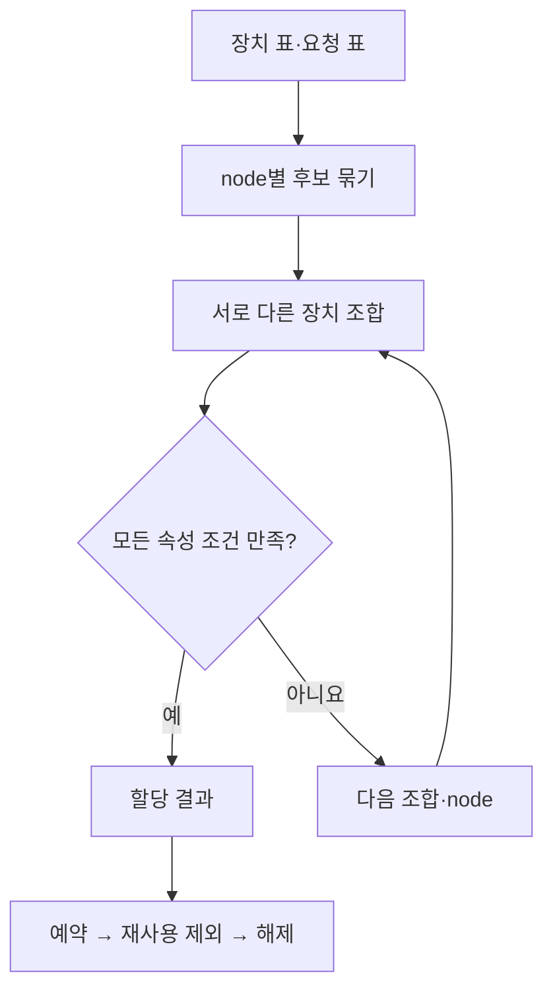

# 12. GPU 없는 로컬 모형 실습

이 장에서는 실제 GPU도 Kubernetes 클러스터도 설치하지 않는다. Python 표준 라이브러리로 **속성 조건과 같은 node 배치 조건을 동시에 만족시키는 작은 할당 문제**를 푼다. DRA 객체의 이름이 왜 필요한지 이해하기 위한 모형이며 실제 scheduler의 알고리즘·성능·동시성 구현을 대신하지 않는다.
## 12.0 로컬 모형이 표현하는 실제 시스템

**모형**은 복잡한 시스템에서 질문에 필요한 규칙만 남긴 작은 계산이다. 이 장의 Python 프로그램은 실제 kube-scheduler, API server, DRA driver를 실행하지 않는다. 장치 목록과 요청 조건을 메모리 안의 Python 객체로 만들고, 같은 node에서 조건을 만족하는 조합을 찾는다. 이 제한을 명시해야 모형의 결과를 실제 cluster 성능이나 지원 주장으로 오해하지 않는다.

실제 시스템에서 **Node**는 kubelet이 실행되는 서버 객체이고, **device**는 GPU 또는 MIG instance처럼 driver가 광고하는 장치 단위다. **ResourceSlice**는 driver가 device inventory를 API server에 게시하는 객체다. **DeviceClass**는 관리자가 허용한 장치 선택 정책이고, **ResourceClaim**은 workload가 원하는 장치 조건과 allocation 결과를 담는다. **ResourceClaimTemplate**은 replica마다 Claim을 만들기 위한 청사진이다.

**scheduler**는 Pod의 CPU·memory·affinity 조건과 Claim의 장치 조건을 함께 만족하는 node/device 조합을 찾는다. **prepare**는 선택 node의 kubelet이 DRA driver에게 장치를 실제 사용 상태로 만들도록 요청하는 단계다. **CDI**는 Container Device Interface의 약자로 runtime이 device file, mount, 환경 변수를 container 설정에 넣도록 하는 표준 명세다. 마지막으로 애플리케이션의 CUDA library가 kernel driver를 통해 GPU 계산을 시작한다. 로컬 모형은 이 전체 경로 중 후보 선택 산술만 재현한다.



점선 이후는 프로그램이 실행하지 않는 단계다. 모형이 `node-a/demo-48 + demo-24`를 골랐어도 실제 ResourceClaim status, NodePrepared, CDI file, CUDA 결과가 생긴 것은 아니다.

## 12.1 2노드·3장치·2Pod 입력을 손으로 계산한다

장치는 `node-a`의 `a0=48 GiB`, `a1=24 GiB`, `node-b`의 `b0=80 GiB` 세 개다. Pod A는 같은 node에서 40 GiB 이상 장치 하나와 20 GiB 이상 장치 하나를 요구한다. Pod B는 20 GiB 이상 장치 하나를 요구한다.

Pod A의 첫 요청 후보는 a0, b0이고 둘째 요청 후보는 a0, a1, b0이다. 같은 node 조건을 적용하면 node-a에서 a0+a1 조합만 가능하다. node-b에는 b0 하나뿐이라 두 독점 요청을 동시에 만족하지 못한다. Pod A를 먼저 배정하면 a0와 a1이 사용 중이 되고 Pod B는 b0을 고른다.

| 단계 | 사용 가능 집합 | 필터 결과 | 선택 |
| --- | --- | --- | --- |
| 초기 | a0, a1, b0 | high={a0,b0}, low={a0,a1,b0} | 없음 |
| Pod A node 조건 | node-a={a0,a1}, node-b={b0} | node-a만 요청 2개 충족 | A→a0,a1 |
| 사용 표시 | b0 | B low 후보={b0} | B→b0 |
| 최종 | 없음 | 두 Pod 모두 할당 | A node-a, B node-b |

순서를 바꾸면 다른 결과가 나올 수 있다. Pod B를 a0에 먼저 배정하는 탐욕 알고리즘은 Pod A를 배치하지 못하게 만들 수 있다. b0을 Pod B에 주면 모두 성공한다. 실제 scheduler는 atomic allocation과 scoring, 다른 Pod 조건을 고려하지만 이 모형은 모든 조합을 탐색하는 이유를 보여 준다.

**backtracking**은 한 선택이 뒤 요청을 막으면 이전 선택으로 돌아가 다른 후보를 시험하는 탐색이다. 장치 수가 커지면 조합 수가 빠르게 늘므로 실제 구현은 pruning, cache, 제한을 사용한다. 로컬 예제의 작은 입력에서 성공했다고 대규모 scheduler 성능을 주장할 수 없다.

## 12.2 상태를 명시해 실패와 rollback을 설명한다

교육용 장치 상태를 `available`, `tentative`, `allocated`, `prepared`, `in-use`, `released`로 나눠 보자. `tentative`는 조합을 계산하는 동안 임시로 잡은 상태다. 모든 요청을 만족하지 못하면 rollback으로 `available`에 돌려야 한다. 일부만 allocated로 남기면 다음 Pod가 실제보다 적은 capacity를 보게 된다.

| 시각 | 주체 | A 상태 | B 상태 | device 상태 |
| --- | --- | --- | --- | --- |
| t=0 | 모형 | pending | pending | a0,a1,b0 available |
| t=1 | 탐색 | tentative | pending | a0,a1 tentative |
| t=2 | 모형 commit | allocated | pending | a0,a1 allocated |
| t=3 | 탐색 | allocated | tentative | b0 tentative |
| t=4 | commit | allocated | allocated | 모두 allocated |
| 실제 t=5 | node driver | preparing | preparing | node-local setup |
| 실제 t=6 | runtime | running | running | CDI edits 적용 |
| 실제 t=10 | app 종료 | releasing | running | a0,a1 unprepare |
| 실제 t=11 | driver | released | running | a0,a1 available |

Python 모형의 rollback은 리스트의 `used` flag를 되돌리는 계산이다. 실제 DRA의 rollback/unprepare는 API allocation과 node-local partition, device 준비, CDI 같은 상태를 조정한다. process가 아직 실행 중인데 unprepare하면 안 된다. 마지막 사용이 끝난 뒤 정리해야 한다.

## 12.3 sharing을 모형에 넣을 때 생기는 함정

time-slicing replica 두 개를 단순히 device 두 개로 입력할 수 있지만 둘이 같은 physical GPU를 가리킨다는 관계를 잃는다. 각 replica의 `memory_gib=24`로 두면 Pod 두 개가 합계 48 GiB를 안전하게 쓸 수 있다는 잘못된 결론을 낼 수 있다. 실제 physical VRAM은 24 GiB이고 고정 partition이 아니다.

MIG instance는 profile별 memory partition을 device로 모델링할 수 있지만 PCIe·CPU·전력 같은 shared parent를 별도 제약으로 넣어야 한다. MPS는 process 실행 공유 방식이므로 단순 device 개수보다 daemon 수명, client 제한, memory와 compute quota를 모델링해야 한다.

따라서 입력 schema에 `physical_parent`, `sharing_mode`, `memory_isolated`, `compute_fraction`을 추가할 수 있다. 그래도 vendor hardware scheduler와 CUDA allocator의 실제 동작을 완전히 재현하지 않는다. 모형은 어떤 가정을 했는지 코드와 출력에 표시해야 한다.

## 12.4 실패를 실제 계층과 연결한다

모형이 `no feasible allocation`을 반환하면 같은 node에 충분한 후보가 없다는 수학적 결론이다. 실제 cluster에서는 ResourceSlice가 stale이거나 selector key가 틀려 후보가 누락될 수 있다. 모형 성공 뒤에도 API status write conflict, prepare terminal failure, CDI resolve 오류, driver/library 불일치, CUDA OOM이 남는다.

반대로 실제 Pod가 느리다고 로컬 allocation 함수를 고칠 이유는 없다. Claim과 NodePrepared가 성공했다면 GPU queue, VRAM pressure, CPU data loader, PCIe와 network를 측정해야 한다. 상태마다 책임 주체와 관찰 증거를 연결한다.

## 12.5 결과 보존과 재현성

**재현성**은 같은 코드, 입력, version에서 같은 결과를 다시 얻을 수 있는 성질이다. device 목록 순서에 따라 결과가 달라지지 않도록 정렬 기준을 명시하고, random이 있다면 seed를 고정한다. 입력과 expected output을 코드와 함께 보존한다.

실제 실험에서는 Kubernetes version, Operator와 DRA driver version, GPU model, driver, runtime, sharing mode도 기록한다. local model 출력과 실제 cluster 출력 파일을 섞지 않는다. retention은 결과를 얼마나 오래 보존할지 정하는 정책이다. 짧은 process ID보다 Pod UID, Claim UID, experiment ID를 안정 상관 키로 쓴다.

## 12.6 숫자 실험 세 가지

실험 A는 Pod A만 배치한다. 예상 결과는 node-a의 a0+a1이다. 실험 B는 Pod B를 먼저 a0에 고정한다. 남은 a1, b0은 서로 다른 node라 Pod A 실패다. 실험 C는 전체 탐색으로 B→b0을 선택한 뒤 A→a0+a1을 선택한다. 탐욕과 전역 조합 탐색의 차이를 보여 준다.

성능 숫자는 별도다. a0와 a1이 같은 PCIe root에서 각각 100 ms 계산하고 통신 40 ms가 필요하면 step 단순 합은 140 ms다. 서로 다른 node라면 이 Pod 구조 자체가 불가능하고, 여러 Pod와 network 통신을 포함한 다른 workload 모델이 필요하다.

## 12.7 모형에서 실제 실험으로 넘어갈 때의 검증 계약

로컬 함수의 반환값은 `allocation={A:[a0,a1], B:[b0]}`처럼 장치 이름의 조합이다. 실제 DRA 실험의 성공 조건은 더 길다. API server가 ResourceClaim을 승인하고, scheduler가 같은 node/device 조합을 Claim status에 기록하고, 각 kubelet이 prepare를 완료하고, runtime이 CDI를 적용하고, CUDA 프로그램이 기대한 수치 결과를 내며, 종료 뒤 unprepare로 세 장치가 다시 후보가 되어야 한다.

각 경계를 boolean 하나로 합치지 않고 다음처럼 결과 record를 만든다.

| 필드 | 값 예시 | 실패 의미 |
| --- | --- | --- |
| `model_feasible` | true | 교육용 조건 조합 존재 |
| `claim_allocated` | true | scheduler 선택 기록 |
| `node_prepare_rpc_ok` | true | 교육 모형에서 NodePrepareResources RPC 성공을 나타내는 가상 값이며 표준 API condition이 아님 |
| `runtime_created` | true | CDI를 포함한 container 생성 |
| `cuda_result` | expected checksum | 실제 계산 정확성 |
| `p99_ms` | 140 | workload 응답 지연 |
| `unprepared` | true | node-local 상태 정리 |
| `inventory_restored` | 3 | capacity 반환 |

예를 들어 앞의 여섯 필드가 성공해도 `p99_ms=140`이고 SLO가 100 ms이면 성능 실험은 실패다. `cuda_result`가 맞아도 `unprepared=false`이면 다음 반복의 초기 상태가 달라져 재현 실험으로 사용할 수 없다. 기능 성공, 성능 성공, 정리 성공을 독립 판정한다.

실험을 반복할 때 첫 실행의 cache warm-up이 시간을 줄일 수 있다. 첫 회 220 ms, 이후 네 회가 140, 138, 142, 140 ms라면 warm-up을 별도 표시하고 steady-state 중앙값 140 ms를 보고한다. 첫 값을 몰래 버리지 않고 제외 기준을 사전에 적는다. 실제 GPU가 없는 이 장에서는 숫자 계산만 보여 주며 어떤 하드웨어 성능도 주장하지 않는다.

## 12.8 추가 완전 풀이 문제

**문제 1.** high 요청 후보가 a0,b0이고 low 후보가 a0,a1,b0다. 같은 node 두 장을 요구할 때 가능한 조합은?

**해설.** node-a의 a0+a1만 가능하다. node-b에는 b0 한 장뿐이다. 전체 후보 수가 세 개라는 사실보다 같은 node 제약이 우선한다.

**문제 2.** Pod B를 a0에 먼저 주자 Pod A가 실패했다. cluster capacity가 본질적으로 부족한가?

**해설.** 아니다. B→b0, A→a0+a1 조합이면 모두 성공한다. 첫 후보를 고정한 탐욕 선택이 문제이며 backtracking 또는 더 나은 scoring이 필요하다.

**문제 3.** 로컬 모형이 성공하면 ResourceClaim도 실제로 생성됐는가?

**해설.** 아니다. Python 메모리의 교육용 결과일 뿐 API server, scheduler, driver를 호출하지 않았다. 실제 객체와 node 상태는 전혀 변경되지 않는다.

**문제 4.** 24 GiB time-slicing replica 두 개를 각각 24 GiB device로 모델링하면 어떤 오류가 생기는가?

**해설.** 물리 parent의 VRAM 24 GiB를 두 번 계산해 48 GiB처럼 보일 수 있다. parent 관계와 memory isolation 부재를 모델에 넣거나 이 결과를 용량 보장에 사용하지 않아야 한다.

**문제 5.** 실제 Claim은 Allocated인데 CUDA OOM이다. allocation 모형의 실패인가?

**해설.** 반드시 그렇지 않다. 모형은 광고 capacity와 배치 조건을 계산한다. CUDA allocator의 peak, sharing tenant, 임시 buffer는 별도 실행 단계다. DCGM과 app memory trace를 조사한다.

## 12.1 입력과 가정부터 고정하기

장치 이름과 용량은 직접 만든 교육용 값이다. 실물 GPU 제품의 사양을 나타내지 않는다. `GiB`는 2의 거듭제곱 기반 단위이고, 표에서는 장치가 광고한 단순 속성 값으로만 사용한다.

| node | 장치 이름 | memory_gib | 사용 가능 |
| --- | --- | --- | --- |
| node-b | demo-80 | 80 | 예 |
| node-a | demo-48 | 48 | 예 |
| node-a | demo-24 | 24 | 예 |

한 Pod에 두 container가 있고 각각 다른 장치 하나를 요청한다고 가정한다. 같은 Pod의 container는 같은 node에 있어야 한다. 전체 클러스터에 장치가 두 개 이상 있다는 사실만으로 충분하지 않다.

| 요청 이름 | 조건 | 개수 |
| --- | --- | --- |
| high | memory_gib >= 40 | 1 |
| low | memory_gib >= 20 | 1 |

이 모형은 장치를 독점 할당한다. 같은 물리 GPU를 두 번 선택하지 않는다. MIG, MPS, time-slicing, consumable capacity, admin access, quota와 queue, topology link는 구현하지 않는다. 그런 조건은 해당 기능을 지원하는 API·driver·정책에서 따로 확인한다.



## 12.2 먼저 손으로 할당하기

high에 node-a의 demo-48을 주고 low에 demo-24를 주면 두 조건을 모두 만족한다. high에 node-b의 demo-80을 먼저 주면 node-b에는 low에 줄 다른 장치가 없다. 이때 low만 node-a로 보내면 같은 Pod의 node 제약을 깨뜨린다.

따라서 “조건을 만족하는 첫 장치를 하나씩 고른다”는 접근과 “Pod 전체의 요청을 같은 node에서 함께 만족한다”는 접근은 결과가 다를 수 있다. 실제 Kubernetes에서 모든 세부 제약을 이 모형과 동일한 순서로 처리한다고 주장하지 않는다.

## 12.3 실행 파일과 예상 출력

[allocation_model.py](examples/allocation_model.py)는 `dataclass`, `itertools` 등 Python 표준 기능만 쓴다. 저장소 최상위에서 실행한다.

```bash
python3 learning/gpu-operator-dra/examples/allocation_model.py
```

기준 입력의 출력은 다음과 같다. **2026-10-10에 Python 3.12.3으로 이 모형을 실행해 아래 값과 일치함을 확인했다.** 이 실행은 표 기반 모형만 확인하며 실제 GPU·Kubernetes·NVIDIA driver를 검증하지 않는다.

```text
case_1: node=node-a high=demo-48 low=demo-24
case_2: unsatisfied
case_3: unsatisfied
after_release: node=node-a high=demo-48 low=demo-24
```

case_1은 위 요청을 처리한다. case_2는 같은 node에서 40 GiB 이상 장치 두 개를 요구해 실패한다. case_3은 case_1의 장치를 예약한 뒤 같은 두 장치를 다시 요구해 실패한다. release 이후에는 다시 성공한다.

모형에서 release는 선택된 이름을 예약 집합에서 제거하는 조작이다. 실제 DRA의 Pod 삭제·claim owner reference·reservedFor·driver unprepare 동작을 이 한 줄로 대체하지 않는다. 실제 생애는 [05장](05-dra-allocation-lifecycle.md)을 따른다.

## 12.4 코드의 네 부분

| 코드의 부분 | 배우는 의미 |
| --- | --- |
| `Device` | 장치 identity·node·속성 값의 구별 |
| `Request` | 업무 요청에 붙는 이름과 선택 조건 |
| `allocate` | 같은 node의 서로 다른 장치 조합을 평가 |
| `reserved` | 이미 쓰는 장치를 다시 할당하지 않는 단순 가정 |

프로그램은 가능한 조합을 전부 검사한다. 장치가 많은 현실 환경의 효율적인 알고리즘이 아니다. 모든 조합을 검사하면 두 요청의 속성과 공동 배치 조건을 설명하기 쉽다는 교육적 선택이다. 탐색 순서도 성능·공정성 정책이라고 해석하지 않는다.



## 12.5 바꿔 보는 문제

1. node-b에 demo-40을 추가한다. 40 GiB 이상 두 장치 요청이 이제 가능한지 계산한다.
2. low의 최소 메모리를 30으로 바꾼다. 기준 node-a는 48과 24이므로 두 요청을 함께 만족하지 못한다.
3. high와 low를 별도 Pod라고 가정한다. 같은 node 조건이 없어지면 어떤 조합이 추가되는지 설명한다.
4. 48 GiB 장치를 time-slicing으로 두 논리 slot처럼 광고했다고 가정한다. 두 slot이 각각 48 GiB의 독립 VRAM이라고 계산하면 왜 틀리는지 말한다. 코드의 장치를 복제하는 것으로 실제 격리 구현을 대체하지 않는다.
5. `memory_gib` 값이 같아도 PCIe·NVLink 연결이 다르면 통신 성능도 같은가? 이 모형에 topology 제약이 없다는 한계를 찾아낸다.
6. 예약 집합을 지우면 실행 중인 실제 GPU process도 종료되는가? 이 프로그램은 실제 장치나 process에 접근하지 않으므로 그런 부작용은 없다.

## 12.6 실제 클러스터 관찰로 연결하기

이후 GPU 환경이 준비됐을 때는 아래와 같은 **조회 명령 예시**로 API 상태를 읽는다. 이번 교재 작성 과정에서 실행한 명령이 아니다. 자신의 context와 namespace를 명시한다.

```text
kubectl --context YOUR_CONTEXT get deviceclasses
kubectl --context YOUR_CONTEXT get resourceslices
kubectl --context YOUR_CONTEXT -n YOUR_NAMESPACE get resourceclaims
kubectl --context YOUR_CONTEXT -n YOUR_NAMESPACE describe pod YOUR_POD
```

DeviceClass는 선택 규칙, ResourceSlice는 광고된 inventory, ResourceClaim status는 allocation·reservation 결과다. 각각을 모형의 요청·장치 표·할당 결과와 대응해 본다. 그리고 **container에서 실제 CUDA 계산이 성공했는가**는 별도로 확인한다.

API 객체 조회만으로 driver 준비, CDI injection, 라이브러리 호환성, 실제 계산을 모두 검증했다고 주장하지 않는다. 이 경계를 구분하는 것이 [11장](11-observability-and-troubleshooting.md)의 목표다.

## 12.7 이해 확인

**문제:** 클러스터에 80 GiB 장치 하나와 48 GiB 장치 하나가 서로 다른 node에 있다. 한 Pod에 장치 두 개를 독점 할당할 수 있는가? **해설:** 다른 조건이 같아도 이 모형의 같은 node 조건을 만족하지 못한다. 여러 node를 쓰려면 여러 Pod 등 별도의 분산 실행 구조가 필요하다.

**문제:** ResourceClaim은 model weights와 실행 process를 자동 복원하는 checkpoint인가? **해설:** 아니다. 장치 요청과 할당 상태의 API 객체다. 모델 상태·학습 checkpoint·process 복구는 다른 구성요소의 책임이다.

[이전: 관측과 진단](11-observability-and-troubleshooting.md) · [다음: 연구 사례](13-research-and-lab-cases.md) · [목차](README.md)
