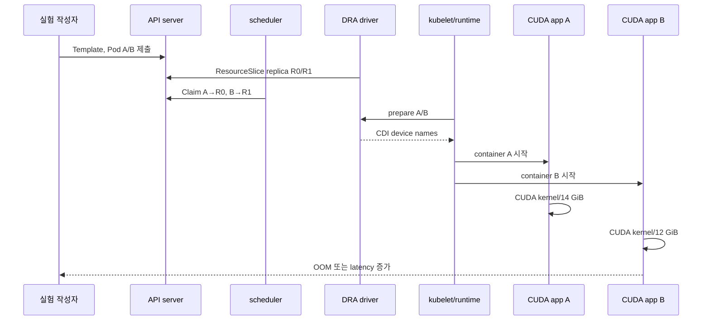
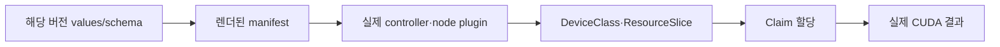
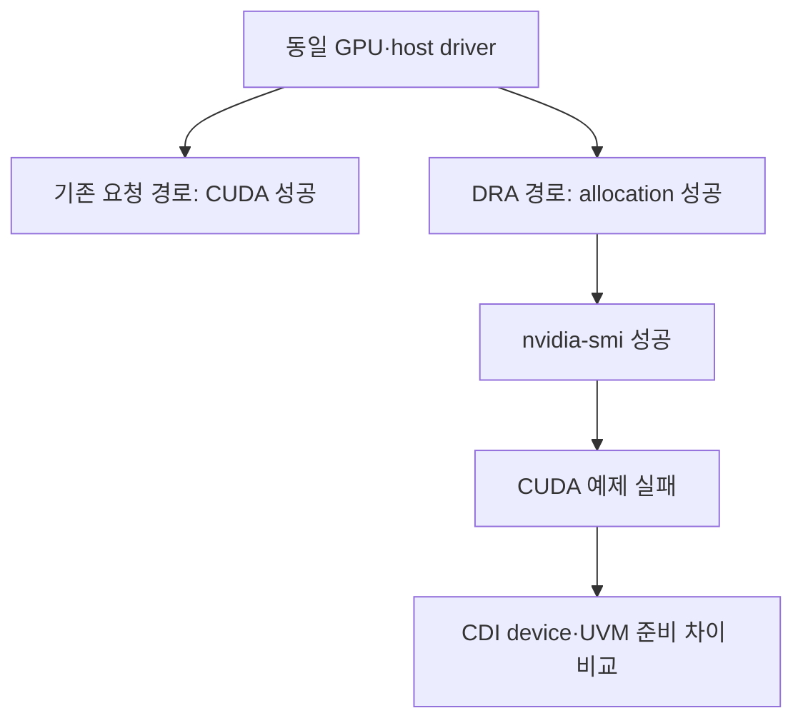
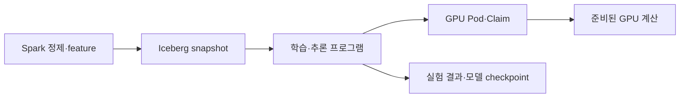

# 13. 연구와 실제 운영 기록을 연결하기

이 저장소에는 실제 GPU 운영 사례가 있다. 그 기록은 일반 개념을 이해하는 좋은 출발점이지만 날짜·클러스터·버전의 범위를 지켜 읽는다. 과거 설치가 성공한 사실과 최신 설치가 지원되는 사실은 다른 근거다.
## 13.0 운영 기록과 연구 결과는 어떤 종류의 증거인가

**운영 기록**은 특정 날짜, cluster, version, 장비에서 사람이 수행한 변경과 관찰을 남긴 문서다. 같은 명령이 한 번 성공했다는 강한 현장 증거지만 다른 version과 GPU에서도 지원된다는 보편 법칙은 아니다. **연구 결과**는 명시한 가설, workload, 비교 기준, metric으로 실험한 결과다. 평가 조건이 다른 운영 환경에 숫자를 그대로 옮길 수 없다.

이 장에서 **실험 단위**는 하나의 변경과 그 결과를 연결할 수 있는 최소 묶음이다. 예를 들어 “DRA driver version만 바꾸고 같은 Pod 요청의 allocation latency를 비교”가 한 단위다. Operator, kernel, sharing mode, model까지 동시에 바꾸면 어느 변화가 결과를 만들었는지 알기 어렵다.

## 13.1 하나의 GPU 요청을 연구 기록으로 남기는 전체 trace

node-a에 24 GiB GPU 한 장을 time-slicing replica 두 개로 광고하고 Pod A와 B가 각각 하나를 요청한다고 하자. 기록은 다음 단계의 입력·주체·상태·결과를 분리한다.

| 시각 | 보존할 증거 | 해석 범위 |
| --- | --- | --- |
| t=0 | manifest와 Git revision | 원하는 요청 |
| t=1 | ResourceSlice snapshot | 광고 inventory |
| t=2 | Claim status·scheduler event | 선택된 장치와 node |
| t=3 | kubelet·DRA driver의 준비 RPC log | NodePrepareResources 성공·실패 |
| t=4 | CDI 이름·runtime log | container 주입 |
| t=5 | image digest·driver/CUDA version | 실행 환경 |
| t=6 | app output·DCGM metric | 계산·메모리·성능 |
| t=7 | Pod 삭제·unprepare log | 정리와 capacity 반환 |

이 trace에서 Claim 할당 시간은 t=1→t=2 구간이고, application throughput은 t=5 이후 계산 결과다. allocation이 500 ms에서 300 ms로 줄어도 kernel throughput이 증가했다고 말할 수 없다. 반대로 throughput이 느려져도 scheduler가 원인이라는 증거는 아니다.

## 13.2 비교 실험의 변수와 대조군

**독립 변수**는 연구자가 바꾸는 값이다. 예를 들어 sharing mode를 whole GPU, MIG, time-slicing, MPS로 바꾼다. **종속 변수**는 결과로 측정하는 값이며 throughput, p99 latency, OOM 수, energy가 예다. **통제 변수**는 비교 사이에 같게 유지하는 model, batch, input, driver, clock, node temperature 등이다.

**대조군**, baseline은 새 정책과 비교할 기준이다. GPU sharing 연구에서 전용 GPU 또는 기존 scheduler를 baseline으로 둘 수 있다. baseline이 다르면 “20% 향상”의 분모도 달라진다. 결과 표에는 절대값과 상대값을 함께 쓴다. 100 req/s에서 120 req/s는 20% 증가지만 p99가 100 ms에서 400 ms가 됐다면 interactive QoS는 악화됐다.

반복 5회의 throughput이 100, 101, 99, 140, 100이라면 평균은 108이지만 140이 outlier다. median은 100이다. 단순 평균 하나보다 분포, warm-up, 반복 수, confidence interval을 기록한다. **confidence interval**은 같은 절차를 반복할 때 추정값의 불확실 범위를 나타낸다.

## 13.3 DRA 제어면과 데이터면 metric을 분리한다

**제어면**은 API 객체를 생성하고 장치와 node를 선택하며 prepare를 지시하는 경로다. allocation latency, pending duration, prepare retry count가 제어면 metric이다. **데이터면**은 실제 workload 데이터와 GPU kernel이 흐르는 경로다. samples/s, token/s, p99, GPU utilization, VRAM, PCIe/NVLink throughput이 데이터면 metric이다.

ResourceSlice 등록 성공은 driver inventory 경로를 증명한다. Claim allocation은 scheduler 결정을 증명한다. NodePrepareResources RPC 성공은 kubelet·DRA driver 로그에서 확인하며 표준 `NodePrepared` condition은 없다. CDI/runtime 성공은 device 접근을 증명한다. CUDA sample은 작은 계산을 증명한다. 실제 모델의 정확도와 성능, tenant isolation은 마지막 workload 실험으로만 평가한다.

## 13.4 sharing 연구를 재현할 때

24 GiB GPU에서 Pod A와 B가 각각 14 GiB, 12 GiB를 요구하면 time-slicing은 합계 26 GiB peak 때문에 OOM 가능성이 있다. MIG는 profile별 고정 메모리 구획 때문에 애초에 이 조합을 만들 수 없거나 각 workload 요구에 맞는 profile이 필요하다. MPS는 client별 memory와 active thread 설정, daemon 수명을 명시해야 한다.

단독 A가 50 ms, 단독 B가 70 ms라고 하자. 동시 실행에서 A p99 140 ms, B p99 180 ms라면 단독 대비 slowdown은 각각 2.8배와 약 2.57배다. throughput 합이 늘었더라도 latency SLO가 100 ms라면 실패다. “GPU utilization이 높아졌다”만으로 좋은 결과라고 결론내리지 않는다.

IWQoS 2024 GPU sharing 연구를 인용할 때 논문이 사용한 GPU, model, tenant 수, arrival pattern, 비교 정책, fairness와 QoS metric을 적는다. Kubernetes 기본 scheduler나 DRA가 논문 정책을 자동 구현한다고 쓰지 않는다.

## 13.5 topology와 network 연구를 재현할 때

다중 GPU 학습은 NCCL collective와 network를 포함한다. GPU 두 장 할당은 NVLink 사용을 보장하지 않는다. 다른 node의 GPU는 NIC, route, MTU, RDMA driver와 fabric 조건이 맞아야 한다. PeRF 계열 RDMA 연구 결과는 특정 network hardware와 message size에서 측정된 결과다.

4 GiB gradient를 40 GiB/s 경로로 보내는 단순 하한은 100 ms이고 16 GiB/s면 250 ms다. 실제 all-reduce는 여러 rank와 protocol overhead가 있다. topology-aware scheduler 연구를 비교하려면 device allocation뿐 아니라 link map과 통신 행렬, job completion time을 기록한다.

## 13.6 실패 실험과 rollback도 결과다

실험 중 prepare가 terminal failure라면 같은 manifest 재적용 횟수를 성능 표본으로 세지 않는다. terminal은 구성이나 capability를 바꾸기 전에는 같은 입력이 회복되지 않는다는 의미다. 일시 timeout은 retry 횟수와 backoff를 기록한다.

rollback은 Git revision을 되돌리는 행위만이 아니다. Pod 종료, Claim release, NodeUnprepareResources, CDI/runtime 상태 정리, ResourceSlice capacity 반환까지 확인한다. driver나 kernel 변경은 node reboot 또는 module 상태 복원이 필요할 수 있다. 실패한 실험의 잔여 상태가 다음 실험에 영향을 주면 표본이 독립적이지 않다.

**retention**은 manifest, log, metric, output을 보존하는 기간이다. Pod UID와 Claim UID, device UUID, image digest, UTC timestamp를 experiment ID와 연결한다. credential과 Secret 원문은 수집하지 않는다. raw log와 요약 결과를 구분해 나중에 재계산할 수 있게 한다.

## 13.7 과거 기록을 최신 지원 주장으로 바꾸지 않는다

2026-06 기록의 Operator 25.x와 별도 DRA chart가 성공했다면 그 날짜의 구성 증거다. 26.7의 GPUCluster 관리 방식과 migration 경로는 26.7 공식 문서와 matrix를 근거로 다시 판단한다. 과거 host driver root나 CDI race 해결책이 새 release에도 필요한지 release note와 실제 상태로 확인한다.

Kubernetes DRA의 1.34 GA 역사, 1.35 stable/locked gate, 현재 문서의 API는 core 기능 근거다. NVIDIA DRA driver의 DynamicMIG 같은 개별 기능 단계와 GPU 지원 범위는 vendor 구현 근거다. core stable을 vendor 모든 기능 stable로 일반화하지 않는다.

## 13.8 완전한 연구 기록 예시

가설은 “time-slicing replica 2가 전용 대비 합산 throughput을 높이지만 p99를 악화시킬 수 있다”다. 독립 변수는 sharing mode, 종속 변수는 합산 req/s와 tenant별 p99·OOM, 통제 변수는 node, GPU, driver, image digest, model, batch다. 전용 baseline을 각 tenant 단독으로 측정한다.

실험 전 ResourceSlice와 Claim이 없는 깨끗한 상태를 기록한다. manifest를 적용하고 allocation/prepare/runtime timestamp를 보존한다. 5분 warm-up 뒤 10분간 metric을 수집한다. Pod를 삭제하고 unprepare와 memory 0 복귀를 확인한다. 세 번 반복한다. 결과에는 성공 실행뿐 아니라 OOM과 retry도 포함한다.

## 13.9 결과 표에서 인과와 상관을 구분한다

두 값이 함께 변했다고 한 값이 다른 값을 만들었다고 바로 말할 수는 없다. Operator upgrade 뒤 throughput이 15% 증가했더라도 같은 시점에 driver, model image, batch, GPU clock이 바뀌었다면 upgrade의 인과 효과를 분리하지 못한다. 이를 **교란 변수**라고 한다. 비교표에는 변경 축을 모두 적고, 가능한 경우 한 축씩 고정한다.

시간 순서도 중요하다. Claim allocation은 300 ms 줄었고 model 시작이 300 ms 빨라졌다면 startup 개선과 직접 연결할 수 있다. 그러나 30분 학습 throughput 증가를 allocation 시간으로 설명하려면 추가 기전이 필요하다. allocation은 한 번 발생하고 kernel execution은 반복되기 때문이다.

관측 누락도 결과다. DCGM metric이 2분 비었으면 그 구간 GPU utilization 평균을 정상 숫자로 채우지 않는다. 수집 실패로 표시하고 app log, exporter restart, timestamp clock 차이를 조사한다. 서로 다른 node의 clock이 5초 어긋나면 prepare log와 CUDA 오류의 선후 관계를 잘못 판단할 수 있으므로 공통 UTC와 clock synchronization 상태를 기록한다.

연구 artifact에는 manifest, 분석 code, raw measurement, version matrix, 실패 실행, 제외 규칙을 함께 보존한다. 요약 그래프만 남기면 selector, sharing mode, retry를 다시 검증할 수 없다. 민감한 token과 Secret은 제거하고 object UID와 image digest처럼 재현에 필요한 식별자는 남긴다.

## 13.10 추가 완전 풀이 문제

**문제 1.** allocation latency가 40% 줄고 model throughput은 같다. “GPU가 40% 빨라졌다”고 말할 수 있는가?

**해설.** 아니다. 제어면 allocation 구간만 줄었다. 데이터면 kernel과 처리량은 같으므로 startup 개선이라고 서술해야 한다.

**문제 2.** time-slicing에서 합산 throughput은 20% 늘고 p99는 3배가 됐다. 좋은 결과인가?

**해설.** 목표에 따라 다르다. batch 처리량 목표에는 이익일 수 있지만 p99 SLO가 있는 서비스에는 실패일 수 있다. 사전에 정한 metric과 threshold로 판정한다.

**문제 3.** Operator와 driver, model을 동시에 바꾸고 성능이 올랐다. 원인을 특정할 수 있는가?

**해설.** 세 독립 변수가 함께 변해 인과 분리가 어렵다. 가능한 한 하나씩 바꾸거나 factorial design으로 interaction을 측정해야 한다.

**문제 4.** Pod 삭제만 확인하고 다음 반복을 시작했다. 어떤 잔여 상태가 영향을 줄 수 있는가?

**해설.** Claim allocation, unprepare 실패, CDI entry, MPS daemon/client, GPU memory/context, driver cache가 남을 수 있다. capacity와 node-local 상태 복귀를 확인한다.

**문제 5.** 과거 Operator 25.x rollout 성공을 26.7 지원 근거로 쓸 수 있는가?

**해설.** 운영 아이디어의 참고는 되지만 최신 지원 근거는 아니다. 26.7 platform matrix, migration 문서와 현재 cluster 검증을 사용한다.

## 13.1 서로 다른 TwinX 기록을 합치지 않는다

TwinX는 이 연구실에서 사용하는 로컬 클러스터 이름이다. GPU 기술 표준이나 NVIDIA 제품명은 아니다. 저장소의 서로 다른 날짜 기록은 같은 별칭을 써도 context·관리 저장소·버전이 다를 수 있다.

| 기록 | 문서에 기록된 주요 조합 | 배우는 질문 |
| --- | --- | --- |
| [2026-06-28 DRA rollout](../../kubernetes/gpu/twinx-nvidia-dra-driver-rollout-2026-06-28.md) | Operator 25.3.4·DRA chart 25.3.2 | 당시 별도 chart·실제 values·DeviceClass 광고 |
| [2026-08-24 node onboarding](../../kubernetes/gpu/twinx-kiss-gpu-node-onboarding-2026-08-24.md) | Kubernetes 1.34.3·Operator 25.10.1·DRA 25.8.1 | driver root·CDI race·계층별 CUDA 비교 |
| [2026-09-02 장비 전용 해제](../../kubernetes/gpu/twinx-sv4000-2-partridge-release-2026-09-02.md) | 그 문서의 실측 상태와 변경 이력 | GPU 전용 정책·MIG 복구·GitOps·smoke test |

위 버전은 **과거 관찰 표**다. 최신 설치값은 [14장](14-versions-and-feature-status.md)을 따른다. 과거 chart에 DRA 키가 없었다는 기록을 현재 26.7 chart에도 DRA 기능이 없다는 결론으로 옮기지 않는다.

## 13.2 사례 A: chart 키가 없으면 무엇을 검증해야 하나

6월 기록은 당시 GPU Operator values에 DRA 활성화 block이 없어서 별도 DRA chart를 적용했다고 설명한다. 이 사례의 배움은 “values 파일에 적었으니 기능이 활성화됐다”라는 추정을 피하는 것이다.

GitOps의 Synced/Healthy 상태, 객체 생성, 장치 광고, allocation, 실제 계산은 각각 확인하는 계약이다. 최신 `GPUCluster` managed workflow에서는 별도 DRA Helm release를 중복 설치하지 않는다는 조건까지 생겼다. 따라서 과거 운영 values를 최신 chart에 통째로 복사하지 않는다.

## 13.3 사례 B: nvidia-smi는 성공, CUDA는 실패

8월 기록은 일반 GPU 요청 경로의 CUDA 예제는 성공했지만 DRA 경로에서는 CUDA memory allocation이 실패한 비교를 담고 있다. 관찰된 원인은 driver 준비와 CDI 명세 생성의 순서가 겹쳐 UVM device 일부가 누락된 것이었다.

이 비교는 실패 위치를 좁히는 데 도움이 된다. 같은 GPU·driver에서 한 경로가 계산까지 성공하면, 다른 경로의 allocation 이후 runtime injection이나 준비 상태를 우선 비교할 이유가 생긴다. 그러나 그 사실만으로 어떤 library·device가 원인인지 즉시 확정되지는 않는다. 실제 기록은 device 목록과 재생성 전후 결과까지 연결했다.

이 장은 과거 작업을 다시 수행하지 않는다. 재부팅·drain·plugin 재시작·MIG 변경은 실제 workload와 저장 상태를 검토해야 하는 운영 작업이다. 교재 작성은 문서와 로컬 모형에 한정된다.

## 13.4 연구 질문을 한 가지 메커니즘으로 좁히기

“DRA가 빠른가?”보다 다음처럼 질문을 구체화한다.

**예시 1:** 서로 다른 GPU 메모리·모델이 섞인 inventory에서 속성 선택 조건을 쓰면, 개수와 node label만 사용하는 기준군에 비해 적합 장치 배정률과 대기 시간이 어떻게 달라지는가?

**예시 2:** 같은 workload를 동일한 GPU에서 단독·time-slicing·MPS·지원 MIG profile로 실행할 때, 처리량·tail latency·메모리 peak·실패 영향은 어떻게 달라지는가?

**예시 3:** driver 준비 순서와 CDI 명세 재생성 조건을 바꿨을 때, node 편입 후 최초 CUDA workload 성공까지의 시간과 실패 빈도가 어떻게 달라지는가?

이들은 연구 설계 예시다. 이 저장소에서 지금 수행한 실험이나 이미 얻은 성능 결과가 아니다.

## 13.5 공정한 비교를 위한 기록 표

| 범주 | 고정하거나 기록할 조건 |
| --- | --- |
| Hardware | GPU 모델·UUID·VRAM·MIG geometry·PCI/NUMA·링크 |
| Node | OS·kernel·driver·runtime·Toolkit·CPU/RAM |
| Kubernetes | minor/patch·feature gates·scheduler·queue 정책 |
| Allocation | device plugin/DRA backend·Class·Claim·sharing policy |
| Workload | image digest·코드·framework·입력·batch·seed |
| 시간 | 제출·admission·allocation·prepare·container start·첫 계산 |
| 측정 | 반복 수·워밍업·throughput·p95/p99·memory·오류 |
| 판정 | 계산 정확성·할당 적합성·실패 원인·관측 한계 |

새로운 driver와 새 GPU 모델, 새로운 공유 방식까지 한꺼번에 바꾸면 결과 차이의 원인을 분리하기 어렵다. 기준군과 실험군에서 어떤 메커니즘 하나를 바꾸었는지 쓴다.

## 13.6 Spark·Iceberg·GPU는 어떤 경로로 연결되나

Spark는 전처리·집계·feature 생성에 사용할 수 있다. Iceberg는 그 입력·출력 테이블의 snapshot을 고정하는 데 사용할 수 있다. GPU workload는 그 feature를 학습·추론에 사용한다. GPU Operator를 설치했다고 Spark의 모든 SQL이 CUDA 연산이 되는 것은 아니다. Spark의 GPU 가속에는 별도 지원 plugin·연산·호환성 조건이 있다.

각 단계의 재현 identity를 별도로 남긴다. snapshot ID·image digest·GPU UUID·Claim allocation·실험 run ID는 다른 종류의 이름이다. 문서에 그 연결이 있어야 데이터·배치·실행 환경의 차이를 추적할 수 있다.

## 13.7 실패를 지우지 않고 분류하기

교육용으로 실행 100회 중 성공 95회·실패 5회가 있었다고 가정한다. 실패 다섯 회를 지우고 평균 지연을 발표하면 성공 조건과 신뢰성을 숨기게 된다. 실패를 admission 대기·allocation 불가·prepare 오류·CUDA OOM·결과 오류 등으로 나누고, 각 범주를 어떻게 관측했는지 기록한다.

이 숫자는 통계 설명용이다. 실제 연구실의 성공률이 아니다. 표본 수와 실패 범위를 명시해야 다른 사람이 결과를 비교할 수 있다.

**문제:** 8월 smoke test가 통과했으니 10월 최신 `GPUCluster` 설치도 검증됐는가? **해설:** 아니다. 당시 버전과 구성의 실제 관찰이며 최신 managed workflow는 별도 지원 조건이다.

**문제:** DRA allocation 시간이 줄었으면 모델 throughput도 증가한 것인가? **해설:** allocation 대기와 계산 throughput은 다른 측정이다. 둘을 별도로 보고 연결되는 원인을 설명한다.

[이전: 로컬 모형](12-local-model-labs.md) · [다음: 버전·기능 단계](14-versions-and-feature-status.md) · [목차](README.md)
