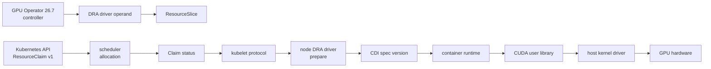
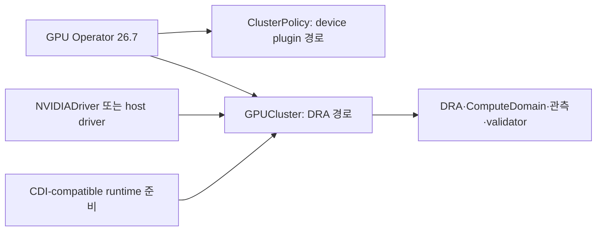
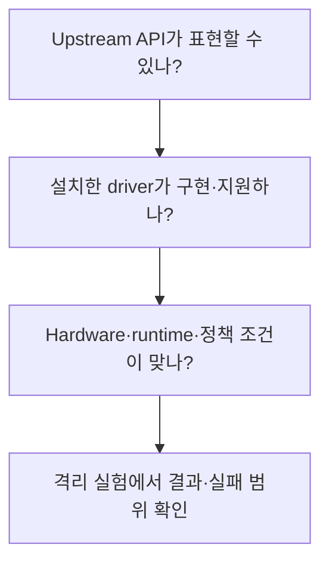

# 14. 버전과 기능 단계: Stable DRA의 범위를 읽기

이 장의 공식 자료 확인 기준일은 **2026-10-10**이다. Kubernetes core API, GPU Operator 관리 방식, NVIDIA DRA driver 구현, GPU hardware 지원은 서로 다른 축이다. 한 축에서 stable이라고 나머지 축의 모든 기능도 stable인 것은 아니다.
## 14.0 버전은 한 줄이 아니라 구성요소 사이의 계약이다

**Kubernetes version**은 API server, scheduler, kubelet 같은 core component가 제공하는 API와 동작 범위를 가리킨다. **GPU Operator version**은 NVIDIA가 배포하는 controller와 함께 관리되는 operand 조합의 release다. **operand**는 Operator가 실제 node에 배포·관리하는 driver, toolkit, device plugin, DRA driver, exporter 같은 구성요소다. 숫자가 비슷해도 서로 다른 제품의 version이므로 한 숫자로 합치지 않는다.

**API 안정 단계**는 Alpha, Beta, Stable로 구분한다. Stable 또는 GA, General Availability는 호환성을 지키는 정식 API 단계다. **feature gate**는 Kubernetes binary에서 기능을 켜고 끄는 설정이고, `locked`는 해당 release에서 gate 값을 사용자가 임의로 바꾸지 못하게 고정했다는 뜻이다. DRA가 1.34에서 GA가 된 역사와 1.35에서 stable/locked로 표시되는 상태는 같은 사건을 다른 말로 반복한 것이 아니다.

**지원 matrix**는 OS, Kubernetes, GPU, driver, runtime과 operand 조합 중 공급자가 지원하는 범위를 정리한 표다. matrix에 있는 조합은 기능 지원 근거이지만 특정 model throughput, p99 latency, tenant isolation을 보장하지 않는다.

## 14.1 요청 한 건에서 version이 만나는 위치

API server가 `resource.k8s.io/v1`을 지원해도 DRA driver가 설치되지 않으면 ResourceSlice가 없다. driver가 장치를 광고해도 kubelet과 node plugin protocol이 맞지 않으면 prepare가 실패한다. CDI spec을 만들었어도 runtime이 그 CDI version을 해석하지 못하면 container create가 실패한다. container가 시작돼도 CUDA library와 host driver가 맞지 않으면 초기화가 실패한다.

각 화살표마다 version 계약이 있다. “Kubernetes 1.35이므로 GPU가 된다”거나 “Operator 26.7이므로 모든 DRA 기능이 된다”는 식의 한 축 결론이 틀린 이유다.

## 14.2 Operator 26.7 관리 객체와 migration

GPU Operator의 **controller**는 API server의 관리 custom resource를 watch하고 desired state에 맞는 DaemonSet·Deployment를 만든다. **CRD**, CustomResourceDefinition은 그 custom resource의 schema를 API에 등록하는 객체다. CRD는 데이터 형식을 제공하며 driver를 직접 설치하지 않는다. controller가 실제 reconcile을 수행한다.

26.7 관리형 workflow에서 **GPUCluster** 같은 관리 객체를 사용할 때 기존 **ClusterPolicy** 기반 설치나 standalone chart와 ownership이 겹치지 않게 해야 한다. ownership은 어떤 controller나 release가 한 component의 desired state를 최종 결정하는지다. 같은 device plugin을 두 release가 관리하면 kubelet socket과 `nvidia.com/gpu` 광고를 경쟁할 수 있다. 같은 driver를 OS image와 Operator가 관리하면 kernel module과 library version이 충돌할 수 있다.

migration은 새 CRD를 적용하는 한 단계가 아니다.

1. 기존 release와 component별 소유자를 inventory로 만든다.
2. 현재 driver, toolkit, plugin, DRA, NFD, exporter의 version과 host 변경을 기록한다.
3. 26.7 migration 문서가 지원하는 source version과 절차를 확인한다.
4. 기존 CR과 새 GPUCluster가 동시에 같은 operand를 만들지 않도록 전환 순서를 정한다.
5. canary node에서 DaemonSet, ResourceSlice, Claim allocation, NodePrepareResources RPC 로그, CDI/runtime, CUDA를 끝까지 검증한다. 표준 `NodePrepared` condition은 사용하지 않는다.
6. rollback할 Git revision과 host driver/runtime 복원 절차를 준비한다.
7. 전체 node로 확대하고 orphan resource와 host file을 정리한다.

CRD version 변환이 있는 경우 stored version과 conversion 지원도 확인한다. 새 controller가 과거 field를 무시하거나 default를 다르게 적용할 수 있다. YAML이 API에서 승인됐다는 사실만으로 기존 의미가 보존됐다고 단정하지 않는다.

## 14.3 두 node migration의 상태표

node-a에 GPU 두 장, node-b에 한 장이 있다. 기존 standalone DRA chart에서 Operator 26.7 관리 DRA로 옮긴다고 하자.

| 시각 | 변경 | 기대 상태 | 위험 신호 |
| --- | --- | --- | --- |
| t=0 | inventory 고정 | 기존 Slice 3 device, workload 정상 | 소유자 불명 DaemonSet |
| t=5 | node-b canary 격리 | 새 workload 유입 중지 | 실행 Pod 강제 중단 |
| t=10 | 기존 node-b DRA 중지 | socket owner 하나 | 두 plugin 동시 등록 |
| t=20 | 26.7 operand 배포 | 새 ResourceSlice generation | device 중복/누락 |
| t=25 | test Claim | ResourceClaim allocation=b0 | stale old Slice 선택 |
| t=28 | prepare/CDI | 준비 RPC 성공을 로그로 확인한 뒤 container 생성 | CDI 이름 충돌 |
| t=30 | CUDA sample | 실제 kernel 결과 | `nvidia-smi`만 성공 |
| t=40 | workload benchmark | baseline 범위 성능 | p99·OOM 회귀 |
| t=50 | unprepare | b0 capacity 반환 | node-local 상태 누수 |
| t=60 | 확대 또는 rollback | node-a 전환 | 전체 capacity 동시 소실 |

**canary**는 전체 대상 전에 작은 node 집합에서 같은 변경을 시험하는 방식이다. test Claim이 할당됐다는 단계에서 멈추지 않고 prepare, CDI/runtime, CUDA, 성능, unprepare를 모두 본다.

## 14.4 지원과 기능 단계를 교차 확인한다

DRA core API가 stable이어도 NVIDIA driver의 DynamicMIG 같은 선택 기능은 별도 단계일 수 있다. **DynamicMIG**는 workload 요구에 따라 MIG layout을 동적으로 구성하는 기능이며, 이미 존재하는 MIG instance를 선택하는 것과 다르다. Alpha 기능은 API와 동작이 바뀔 수 있어 운영 위험과 rollback을 별도로 설계한다.

GPU hardware도 capability가 다르다. 모든 GPU가 MIG, MNNVL, confidential mode를 지원하지 않는다. OS kernel과 driver branch, container runtime, toolkit version, DRA driver release가 matrix 조합에 포함돼야 한다. 표의 가장 큰 driver 번호가 권장 기본값과 같지 않을 수 있다.

extended resource 이름 `nvidia.com/gpu`가 보인다고 내부가 항상 기존 device plugin이라고 단정하지 않는다. Kubernetes에는 extended resource 요청을 DRA backend와 연결하는 기능이 있을 수 있다. DeviceClass mapping, ResourceSlice, Claim status와 실제 배포 component를 확인한다.

## 14.5 실패와 rollback의 version 의미

API server가 객체를 거부하면 schema/API version 문제다. 객체는 생성되지만 ResourceSlice가 없으면 driver deployment와 지원 GPU를 본다. allocation 뒤 prepare가 terminal failure면 kubelet-driver protocol, capability, node 설정을 본다. CDI resolve 실패면 spec version과 runtime support를 본다. CUDA 초기화 실패면 image library와 host driver 조합을 본다.

rollback 시 CR만 이전 Git revision으로 돌리고 끝내면 안 된다. 새 driver kernel module, CDI file, runtime config, MIG layout이 host에 남을 수 있다. 실행 Pod를 종료하고 Claim 사용이 사라진 뒤 unprepare를 확인하며, release note가 허용하는 downgrade 경로를 따른다. GPU memory와 context가 정리되고 ResourceSlice capacity가 정상 복구됐는지 본다.

log retention도 migration 일부다. 전후의 Operator condition, DaemonSet revision, ResourceSlice generation, Claim UID, image digest, driver와 CUDA version, CUDA 결과와 p99를 같은 experiment ID로 보존한다. Secret과 credential 원문은 수집하지 않는다.

## 14.6 성능 연구와 지원 matrix를 섞지 않는다

지원 matrix는 공급자의 기능 지원 범위다. IWQoS GPU sharing 연구는 특정 GPU, workload, scheduling 정책과 metric의 실험 결과다. matrix의 “supported”를 연구의 throughput 개선으로 읽을 수 없고, 논문의 개선을 vendor support 약속으로 바꿀 수도 없다.

단독 latency 50 ms인 workload 두 개가 time-slicing에서 120 ms와 150 ms가 됐다면 기능은 정상이어도 p99 SLO 100 ms에는 실패다. MIG profile로 바꾸면 memory isolation은 강해질 수 있지만 profile 크기와 workload 요구가 맞아야 한다. 같은 version 조합에서도 정책에 따라 결과가 달라진다.

## 14.7 추가 완전 풀이 문제

**문제 1.** Kubernetes 1.35의 DRA gate가 locked다. NVIDIA DRA driver가 없어도 Claim이 실행되는가?

**해설.** 아니다. locked는 core feature gate 상태다. device inventory를 게시하고 node prepare를 수행할 vendor driver가 필요하다.

**문제 2.** Operator 26.7 설치 전에 기존 standalone device plugin을 남겼다. 어떤 위험이 있는가?

**해설.** 두 instance가 같은 kubelet resource/socket과 Node 광고를 경쟁할 수 있다. component 소유자를 하나로 정하고 migration 순서에 따라 기존 관리자를 중지한다.

**문제 3.** ResourceSlice와 Claim allocation은 성공했지만 runtime이 CDI version을 지원하지 않는다. 어디서 실패하는가?

**해설.** scheduler 단계는 통과한다. node prepare 결과가 CDI 이름을 주더라도 runtime resolve 또는 container create에서 실패한다. runtime version과 CDI spec을 맞춘다.

**문제 4.** platform matrix에 조합이 있으므로 p99가 이전과 같다고 보장할 수 있는가?

**해설.** 아니다. matrix는 기능 지원 근거다. sharing mode, topology, model, load에서 canary benchmark로 p99와 오류를 비교한다.

**문제 5.** Git rollback 뒤 GPU가 여전히 안 보인다. 어떤 상태를 확인하는가?

**해설.** controller desired state 외에 host kernel module, driver library, runtime config, CDI file, MIG layout, old/new DaemonSet과 ResourceSlice를 본다. host 상태 복원이 끝나야 전체 rollback이다.

## 14.1 숫자가 서로 다른 이유

| 축 | 기준일에 확인한 기준 | 읽는 법 |
| --- | --- | --- |
| Kubernetes | 이 교재의 최신 기능 설명은 1.37 | core API·feature gate·component 지원 |
| GPU Operator | 정식 최신 v26.7.1 | calendar version·관리 CR·operand matrix |
| NVIDIA DRA driver | Operator matrix의 v0.5.0 | driver 기능·gate·node 준비 구현 |
| NVIDIA GPU driver | 권장 기본 595.91.07 및 matrix의 지원 대안 | CUDA·GPU 모델·OS/kernel 조합 |
| Container Toolkit | v26.7.1 matrix의 1.20.1 | container 연결 도구 버전 |
| Device plugin | v26.7.1 matrix의 0.20.1 | 기존 plugin 경로의 구현 버전 |

Operator v26.7.1 matrix에는 GPU driver 615.71.09 등 여러 지원 버전이 있다. **지원 표의 가장 큰 driver 번호와 권장 기본 driver는 같은 항목이 아니다.** 이 표는 모든 component를 동시에 설치하라는 지침이 아니라 각 버전 축을 읽는 자료다. [공식 지원 matrix](https://docs.nvidia.com/datacenter/cloud-native/gpu-operator/latest/platform-support.html)

정식 릴리스는 [GPU Operator releases](https://github.com/NVIDIA/gpu-operator/releases)와 [DRA driver releases](https://github.com/kubernetes-sigs/dra-driver-nvidia-gpu/releases)에서 확인한다. `main` branch의 예제를 정식 release와 같은 지원 근거로 쓰지 않는다.

## 14.2 GPU Operator의 지원 수명

기준일 공식 표는 **26.7.x Supported, 26.3.x Deprecated, 25.10.x 이하 End of Support**로 구분한다. 과거 교재·운영 사례의 25.3.4나 25.10.1은 역사적 기록이다. 과거 실측을 지우지 않되 새 설치의 지원 조합으로 추천하지 않는다.

Deprecated는 최신 지원 버전과 같은 상태가 아니다. 공식 수명 정책과 설치한 distribution의 계약을 함께 본다. 업그레이드도 무제한 버전 건너뛰기가 아니라 지원 경로를 따른다.

## 14.3 최신 Operator 관리 모드의 변화

`GPUCluster` 자체는 GPU kernel driver를 관리하지 않는다. Operator가 별도 `NVIDIADriver` CR로 containerized driver를 관리하거나 사전 설치한 host driver를 사용할 수 있다. CDI-compatible runtime도 준비 조건이다.

최신 managed workflow의 최소 조건은 Kubernetes **1.34.2 이상**, NVIDIA driver **580 이상**, 필요한 API와 runtime 지원이다. 별도 upstream driver 문서의 넓은 최소 버전과 Operator-managed 조합의 최소 버전을 섞지 않는다.

동일 클러스터에 `ClusterPolicy`와 `GPUCluster`를 동시에 두는 구성과, standalone DRA Helm release를 managed DRA와 중복 설치하는 구성은 지원되지 않는다. 기존 구성에서 `GPUCluster`로 **in-place migration도 지원되지 않는다**. 자세한 제한과 설치 경로는 [Operator 26.7 DRA 문서](https://docs.nvidia.com/datacenter/cloud-native/gpu-operator/26.7/dra-intro-install.html)와 [10장](10-deployment-compatibility-and-gitops.md)을 따른다.

## 14.4 Kubernetes 1.37의 DRA 단계

2026-10-11 현재 공식 문서는 Kubernetes v1.37을 기준으로 읽는다. DRA가 1.34에서 GA가 된 것은 안정 API의 역사이고, 1.35의 `stable`·`locked` 표기는 그 릴리스에서 기능 gate가 잠긴 역사다. 이를 현재 최신 버전 번호나 NVIDIA 드라이버 지원 범위로 읽지 않는다. 이 책의 API 예시는 현재 안정 `resource.k8s.io/v1`을 사용하지만 실제 실습 클러스터가 이 API와 필요한 드라이버를 제공하는지는 별도로 확인한다. [현재 core 문서](https://kubernetes.io/docs/concepts/resource-management/dynamic-resource-allocation/)

| Kubernetes 기능 | 1.37에서의 단계 | 의미 |
| --- | --- | --- |
| DRA core | Stable·locked | 기본 요청·선택·할당 경로 |
| DRA extended resource | Stable 1.37 | 기존 정수 요청을 DRA backend로 연결 |
| Device taints·DeviceTaintRule | Stable 1.37 | 장치별 새 배치 제한·조건부 eviction |
| Claim device status | Stable 1.37 | driver 제공 device status |
| Consumable capacity | Beta 1.36부터·기본 활성 | 독립 Claim의 광고 용량 소비 회계 |
| Partitionable devices | Beta 1.36부터·기본 활성 | 논리 장치가 공유하는 underlying 자원 회계 |
| Device health reporting | Beta 1.36부터·기본 활성 | 지원 driver의 health를 kubelet/Pod에 전달 |
| Device metadata downward API | Beta 1.37 | 지원 driver의 metadata를 container에 제공 |
| Workload/PodGroup Claim | Beta 1.37·기본 비활성 | 그룹 수준 Claim 참조 지원 |
| Device compatibility groups | Alpha 1.37·기본 비활성 | 같은 hardware의 비호환 모드 조합 제외 |
| Optional node operations | Alpha 1.37·기본 비활성 | 조건부 prepare/unprepare 생략 |
| Node allocatable resource mapping | Alpha·기본 비활성 | DRA 요청과 host 자원 accounting 연결 |

공식 근거: [1.37 변경 발표](https://kubernetes.io/blog/2026/09/03/kubernetes-v1-37-dra-updates/), [고급 기능](https://kubernetes.io/docs/concepts/resource-management/dynamic-resource-allocation/dra-features/), [관측 기능](https://kubernetes.io/docs/concepts/resource-management/dynamic-resource-allocation/dra-observability/), [device taints](https://kubernetes.io/docs/concepts/resource-management/dynamic-resource-allocation/device-taints/).

Device metadata·derived/list attribute·fractional capacity 등 세부 확장도 각각의 gate와 API를 가진다. 이들을 기본 GPU 요청의 전제로 넣지 않는다. 필요할 때 해당 release의 API reference를 읽는다.

## 14.5 NVIDIA DRA v0.5.0의 단계는 별도로 읽는다

| NVIDIA driver capability | 기준일 지원 단계 | 기본 |
| --- | --- | --- |
| Full GPU·기존 MIG 할당 | GA | Enabled |
| ComputeDomain | GA | Enabled; 지원 MNNVL hardware 필요 |
| ConsumableShares | Alpha | Disabled |
| DynamicMIG | Alpha | Disabled |
| MPSSupport | Alpha | Disabled |
| TimeSlicingSettings | Alpha | Disabled |
| NVMLDeviceHealthCheck | Alpha | Disabled |
| PassthroughSupport | Alpha | Disabled |
| DeviceMetadata | Alpha | Disabled |

이 표는 [NVIDIA DRA 기능 정의](https://github.com/kubernetes-sigs/dra-driver-nvidia-gpu/tree/v0.5.0)와 Operator의 driver maturity 표를 따른다. `ComputeDomainCliques`, `CrashOnNVLinkFabricErrors`, `IMEXDaemonsWithDNSNames`는 해당 표에서 GA·기본 활성인 세부 기능이다.

예를 들어 upstream consumable capacity가 Beta·기본 활성이어도 NVIDIA `ConsumableShares`는 Alpha·기본 비활성이다. driver gate와 capacity 설정을 하지 않았는데 자동으로 “40 GiB 장치를 10 GiB씩 네 Claim에 배정”한다고 설명하면 틀린다.

## 14.6 기존 개수 요청의 호환 경로

Kubernetes `DRAExtendedResource`는 1.35 Alpha → 1.36 Beta·기본 활성 → 1.37 GA로 발전했다. 관리되는 NVIDIA class `gpu.nvidia.com`을 사용할 extended-resource 이름은 `deviceclass.resource.kubernetes.io/gpu.nvidia.com`이다.

기존 `nvidia.com/gpu` 이름을 그대로 DRA로 받고 싶다면 그 이름을 `spec.extendedResourceName`으로 연결한 별도 DeviceClass가 필요하다. 기본 NVIDIA class가 그 mapping을 자동 제공한다고 가정하지 않는다. [DeviceClass v1 API](https://kubernetes.io/docs/reference/kubernetes-api/resource/device-class-v1/)

## 14.7 기능 켜기 전 질문 세 개

`DynamicMIG`와 `MPSSupport`처럼 조합 제약이 있는 gate도 있다. gate를 모두 true로 만드는 것이 최대 지원 구성은 아니다. 설치 버전의 제한 표를 읽고 연구에서 필요한 메커니즘만 선정한다.

**문제:** Kubernetes DRA가 stable이면 NVIDIA DynamicMIG도 stable인가? **해설:** API와 vendor 구현의 지원 단계는 다르다. 이 기준일의 DynamicMIG는 Alpha다.

**문제:** `nvidia.com/gpu: 1`이면 DRA를 쓰지 않는다고 확정할 수 있나? **해설:** 아니다. DeviceClass extended-resource mapping과 실제 backend를 확인해야 한다.

[이전: 연구 사례](13-research-and-lab-cases.md) · [다음: 문제·용어](15-exercises-glossary-sources.md) · [목차](README.md)
