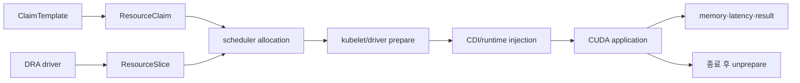

# 15. 문제·해설·용어사전·공식 자료 지도

답을 외우는 대신 요청부터 장치와 계산 결과까지 한 경로를 그린다. 문제의 숫자와 장치 이름은 교육용 예시다. 실제 성능 측정이나 특정 제품의 사양을 뜻하지 않는다.
## 15.0 종합 문제를 풀 때 쓰는 하나의 기준 경로

이 장의 모든 답은 “요청이 있다”에서 바로 “GPU가 계산한다”로 건너뛰지 않는다. 다음 객체와 프로그램을 순서대로 놓는다.

**Node**는 kubelet과 container runtime이 실행되는 서버이고, **device**는 GPU 또는 MIG instance처럼 driver가 광고하는 장치 단위다. **ResourceSlice**는 DRA driver가 API server에 게시한 device inventory다. **DeviceClass**는 관리자가 허용한 장치 선택 정책이다. **ResourceClaim**은 workload의 요구와 scheduler가 정한 allocation 결과를 가진 namespace 객체다. **ResourceClaimTemplate**은 Pod마다 Claim을 만들기 위한 청사진이다.

**scheduler**는 Pod의 node 조건과 Claim의 device 조건을 함께 만족하는 조합을 찾는다. **prepare**는 선택 node의 kubelet이 DRA driver에게 장치를 실제 사용 상태로 만들도록 요청하는 단계다. **CDI**는 runtime이 device file, mount, 환경 변수를 container 설정에 넣도록 하는 명세다. **CUDA application**은 container 안에서 사용자 library를 호출하고, 그 library가 host kernel driver를 통해 GPU에 명령을 보낸다.

각 화살표는 서로 다른 성공 조건이다. Slice가 있다는 것은 inventory 광고 성공, Claim allocation은 선택 성공을 뜻한다. 그 다음 NodePrepareResources RPC의 성공·실패는 표준 API condition이 아니라 kubelet·DRA 드라이버 로그로 확인한다. CDI/runtime은 container 접근 설정 성공, CUDA output은 실제 계산 성공을 뜻한다. 어느 하나도 다음 단계를 자동 보장하지 않는다.

## 15.1 하나의 수치 사례로 전체 문제를 연결한다

node-a에는 80 GiB `a0`과 24 GiB `a1`, node-b에는 40 GiB MIG `b0`이 있다. Pod A는 full GPU 40 GiB 이상, Pod B는 24 GiB 이상이며 MIG 허용이다. scheduler는 A→a0/node-a, B→b0/node-b를 선택할 수 있다.

| 시각 | 상태 | 관찰 |
| --- | --- | --- |
| t=0 | driver가 세 device 광고 | ResourceSlice generation 기록 |
| t=1 | Template에서 Claim A/B 생성 | 두 Claim 미할당 |
| t=2 | scheduler 선택 | Claim status에 a0,b0 |
| t=3 | kubelet prepare | 준비 RPC 성공·실패를 kubelet·드라이버 로그에서 확인 |
| t=4 | runtime CDI 병합 | container device/mount 생성 |
| t=5 | app CUDA 초기화 | kernel driver 통신 |
| t=6 | model 실행 | VRAM, throughput, p99 관측 |
| t=10 | Pod B 종료 | container 제거 뒤 unprepare |
| t=11 | driver 정리 | b0 capacity 반환 |

Pod A가 실제 peak 86 GiB를 요구하면 80 GiB device에 할당됐어도 CUDA OOM이 가능하다. Pod B의 MIG instance는 profile 범위의 memory isolation이 있지만 node의 CPU, PCIe, NIC까지 독립시키지 않는다. allocation 성공과 성능 격리는 다른 문제다.

## 15.2 실패 문장을 정확한 주체로 바꾸는 연습

“DRA가 실패했다”는 너무 넓다. Claim 후보가 0이면 DeviceClass selector와 ResourceSlice를 본다. allocation은 있지만 NodePrepareResources RPC가 실패하면 kubelet과 node DRA driver 로그를 본다. 표준 `NodePrepared` condition은 없다. prepare 성공 뒤 container create가 실패하면 CDI spec과 runtime을 본다. container가 Running인데 CUDA 초기화가 실패하면 image library와 host driver를 본다. 계산 중 OOM이면 VRAM peak와 sharing tenant를 본다. 느리면 GPU queue, CPU data loader, PCIe, topology, network를 측정한다.

**terminal failure**는 같은 입력 재시도로 회복되지 않는다고 driver가 분류한 오류다. 지원하지 않는 capability나 관리자 구성이 필요한 경우가 예다. 일시 timeout은 멱등 재시도로 회복될 수 있다. **멱등**은 같은 prepare 요청을 반복해도 device partition이나 CDI entry가 중복 생성되지 않고 같은 최종 상태가 되는 성질이다.

**unprepare**는 마지막 사용 뒤 node-local 준비 상태를 해제하는 작업이다. Claim API 객체 삭제만 뜻하지 않는다. 실행 process가 남아 있는데 먼저 unprepare하면 장치 접근이 깨질 수 있다. 반대로 정리가 실패해 상태가 남으면 다음 Claim의 capacity가 누수될 수 있다.

## 15.3 공유 방식 문제의 공통 오답

**MIG**는 지원 GPU를 profile별 하드웨어 instance로 나눠 memory와 계산 자원 경계를 제공한다. **time-slicing**은 같은 GPU 실행 시간을 여러 논리 replica가 공유하며 고정 VRAM partition을 만들지 않는다. **MPS**는 여러 CUDA process의 명령 제출을 service process가 조정한다. 세 방식 모두 “GPU 공유”지만 memory, 실행, fault, daemon 수명이 다르다.

24 GiB GPU를 time-slicing replica 4개로 광고해도 각 6 GiB가 보장되지 않는다. 네 Pod가 8 GiB씩 요구하면 논리 allocation 네 개는 성공해도 합계 32 GiB로 OOM이 가능하다. 단독 40 ms인 kernel 두 개가 직렬 경합하면 두 번째 응답은 단순 모델에서 80 ms가 된다. 등록 가능 수와 p99 SLO를 분리한다.

## 15.4 버전 문제의 공통 오답

Kubernetes DRA가 1.34에서 GA가 된 것은 core API의 안정 단계 역사다. 1.35의 stable/locked 표시는 그 release의 기능 단계와 gate 상태다. NVIDIA DRA driver와 DynamicMIG, GPU Operator 26.7의 지원 범위는 별도 vendor 구현 축이다. core stable을 모든 vendor 기능 stable로 확대하지 않는다.

GPU Operator platform matrix는 Kubernetes, OS, kernel, GPU, driver, runtime과 operand 조합의 지원 근거다. 성능 연구는 특정 GPU, model, sharing policy, 부하와 metric의 결과다. 지원 표를 throughput 보장으로 읽거나 연구 결과를 vendor support 약속으로 읽지 않는다.

## 15.5 추가 종합 문제

**문제 1.** Claim A의 allocation이 기록되고 Pod가 node-a에 bind됐지만 driver log에 prepare terminal failure가 있다. scheduler를 반복 실행하면 해결되는가?

**해설.** 같은 선택과 조건으로는 회복되지 않는 실패다. 장치 capability, node driver/runtime 구성, 지원 matrix를 확인하고 조건이나 구성을 수정해야 한다. allocation 성공은 prepare 성공이 아니다.

**문제 2.** NodePrepareResources RPC와 CDI resolve는 성공했지만 `/dev/nvidia0` open이 permission denied다. 무엇을 확인하는가?

**해설.** runtime이 만든 device permission, device cgroup, SELinux/AppArmor 같은 LSM audit를 본다. Claim selector를 바꾸는 것은 현재 증거와 맞지 않는다.

**문제 3.** Pod B 삭제 뒤 b0가 새 Claim 후보로 돌아오지 않는다. 가능한 상태 전이는?

**해설.** container 종료 뒤 NodeUnprepareResources가 실패했거나 driver inventory/Claim allocation이 stale할 수 있다. 이전 Claim UID, unprepare log와 ResourceSlice generation을 연결한다.

**문제 4.** Operator 26.7 matrix에 지원된 node에서 time-slicing p99가 3배다. 제품 미지원의 증거인가?

**해설.** 곧바로 그렇지 않다. matrix는 기능 조합 지원이고 p99는 workload 성능이다. 동시 tenant, kernel 길이, VRAM·queue, CPU와 topology를 같은 baseline으로 측정한다.

**문제 5.** ResourceClaim을 model checkpoint라고 설명했다. 어떤 두 수명을 혼동했는가?

**해설.** Claim은 device 요구와 allocation을 담는 API 객체다. model checkpoint는 학습 process의 가중치·optimizer 상태를 저장한 데이터다. Claim release/unprepare와 model 복원은 서로 다른 구성요소 책임이다.

## 15.1 계산과 경로 문제

### 문제 1. GPU가 두 장이면 30 GiB를 할당할 수 있나

각각 24 GiB GPU 두 장이 있다. 한 GPU에서 30 GiB allocation이 필요한 프로그램이 GPU 두 개를 요청했다. 자동으로 성공하는가?

**해설:** 아니다. 두 장치를 배정받는 일과 한 allocation을 분산하는 일은 다르다. 프로그램의 모델/텐서 분할·메모리 기능·통신 구조를 구현하고 peak를 확인해야 한다.

### 문제 2. 전체 GPU는 세 개인데 Pod가 Pending이다

node-a에 한 장, node-b에 한 장, node-c에 한 장이 있다. Pod 하나가 두 장을 요청한다. 다른 제약은 없다고 가정한다.

**해설:** 한 Pod는 한 node에 배치된다. 한 node에서 두 장을 제공하지 못하므로 클러스터 합계 세 장만으로 해결되지 않는다. 여러 node를 사용할 분산 workload는 별도 Pod·launcher 구조가 필요하다.

### 문제 3. DRA 요청 이름 세 개를 구별하기

Template 이름은 `gpu-per-pod`, Pod의 claim 참조 이름은 `accelerator`, Template 내부 device request 이름은 `gpu`다. container `resources.claims[].name`에는 무엇을 넣나?

**해설:** `accelerator`다. 이는 Pod의 claim 참조 이름을 연결한다. 특정 request만 소비할 때 `request: gpu`를 추가한다. 실제 생성된 ResourceClaim object 이름과도 구별한다.

### 문제 4. memory 조건이 맞는데도 할당 실패

같은 Pod가 40 GiB 이상 장치 하나와 20 GiB 이상 장치 하나를 요구한다. node-a는 48+24, node-b는 80이다.

**해설:** node-a에서 48과 24를 선택하면 만족한다. 80을 먼저 선택한 뒤 다른 node의 24를 묶으면 Pod의 공동 node 조건을 위반한다. 12장 모형으로 이 조합을 직접 확인한다.

### 문제 5. time-slicing replica 4의 의미

24 GiB 물리 GPU 한 장을 replica 4로 광고한다. workload 네 개가 각각 8 GiB를 사용할 예정이다. 모두 안전한가?

**해설:** 요구 합계는 32 GiB이고 광고된 slot은 독립 6 GiB VRAM 영역을 만드는 기능이 아니다. 실제 메모리·실행 동시성·오류 경계를 측정해야 한다. replica 개수로 memory isolation을 증명할 수 없다.

### 문제 6. Claim allocation과 CUDA 성공

ResourceClaim에 allocation이 있고 Pod가 Running이며 `nvidia-smi`도 성공한다. CUDA vectorAdd는 실패했다. 어디를 더 보나?

**해설:** prepare·CDI device/mount·runtime·library·CUDA 오류를 비교한다. 저장소 8월 기록은 UVM 관련 CDI 누락을 관찰했지만 모든 실패가 같은 원인이라는 결론은 아니다.

### 문제 7. Claim을 공유하면 GPU 두 장을 받나

container 두 개가 장치 하나를 할당한 같은 Claim을 참조한다.

**해설:** 같은 allocation 결과를 소비하는 구조다. 참조가 두 번 있다고 장치 두 개를 새로 할당하지 않는다. 공유 실행과 memory 조건은 별도다.

### 문제 8. Pod 종료 후 Claim은 항상 사라지나

명시적으로 만든 ResourceClaim을 Pod가 참조하고 있다. Pod만 삭제했다.

**해설:** 명시 Claim은 Pod보다 오래 남고 장치 allocation을 유지할 수 있다. Template 기반 Pod별 Claim의 owner 수명과 다르다. reservation·unprepare·claim deletion 조건을 구분한다.

### 문제 9. Stable DRA와 Alpha DynamicMIG

Kubernetes DRA core가 stable이다. NVIDIA DynamicMIG를 production 기본 기능으로 설명해도 되나?

**해설:** 아니다. 기준일 NVIDIA v0.5.0에서는 DynamicMIG가 Alpha·기본 비활성이다. upstream API·vendor 구현·hardware·policy는 별도 축이다.

### 문제 10. ComputeDomain이면 GPU도 할당됐나

지원 MNNVL 시스템에서 ComputeDomain을 만들었다. 학습 Pod의 GPU 배정도 완료됐는가?

**해설:** ComputeDomain은 IMEX domain/channel 등의 fabric 준비 경로다. GPU 자체의 Claim 할당·사용과 구별한다. 이름 하나로 두 생애를 합치지 않는다.

### 문제 11. 기존 YAML로 DRA를 쓰는가

Pod에는 `limits: nvidia.com/gpu: 1`만 보인다. device plugin을 쓴다고 확정할 수 있나?

**해설:** 최신 extended-resource compatibility 경로에서는 DeviceClass mapping에 따라 DRA backend가 충족할 수 있다. 실제 광고·Class·backend를 확인해야 한다.

### 문제 12. 같은 GPU를 allocator 두 개에 공개하기

기존 device plugin과 DRA GPU driver가 같은 GPU를 독립 inventory로 광고한다. 한쪽에서 할당해도 다른 쪽은 free라고 보인다.

**해설:** 같은 물리 장치를 중복 할당할 위험이 있다. 최신 Operator의 ClusterPolicy/GPUCluster 관리 모드 제약과 extended-resource 전환 경로를 따라 한 allocation 책임을 명확히 한다.

## 15.2 설계 과제와 해설 방향

**과제 A:** 24·48·80 GiB 장치가 섞인 교육용 클러스터에 서로 다른 메모리 요구의 작업을 배치한다. 속성 선택·공동 node 조건·예약·대기 이유를 표로 만든다. **해설 방향:** claim allocation 적합성과 계산 성공을 별도 판정하고 quota·queue가 모형에 포함됐는지 명시한다.

**과제 B:** 공유 방식 두 개를 비교하는 실험을 설계한다. **해설 방향:** 동일 GPU·image·입력·driver를 고정하고 throughput·tail latency·peak memory·실패 영향·metric 귀속 한계를 기록한다. 지원하지 않는 GPU에 MIG를 가정하지 않는다.

**과제 C:** Pod가 Pending → Running → CUDA 오류로 변한 가상 장애 보고서를 작성한다. **해설 방향:** 시각·객체 identity·allocation·prepare·runtime·실제 오류를 연결하고, 각 가설을 구별할 관찰을 제안한다. 관측 전 원인을 확정하지 않는다.

## 15.3 용어사전

| 용어 | 이 책에서의 뜻 |
| --- | --- |
| GPU | 병렬 계산을 수행하는 가속 장치 |
| VRAM | GPU 작업이 사용하는 장치 메모리 |
| Host RAM | CPU·프로세스가 사용하는 시스템 메모리 |
| Driver | 운영체제·프로그램과 장치 제어를 연결하는 소프트웨어 |
| Kernel module | Linux kernel에서 실행되는 모듈 |
| Device node | `/dev` 등의 장치 인터페이스 파일 |
| CUDA | NVIDIA GPU 개발·실행 생태계 |
| CUDA kernel | GPU에서 실행하도록 작성한 계산 함수 |
| NVML | NVIDIA 장치 관리·관측 library API |
| nvidia-smi | NVML 기반 GPU 상태 관리 도구 |
| UVM | NVIDIA Unified Virtual Memory 관련 driver 구성 |
| CUDA Toolkit | CUDA compiler·library·도구 묶음 |
| Container Toolkit | NVIDIA GPU 접근을 container runtime에 연결하는 도구 |
| Container runtime | container 실행 spec과 프로세스를 구현하는 runtime |
| CRI | Kubernetes kubelet과 container runtime의 interface |
| OCI | container image·runtime 등의 표준 규격 생태계 |
| CDI | Container Device Interface; 장치 주입 설정 규격 |
| Device injection | container에 장치·mount·설정을 전달하는 과정 |
| Device plugin | kubelet에 vendor 장치 자원을 등록하는 구현 |
| Extended resource | CPU/RAM 외 이름 있는 정수 자원 |
| Capacity | 공개된 총 자원/용량; 문맥별 대상 확인 |
| Allocatable | Node 등에서 배치에 사용할 수 있게 공개된 자원 |
| GPU Operator | NVIDIA GPU 구성요소를 선언에 맞춰 관리하는 controller |
| Operand | Operator가 관리·배포하는 구성요소 |
| CRD | Kubernetes API에 사용자 resource 정의를 추가하는 객체 |
| ClusterPolicy | NVIDIA Operator의 기존 device-plugin 관리 CR |
| GPUCluster | 최신 NVIDIA Operator의 DRA 관리 CR |
| NVIDIADriver | containerized GPU driver의 별도 관리 CR |
| NFD | Node Feature Discovery; node 속성 발견과 label |
| GFD | GPU Feature Discovery; NVIDIA GPU 속성 label |
| DCGM | NVIDIA Data Center GPU Manager; 관리·관측 기능 |
| DCGM Exporter | DCGM 지표를 metrics endpoint로 공개하는 구성요소 |
| Validator | 특정 GPU 실행 경로의 준비·사용 조건을 확인하는 workload |
| DRA | Dynamic Resource Allocation; 장치 요청·할당·준비 API 경로 |
| DRA driver | 특정 자원을 DRA 경로에 연결하는 구현 |
| DeviceClass | cluster 범위 장치 선택 규칙·설정 묶음 |
| ResourceSlice | driver가 공개하는 장치 inventory의 slice |
| Pool | 한 driver가 관리하는 inventory 집합의 이름 |
| ResourceClaim | namespace 범위 구체 장치 요청·allocation 객체 |
| ResourceClaimTemplate | Pod별 Claim을 만들기 위한 요청 template |
| Attribute | 장치 모델·주소 등 driver가 공개한 속성 |
| CEL | Common Expression Language; selector 표현 언어 |
| Exactly | 하나의 명확한 device 요청 묶음 |
| FirstAvailable | 우선순위 있는 대안 subrequest 목록 |
| Allocation | 요청을 구체 device identity와 연결하는 결정 |
| Reservation | allocation의 소비 Pod 등 사용 관계 추적 |
| ReservedFor | Claim을 예약한 소비자를 나타내는 status 정보 |
| Prepare | node-local driver가 할당 자원의 사용 준비를 하는 과정 |
| Unprepare | 사용 종료 후 node-local 준비를 해제하는 과정 |
| MIG | 지원 GPU의 하드웨어 인스턴스 분할 |
| MIG geometry | 하나의 GPU에 구성한 instance/profile 배치 |
| Time-slicing | 여러 작업의 GPU 실행을 시간적으로 공유 |
| MPS | Multi-Process Service; 여러 CUDA process 실행 공유 |
| Consumable capacity | 독립 Claim이 장치의 광고 용량을 나누어 소비하는 회계 |
| Partitionable device | underlying 자원을 공유하는 논리 device 표현 |
| Device taint | 장치 allocation·소비를 제한하는 상태/정책 |
| NUMA | CPU·memory·device의 거리 차이를 가진 구조 |
| PCIe topology | GPU·NIC 등이 연결된 root·switch·link 관계 |
| NVLink | 지원 GPU 사이의 고속 연결 기술 |
| MNNVL | Multi-Node NVLink; 지원 시스템의 노드 간 NVLink 연결 |
| IMEX | 지원 시스템의 GPU memory export/import 접근을 관리하는 구성 |
| ComputeDomain | NVIDIA MNNVL/IMEX 작업 연결을 관리하는 CR |
| NCCL | NVIDIA GPU collective communication library |
| Rank | 분산 실행에서 process에 붙이는 논리 번호 |
| Image digest | image 내용을 식별하는 hash identity |
| Feature gate | 특정 기능을 활성화하는 버전별 설정 |
| GA/Stable | 기능이 정식 지원 단계에 도달한 상태 |
| Beta/Alpha | 각각의 시험·지원 조건을 확인해야 하는 단계 |

## 15.4 공식 자료 지도

| 궁금한 질문 | 공식 근거 |
| --- | --- |
| GPU Operator의 현재 지원·component 버전 | [Platform support](https://docs.nvidia.com/datacenter/cloud-native/gpu-operator/latest/platform-support.html) |
| 최신 managed DRA 설치·상호배타·제한 | [Operator 26.7 DRA](https://docs.nvidia.com/datacenter/cloud-native/gpu-operator/26.7/dra-intro-install.html) |
| GPU Operator 릴리스 변경 | [Release notes](https://docs.nvidia.com/datacenter/cloud-native/gpu-operator/latest/release-notes.html) |
| Container 연결의 내부 구조 | [Toolkit architecture](https://docs.nvidia.com/datacenter/cloud-native/container-toolkit/latest/arch-overview.html) |
| CDI 설정과 제한 | [Toolkit CDI](https://docs.nvidia.com/datacenter/cloud-native/container-toolkit/latest/cdi-support.html) |
| CUDA와 driver 호환성 | [CUDA Compatibility](https://docs.nvidia.com/deploy/cuda-compatibility/latest/index.html) |
| 기존 plugin의 등록·Allocate | [Kubernetes Device Plugins](https://kubernetes.io/docs/concepts/extend-kubernetes/compute-storage-net/device-plugins/) |
| DRA 기본 객체 | [DRA 개념](https://kubernetes.io/docs/concepts/resource-management/dynamic-resource-allocation/) |
| Scheduler·controller·kubelet 생애 | [How DRA works](https://kubernetes.io/docs/concepts/resource-management/dynamic-resource-allocation/how-dra-works/) |
| Claim API의 정확한 필드 | [ResourceClaim v1](https://kubernetes.io/docs/reference/kubernetes-api/resource/resource-claim-v1/) |
| 실제 workload 참조 구조 | [Allocate devices task](https://kubernetes.io/docs/tasks/configure-pod-container/assign-resources/allocate-devices-dra/) |
| NVIDIA GPU selector | [Request full GPUs](https://dra-driver-nvidia-gpu.sigs.k8s.io/docs/guides/gpu-allocation/allocating-gpus/) |
| NVIDIA driver 구성요소 | [Driver architecture](https://dra-driver-nvidia-gpu.sigs.k8s.io/docs/concepts/architecture/) |
| ComputeDomain과 IMEX | [ComputeDomain workload](https://dra-driver-nvidia-gpu.sigs.k8s.io/docs/guides/compute-domain-workloads/) |
| Time-slicing의 memory·fault 한계 | [NVIDIA sharing](https://docs.nvidia.com/datacenter/cloud-native/gpu-operator/latest/gpu-sharing.html) |
| MIG의 실제 지원·profile | [MIG User Guide](https://docs.nvidia.com/datacenter/tesla/mig-user-guide/latest/index.html) |
| DRA MPS 조건 | [MPS guide](https://dra-driver-nvidia-gpu.sigs.k8s.io/docs/guides/mps/) |
| Upstream 고급 기능 단계 | [DRA features](https://kubernetes.io/docs/concepts/resource-management/dynamic-resource-allocation/dra-features/) |
| Device status·health·metadata | [DRA observability](https://kubernetes.io/docs/concepts/resource-management/dynamic-resource-allocation/dra-observability/) |
| DRA 권한 경계 | [DRA hardening](https://kubernetes.io/docs/concepts/security/hardening-guide/dynamic-resource-allocation/) |

위 문서의 `latest`는 앞으로 내용이 바뀔 수 있다. 재현 실험에서는 설치 버전·release tag·지원 표 확인 날짜를 함께 남긴다. 교육용 모형과 실제 적용 기록도 분리한다.

[이전: 버전·기능 단계](14-versions-and-feature-status.md) · [목차](README.md) · [통합 교재](../README.md)
