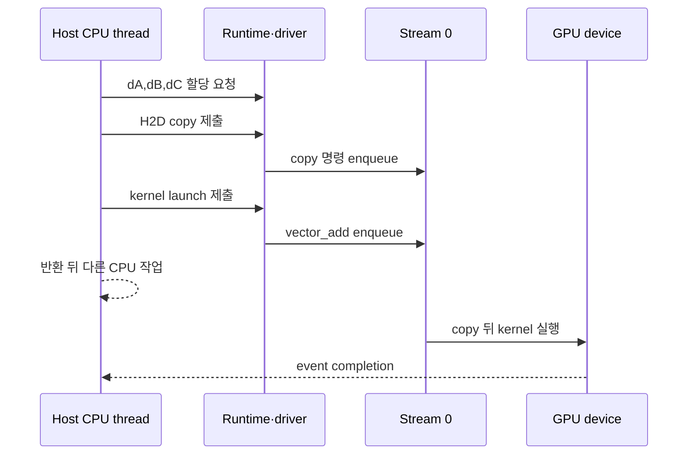

# 00. GPU 프로그래밍 지도

[목차](README.md) · [다음: 01. CPU·GPU와 병렬 작업](01-cpu-gpu-and-parallel-work.md)

GPU program을 이해하려면 코드 한 줄보다 객체의 위치와 실행 주체를 먼저 구분한다.

## 첫 실행을 구성하는 아홉 단어

**program(프로그램)**은 입력을 받아 작업 순서를 정하는 전체 코드다. GPU 프로그램에는 CPU가 실행하는 host 코드와 GPU가 실행하는 device 코드가 함께 있다. 소스 파일 하나에 있어도 실행 장소와 시작 시각은 다르다.

**CPU(Central Processing Unit)**는 운영체제 위에서 host thread를 실행하며 파일·네트워크·메모리 할당과 GPU 작업 제출을 조정한다. **GPU(Graphics Processing Unit)**는 많은 실행 lane으로 대량의 비슷한 계산을 처리한다. CPU가 “지휘자”, GPU가 “계산기”라는 비유는 출발점일 뿐이다. GPU도 scheduling과 cache를 가지며 CPU도 병렬 계산을 한다.

**host(호스트)**는 GPU API를 호출하는 CPU 쪽 실행 주체와 system memory 영역을 가리킨다. **device(디바이스)**는 GPU 실행 주체와 GPU가 접근할 수 있는 자원을 가리킨다. 같은 pointer 모양이라도 어느 주소 공간의 allocation인지, 누가 접근할 권한이 있는지 확인해야 한다.

**kernel(커널)**은 GPU의 여러 logical thread가 실행할 device 함수다. Host는 kernel body를 한 번 직접 계산하는 대신 grid 모양과 argument를 지정해 launch한다. **runtime(런타임)**은 application에 allocation, copy, launch 같은 API를 제공하고, **driver(드라이버)**는 context·module·device 명령을 더 낮은 계층에서 관리한다. Runtime 함수 호출 성공은 GPU 작업 완료와 같은 사건이 아니다.

**stream(스트림)**은 host가 제출한 device 작업들의 순서가 놓이는 논리 queue다. 같은 stream의 순서는 보존되지만 서로 다른 stream 작업이 실제로 겹치는지는 dependency와 hardware 자원에 달렸다. **launch(실행 제출)**는 kernel의 grid를 stream에 넣는 행위다. 보통 host는 GPU의 모든 thread가 끝날 때까지 launch 호출 안에서 기다리지 않고 다음 host 문장으로 돌아온다.

호스트 메모리의 입력을 GPU가 접근하는 디바이스 메모리로 복사하는 방향을 **H2D(Host to Device, 호스트에서 디바이스로)**라고 한다. 계산이 끝난 결과를 디바이스 메모리에서 호스트 메모리로 되가져오는 방향은 **D2H(Device to Host, 디바이스에서 호스트로)**다. 아래 그림에서 H2D copy는 입력 전달, kernel launch는 GPU 계산 제출, D2H copy는 결과 회수다. 세 작업을 같은 스트림에 그 순서로 제출하면, 뒤의 작업은 앞의 작업이 완료된 뒤 진행하므로 계산이 입력을 읽기 전에 입력 전달이 끝나야 한다는 의존성을 표현할 수 있다.



## 비동기 요청 하나의 수명 추적

Host 배열 A와 B가 각각 float 8개라면 각 32 byte다. Runtime을 통해 device allocation dA, dB, dC를 각각 32 byte 만든다. Host가 H2D copy를 stream 0에 넣고 바로 vector-add kernel을 같은 stream에 넣으면, 같은 stream 순서 때문에 kernel은 copy가 끝난 입력을 본다.

시각을 단순화해 t=0.00 ms에 copy를 제출하고 API가 t=0.02 ms에 반환한다고 하자. Device copy는 t=0.10~0.14 ms, kernel은 t=0.14~0.18 ms, D2H copy는 t=0.18~0.22 ms에 실행될 수 있다. Host 반환 0.02 ms는 device 완료 0.22 ms보다 앞선다. Host가 0.03 ms에 dA를 free하거나 결과를 읽으면 수명·완료 계약을 어긴다.

Event를 D2H 뒤에 기록하고 host가 그 event 완료를 확인한 다음 `[11,22,33,44,55,66,77,88]`을 검증한다. Event는 시간을 재는 표식으로도 쓰지만 핵심은 stream의 특정 지점까지 끝났다는 dependency를 표현하는 것이다. 모든 device를 무조건 동기화하면 안전해 보일 수 있으나 불필요하게 overlap을 잃는다.

## 두 번째 추적: stream 둘이 자동 병렬이 아닌 이유

Stream 0에 kernel A 4 ms, stream 1에 kernel B 3 ms를 제출했다고 하자. 두 kernel이 각각 GPU 계산 자원 전부를 요구하면 실행은 4+3=7 ms가 될 수 있다. 각자 절반 이하 자원을 쓰고 dependency가 없으면 일부가 겹쳐 약 4 ms에 끝날 가능성이 생긴다. Stream 수만 보고 7 ms인지 4 ms인지 확정할 수 없다.

B가 A 결과 dX를 읽는다면 event로 `A 완료→B 시작` 관계를 만들어야 한다. 다른 stream이라는 이유로 순서가 생기지 않는다. 반대로 관계가 없는 작업에 전역 sync를 넣으면 정확성은 유지해도 concurrency를 막는다.

## API 오류가 보이는 시점

잘못된 block 크기는 launch 제출 시점에 발견될 수 있다. Kernel 안 out-of-bounds 접근은 비동기 실행 뒤 다음 synchronization이나 copy에서 보고될 수 있다. “D2H copy에서 오류가 났다”는 메시지가 copy 자체의 원인이라고 단정하지 않고 그 stream 앞의 launch와 index를 확인한다.

## 연구와 기초 객체의 연결

FlashAttention-3의 Hopper 전용 경로는 TMA가 memory 이동을 비동기로 맡고 Tensor Core가 행렬 계산을 하는 producer-consumer 구성을 warp 역할로 나눈다. 여기서도 program, kernel, memory 수명, 동기화 범위라는 기본 질문은 그대로다. Hopper 기능과 shape·precision 조건을 벗어난 장치에 같은 이득을 가정하지 않는다.

FlashInfer는 동적으로 바뀌는 추론 요청, KV layout, JIT kernel과 CUDA Graph 활용 조건을 다룬다. Graph replay는 launch sequence와 주소가 재사용 가능해야 이점이 생긴다. 요청 길이와 buffer 주소가 매번 달라지면 padding, indirection 또는 graph 후보 분류가 필요하다. 특정 논문의 수치를 이 작은 vector add의 성능으로 옮기지 않는다.

## 다섯 문제를 단계별로 푼다

**문제 1.** Kernel launch가 반환되면 dC 결과가 준비됐는가?

**해설.** 보통 제출이 끝났다는 뜻이다. 같은 stream의 D2H completion이나 event 등 계약된 완료를 확인해야 host가 결과를 안전하게 읽는다.

**문제 2.** A와 B가 float 8개일 때 입력·출력 allocation 합은?

**해설.** 배열 하나는 `8×4=32 byte`, 세 배열은 96 byte다. 실제 allocator metadata는 이 교육 계산에 포함하지 않는다.

**문제 3.** Runtime과 driver는 같은가?

**해설.** Runtime은 편한 상위 API를 제공하고 내부적으로 driver 기능을 사용한다. 둘의 호출 경계와 context 관리 방식은 다르며, 어느 API의 오류인지 기록한다.

**문제 4.** Stream 두 개면 kernel이 반드시 겹치는가?

**해설.** 아니다. Dependency, 계산·memory 자원, device capability가 허용해야 한다. Timeline과 profiler로 확인한다.

**문제 5.** Host가 비동기 copy 직후 입력 buffer를 바꿔도 되는가?

**해설.** Copy가 그 host buffer를 다 읽었다는 완료 조건 전에는 안 된다. API의 동기·비동기 및 pinned-memory 계약을 확인하고 event 뒤에 재사용한다.


## 1. Host와 device

Host는 보통 CPU가 실행하는 program과 system memory 쪽을 뜻한다. Device는 GPU와 GPU가 접근하는 memory 자원을 뜻한다.

CUDA runtime API를 호출하는 C/C++ 함수는 host thread가 실행한다. `__global__` kernel의 body는 device의 많은 GPU thread가 실행한다.

| 객체 | 주된 위치 | 실행·관리 주체 |
| --- | --- | --- |
| Host array | System memory | CPU program |
| Device allocation | GPU-visible memory | Runtime 요청, GPU 접근 |
| Kernel code | Device 실행 코드 | GPU thread |
| Stream | Host가 구성한 작업 순서 | Runtime·driver·GPU |
| Event | 작업 진행 표식 | Host 기록 요청, device 진행 |

## 2. Kernel은 한 번의 함수 호출 모양이다

Kernel launch syntax는 한 함수를 부르는 것처럼 보이지만 grid 전체 thread instance를 만든다.

```text
vector_add<<<grid, block>>>(a, b, c, n)
```

Host는 launch를 enqueue할 수 있고, device는 각 thread가 자기 index를 계산해 element를 처리한다.

## 3. 입력 8개 손 추적

`a=[1,2,3,4,5,6,7,8]`, `b=[10,20,30,40,50,60,70,80]`이고 block당 4 thread, grid 2 block이라 하자.

| block | threadIdx.x | global index | 계산 | 결과 |
| ---: | ---: | ---: | --- | ---: |
| 0 | 0 | 0 | 1+10 | 11 |
| 0 | 1 | 1 | 2+20 | 22 |
| 0 | 2 | 2 | 3+30 | 33 |
| 0 | 3 | 3 | 4+40 | 44 |
| 1 | 0 | 4 | 5+50 | 55 |
| 1 | 1 | 5 | 6+60 | 66 |
| 1 | 2 | 6 | 7+70 | 77 |
| 1 | 3 | 7 | 8+80 | 88 |

Global index는 `blockIdx.x*blockDim.x+threadIdx.x`다.

## 4. 왜 boundary check가 필요한가

n=10인데 block 4, grid 3이면 12 thread가 만들어진다. Index 10과 11은 array 밖이다.

```text
if index < n:
    c[index] = a[index] + b[index]
```

Launch 크기를 올림 계산했더라도 마지막 block의 여분 thread를 막아야 한다.

## 5. GPU가 필요한 이유

같은 독립 연산이 매우 많고 data parallelism이 있으면 많은 thread로 throughput을 높일 수 있다. 모든 작업이 GPU에 맞는 것은 아니다.

작은 array는 copy와 launch overhead가 계산보다 클 수 있다. 순차 dependency가 강하면 동시에 실행할 일이 적다.

## 6. Parallelism과 concurrency

Parallelism은 같은 시간에 여러 계산을 실제 진행하는 구조다. Concurrency는 여러 작업의 진행 구간이 겹치도록 관리하는 성질이다.

Stream 두 개가 있어도 hardware resource가 부족하거나 dependency가 있으면 실제 kernel이 겹치지 않을 수 있다.

## 7. Throughput과 latency

Latency는 한 작업이 끝날 때까지 시간, throughput은 단위 시간당 처리량이다. GPU는 많은 element throughput에 강할 수 있지만 단일 작은 요청 latency는 CPU보다 불리할 수 있다.

## 8. SIMD와 SIMT

SIMD는 한 instruction이 여러 data lane을 처리하는 모형이다. CUDA는 SIMT, Single Instruction Multiple Threads라는 thread 관점을 제공한다.

Warp의 lane들이 같은 instruction을 실행하기 좋지만 각 lane은 thread state와 index를 가진다.

## 9. Warp

현재 CUDA warp는 32 lane으로 설명한다. Hardware scheduling 단위와 program의 logical thread를 구분한다.

Block thread 수 64면 보통 warp 0은 thread 0~31, warp 1은 32~63이다.

## 10. 발산

Warp 안에서 lane별 조건이 다르면 branch 경로를 나누어 실행할 수 있다.

```text
if index % 2 == 0: even path
else: odd path
```

32 lane 중 16개씩 다른 경로라면 두 경로가 모두 실행될 수 있다. 결과가 틀린 것은 아니지만 효율이 낮아질 수 있다.

## 11. Memory가 핵심인 이유

GPU arithmetic가 빨라도 global memory에서 data를 충분히 공급하지 못하면 kernel은 memory-bound다. 주소 배열과 재사용을 함께 설계한다.

## 12. Synchronization이 필요한 이유

Thread가 서로의 중간 결과를 읽는다면 “쓴 뒤 읽는다”는 순서를 만들어야 한다. Barrier, atomic, stream event는 범위와 보장이 다르다.

## 13. 비동기 수명

Kernel launch나 copy가 host에 비동기로 반환될 수 있다. Host가 API 반환 직후 buffer를 해제하면 device 작업이 아직 사용할 수 있다.

작업 completion을 event·stream sync 등 계약된 방법으로 확인한 뒤 수명을 끝낸다.

## 14. 정확성과 성능을 분리한다

Race가 있는 kernel이 우연히 빠른 결과를 냈다고 올바른 것이 아니다. 정확성 조건을 먼저 검증하고 그다음 profiler로 병목을 본다.

## 14.1 한 vector add의 객체 수명

Host array A와 B는 CPU가 채운다. Device allocation dA·dB·dC는 runtime API를 통해 만들지만 실제 주소는 GPU가 접근하는 영역이다.

| 순서 | Host 주체 | Device 상태 | 해제 가능성 |
| ---: | --- | --- | --- |
| 1 | A,B 생성 | Allocation 없음 | Host array 사용 중 |
| 2 | dA,dB,dC 할당 | 세 buffer 존재 | Device free 금지 |
| 3 | H2D copy | dA,dB 입력 준비 | A,B는 copy 완료 뒤 재사용 |
| 4 | Kernel launch | dC 계산 중 | dA,dB,dC free 금지 |
| 5 | D2H copy | dC 결과 전송 | Completion 전 dC free 금지 |
| 6 | 결과 검증 | 작업 완료 | 세 device buffer 해제 가능 |

API 호출이 성공했다는 것과 비동기 작업이 끝났다는 것을 분리한다. Stream completion이 수명 경계를 만든다.

## 14.2 오류도 계층별로 본다

Allocation 실패는 memory 크기·context 문제, launch configuration 오류는 grid/block·shared byte 문제, execution 오류는 out-of-bounds·illegal access 문제일 수 있다.

“CUDA error” 한 줄로 합치지 않고 어느 API와 어느 stream completion에서 발견했는지 기록한다.

Kernel body가 틀렸는데 copy API를 반복하는 것은 원인에 가깝지 않다. CPU reference와 boundary input으로 먼저 결과 위치를 좁힌다.

## 15. 작은 반례

Element 수 1인 vector add는 GPU thread 수가 많아도 병렬 이득이 거의 없다. GPU라는 이유만으로 자동 가속되지 않는다.

Block 사이에서 `__syncthreads()`로 동기화할 수 있다고 생각하면 틀리다. 그 barrier는 참여 block 범위다.

## 문제와 해설

**문제 1.** n=9, block=4이면 grid block 수는?

**해설.** `(9+4-1)//4=3`이다. 12 thread 중 index 9~11은 boundary check에서 빠진다.

**문제 2.** Kernel launch 함수를 CPU가 직접 각 element마다 호출하는가?

**해설.** Host가 grid launch를 요청하고 GPU thread instance가 element index를 처리한다.

**문제 3.** Warp 32 lane이면 block도 항상 32 thread인가?

**해설.** 아니다. Block은 여러 warp를 포함할 수 있고 마지막 warp가 부분적으로 채워질 수 있다.

## 공식 자료

- [CUDA Programming Guide](https://docs.nvidia.com/cuda/cuda-programming-guide/)
- [CUDA programming model](https://docs.nvidia.com/cuda/cuda-programming-guide/01-introduction/programming-model.html)
- [FlashAttention-3 preprint (2024)](https://arxiv.org/abs/2407.08608)
- [FlashInfer, MLSys 2025](https://proceedings.mlsys.org/paper_files/paper/2025/hash/dbf02b21d77409a2db30e56866a8ab3a-Abstract-Conference.html)
