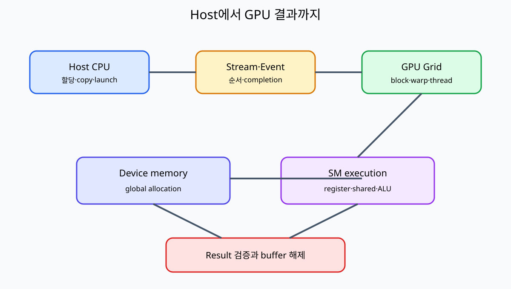

# 00. GPU 프로그래밍 지도

[목차](README.md) · [다음: 01. CPU·GPU와 병렬 작업](01-cpu-gpu-and-parallel-work.md)

GPU program을 이해하려면 코드 한 줄보다 객체의 위치와 실행 주체를 먼저 구분한다.




## 1. Host와 device

Host는 보통 CPU가 실행하는 program과 system memory 쪽을 뜻한다. Device는 GPU와 GPU가 접근하는 memory 자원을 뜻한다.

CUDA runtime API를 호출하는 C/C++ 함수는 host thread가 실행한다. `__global__` kernel의 body는 device의 많은 GPU thread가 실행한다.

| 객체 | 주된 위치 | 실행·관리 주체 |
| --- | --- | --- |
| Host array | System memory | CPU program |
| Device allocation | GPU-visible memory | Runtime 요청, GPU 접근 |
| Kernel code | Device 실행 코드 | GPU thread |
| Stream | Host가 구성한 작업 순서 | Runtime·driver·GPU |
| Event | 작업 진행 표식 | Host 기록 요청, device 진행 |

## 2. Kernel은 한 번의 함수 호출 모양이다

Kernel launch syntax는 한 함수를 부르는 것처럼 보이지만 grid 전체 thread instance를 만든다.

```text
vector_add<<<grid, block>>>(a, b, c, n)
```

Host는 launch를 enqueue할 수 있고, device는 각 thread가 자기 index를 계산해 element를 처리한다.

## 3. 입력 8개 손 추적

`a=[1,2,3,4,5,6,7,8]`, `b=[10,20,30,40,50,60,70,80]`이고 block당 4 thread, grid 2 block이라 하자.

| block | threadIdx.x | global index | 계산 | 결과 |
| ---: | ---: | ---: | --- | ---: |
| 0 | 0 | 0 | 1+10 | 11 |
| 0 | 1 | 1 | 2+20 | 22 |
| 0 | 2 | 2 | 3+30 | 33 |
| 0 | 3 | 3 | 4+40 | 44 |
| 1 | 0 | 4 | 5+50 | 55 |
| 1 | 1 | 5 | 6+60 | 66 |
| 1 | 2 | 6 | 7+70 | 77 |
| 1 | 3 | 7 | 8+80 | 88 |

Global index는 `blockIdx.x*blockDim.x+threadIdx.x`다.

## 4. 왜 boundary check가 필요한가

n=10인데 block 4, grid 3이면 12 thread가 만들어진다. Index 10과 11은 array 밖이다.

```text
if index < n:
    c[index] = a[index] + b[index]
```

Launch 크기를 올림 계산했더라도 마지막 block의 여분 thread를 막아야 한다.

## 5. GPU가 필요한 이유

같은 독립 연산이 매우 많고 data parallelism이 있으면 많은 thread로 throughput을 높일 수 있다. 모든 작업이 GPU에 맞는 것은 아니다.

작은 array는 copy와 launch overhead가 계산보다 클 수 있다. 순차 dependency가 강하면 동시에 실행할 일이 적다.

## 6. Parallelism과 concurrency

Parallelism은 같은 시간에 여러 계산을 실제 진행하는 구조다. Concurrency는 여러 작업의 진행 구간이 겹치도록 관리하는 성질이다.

Stream 두 개가 있어도 hardware resource가 부족하거나 dependency가 있으면 실제 kernel이 겹치지 않을 수 있다.

## 7. Throughput과 latency

Latency는 한 작업이 끝날 때까지 시간, throughput은 단위 시간당 처리량이다. GPU는 많은 element throughput에 강할 수 있지만 단일 작은 요청 latency는 CPU보다 불리할 수 있다.

## 8. SIMD와 SIMT

SIMD는 한 instruction이 여러 data lane을 처리하는 모형이다. CUDA는 SIMT, Single Instruction Multiple Threads라는 thread 관점을 제공한다.

Warp의 lane들이 같은 instruction을 실행하기 좋지만 각 lane은 thread state와 index를 가진다.

## 9. Warp

현재 CUDA warp는 32 lane으로 설명한다. Hardware scheduling 단위와 program의 logical thread를 구분한다.

Block thread 수 64면 보통 warp 0은 thread 0~31, warp 1은 32~63이다.

## 10. 발산

Warp 안에서 lane별 조건이 다르면 branch 경로를 나누어 실행할 수 있다.

```text
if index % 2 == 0: even path
else: odd path
```

32 lane 중 16개씩 다른 경로라면 두 경로가 모두 실행될 수 있다. 결과가 틀린 것은 아니지만 효율이 낮아질 수 있다.

## 11. Memory가 핵심인 이유

GPU arithmetic가 빨라도 global memory에서 data를 충분히 공급하지 못하면 kernel은 memory-bound다. 주소 배열과 재사용을 함께 설계한다.

## 12. Synchronization이 필요한 이유

Thread가 서로의 중간 결과를 읽는다면 “쓴 뒤 읽는다”는 순서를 만들어야 한다. Barrier, atomic, stream event는 범위와 보장이 다르다.

## 13. 비동기 수명

Kernel launch나 copy가 host에 비동기로 반환될 수 있다. Host가 API 반환 직후 buffer를 해제하면 device 작업이 아직 사용할 수 있다.

작업 completion을 event·stream sync 등 계약된 방법으로 확인한 뒤 수명을 끝낸다.

## 14. 정확성과 성능을 분리한다

Race가 있는 kernel이 우연히 빠른 결과를 냈다고 올바른 것이 아니다. 정확성 조건을 먼저 검증하고 그다음 profiler로 병목을 본다.

## 14.1 한 vector add의 객체 수명

Host array A와 B는 CPU가 채운다. Device allocation dA·dB·dC는 runtime API를 통해 만들지만 실제 주소는 GPU가 접근하는 영역이다.

| 순서 | Host 주체 | Device 상태 | 해제 가능성 |
| ---: | --- | --- | --- |
| 1 | A,B 생성 | Allocation 없음 | Host array 사용 중 |
| 2 | dA,dB,dC 할당 | 세 buffer 존재 | Device free 금지 |
| 3 | H2D copy | dA,dB 입력 준비 | A,B는 copy 완료 뒤 재사용 |
| 4 | Kernel launch | dC 계산 중 | dA,dB,dC free 금지 |
| 5 | D2H copy | dC 결과 전송 | Completion 전 dC free 금지 |
| 6 | 결과 검증 | 작업 완료 | 세 device buffer 해제 가능 |

API 호출이 성공했다는 것과 비동기 작업이 끝났다는 것을 분리한다. Stream completion이 수명 경계를 만든다.

## 14.2 오류도 계층별로 본다

Allocation 실패는 memory 크기·context 문제, launch configuration 오류는 grid/block·shared byte 문제, execution 오류는 out-of-bounds·illegal access 문제일 수 있다.

“CUDA error” 한 줄로 합치지 않고 어느 API와 어느 stream completion에서 발견했는지 기록한다.

Kernel body가 틀렸는데 copy API를 반복하는 것은 원인에 가깝지 않다. CPU reference와 boundary input으로 먼저 결과 위치를 좁힌다.

## 15. 작은 반례

Element 수 1인 vector add는 GPU thread 수가 많아도 병렬 이득이 거의 없다. GPU라는 이유만으로 자동 가속되지 않는다.

Block 사이에서 `__syncthreads()`로 동기화할 수 있다고 생각하면 틀리다. 그 barrier는 참여 block 범위다.

## 문제와 해설

**문제 1.** n=9, block=4이면 grid block 수는?

**해설.** `(9+4-1)//4=3`이다. 12 thread 중 index 9~11은 boundary check에서 빠진다.

**문제 2.** Kernel launch 함수를 CPU가 직접 각 element마다 호출하는가?

**해설.** Host가 grid launch를 요청하고 GPU thread instance가 element index를 처리한다.

**문제 3.** Warp 32 lane이면 block도 항상 32 thread인가?

**해설.** 아니다. Block은 여러 warp를 포함할 수 있고 마지막 warp가 부분적으로 채워질 수 있다.

## 공식 자료

- [CUDA Programming Guide](https://docs.nvidia.com/cuda/cuda-programming-guide/)
- [CUDA programming model](https://docs.nvidia.com/cuda/cuda-programming-guide/01-introduction/programming-model.html)
