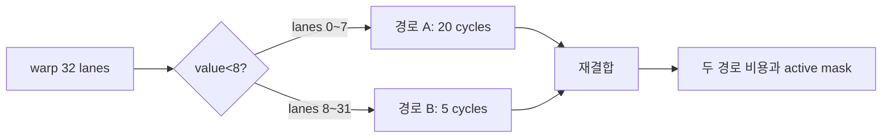
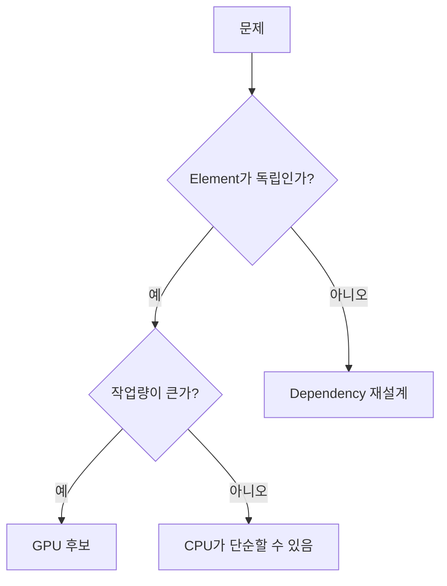

# 01. CPU·GPU와 병렬 작업

[이전: 00. 지도](00-gpu-programming-map.md) · [목차](README.md) · [다음: 02. Thread 계층](02-threads-blocks-warps-and-grids.md)

GPU로 옮길 작업은 독립성, 양, data 이동 비용으로 판단한다.

## Parallel work를 일의 목록으로 먼저 쓴다

**parallel work(병렬 작업)**는 동시에 수행해도 서로의 미완성 값을 필요로 하지 않는 작업 묶음이다. 배열 1024개에 각각 2를 곱할 때 output i는 input i만 읽으므로 1024개의 독립 work item이 있다. 반면 다음 값이 앞의 누적합을 필요로 하면 단순히 1024 thread를 띄우는 것만으로 올바르지 않다.

**SIMD(Single Instruction, Multiple Data)**는 한 instruction이 여러 data lane에 연산을 적용하는 명령 관점이다. **SIMT(Single Instruction, Multiple Threads)**는 programmer에게 각 lane을 독립 thread처럼 보이게 하는 실행 관점이다. CUDA thread마다 index와 register state가 있지만 scheduler는 보통 32-thread warp에 instruction을 issue한다. SIMT라는 추상화가 lane들이 언제나 독립 시간에 실행된다는 뜻은 아니다.

**divergence(분기 발산)**는 한 warp의 lane들이 서로 다른 branch 경로를 선택하는 상황이다. Active mask를 바꿔 각 경로를 실행하므로 정답은 맞을 수 있지만 둘의 시간을 모두 낼 수 있다. **efficiency(효율)**는 issue된 lane 작업 중 유용한 비율을 묻고, **occupancy(점유율)**는 SM에서 resident 가능한 warp가 최대치 중 얼마나 차 있는지를 묻는다. 높은 occupancy가 자동으로 높은 효율이나 성능을 뜻하지 않는다.



## 수치 추적 1: 발산의 유용 lane 비율

Lane 0~7만 A 경로 20 cycle, 나머지 24 lane은 B 경로 5 cycle이라고 하자. 단순 모형에서 warp는 A와 B를 순서대로 실행해 25 cycle을 쓴다. A 동안 유용 lane-cycle은 `8×20=160`, B 동안은 `24×5=120`, 합 280이다. 모든 32 lane이 25 cycle 유용했다면 800 lane-cycle이므로 이 분기의 유용 비율은 `280/800=35%`다.

분기 없는 대체 계산이 항상 빠른 것은 아니다. 양쪽 계산을 모든 lane에서 실행하면 연산량이 더 커질 수 있다. 데이터를 비슷한 경로끼리 재배열하면 발산을 줄일 수 있지만 분류와 scatter/gather 비용이 추가된다.

## 수치 추적 2: Amdahl과 전송을 함께 계산한다

CPU 전체 시간이 100 ms이고 병렬화 가능한 계산 80 ms, 순차 준비 20 ms라 하자. GPU kernel이 그 80 ms를 10배 줄여 8 ms로 만들면 계산만 본 시간은 28 ms, speedup은 `100/28≈3.57`배다. 여기에 H2D 6 ms, launch 1 ms, D2H 5 ms가 새로 필요하면 총 40 ms, 실제 speedup은 2.5배다.

병렬 부분을 무한히 빠르게 해도 전송 포함 고정 부분 `20+12=32 ms` 아래로 갈 수 없다. 이 모형의 최대 speedup은 `100/32=3.125`배다. Kernel 배속과 end-to-end 배속을 같은 값으로 말하면 안 된다.

## Occupancy를 자원 수로 계산한다

한 SM에서 최대 64 warp를 resident할 수 있다고 하자. Block 256 thread는 8 warp다. Register와 shared memory 제한 때문에 4 block만 resident하면 32 warp, occupancy는 `32/64=50%`다. Block을 128 thread로 바꾸어 8 block이 resident해도 32 warp로 같은 50%일 수 있다.

50% occupancy라도 memory latency를 숨기기에 충분하고 instruction이 잘 공급되면 100%보다 빠를 수 있다. 반대로 100%인데 모든 warp가 같은 비연속 memory access를 기다리면 throughput은 낮다. Occupancy는 원인 후보를 좁히는 지표이지 점수표가 아니다.

## Arithmetic intensity와 병목

Float vector add 한 element는 input 8 byte를 읽고 output 4 byte를 쓰며 add 하나를 한다. 단순 intensity는 `1/12≈0.083 operation/byte`다. Memory bandwidth가 병목일 가능성이 크다. 같은 값을 shared tile에 올려 16번 재사용하면 global byte당 연산량이 커져 계산 자원 병목으로 이동할 수 있다.

## Dynamic request 연구와 연결

FlashInfer가 다루는 추론 workload는 요청마다 sequence 길이와 KV cache 위치가 변한다. 길이 1 decode 요청 31개와 길이 128 요청 1개를 단순히 한 warp의 같은 loop에 매핑하면 짧은 요청 lane들이 긴 요청을 기다릴 수 있다. 요청을 길이 bucket으로 묶으면 발산은 줄지만 batching 대기 시간이 늘어난다. 그래서 throughput, 단일 요청 latency, graph replay 가능 조건을 같이 측정한다.

## 반례

독립 작업이 8개뿐이고 copy 10 ms, kernel 0.01 ms라면 GPU lane이 많아도 CPU 0.1 ms보다 느릴 수 있다. Branch가 없더라도 stride가 큰 주소나 atomic 한 곳의 경쟁 때문에 느릴 수 있다. Occupancy 25%에서 50%로 올렸는데 register spill이 생기면 오히려 global traffic이 늘 수 있다.

## 다섯 문제를 단계별로 푼다

**문제 1.** 순차 30 ms, 병렬 70 ms를 7배 가속하면 총시간과 speedup은?

**해설.** 총시간은 `30+70/7=40 ms`, speedup은 `100/40=2.5`배다.

**문제 2.** Warp 32 lane 중 16개씩 다른 10-cycle 경로를 택하면 단순 실행시간은?

**해설.** 두 경로를 차례로 실행하면 약 20 cycle이다. 각 경로 동안 절반 lane만 유용하므로 유용 lane 비율은 약 50%다.

**문제 3.** Occupancy 100%이면 최적 성능인가?

**해설.** 아니다. Memory access, divergence, instruction mix, spill이 병목일 수 있다. 실행시간과 profiler 지표로 검증한다.

**문제 4.** SIMD와 SIMT 차이를 한 문장으로 설명하라.

**해설.** SIMD는 한 명령이 여러 data를 처리하는 명령 관점이고, SIMT는 여러 logical thread가 warp 단위로 명령을 수행하는 프로그래밍 관점이다.

**문제 5.** Kernel 4 ms, 왕복 copy 12 ms, CPU 10 ms면 GPU가 빠른가?

**해설.** GPU 경로는 최소 16 ms라 이 조건에서는 느리다. 재사용으로 copy를 없애거나 batch를 키운 뒤 다시 end-to-end로 잰다.



## 1. CPU core와 GPU execution resource

CPU는 복잡한 control flow와 낮은 latency에 강한 소수의 강한 core를 가진다. GPU는 많은 lane이 비슷한 계산을 수행해 throughput을 높이는 방향이다.

이는 절대 법칙이 아니라 설계 경향이다. Architecture와 세대에 따라 세부가 다르다.

## 2. Data parallel work

Image pixel 1024개에 각각 2를 곱한다면 각 output은 다른 element에 의존하지 않는다.

```text
input[i] → output[i]=2*input[i]
```

Thread i가 element i를 맡기 쉽다.

## 3. Task parallel work

서로 다른 두 kernel이나 copy와 compute가 겹칠 수 있다. 그러나 stream dependency와 resource가 허용해야 실제 overlap된다.

## 4. Dependency chain

Prefix sum은 output[i]가 앞 값 전체 합이다. 단순히 모든 thread가 `out[i]=out[i-1]+in[i]`를 동시에 하면 out[i-1]이 준비되지 않을 수 있다.

Parallel scan처럼 dependency 구조를 단계로 재설계해야 한다.

## 5. Amdahl 식 손 계산

전체 100 ms 중 GPU로 가속 가능한 부분 80 ms, 순차 부분 20 ms라고 하자. Parallel 부분을 10배 빠르게 해도 `20+80/10=28 ms`다.

Speedup은 `100/28≈3.57`배다. 10배 전체 가속이 아니다.

## 6. Data 이동 포함

Host→device copy 8 ms, kernel 4 ms, device→host copy 8 ms면 GPU 구간은 20 ms다. CPU 계산이 15 ms라면 GPU kernel만 빠르다는 이유로 전체가 빠르지 않다.

| 단계 | 시간 가정 |
| --- | ---: |
| H2D copy | 8 ms |
| Kernel | 4 ms |
| D2H copy | 8 ms |
| 합계 | 20 ms |

H2D는 Host-to-Device, D2H는 Device-to-Host다.

## 7. Batch

작은 요청 100개를 kernel 100번 launch하는 대신 한 batch로 묶으면 launch overhead를 나눌 수 있다. Latency 요구와 memory 크기를 함께 본다.

## 8. Arithmetic intensity

읽은 byte당 arithmetic operation 수다. 4-byte 값 두 개를 읽고 하나를 쓰며 add 하나라면 대략 12 byte 이동에 연산 1개다.

Matrix multiply는 tile 재사용으로 한 번 읽은 값을 여러 multiply-add에 쓸 수 있다.

## 9. CPU reference

GPU kernel의 작은 입력 결과를 비교할 단순 CPU implementation을 둔다. Reference는 빠를 필요보다 명확성이 중요하다.

## 10. Floating-point 비교

Parallel reduction은 덧셈 순서가 CPU와 달라 rounding 결과가 조금 다를 수 있다. Exact equality 대신 허용 오차를 정한다.

오차 허용은 틀린 index나 race를 숨기는 수단이 아니다.

## 11. Work decomposition

n=1000, block=256이면 grid=4 block, 총 1024 thread다. 각 thread 하나씩 처리하면 24 thread가 여분이다.

Grid-stride loop를 쓰면 thread 수보다 큰 n도 여러 index로 처리할 수 있다.

```text
i = global_index
while i < n:
    process(i)
    i += total_grid_threads
```

## 12. Load imbalance

각 element 처리 시간이 다르면 일부 warp·block이 오래 남는다. 평균 작업량보다 최대 작업량이 kernel 종료를 지배할 수 있다.

## 13. Branch 예제

Lane 0~31에서 값이 0~31이고 `value<4`만 비싼 경로 100 step, 나머지 1 step이라고 하자. 네 lane의 긴 경로 때문에 warp가 두 경로를 처리한다.

Data를 분류해 비슷한 work를 묶는 방법을 검토할 수 있지만 분류 비용도 든다.

## 14. CPU와 GPU 협업

CPU는 input 준비, launch, dependency 구성, result 검증을 맡을 수 있다. GPU는 대량 kernel 계산을 맡는다.

CPU가 기다리는 동안 다른 일을 할 수 있는지는 async API와 program 구조에 달렸다.

## 14.1 Work를 byte와 operation으로 세기

Vector add n=1,000,000은 float input 두 개 8 MB, output 4 MB를 이동하고 add 백만 번을 수행한다는 단순 모형이다.

| 항목 | 계산 | 값 |
| --- | --- | ---: |
| Input read | 2×n×4 byte | 8 MB |
| Output write | n×4 byte | 4 MB |
| Add | n | 1,000,000 |
| 총 device traffic 단순값 | 12×n byte | 12 MB |

Cache와 write 정책을 생략했지만 arithmetic intensity가 낮다는 방향을 보여 준다.

Matrix multiply n×n은 대략 O(n³) arithmetic와 O(n²) data를 재사용할 가능성이 있어 다른 성격이다.

## 14.2 Pipeline을 그린 뒤 overlap을 주장한다

Chunk 0 H2D 3 ms, compute 5 ms, D2H 2 ms를 직렬로 하면 10 ms다. 두 chunk가 있어도 dependency 없이 자동 20 ms 또는 자동 10 ms라고 단정하지 않는다.

Copy engine, pinned memory, 서로 다른 stream, buffer 두 세트가 있을 때 다음 chunk copy와 현재 compute를 겹칠 후보가 생긴다.

Overlap 전후에도 각 chunk result가 맞고 buffer 수명이 겹치지 않는지 검증한다.

## 15. Unified memory 주의

통합 주소 공간이 data 이동 비용을 없애는 마법은 아니다. Page migration과 fault, prefetch, access pattern이 있다.

## 16. 반례

Linked list를 pointer 따라 한 node씩 방문하는 작업은 memory locality와 dependency가 나빠 단순 GPU mapping이 어렵다.

각 element가 독립이어도 n=8이면 launch overhead가 더 클 수 있다.

## 문제와 해설

**문제 1.** 전체 50 ms 중 순차 10 ms, 나머지를 무한히 가속하면 최소 시간은?

**해설.** 10 ms 아래로 갈 수 없다. 최대 speedup은 5배다.

**문제 2.** Kernel 2 ms만 보고 CPU 5 ms보다 빠르다고 결론 내릴 수 있는가?

**해설.** Copy, launch, synchronization을 포함한 end-to-end 시간을 봐야 한다.

**문제 3.** 독립 pixel 계산이면 항상 GPU가 빠른가?

**해설.** 아니다. 입력 크기, transfer, batch, hardware, implementation이 결정한다.

## 공식 자료

- [CUDA execution model](https://docs.nvidia.com/cuda/cuda-programming-guide/01-introduction/programming-model.html)
- [CUDA best practices](https://docs.nvidia.com/cuda/cuda-c-best-practices-guide/)
- [FlashInfer, MLSys 2025](https://proceedings.mlsys.org/paper_files/paper/2025/hash/dbf02b21d77409a2db30e56866a8ab3a-Abstract-Conference.html)
