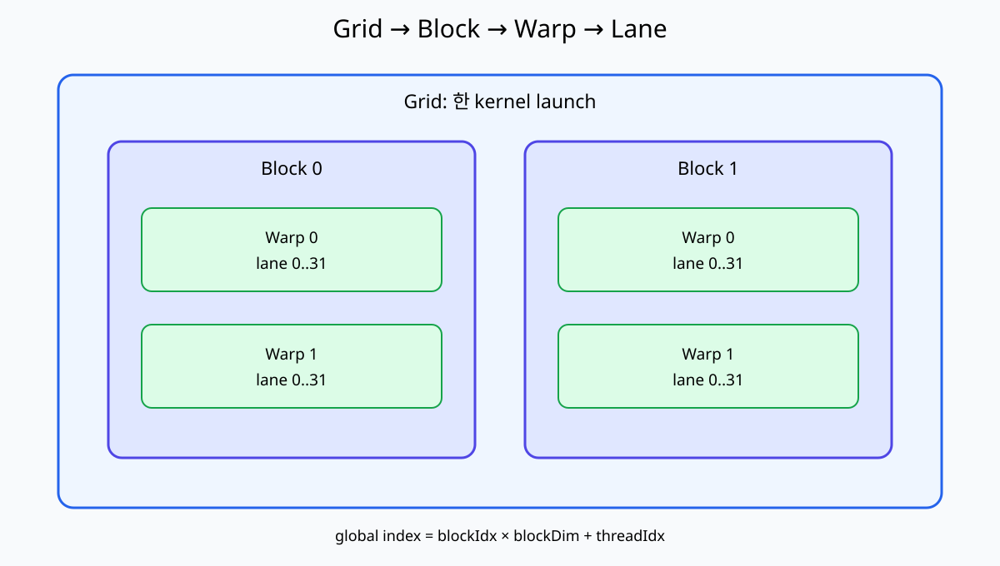
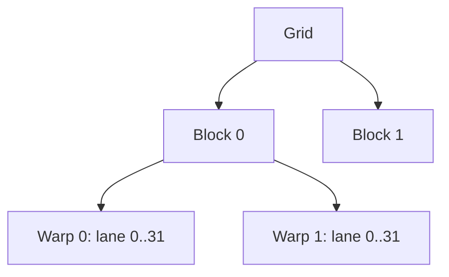

# 02. Thread·Block·Warp·Grid

[이전: 01. CPU·GPU](01-cpu-gpu-and-parallel-work.md) · [목차](README.md) · [다음: 03. Memory 공간](03-registers-global-and-shared-memory.md)

Thread 계층은 code를 data 주소에 연결하는 좌표계다.





## 1. Thread

Kernel body의 한 logical instance다. `threadIdx`로 block 안 좌표를 얻는다.

Thread마다 register state와 local variables가 있을 수 있다.

## 2. Block

함께 배치되고 shared memory와 block barrier를 사용할 수 있는 thread 집합이다.

`blockDim`은 block 크기, `blockIdx`는 grid 안 block 좌표다.

## 3. Grid

한 kernel launch의 모든 block 집합이다. `gridDim`은 grid 크기다.

Block 실행 순서는 일반적으로 program이 가정하면 안 된다.

## 4. Warp와 lane

Warp는 hardware가 함께 issue하는 thread 묶음이며 현재 CUDA에서 32 lane이다. Lane은 warp 안 위치다.

ThreadIdx.x 37은 block 내 두 번째 warp의 lane 5다. `37//32=1`, `37%32=5`다.

## 5. 1D index

Block 128 thread, blockIdx 3, threadIdx 7이면 global index는 `3*128+7=391`이다.

## 6. 2D image index

Block `(16,16)`, blockIdx `(2,1)`, threadIdx `(3,5)`라 하자.

```text
x = 2*16+3 = 35
y = 1*16+5 = 21
```

Image width 100이면 row-major linear index는 `21*100+35=2135`다.

## 7. Row-major

같은 row의 x가 1 증가하면 adjacent element 주소로 이동한다. Coalescing을 위해 warp의 x dimension이 연속 element를 맡게 설계하는 이유다.

## 8. 3D 좌표

Volume `(width,height,depth)`에서 linear index는 보통 `(z*height+y)*width+x`다. Overflow와 type width를 확인한다.

## 9. Grid 크기 올림

n=1000, block=256이면 `(1000+255)//256=4` block이다.

마지막 block의 유효 thread는 index 768~999, 232개다. 24 lane은 inactive condition이 된다.

## 10. Partial warp

Block 크기 40이면 warp 0은 32 active lane, warp 1은 8 thread만 block에 있다. Resource allocation과 branch mask를 고려한다.

## 11. Warp divergence

Warp 안 lane이 서로 다른 branch를 택하면 active mask를 바꿔 경로를 나눠 실행할 수 있다.

Warp가 같은 경로를 실행한다는 관찰을 synchronization 보장으로 오해하지 않는다.

## 12. Independent thread scheduling

Warp-synchronous programming을 명시적 primitive 없이 가정하면 위험하다. 필요한 경우 warp-level synchronization과 mask 계약을 사용한다.

## 13. Block barrier 참여

`__syncthreads()`는 block의 참여 thread가 도달해야 한다. 일부 thread만 들어가는 branch 안 barrier는 다른 thread가 오지 않아 hang·undefined behavior 위험이 있다.

```text
if threadIdx.x < 16:
    __syncthreads()  # block의 나머지가 오지 않음
```

## 14. Grid-stride loop 손 추적

n=20, total threads=8이면 thread 3은 index 3,11,19를 처리한다.

| iteration | i | 다음 i |
| ---: | ---: | ---: |
| 0 | 3 | 11 |
| 1 | 11 | 19 |
| 2 | 19 | 27 종료 |

## 14.1 Warp별 주소 표

Block 64 thread가 float array를 읽는다면 warp 0과 warp 1은 다음 주소를 만든다. Base는 0으로 단순화한다.

| Warp | ThreadIdx | Global index | Byte 주소 |
| ---: | --- | --- | --- |
| 0 | 0..31 | 0..31 | 0..124 |
| 1 | 32..63 | 32..63 | 128..252 |

Block과 warp는 실행 계층이고 byte 주소는 memory 계층이다. Thread 번호가 연속이어도 index 식에 stride를 곱하면 주소는 연속이 아닐 수 있다.

## 14.2 2D boundary

Image 35×21, block 16×16이면 grid는 x방향 3, y방향 2다. 총 thread는 `3×2×256=1536`, 유효 pixel은 735다.

마지막 x block은 x=32,33,34 세 column만 유효하고, 마지막 y block은 y=16..20 다섯 row만 유효하다.

```text
if x < width and y < height:
    output[y*width+x] = ...
```

x만 검사하고 y를 빠뜨리면 아래쪽 범위를 벗어난다. Linear index를 계산하기 전에 두 좌표를 검사한다.

## 15. Persistent work 주의

Thread가 queue에서 여러 일을 가져오는 구조는 load balance를 개선할 수 있지만 atomic queue와 termination protocol이 필요하다.

## 16. Object 위치

`threadIdx`, `blockIdx`는 device kernel에서 읽는 built-in 좌표다. Host code에서 같은 방식으로 직접 읽지 않는다.

## 17. 반례

Block 2개가 동시에 실행될 것이라고 가정해 flag만 기다리면 deadlock할 수 있다. Scheduling과 residency를 보장받지 않았다.

Warp 32이므로 global thread index도 0~31뿐이라는 생각은 틀리다. Block과 grid가 여러 warp를 만든다.

## 문제와 해설

**문제 1.** block 64에서 threadIdx 50의 warp와 lane은?

**해설.** Warp 1, lane 18이다.

**문제 2.** width 64, `(x,y)=(7,3)`의 row-major index는?

**해설.** `3*64+7=199`다.

**문제 3.** n=513, block=256의 grid와 여분 thread는?

**해설.** 3 block, 총 768 thread, 여분 255다. Boundary check가 필요하다.

## 공식 자료

- [CUDA thread hierarchy](https://docs.nvidia.com/cuda/cuda-programming-guide/01-introduction/programming-model.html)
- [CUDA SIMT architecture](https://docs.nvidia.com/cuda/cuda-programming-guide/02-basics/writing-cuda-kernels.html)
