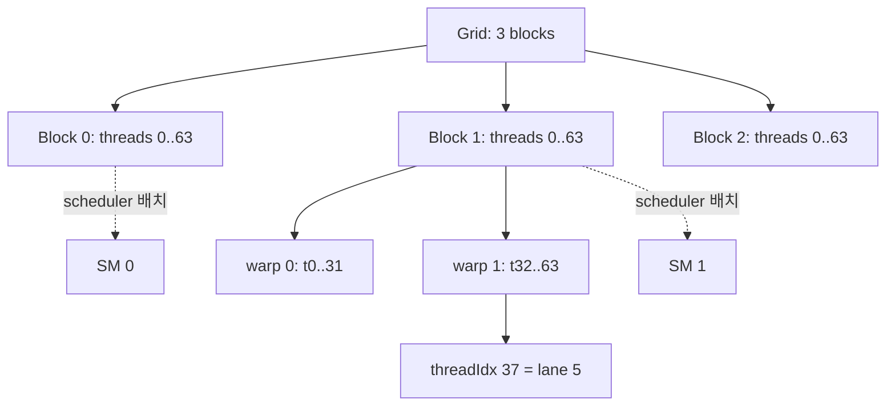
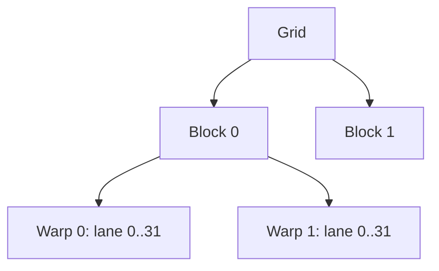

# 02. Thread·Block·Warp·Grid

[이전: 01. CPU·GPU](01-cpu-gpu-and-parallel-work.md) · [목차](README.md) · [다음: 03. Memory 공간](03-registers-global-and-shared-memory.md)

Thread 계층은 code를 data 주소에 연결하는 좌표계다.

## 좌표와 실제 실행 단위를 차례로 구분한다

**thread(스레드)**는 kernel body 한 사본을 실행하는 logical 주체다. Thread는 `threadIdx`라는 block 내부 좌표를 읽고 자기 element 주소를 계산한다. **block(블록)**은 shared memory와 block barrier를 공유할 수 있는 thread 집합이다. **grid(그리드)**는 한 launch가 만든 모든 block이다.

**warp(워프)**는 scheduler가 instruction을 issue하는 32-thread 묶음이고, **lane(레인)**은 warp 안 0~31 위치다. Block 안 linear thread 번호가 70이면 warp 번호는 `70//32=2`, lane은 `70%32=6`이다. Grid 전체 thread 번호 70이라는 말과 특정 block의 threadIdx 70이라는 말은 blockIdx가 빠져 서로 다를 수 있다.

**SM(Streaming Multiprocessor)**은 warp를 resident시키고 실행하는 GPU의 처리 단위다. Block은 한 SM에 배치되며 실행 중 다른 SM으로 반씩 나뉘지 않는다. 한 SM에 여러 block과 warp가 함께 resident할 수 있고 scheduler는 준비된 warp에서 instruction을 고른다. Source 코드의 block 순서는 SM 배치 순서를 보장하지 않는다.



## 수치 추적 1: 100개 element의 모든 경계

`n=100`, blockDim.x=32라면 grid는 `(100+31)//32=4` block, 총 128 thread다. Block 0은 global index 0~31, block 1은 32~63, block 2는 64~95, block 3은 96~127을 만든다. 마지막 block에서 96~99 네 thread만 유효하고 100~127의 28 thread는 `if i<n`에서 빠진다.

Block 3의 threadIdx 3은 `i=3×32+3=99`, warp 0 lane 3이다. ThreadIdx 4는 i=100이라 out-of-range다. Boundary branch가 warp 안에서 4 active lane과 28 inactive lane을 만들지만, 잘못된 memory access를 막는 정확성 조건이 먼저다.

Block 크기를 40으로 바꾸면 grid는 3 block, 총 120 thread다. 각 block은 완전한 첫 warp 32 thread와 8-thread partial warp를 갖는다. 마지막 block의 유효 thread는 20개뿐이다. 총 logical thread가 더 적어도 partial warp와 resource 배치 때문에 어느 쪽이 빠른지는 측정해야 한다.

## 수치 추적 2: 2D image와 linear address

Image width=35, height=21, block=(16,16)이면 grid=(3,2)다. Block `(2,1)`의 thread `(2,4)`는 `x=2×16+2=34`, `y=1×16+4=20`이라 마지막 유효 pixel이다. Linear index는 `20×35+34=734`; float byte offset은 `734×4=2936`이다.

같은 block의 thread `(3,4)`는 x=35라 범위를 벗어난다. `linear=y*width+x`를 먼저 계산해 735를 얻은 뒤 x 검사를 빼면 다음 row처럼 보이는 주소를 잘못 쓸 수 있다. x와 y를 각각 확인한 다음 주소를 계산한다.

## Scheduler와 준비된 warp

Warp A가 global load 결과를 기다리는 동안 warp B의 operand가 준비되어 있으면 scheduler가 B instruction을 issue해 latency를 숨길 수 있다. Occupancy가 너무 낮으면 고를 준비 warp가 없을 수 있다. 그러나 warp가 많아도 모두 같은 memory transaction을 기다리면 숨길 일이 없다.

Block 간 순서는 지정되지 않는다. Block 0이 flag를 쓸 때까지 block 1이 spin한다고 해도 block 0이 아직 resident하지 못하면 block 1이 자원을 점유한 채 기다리는 deadlock이 가능하다. Kernel 경계나 cooperative launch의 명시 계약 없이 block 순서를 protocol로 쓰지 않는다.

## Grid-stride loop와 workload 수명

총 thread 8, n=20이면 thread 3은 3,11,19를 처리하고 thread 7은 7,15를 처리한다. 각 반복에서 index가 8씩 증가한다. 적은 grid로 큰 배열을 덮을 수 있지만 한 thread의 loop가 길어지므로 register 수명과 load balance가 달라진다.

Persistent kernel이 queue에서 작업을 꺼내면 grid/block 좌표는 worker ID가 되고 실제 요청 ID는 queue 값이 된다. Queue atomic, 빈 queue 종료, 새 작업 도착 조건을 따로 설계해야 한다. 이 구조를 일반적인 one-thread-one-element와 섞어 설명하면 주소 주체를 잃는다.

## Warp specialization 연구와 연결

FlashAttention-3의 Hopper 구현은 일부 warp를 TMA 기반 data producer, 다른 warp를 Tensor Core consumer로 역할 분리한다. 모든 warp가 같은 instruction을 수행해야 한다는 초보 가정과 달리 block 안 warp별 역할이 다를 수 있다. 대신 shared buffer slot의 준비·사용 완료를 정확히 동기화하고, producer가 덮기 전에 consumer가 끝났는지 보장해야 한다.

이 패턴은 Hopper의 특정 비동기 기능과 행렬 shape를 전제로 한다. 일반 GPU kernel에서 warp 번호만 나누고 같은 primitive를 기대하면 안 된다. 역할 분리의 correctness와 이득을 architecture별로 검증한다.

## 다섯 문제를 단계별로 푼다

**문제 1.** blockDim 128, blockIdx 2, threadIdx 17의 global index는?

**해설.** `2×128+17=273`이다. Block 내부 warp는 `17//32=0`, lane 17이다.

**문제 2.** threadIdx 70의 warp와 lane은?

**해설.** `70//32=2`번째 warp, `70%32=6`번 lane이다.

**문제 3.** n=1000, block=128의 grid와 여분 thread는?

**해설.** `(1000+127)//128=8` block, 총 1024 thread다. 24 thread는 boundary check에서 빠진다.

**문제 4.** Block 0과 1이 같은 shared 배열을 읽을 수 있는가?

**해설.** Shared allocation은 block별이다. Block 사이 전달에는 global memory와 kernel/event/cooperative protocol 같은 더 넓은 범위가 필요하다.

**문제 5.** Warp가 32 lane이면 block은 32의 배수여야 정확한가?

**해설.** 정확성상 필수는 아니다. 마지막 partial warp가 생길 수 있으며 resource와 효율을 고려해 block 크기를 선택한다.




## 1. Thread

Kernel body의 한 logical instance다. `threadIdx`로 block 안 좌표를 얻는다.

Thread마다 register state와 local variables가 있을 수 있다.

## 2. Block

함께 배치되고 shared memory와 block barrier를 사용할 수 있는 thread 집합이다.

`blockDim`은 block 크기, `blockIdx`는 grid 안 block 좌표다.

## 3. Grid

한 kernel launch의 모든 block 집합이다. `gridDim`은 grid 크기다.

Block 실행 순서는 일반적으로 program이 가정하면 안 된다.

## 4. Warp와 lane

Warp는 hardware가 함께 issue하는 thread 묶음이며 현재 CUDA에서 32 lane이다. Lane은 warp 안 위치다.

ThreadIdx.x 37은 block 내 두 번째 warp의 lane 5다. `37//32=1`, `37%32=5`다.

## 5. 1D index

Block 128 thread, blockIdx 3, threadIdx 7이면 global index는 `3*128+7=391`이다.

## 6. 2D image index

Block `(16,16)`, blockIdx `(2,1)`, threadIdx `(3,5)`라 하자.

```text
x = 2*16+3 = 35
y = 1*16+5 = 21
```

Image width 100이면 row-major linear index는 `21*100+35=2135`다.

## 7. Row-major

같은 row의 x가 1 증가하면 adjacent element 주소로 이동한다. Coalescing을 위해 warp의 x dimension이 연속 element를 맡게 설계하는 이유다.

## 8. 3D 좌표

Volume `(width,height,depth)`에서 linear index는 보통 `(z*height+y)*width+x`다. Overflow와 type width를 확인한다.

## 9. Grid 크기 올림

n=1000, block=256이면 `(1000+255)//256=4` block이다.

마지막 block의 유효 thread는 index 768~999, 232개다. 24 lane은 inactive condition이 된다.

## 10. Partial warp

Block 크기 40이면 warp 0은 32 active lane, warp 1은 8 thread만 block에 있다. Resource allocation과 branch mask를 고려한다.

## 11. Warp divergence

Warp 안 lane이 서로 다른 branch를 택하면 active mask를 바꿔 경로를 나눠 실행할 수 있다.

Warp가 같은 경로를 실행한다는 관찰을 synchronization 보장으로 오해하지 않는다.

## 12. Independent thread scheduling

Warp-synchronous programming을 명시적 primitive 없이 가정하면 위험하다. 필요한 경우 warp-level synchronization과 mask 계약을 사용한다.

## 13. Block barrier 참여

`__syncthreads()`는 block의 참여 thread가 도달해야 한다. 일부 thread만 들어가는 branch 안 barrier는 다른 thread가 오지 않아 hang·undefined behavior 위험이 있다.

```text
if threadIdx.x < 16:
    __syncthreads()  # block의 나머지가 오지 않음
```

## 14. Grid-stride loop 손 추적

n=20, total threads=8이면 thread 3은 index 3,11,19를 처리한다.

| iteration | i | 다음 i |
| ---: | ---: | ---: |
| 0 | 3 | 11 |
| 1 | 11 | 19 |
| 2 | 19 | 27 종료 |

## 14.1 Warp별 주소 표

Block 64 thread가 float array를 읽는다면 warp 0과 warp 1은 다음 주소를 만든다. Base는 0으로 단순화한다.

| Warp | ThreadIdx | Global index | Byte 주소 |
| ---: | --- | --- | --- |
| 0 | 0..31 | 0..31 | 0..124 |
| 1 | 32..63 | 32..63 | 128..252 |

Block과 warp는 실행 계층이고 byte 주소는 memory 계층이다. Thread 번호가 연속이어도 index 식에 stride를 곱하면 주소는 연속이 아닐 수 있다.

## 14.2 2D boundary

Image 35×21, block 16×16이면 grid는 x방향 3, y방향 2다. 총 thread는 `3×2×256=1536`, 유효 pixel은 735다.

마지막 x block은 x=32,33,34 세 column만 유효하고, 마지막 y block은 y=16..20 다섯 row만 유효하다.

```text
if x < width and y < height:
    output[y*width+x] = ...
```

x만 검사하고 y를 빠뜨리면 아래쪽 범위를 벗어난다. Linear index를 계산하기 전에 두 좌표를 검사한다.

## 15. Persistent work 주의

Thread가 queue에서 여러 일을 가져오는 구조는 load balance를 개선할 수 있지만 atomic queue와 termination protocol이 필요하다.

## 16. Object 위치

`threadIdx`, `blockIdx`는 device kernel에서 읽는 built-in 좌표다. Host code에서 같은 방식으로 직접 읽지 않는다.

## 17. 반례

Block 2개가 동시에 실행될 것이라고 가정해 flag만 기다리면 deadlock할 수 있다. Scheduling과 residency를 보장받지 않았다.

Warp 32이므로 global thread index도 0~31뿐이라는 생각은 틀리다. Block과 grid가 여러 warp를 만든다.

## 문제와 해설

**문제 1.** block 64에서 threadIdx 50의 warp와 lane은?

**해설.** Warp 1, lane 18이다.

**문제 2.** width 64, `(x,y)=(7,3)`의 row-major index는?

**해설.** `3*64+7=199`다.

**문제 3.** n=513, block=256의 grid와 여분 thread는?

**해설.** 3 block, 총 768 thread, 여분 255다. Boundary check가 필요하다.

## 공식 자료

- [CUDA thread hierarchy](https://docs.nvidia.com/cuda/cuda-programming-guide/01-introduction/programming-model.html)
- [CUDA SIMT architecture](https://docs.nvidia.com/cuda/cuda-programming-guide/02-basics/writing-cuda-kernels.html)
