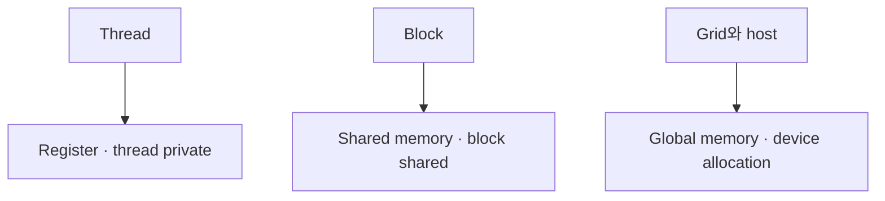

# 03. Register·Global·Shared Memory

[이전: 02. Thread 계층](02-threads-blocks-warps-and-grids.md) · [목차](README.md) · [다음: 04. 동기화](04-synchronization-and-memory-order.md)

Memory 공간은 주소 위치, 공유 범위, 수명, 비용이 다르다.

## 1. Register

Thread의 작은 scalar 임시값을 보관하는 빠른 on-chip 자원이다. Programmer가 physical register 번호를 직접 정하지 않고 compiler가 배치한다.

Register 사용량이 많으면 동시에 resident할 warp 수가 줄거나 spill이 생길 수 있다.

## 2. Local memory라는 이름

Local variable이 모두 빠른 register라는 뜻은 아니다. Register에 못 들어간 값이나 큰 thread-private array는 local memory 주소 공간을 사용하고 device memory traffic이 생길 수 있다.

## 3. Global memory

Device allocation의 큰 memory다. 여러 block과 kernel이 주소를 전달받아 접근할 수 있다.

Access latency가 크므로 coalescing, cache, 재사용이 중요하다.

## 4. Shared memory

한 block의 thread가 공유하는 on-chip scratchpad다. Block이 실행되는 동안 존재하며 다른 block은 같은 shared object를 직접 공유하지 않는다.

## 5. 수명 표

| 공간 | 주 사용자 | 공유 범위 | 대표 수명 |
| --- | --- | --- | --- |
| Register | 한 thread | Private | Thread 실행 |
| Local | 한 thread | Private 주소 | Thread 실행 |
| Shared | 한 block | Block threads | Block 실행 |
| Global | Device/host API | Allocation 접근자 | 명시적 해제까지 |
| Constant | Grid readers | Device constant | Module/allocation 정책 |

## 6. Shared tile 예제

Block thread 4개가 global `[10,20,30,40]`을 shared로 옮긴다.

| thread | global read | shared write |
| ---: | ---: | --- |
| 0 | 10 | tile[0]=10 |
| 1 | 20 | tile[1]=20 |
| 2 | 30 | tile[2]=30 |
| 3 | 40 | tile[3]=40 |

모두 쓴 뒤 barrier가 있어야 thread 0이 tile 전체를 안전하게 합칠 수 있다.

## 7. Barrier 전 읽기 반례

Thread 0이 먼저 tile[3]을 읽으면 thread 3 write가 아직 끝나지 않았을 수 있다. 같은 block이라고 자동 순서가 생기지 않는다.

## 8. Shared 재사용

Matrix tile을 shared에 한 번 load하고 여러 output multiply에 사용하면 global load를 줄인다.

Shared copy 자체와 barrier 비용도 있어 재사용이 적으면 이득이 작다.

## 9. Dynamic shared memory

Launch 시 byte 크기를 정하는 shared region을 사용할 수 있다. 여러 type 배열로 나누면 alignment와 offset을 계산한다.

## 10. Alignment

4-byte float 주소가 4의 배수인지, vector load가 요구 alignment를 만족하는지 확인한다. Misaligned access는 transaction을 늘리거나 일부 type에서 잘못된 사용이 될 수 있다.

## 11. Cache

Global load가 cache hit할 수 있지만 cache에 항상 남는다고 가정하지 않는다. Working set과 access pattern, architecture가 영향을 준다.

## 12. Constant memory

Warp lane이 같은 constant 주소를 읽는 pattern에 유리할 수 있다. Lane마다 서로 다른 많은 주소면 serialization 성격이 생길 수 있다.

## 13. Read-only data

Compiler와 API가 read-only 성질을 활용할 수 있지만 pointer alias와 mutation 계약을 정확히 지켜야 한다.

## 14. Register pressure 숫자

SM에 65536 register가 있고 block 256 thread, thread당 64 register라는 단순 모형이면 block당 16384 register, register만 보면 4 block이다.

실제 residency는 shared memory, warp, block limit도 함께 제한한다.

## 14.1 두 자원 제한을 함께 계산한다

같은 SM이 register 65536개, shared 96 KiB를 가진다는 교육 모형에서 block 256 thread, thread당 64 register, block당 shared 40 KiB라고 하자.

| 제한 | Block당 사용 | 가능한 block |
| --- | ---: | ---: |
| Register | 16384 | 4 |
| Shared | 40 KiB | 2 |

두 조건을 동시에 만족하는 상한은 2 block이다. Register만 보고 4 block이라 하면 shared 제한을 놓친다.

Block당 256 thread면 resident thread는 512, warp는 16이다. Architecture의 최대 thread·warp·block limit이 더 낮으면 다시 줄어든다.

## 14.2 Shared layout 주소 계산

Dynamic shared 1024 byte를 float tile 128개와 int flag 8개로 나눈다고 하자. Float 영역은 512 byte, 다음 int 영역은 offset 512에서 시작한다.

Type alignment를 맞추지 않고 byte pointer를 임의로 나누면 misaligned pointer가 될 수 있다. 필요한 alignment로 offset을 올림한다.

Shared 배열 두 개가 겹치면 한 thread의 tile write가 다른 의미의 flag를 덮는다. 전체 byte 합과 각 구간을 표로 검산한다.

## 15. Spill

Thread당 register 요구가 hardware/compiler allocation 범위를 넘으면 local memory load/store가 생길 수 있다. Source local variable 수만 보고 확정하지 말고 compiler·profiler 증거를 본다.

## 16. Global allocation 수명

Async kernel이 pointer를 쓰는 동안 host가 allocation을 free하면 use-after-free 위험이다. Stream/event completion 뒤 해제한다.

## 17. Unified addressing 주의

Pointer 값 체계가 통합되어도 memory placement와 migration, 접근 권한, 동기화 문제는 남는다.

## 18. 반례

Shared memory가 빠르다고 input 전체를 shared에 넣을 수 없다. Block당 용량이 제한되고 block 사이 공유가 아니다.

Register가 빠르다고 thread당 배열을 크게 만들면 occupancy와 spill이 악화될 수 있다.

## 문제와 해설

**문제 1.** Block A의 shared 값을 Block B가 barrier 뒤 읽을 수 있는가?

**해설.** 같은 shared object를 block 사이 직접 공유하지 않는다. Global memory와 grid-level protocol 등 다른 방법이 필요하다.

**문제 2.** Local memory는 host RAM인가?

**해설.** 아니다. CUDA의 thread-private address space 이름이며 device memory traffic이 될 수 있다.

**문제 3.** Async kernel launch 반환 뒤 device buffer를 즉시 free해도 되는가?

**해설.** Kernel completion을 확인하기 전이면 안 된다.

## 공식 자료

- [CUDA memory hierarchy](https://docs.nvidia.com/cuda/cuda-programming-guide/01-introduction/programming-model.html)
- [CUDA hardware implementation](https://docs.nvidia.com/cuda/cuda-programming-guide/02-basics/writing-cuda-kernels.html)
