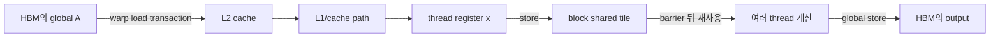
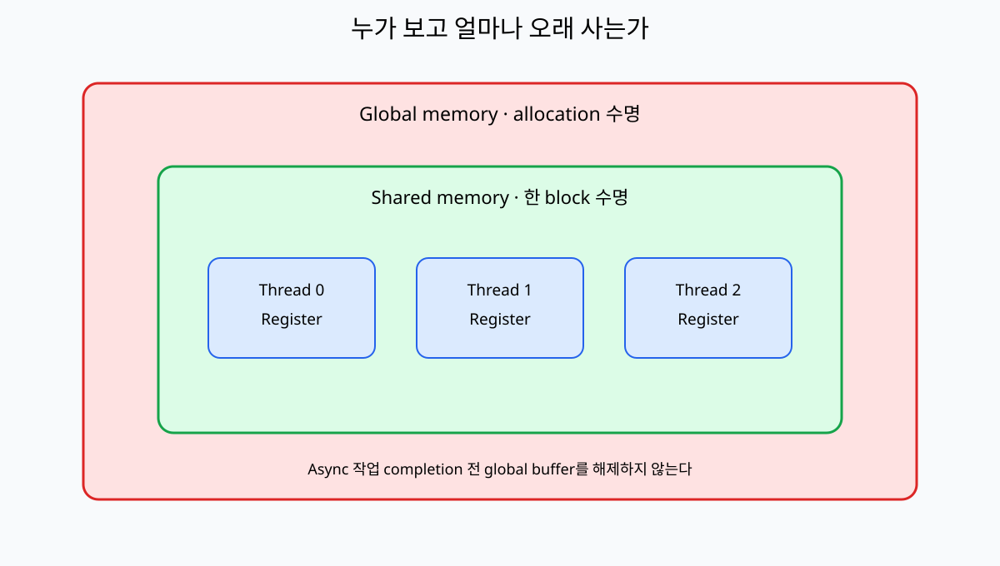
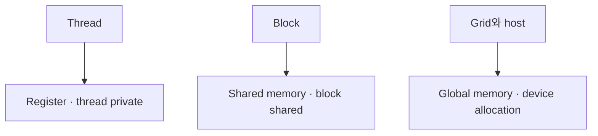

# 03. Register·Global·Shared Memory

[이전: 02. Thread 계층](02-threads-blocks-warps-and-grids.md) · [목차](README.md) · [다음: 04. 동기화](04-synchronization-and-memory-order.md)

Memory 공간은 주소 위치, 공유 범위, 수명, 비용이 다르다.

## 이름보다 할당 위치·공유 범위·수명을 본다

**register(레지스터)**는 compiler가 thread의 scalar 임시값에 배치하는 on-chip 저장 자원이다. Thread마다 private하며 kernel thread가 끝나면 그 값의 수명도 끝난다. Source 변수 하나가 항상 physical register 하나라는 보장은 없고, live range와 최적화가 allocation을 정한다.

**local memory(로컬 메모리)**는 이름과 달리 host RAM이 아니다. Thread-private 주소 공간이며 register에 못 들어간 값이나 동적 index의 큰 배열이 device memory에 놓일 수 있다. **global memory(글로벌 메모리)**는 device allocation으로 여러 block과 kernel이 pointer를 통해 접근한다. 보통 GPU board의 **HBM(High Bandwidth Memory)** 또는 device DRAM이 물리 backing이지만, 주소 공간과 물리 위치를 완전히 같은 말로 취급하지 않는다.

**shared memory(공유 메모리)**는 한 block이 실행되는 동안 그 block thread들이 공유하는 programmer-managed on-chip 공간이다. **L1/L2 cache**는 최근 global/local load를 보관할 수 있는 hardware-managed 계층이다. Shared는 어떤 값을 어느 index에 둘지 코드가 정하지만 cache hit와 교체는 일반적으로 코드가 직접 소유하지 않는다. L1은 SM 가까이, L2는 device 전반에서 공유되는 계층이지만 용량·정책은 architecture별로 다르다.

**load/store(로드/스토어)**는 memory에서 register로 읽고 register 값을 memory로 쓰는 instruction이다. Warp의 32 lane 주소는 하나 이상의 **transaction(메모리 거래)**으로 합쳐진다. Lane 주소가 연속되고 alignment가 맞으면 적은 transaction으로 처리될 가능성이 크다. 공간 이름만 알아서는 실제 byte 이동량을 알 수 없다.

## 수치 추적 1: 네 thread의 load·공유·store

Global A가 `[10,20,30,40]`이고 thread 0~3이 각각 A[t]를 register `x`로 load한다. 각 thread는 `shared[t]=x`를 store한 뒤 block barrier에 도달한다. Barrier 뒤 thread 0이 shared 네 값을 읽어 합 100을 계산하고 global output[0]에 store한다.

Thread 0의 시간표를 보면 global load→register 10→shared store `s[0]=10`→barrier 대기→shared load 4회→register sum 100→global store다. Thread 3은 register 40과 shared `s[3]`을 만들지만 output을 쓰지 않는다. Barrier가 없으면 thread 0이 아직 쓰이지 않은 `s[3]`을 읽을 수 있다.

Float 네 개는 16 byte다. 실제 transaction은 cache line과 architecture 규칙에 따라 16 byte보다 클 수 있다. “필요 데이터 16 byte”와 “memory system이 이동한 byte”를 구분하고 profiler로 후자를 확인한다.

## 수치 추적 2: tile 재사용의 이동량

4×4 행렬 tile 두 개를 float로 global에서 읽으면 각 16×4=64 byte, 합 128 byte다. Shared에 한 번 올리고 16 output의 dot product에서 재사용하면 단순히 매 multiply마다 global에서 다시 읽는 모형보다 load를 줄인다. 각 output이 길이 4의 두 벡터를 매번 읽으면 `16 outputs×8 floats×4 byte=512 byte`다.

이 교육 계산은 cache hit, write, instruction을 생략한다. Shared 방식은 128 byte와 barrier·shared access 비용을 쓰고, 순진 방식도 cache가 일부 512 byte 요청을 흡수할 수 있다. 재사용 1회뿐인 작은 tile에서는 shared copy 비용이 이득을 넘을 수 있다.

## Allocation과 lifetime 표를 실행으로 읽기

Host가 dA를 할당하면 명시적으로 free할 때까지 allocation 수명이 이어진다. Kernel thread register와 local 값은 해당 thread 실행 동안, dynamic shared 배열은 해당 block 실행 동안만 존재한다. Kernel A의 shared pointer를 kernel B에 저장해 읽는 것은 유효하지 않다.

Async kernel이 dA를 읽는 동안 host가 dA를 free하면 pointer 변수 자체가 남아 있어도 allocation lifetime이 끝난다. Stream event completion 뒤 free하거나 stream-ordered allocation API의 계약을 지켜야 한다. Cache에 값이 남았다는 사실은 allocation 수명을 연장하지 않는다.

## Register pressure와 spill의 인과

SM register 65536개, block 256 thread, thread당 32 register면 block당 8192라 register 기준 최대 8 block이다. Thread당 96이면 block당 24576이므로 정수로 2 block까지만 들어간다. Compiler가 더 필요한 값을 local memory로 spill하면 resident block은 늘 가능성이 있어도 HBM/cache traffic이 추가될 수 있다.

따라서 register 수를 강제로 낮추면 occupancy가 올라 성능이 좋아진다는 단순 결론은 위험하다. Spill load/store 증가와 준비 warp 수를 함께 profiler로 본다.

## 비동기 producer-consumer의 수명

FlashAttention-3 같은 Hopper 경로에서 producer warp가 TMA로 global tile을 shared buffer slot에 채우고 consumer warp가 Tensor Core 계산에 쓴다. Slot 0이 준비되기 전에 consumer가 읽으면 race이고, consumer가 끝나기 전에 producer가 다음 tile로 덮으면 lifetime overlap 오류다. “copy 시작”, “data ready”, “slot free”는 서로 다른 상태다.

두 slot을 ping-pong하면 producer가 slot 1을 채우는 동안 consumer가 slot 0을 계산할 수 있다. 이 overlap은 Hopper TMA와 정확한 barrier protocol이라는 조건을 가진다. 다른 architecture나 크기에서는 일반 load가 더 맞을 수 있다.

## 다섯 문제를 단계별로 푼다

**문제 1.** Thread-private 큰 배열이 source에서 local이면 register인가?

**해설.** 반드시 그렇지 않다. Compiler가 register에 둘 수 없으면 local address space의 device memory traffic이 생길 수 있다. Compiler report와 profiler를 본다.

**문제 2.** Float 32개를 연속으로 읽는 warp의 유용 byte는?

**해설.** `32×4=128 byte`다. 실제 transaction 수와 byte는 alignment·cache line·architecture에 달린다.

**문제 3.** Kernel A shared 값을 kernel B가 읽을 수 있는가?

**해설.** 아니다. Shared 수명은 block 실행 범위다. 지속할 값은 global allocation 등에 저장하고 kernel 순서를 만든다.

**문제 4.** Register 사용을 줄이면 항상 빠른가?

**해설.** 아니다. Occupancy는 늘 수 있지만 spill이 global/local traffic을 추가할 수 있다. 둘을 함께 측정한다.

**문제 5.** L2 cache hit이면 global allocation을 free해도 되는가?

**해설.** 아니다. Cache는 수명 권한이 아니다. 모든 사용자 작업이 끝난 뒤 allocation을 해제한다.

## 1. Register

Thread의 작은 scalar 임시값을 보관하는 빠른 on-chip 자원이다. Programmer가 physical register 번호를 직접 정하지 않고 compiler가 배치한다.

Register 사용량이 많으면 동시에 resident할 warp 수가 줄거나 spill이 생길 수 있다.

## 2. Local memory라는 이름

Local variable이 모두 빠른 register라는 뜻은 아니다. Register에 못 들어간 값이나 큰 thread-private array는 local memory 주소 공간을 사용하고 device memory traffic이 생길 수 있다.

## 3. Global memory

Device allocation의 큰 memory다. 여러 block과 kernel이 주소를 전달받아 접근할 수 있다.

Access latency가 크므로 coalescing, cache, 재사용이 중요하다.

## 4. Shared memory

한 block의 thread가 공유하는 on-chip scratchpad다. Block이 실행되는 동안 존재하며 다른 block은 같은 shared object를 직접 공유하지 않는다.

## 5. 수명 표

| 공간 | 주 사용자 | 공유 범위 | 대표 수명 |
| --- | --- | --- | --- |
| Register | 한 thread | Private | Thread 실행 |
| Local | 한 thread | Private 주소 | Thread 실행 |
| Shared | 한 block | Block threads | Block 실행 |
| Global | Device/host API | Allocation 접근자 | 명시적 해제까지 |
| Constant | Grid readers | Device constant | Module/allocation 정책 |

## 6. Shared tile 예제

Block thread 4개가 global `[10,20,30,40]`을 shared로 옮긴다.

| thread | global read | shared write |
| ---: | ---: | --- |
| 0 | 10 | tile[0]=10 |
| 1 | 20 | tile[1]=20 |
| 2 | 30 | tile[2]=30 |
| 3 | 40 | tile[3]=40 |

모두 쓴 뒤 barrier가 있어야 thread 0이 tile 전체를 안전하게 합칠 수 있다.

## 7. Barrier 전 읽기 반례

Thread 0이 먼저 tile[3]을 읽으면 thread 3 write가 아직 끝나지 않았을 수 있다. 같은 block이라고 자동 순서가 생기지 않는다.

## 8. Shared 재사용

Matrix tile을 shared에 한 번 load하고 여러 output multiply에 사용하면 global load를 줄인다.

Shared copy 자체와 barrier 비용도 있어 재사용이 적으면 이득이 작다.

## 9. Dynamic shared memory

Launch 시 byte 크기를 정하는 shared region을 사용할 수 있다. 여러 type 배열로 나누면 alignment와 offset을 계산한다.

## 10. Alignment

4-byte float 주소가 4의 배수인지, vector load가 요구 alignment를 만족하는지 확인한다. Misaligned access는 transaction을 늘리거나 일부 type에서 잘못된 사용이 될 수 있다.

## 11. Cache

Global load가 cache hit할 수 있지만 cache에 항상 남는다고 가정하지 않는다. Working set과 access pattern, architecture가 영향을 준다.

## 12. Constant memory

Warp lane이 같은 constant 주소를 읽는 pattern에 유리할 수 있다. Lane마다 서로 다른 많은 주소면 serialization 성격이 생길 수 있다.

## 13. Read-only data

Compiler와 API가 read-only 성질을 활용할 수 있지만 pointer alias와 mutation 계약을 정확히 지켜야 한다.

## 14. Register pressure 숫자

SM에 65536 register가 있고 block 256 thread, thread당 64 register라는 단순 모형이면 block당 16384 register, register만 보면 4 block이다.

실제 residency는 shared memory, warp, block limit도 함께 제한한다.

## 14.1 두 자원 제한을 함께 계산한다

같은 SM이 register 65536개, shared 96 KiB를 가진다는 교육 모형에서 block 256 thread, thread당 64 register, block당 shared 40 KiB라고 하자.

| 제한 | Block당 사용 | 가능한 block |
| --- | ---: | ---: |
| Register | 16384 | 4 |
| Shared | 40 KiB | 2 |

두 조건을 동시에 만족하는 상한은 2 block이다. Register만 보고 4 block이라 하면 shared 제한을 놓친다.

Block당 256 thread면 resident thread는 512, warp는 16이다. Architecture의 최대 thread·warp·block limit이 더 낮으면 다시 줄어든다.

## 14.2 Shared layout 주소 계산

Dynamic shared 1024 byte를 float tile 128개와 int flag 8개로 나눈다고 하자. Float 영역은 512 byte, 다음 int 영역은 offset 512에서 시작한다.

Type alignment를 맞추지 않고 byte pointer를 임의로 나누면 misaligned pointer가 될 수 있다. 필요한 alignment로 offset을 올림한다.

Shared 배열 두 개가 겹치면 한 thread의 tile write가 다른 의미의 flag를 덮는다. 전체 byte 합과 각 구간을 표로 검산한다.

## 15. Spill

Thread당 register 요구가 hardware/compiler allocation 범위를 넘으면 local memory load/store가 생길 수 있다. Source local variable 수만 보고 확정하지 말고 compiler·profiler 증거를 본다.

## 16. Global allocation 수명

Async kernel이 pointer를 쓰는 동안 host가 allocation을 free하면 use-after-free 위험이다. Stream/event completion 뒤 해제한다.

## 17. Unified addressing 주의

Pointer 값 체계가 통합되어도 memory placement와 migration, 접근 권한, 동기화 문제는 남는다.

## 18. 반례

Shared memory가 빠르다고 input 전체를 shared에 넣을 수 없다. Block당 용량이 제한되고 block 사이 공유가 아니다.

Register가 빠르다고 thread당 배열을 크게 만들면 occupancy와 spill이 악화될 수 있다.

## 문제와 해설

**문제 1.** Block A의 shared 값을 Block B가 barrier 뒤 읽을 수 있는가?

**해설.** 같은 shared object를 block 사이 직접 공유하지 않는다. Global memory와 grid-level protocol 등 다른 방법이 필요하다.

**문제 2.** Local memory는 host RAM인가?

**해설.** 아니다. CUDA의 thread-private address space 이름이며 device memory traffic이 될 수 있다.

**문제 3.** Async kernel launch 반환 뒤 device buffer를 즉시 free해도 되는가?

**해설.** Kernel completion을 확인하기 전이면 안 된다.

## 공식 자료

- [CUDA memory hierarchy](https://docs.nvidia.com/cuda/cuda-programming-guide/01-introduction/programming-model.html)
- [CUDA hardware implementation](https://docs.nvidia.com/cuda/cuda-programming-guide/02-basics/writing-cuda-kernels.html)
- [FlashAttention-3 preprint (2024)](https://arxiv.org/abs/2407.08608)
